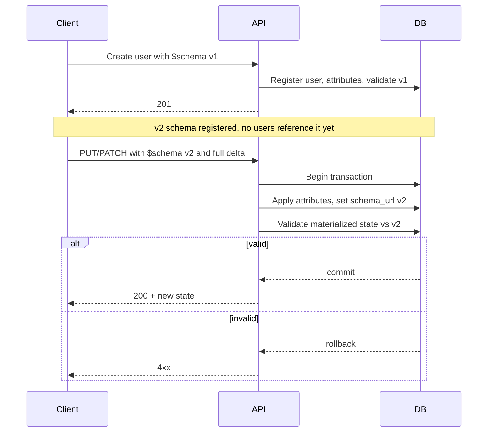

# ADR 009: User JSON Schema Validation

> **Status:** Implemented — 2026-10-24 (originally Proposed 2026-04-30)
> **Date:** 2026-04-30
> **Context:** Dynamic users and schema-driven validation
>
> **Amendment (2026-10-24):** the user API validates against the bound schema
> on every write, and `PATCH /users/{user_id}` moves a user to another schema
> by validating the merged attributes against it before commit (#1180).
> One rule the decision below does not state: a move must keep the same
> `objectType` (#2036). Schemas have no update endpoint, so a published
> version does not change.
>
> **Amendment (2026-11-03):** user writes assert `format`, per
> [§5](#5-format-is-asserted-on-user-writes) (#2651).
>
> **Amended by:** [ADR 052](052-user-envelope-and-attributes.md) — the API
> property is `schema`, not `$schema`, and it sits on an envelope beside the
> validated `attributes` document.

## Context

Users are dynamic objects stored in the EAV model described in [ADR 008](008-users-eav-store.md). Attribute payloads must be validated so writes remain coherent with tenant-defined structure and constraints.

JSON Schema is the validation mechanism. The server resolves schemas per instance from persisted definitions and applies them when user data is created or updated. This ADR records the contract and migration expectations the HTTP user API follows.

**Why not automatic schema migration:** Moving a user from schema A to B is not a generic server concern. New schemas may introduce required fields the system cannot invent, change uniqueness or org-scoped rules, or require business logic only the customer controls. The product therefore does not offer automatic cross-schema transformation.

## Decision

### 1. `$schema` on create and update

> Amended by [ADR 052](052-user-envelope-and-attributes.md): the property is named `schema`, and the attributes it governs are nested under `attributes` rather than sitting at the top level beside it.

When users are created or updated over the API, the request body includes a **`$schema`** property: a URL string that references a JSON Schema **already registered** for the instance (a row in `json_schemas`, same URL as the `url` column).

The API value maps to the persisted user header: `users.schema_url` references `json_schemas (instance_id, url)` (see database migration). It is the same identifier, not a parallel field.

### 2. Immutability and URL-based versioning

Schemas stored at a given URL are **immutable**. To ship breaking or additive changes, register a **new** URL (for example `https://acme.com/schemas/user/v2/users.json`). Customers define their own URL layout and manage how they roll out breaking changes.

This matches domain storage semantics: schemas are created and not updated in place; multiple versions coexist as distinct URLs.

### 3. Trust boundary for resolution

**Runtime validation** uses schemas loaded for the instance from storage (for example via `JSONSchemaResolver` without treating remote URLs as an authority for validation). Fetching a schema over HTTP is an **ingestion** path to populate the repository, not a substitute for trusting only instance-stored definitions at validation time.

### 4. Upgrading to a new schema (explicit, transactional)

No background or automatic migration from schema v1 to v2. The intended flow:

1. User exists and was validated against v1.
2. v2 is added to storage; no users reference it yet.
3. The client sends a **self-contained** update (PUT and/or PATCH) that sets **`$schema`** to the v2 URL and includes all attribute additions, updates, and removals required to satisfy v2 in **one request**.
4. The server applies changes in a **single transaction**, materializes the new user state, **validates it against the v2 schema before commit**, and returns the new state. Validation failure aborts the transaction.

SQL-oriented put/patch contracts under `internal/storage/dialect/postgres/migration/sql/user_examples/` already reflect single-transaction user updates; HTTP APIs should preserve that atomicity.

### 5. `format` is asserted on user writes

JSON Schema 2020-12 treats `format` as an annotation unless an implementation opts in. Zitadel opts in for user attributes: a schema author who writes `"format": "email"` on an identifier means it, the default schemas do, and the sign-up flow already refused what the user API stored.

- **Where:** creating a user, patching one, and every flow that creates one. A flow step refuses the value itself, so the user can correct it there. A hidden SSO claim that fails its format is left out, as one failing any other keyword is. A `--user-file` bootstrap document is held to `format` when it creates its user, and to no other keyword: it carries markers its schema does not declare. A user it already created is skipped first, so a document cannot stop a server from starting once its user exists.
- **Which names:** the standard ones the validator implements: `date`, `date-time`, `duration`, `email`, `hostname`, `idn-email`, `idn-hostname`, `ipv4`, `ipv6`, `iri`, `iri-reference`, `json-pointer`, `regex`, `relative-json-pointer`, `time`, `uri`, `uri-reference`, `uri-template`, `uuid`. Any other name, such as `phone` or `tel`, stays an annotation; use `pattern` to enforce one.
- **`email` and `idn-email`:** a single address, with no display name, angle brackets or padding. Non-ASCII characters are allowed in both parts, since real addresses have them and rejecting one would lock its owner out of sign-up.
- **Values stored before this rule:** get no special treatment. A patch validates the merged document, so a stored `not-an-email` must be corrected in the same request as any other edit, and a stored identifier failing its format no longer signs its user in. There is no compatibility promise before 1.0 (ADR 074).
- **Blank optional fields:** a flow treats a blank optional field with a format as unset rather than collecting `""`, which user creation would refuse, possibly on a later step with no such field. The user API stays strict: `""` is refused.
- **`date-time` in a flow:** it has its own field type, `date_time`, which the login UI renders as a `datetime-local` input. The wire value is an RFC 3339 timestamp, so the UI converts it to local time to show a prefilled value and back to submit one. A `date` keeps the date input.

## Consequences

### Positive

- **Clear ownership:** Customers control versioning and upgrade timing via URL choice and client-driven updates.
- **Consistent storage:** `schema_url` and `json_schemas` stay aligned with API `$schema`.
- **Safe upgrades:** Validation-before-commit prevents half-applied schema switches.

### Negative / Risks

- **Client burden:** Every schema upgrade is an explicit, correctly shaped request.
- **No silver-bullet migration:** Operators cannot rely on the product to rewrite arbitrary user graphs between schemas.

## Non-goals

- Exact REST paths, full request body shape beyond `$schema`, or OpenAPI changes are deferred to API implementation work.
