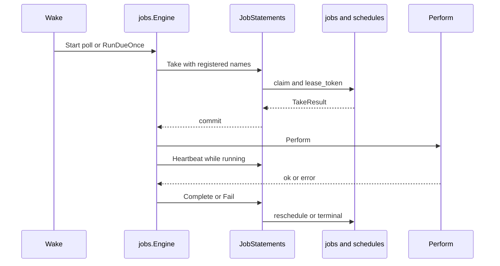

# ADR 065: SQL-Backed Background Jobs

> **Status:** Proposed
> **Date:** 2026-09-03
> **Amended:** 2026-11-25 — schema split (`jobs` + `job_schedules`), `SetPeriodic`, `jobs.Engine`, Take name allowlist, short lease + Heartbeat, first product handler `sessions.gc`, serverless Cron drain as runner, prefix `sched`
> **Context:** Periodic sweeps and queued work in the Go server across PostgreSQL, Spanner, and SQLite
> **Builds on:** [ADR 028](028-storage-v2-statements-and-dialects.md), [ADR 041](041-storage-statement-contract-tests.md), [ADR 047](047-dialect-id-generation.md), [ADR 048](048-wide-events-internal-audit-primitive.md), [ADR 049](049-events-api-retention-export.md)
> **Amends if accepted:** [ADR 046](046-claim-lifecycle-v2.md) (unclaimed-project **deletion** can run on this loop; this ADR does not add that sweeper), [ADR 047](047-dialect-id-generation.md) (§2: registers the `job` and `sched` prefixes)
> **Related:** [ADR 010](010-session-auth-attempt-check-model.md), [ADR 037](037-token-lifecycle.md), [ADR 039](039-signing-key-rotation-and-incident-response.md), [ADR 050](050-dev-inbox.md), [#881](https://github.com/zitadel/nextgen/issues/881)

## Context

Today each background sweeper has its own loop in the process:

- Event retention ([`internal/audit/retention.go`](../../apps/api/internal/audit/retention.go)) is started from [`cmd/server/server.go`](../../apps/api/cmd/server/server.go). Hosted cloud has no long-lived ticker — Vercel Cron hits `/cron/events-retention`.
- The event shipper is a separate poller.
- Path A request wide events sit in an in-process buffer; [ADR 048](048-wide-events-internal-audit-primitive.md) defers a durable outbox.

We need the same kind of work for more than retention: expired-session cleanup that can write a `session.expired` event ([#881](https://github.com/zitadel/nextgen/issues/881)), auth-attempt TTL ([ADR 010](010-session-auth-attempt-check-model.md)), and later outbound mail ([ADR 050](050-dev-inbox.md)).

This ADR is **not** [ADR 046](046-claim-lifecycle-v2.md) project claim (the HTTP flow that assigns an owning team to a project). Below, **Take** means “this server picks up due work and runs it.” It does not look at `projects.created_at`. Deleting unclaimed projects stays an ADR 046 non-goal.

Storage is SQL on three dialects ([ADR 028](028-storage-v2-statements-and-dialects.md)): PostgreSQL, Spanner, and SQLite. A job system that exists only on Postgres (River) or only on GCP (Pub/Sub) does not cover that set.

## Decision

River is the **blueprint**, not a dependency. Portability is `service.JobStatements` on three dialects plus a shared **`jobs.Engine`** above statements. Dialects never `RegisterWorker`.

**First product handler** is **`sessions.gc`** ([#881](https://github.com/zitadel/nextgen/issues/881)). Event retention stays on today’s `RetentionJob` ticker / `/cron/events-retention` until a later cutover PR. Ship `JobStatements`, Engine, and periodic infrastructure so retention can move later without a second runtime.

How work runs:

1. Queued: product tx calls `Enqueue`. Periodic: boot (or later operator path) calls **`SetPeriodic`**.
2. Engine **Takes** due work whose `name` is in this process’s registered-handler allowlist, writing a time-limited lease and fencing `lease_token`.
3. **Perform** runs outside the Take transaction. Heartbeat extends the lease.
4. **Complete** or **Fail** writes the outcome (token must match).

### Schema: `jobs` and `job_schedules`

Two relations from day one (River-inspired split):

| Relation | Role |
|----------|------|
| `job_schedules` | Periodic definitions: `name`, `period`, next `run_at`, lease columns while a sweep is in flight. PK `sched_<opaque>` ([ADR 047](047-dialect-id-generation.md)). |
| `jobs` | Queued work and terminal queued rows (`pending` / `leased` / `done` / `dead`). PK `job_<opaque>`. |

**Periodic reschedule:** on Complete or Fail of a sweep, set `run_at = now() + period` (skip missed beats). Do **not** insert a new row per period.

Column types are dialect-owned. Logical shapes:

**`job_schedules`**

| Column | Role |
|--------|------|
| `id` | dialect-minted `sched_<opaque>`. Not an HTTP resource. |
| `name` | handler name (`sessions.gc`, later `jobs.gc`, `events.retention`). Unique. |
| `period` | how often the sweep may run. |
| `run_at` | do not start **before** this time (database clock). |
| `lease_until`, `lease_by`, `lease_token` | in-flight lease + fencing token. |
| `last_error` | last Fail cause (optional). |
| `attempt` | reset on successful Complete (bookkeeping only; periodic Fail does not death-count). |

**`jobs` (queued)**

| Column | Role |
|--------|------|
| `id` | dialect-minted `job_<opaque>`. Not an HTTP resource. |
| `name` | which handler to run (`email.send`, …). Not unique. |
| `payload` | opaque bytes. |
| `unique_key` | stops two **live** rows (`pending` or `leased`) from being the same logical job. Optional. Many nulls are allowed. |
| `run_at` | do not start **before** this time (database clock). |
| `not_after` | do not start **at or after** this time (database clock). Nullable. Too late when `not_after <= now()`. |
| `lease_until`, `lease_by`, `lease_token` | who holds the row and until when; fencing token. |
| `attempt`, `max_attempts`, `last_error` | retry bookkeeping. `max_attempts` is per row (Enqueue may override; engine supplies a default). |
| `status` | `pending` \| `leased` \| `done` \| `dead`. |
| `completed_at` | set when the row becomes `done` or `dead`. |

**`unique_key` (queued).** Omit to insert a new row every Enqueue. Set it (for example `email.send:{user_id}:welcome`) so a second Enqueue while the first is still `pending` or `leased` keeps the existing row. After `done`/`dead`, the same key may be enqueued again.

**Take** considers due schedules and due queued jobs (waiting, or lease expired). For queued rows it also sees past-`not_after` so a crash mid-run is not stranded. It ignores `done` and `dead`. It does not look at projects.

### 1. Two kinds of work, one Engine line

| Kind | How many are due at once | Cluster concurrency for that name |
|------|--------------------------|-----------------------------------|
| Periodic (`sessions.gc`, later `jobs.gc`) | one schedule row per `name` | at most one lease of that schedule |
| Queued (`email.send`) | one `jobs` row per unit of work | as many as free workers |

How many Performs run at once: `number of processes × jobs.concurrency`. Shared ordering by `run_at` across due work is accepted for v1. Per-name fairness is later.

### 2. Portability is `JobStatements`; runtime is `jobs.Engine`

The dialect adapter is [`service.AllStatements`](../../apps/api/internal/service/statement.go). Dialects write the SQL.

**`jobs.Engine`** (shared package, not per dialect): `RegisterWorker`, `Start` / `Close`, `RunDueOnce` (drain until budget, deadline, or cancel). Engine opens txs for Take / Heartbeat / Complete / Fail / DeleteCompleted. Callers open txs for Enqueue and SetPeriodic. Statements are tx-passive: they never call `pool.Transaction` and never start goroutines.

Who opens the transaction:

- `Enqueue` and `SetPeriodic` use the caller’s transaction (the product write, or boot).
- `Take`, `Heartbeat`, `Complete`, `Fail`, and `DeleteCompleted`: the **Engine** opens the read/write transaction.

Surface (names stable; schedule vs job return types as implemented):

- `Enqueue` — insert a queued job in the product transaction. If a live row already has this `unique_key`, keep that row; never fail the caller’s tx for that collision.
- `SetPeriodic` — boot (and later operator CLI/API). Insert or update `period` for `name`. Do not overwrite `lease_until`, `lease_by`, `lease_token`, or `run_at` while another replica holds a live lease.
- `Take(limit, leaseBy, leaseFor, names)` — lease due work whose `name` is in **`names`** (the Engine passes registered handler names). Empty `names` leases nothing for Perform. May mark past-`not_after` queued rows `dead` without Perform (name-agnostic expiry path is allowed and must be documented in implementation). Returns `lease_token`.
- `Complete` / `Fail` — §3. Must send `id` + `lease_token`.
- `DeleteCompleted` — delete `done`/`dead` queued rows whose `completed_at` is older than the retain window.
- `Heartbeat` — extend `lease_until` where `id` and `lease_token` match this Take.

No `Backend` interface, memory backend, River dependency, Pub/Sub, or Cloud Tasks as source of truth. Spanner queues are not behind Take in v1.

Enqueue uniqueness mechanics stay dialect-owned (Postgres/SQLite `ON CONFLICT DO NOTHING` on live partial unique index; Spanner lookup-then-insert with `active_unique_key`), same rationale as before.

### 3. Lease, then work, then complete

1. **Take** — pick due work (waiting, or lease expired) **filtered by registered names**:
   - Queued and `not_after <= now()`: mark `dead`, set `completed_at`, clear the lease, do not Perform.
   - Else: write the lease (`lease_until = now() + lease_duration`, new `lease_token`), commit, Perform.
   - Names not in the allowlist are not leased for Perform (rolling deploys / old binaries).

   **Process** means one `zitadel start` replica. **Registered `name`** is the in-memory handler map from `RegisterWorker`. It is not a version→kinds table.

   If `not_after` passes **while this replica still holds a live lease**, it finishes Perform. After the lease expires, Take may mark `dead` without a second Perform. Late Heartbeat / Complete / Fail with the old token are no-ops.

2. **Perform** — handler work in its own transactions or I/O. Keep Heartbeat going.
3. **Complete** or **Fail** — must match `lease_token` and only apply while still leased.

Complete:

- Queued success → `done` + `completed_at`. Clear live unique projection. Reset `attempt`.
- Periodic success → clear lease on the schedule. Set `run_at = now() + period`. Reset attempt bookkeeping. Never `done`. No history / per-beat row.

Fail:

- Queued: increment `attempt`. Clear lease. `pending` with `run_at = now() + backoff`. Become `dead` when `attempt` reaches `max_attempts`, or when the next `run_at` would be `>= not_after`. Dying clears the live unique key.
- Periodic: never `done` or `dead`. Clear lease. Set `run_at = now() + period`. Record `last_error`. Fail does not count toward death.

Delivery is at-least-once. Handlers must be idempotent.

### 4. Database clock; dialect-owned duration columns

Due checks and reschedule use the database clock (`now()` / `CURRENT_TIMESTAMP`), not the Go wall clock ([ADR 048](048-wide-events-internal-audit-primitive.md)).

The Go API is `time.Duration`. Column types follow sessions: Postgres `INTERVAL`, Spanner `INT64` nanoseconds, SQLite `INTEGER` nanoseconds. [`stmttest`](../../apps/api/internal/storage/stmttest/) never sees the column type.

### 5. Periodic registration

Boot (and later operator paths) call `SetPeriodic(name, period, …)` from **server config** for v1 (for example `sessions.gc.enabled` / `sessions.gc.period`). Config remains the knob; replicas overwrite `period` from config without clobbering a live lease. The schedule row owns `run_at` / `period` for Take and Complete.

`RegisterWorker` only binds the in-process handler. It does not write storage.

### 6. Queued work is inserted in the product transaction

A service calls `Enqueue` on the statements of the transaction that wrote the entity. If that transaction rolls back, the job is gone. After commit, any replica that registered the name can Take the row.

Enqueue may set `not_after` and `max_attempts` per row.

### 7. Retain, then `jobs.gc`

`done` and `dead` stay until unique periodic `jobs.gc` calls `DeleteCompleted` (retain window independent of ADR 049’s event window). GC does not delete `pending` or `leased`. Take owns past-`not_after` expiry. No dead-letter table.

### 8. Observability (metrics, not an API)

Operators watch the Engine. There is no job OpenAPI product surface and no dead-letter table.

Every series is labeled by handler `name`. Counters: `jobs_taken`, `jobs_completed`, `jobs_failed`, `jobs_dead`, `jobs_expired`. Histograms: `jobs_perform_duration`, `jobs_take_lag`. Same semantics as before (outcome in the series name, not a `status` label).

### 9. Wake modes: self-hosted poll and serverless drain

**Self-hosted:** every replica may `Start()` the Engine poll loop with the HTTP server. No `zitadel worker` command, no leader election. The lease is the lock.

**Hosted / serverless:** the process is request-scoped. Cron HTTP authenticates with a trigger secret and calls **`RunDueOnce` / drain** until time budget or graceful shutdown. That wake **is** the runner — not a separate nudge that expects a long-lived poll. When the trigger secret is set, do not start the in-process poll loop (same idea as today’s retention trigger).

Same `JobStatements` either way. Engine passes the registered-name allowlist into every Take.

Take SQL is dialect-owned:

- Postgres: `FOR UPDATE SKIP LOCKED`
- Spanner: poll jitter; lease one row in the read-write transaction
- SQLite: single writer; concurrency 1

Defaults (config key names are an implementation detail; numbers are the contract):

| Knob | Default | Role |
|------|---------|------|
| `jobs.concurrency` | `1` | Parallel Take/Perform loops per process |
| `jobs.poll_interval` | 1s | Idle wait between Takes in `Start()` |
| `jobs.take_batch_size` | `1` | Rows one Take leases |
| `jobs.lease_duration` | **30s** | Take writes `lease_until`; short reclaim after crash. Long Performs extend via Heartbeat |
| `jobs.heartbeat_interval` | **10s** | Heartbeat while Perform runs (~lease/3) |
| `jobs.max_attempts` | 5 | Default queued Fail ceiling when Enqueue omits override |
| `jobs.backoff_cap` | 1h | Default backoff cap |
| `jobs.retain` | 7d | `DeleteCompleted` window |

SQLite stays at concurrency 1. Keep take batches small so other nodes can claim remaining work. Deleting N expired sessions inside one Perform belongs in the handler, not in `take_batch_size`.

### 10. Background Path B uses `system` actor

Handlers that emit wide events ([ADR 048](048-wide-events-internal-audit-primitive.md)) stamp `EventActorTypeSystem`. A reaper `session.expired` must not look like a missing request `ActorContext`.

### 11. What we ship first

- `jobs` + `job_schedules`, `JobStatements`, `jobs.Engine` (poll + `RunDueOnce`)
- First product handler: **`sessions.gc`** / [#881](https://github.com/zitadel/nextgen/issues/881) (read-time expiry stays; reaper is Path B producer; one schedule row, not one job per session)
- Hosted Cron drain path for the Engine (alongside existing retention cron until cutover)
- Unchanged until a later PR: `RetentionJob` / `/cron/events-retention`, event shipper, Path A request buffer
- `email.send` remains an example queued producer, not a deliverable of the first product cut
- Follow-ups: `jobs.gc`, retention cutover onto `events.retention`, operator `SetPeriodic`, auth-attempt sweeper, mail

## Non-goals

- Unclaimed-project deletion ([ADR 046](046-claim-lifecycle-v2.md)) in this ADR’s first cut.
- A dedicated `DELETE` role on the jobs tables, analogous to [ADR 049](049-events-api-retention-export.md)’s events-table role.
- Signing-key purge ([ADR 039](039-signing-key-rotation-and-incident-response.md)) and ADR 050 outbound as handlers in the first product cut.
- Spanner queues / Pub/Sub as source of truth; a version→job-kinds support table; per-name fairness.
- Job OpenAPI product surface.

## Consequences

### Positive

- Sweeps and queued work share one runtime, one test seam, and one shutdown path.
- Enqueue joins the product transaction without a second API.
- Rolling deploys: Take allowlist matches registered handlers; schedules reschedule from `period`.
- Serverless and self-hosted share statements; Cron drain is a first-class runner.
- SQLite, Postgres, and Spanner stay on the statements model.

### Negative / Risks

- **At-least-once:** handlers must tolerate retry after crash-before-Complete or missed Heartbeat.
- **Shared line:** `ORDER BY run_at` can delay a due sweep under a flood of queued rows until a worker is free (accepted for v1).
- **Retention coexistence:** until cutover, two background mechanisms exist (`RetentionJob` and jobs Engine).

### Testing

- [`stmttest`](../../apps/api/internal/storage/stmttest/) owns, across dialects via `forEachDialect` ([ADR 041](041-storage-statement-contract-tests.md)): Take of pending and lease-expired rows; Take allowlist (including empty); Take marking `not_after <= now()` `dead` without Perform; Fail returning queued rows to `pending` with backoff; queued Fail-to-dead at `max_attempts` and when next `run_at` would be `>= not_after`; periodic Fail and Complete advancing `run_at = now() + period` without inserting a new beat row; Complete resetting attempt; live-row `unique_key` conflict vs insert after `done`/`dead`; `SetPeriodic` updating `period` without clobbering a live lease; `DeleteCompleted` ignoring `pending`/`leased`; Heartbeat/Complete/Fail rejected when `lease_token` does not match; Enqueue keep-winner under concurrent same `unique_key`.
- The Engine is tested against a fake `JobStatements` (or sqlite only): RegisterWorker → RunDueOnce, Heartbeat, budget/cancel, Start/Close — not a second three-dialect matrix.

## Alternatives considered

| Alternative | Why rejected |
|-------------|--------------|
| River as the portability layer | Postgres-only; SQLite and Spanner still need another runtime |
| Pub/Sub / Cloud Tasks as source of truth | No transactional enqueue with the entity write; no SQLite |
| Insert a tick row per period | Backlog of missed intervals; updating `run_at` already skips missed beats |
| `INSERT ... ON CONFLICT` as the Enqueue contract | Spanner rejects a `NULL_FILTERED` unique index as an `ON CONFLICT` arbiter |
| Call the pick-up step `Claim` | Collides with ADR 046 project claim |
| Version → job-kinds table for Take | Second registry that drifts from `RegisterWorker`; allowlist from registration is enough for v1 |
| 15m lease sized to retention Perform | Heartbeat covers long runs; short lease reclaim crashes faster (30s / 10s) |
