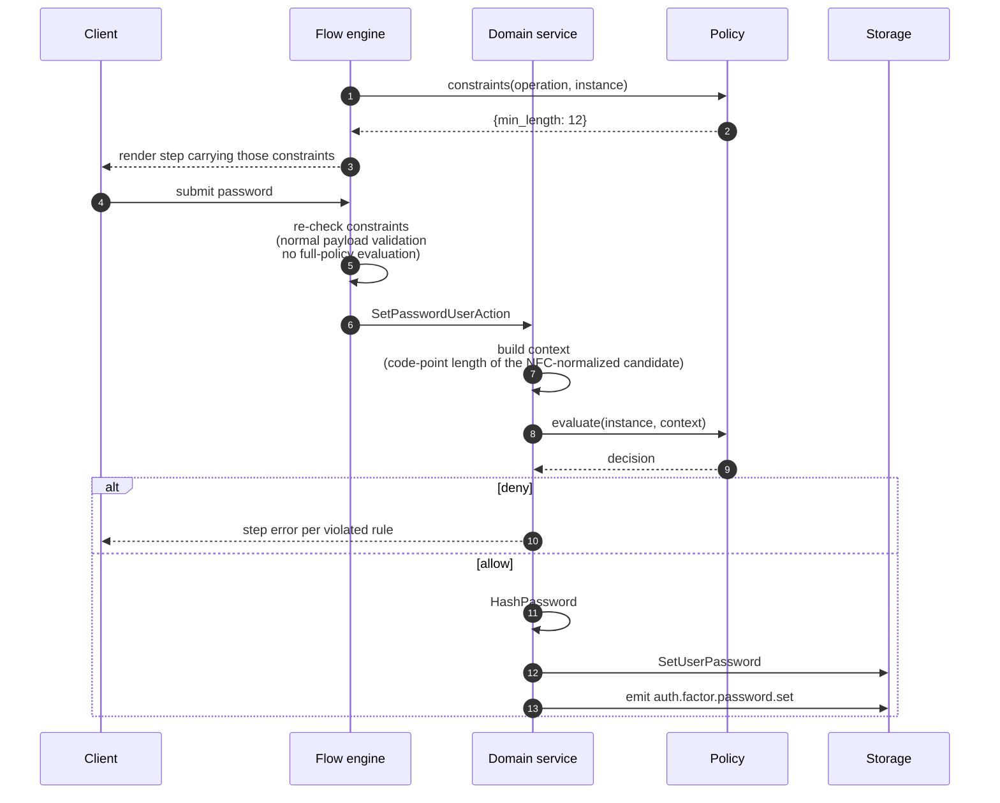

# ADR 066: Operation Policies

> **Status:** Draft
> **Date:** 2026-08-28 (revised 2026-09-28, 2026-10-16)
> **Context:** [#383](https://github.com/zitadel/nextgen/issues/383) asks for the
> settings-and-policies architecture; [#899](https://github.com/zitadel/nextgen/issues/899)
> defines the product model; [#898](https://github.com/zitadel/nextgen/issues/898)
> is the first consumer.
> **Related:** [ADR 020](020-credentials-out-of-user-schema.md),
> [ADR 035](035-configuration-environments.md),
> [ADR 042](042-scaffolded-file-ownership-and-drift-detection.md),
> [ADR 048](048-wide-events-internal-audit-primitive.md),
> audience-scoped configuration (proposed in [#1264](https://github.com/zitadel/nextgen/pull/1264), not decided)

## Context

This ADR proposes the data model and enforcement mechanism for policies in nextgen.

## Status quo

### Zitadel previous versions

There are many controls, but they are fragmented, inconsistently named, and mix capability configuration with security enforcement.

Some work was planned as part of ([zitadel#11596](https://github.com/zitadel/zitadel/issues/11596)) to better organize and split settings and policies.

### Nextgen

No defined settings / policy model. Some configuration is hard-coded, for example:
- Password minimum length: [`MinLength: 8`](../../internal/domain/flow_field_resolver_schema.go)
- Passkey user verification is a fixed [`"preferred"`](../../internal/domain/flow_state_machine.go)
- Failed authentication attempts are recorded "for rate-limiting purposes" with no threshold reading them.

The first priority is to introduce proper password policies ([#898](https://github.com/zitadel/nextgen/issues/898)):

- Minimum password length
- Password history

#### The flow-engine and auth-attempt already assume a policy engine

Apart from the new password policy requirements, initial flow-engine design documents describe a policy engine as one of their five core concepts, for example in [`docs/design/flowengine/README.md`](../design/flowengine/README.md):
> *"Policy Engine — the sole decision maker. Evaluates session state + context and determines what's required. **Design TBD** — not covered in these documents"*

In the design documents, these are some of the capabilities expected from the policy engine:

1. Flow engine, risk evaluation: decide when a captcha is required, and inject the gate on any step ([`bot-detection.md`](../design/flowengine/bot-detection.md), [ADR 019](019-captcha-gate-and-bot-signals.md)).
2. Flow engine, input validation: block a submission based on its input, and validate fields against rules the flow definition does not carry ([`flow-engine-external-auth-factors.md`](../design/flowengine/flow-engine-external-auth-factors.md)).
3. Auth attempt, assurance evaluation: compare the factors verified so far against the requested ACR after each submission, and inject the missing factor as a step ([`flow-engine.md`](../design/flowengine/flow-engine.md), [`session-api.md`](../design/flowengine/session-api.md), [ADR 010](010-session-auth-attempt-check-model.md)).

## Proposal

A policy attaches to one domain operation. It is split in two, following the
template-and-instance shape that policy-as-code systems converge on (Gatekeeper's
`ConstraintTemplate`/`Constraint`, Kubernetes' `ValidatingAdmissionPolicy`/`Binding`,
Azure Policy's definition/assignment):

- The template is Zitadel-defined and ships with the server. It declares, for
  one operation, which configuration a developer may set, which request context
  the rules receive, and the rules themselves: a list of named boolean
  expressions in [CEL](https://cel.dev) over `config` and context.
- The instance is developer-authored and lives in the release. It carries the
  configuration values for the whole project.

A policy is always evaluated before its operation runs. Every active rule must
hold for the operation to proceed.

Only what the developer configured is enforced. A template carries no
defaults and no recommendations: a setting the instance omits switches off
the rule that reads it, and a project without an instance has no policy for
that operation. A setting is bounded only where the server has a technical
limit. What the server enforces regardless of any policy (the maximum
password length, for one) is a guard in the domain, not a policy.

#### No server defaults

Decided on 2026-10-15, revising #898's "defaults to 15 characters".

- The product does not teach a project what is best for it. Requirements
  legitimately differ between projects, so Zitadel enforces what a project
  configures and does not grade it: no recommended values, no warnings below
  a threshold, no product floor beyond what the server technically needs.
- Nothing opinionated is hidden in the server. A value Zitadel chose on the
  project's behalf would be enforced without appearing anywhere the project
  can read or review.
- Everything that is enforced is visible in the project's own
  configuration: the instance file in `.zitadel/policies/`, versioned and
  reviewed with the rest of the release.
- Overrides stay simple. A later audience or hierarchy model resolves
  between instances that exist, not between instances and a hidden default.

Projects still start from a sensible policy. `zitadel setup` scaffolds a
starter instance for `auth.factor.password.set` with `min_length: 15`, the
NIST SP 800-63B minimum for a password used as a single factor
([#1450](https://github.com/zitadel/nextgen/issues/1450)). #898's default
therefore lives on as the starter's value, not as server behaviour. A project
that skips the starter, or later removes the file or its `min_length`, has no
length policy; the domain guards (non-empty, at most 64 code points) still
apply. NIST alignment holds for projects that keep the starter.

### Terminology

- Operation: a domain action that can carry a policy, such as `auth.factor.password.set`. Zitadel defines the list.
- Template: the Zitadel-defined half of a policy for one operation: config schema, context schema, rules.
- Instance (or just policy): the developer-authored half, the config values. A revisioned resource in the release, one per operation per project.
- Setting: one value an instance may set. Omitted means off.
- Rule: one named CEL expression in a template that must evaluate to `true`. It reads exactly one setting, carries that setting's name, and is active only when the setting is set.
- Config rule: one named CEL expression over settings alone, checked whenever an instance is bound (on publish, in release validation and when it is resolved for an operation), never per evaluation.
- Decision: what evaluating an instance against a request context returns, `allow` or `deny` with the violated rules.

### Data model

#### Template

One template per operation, defined by Zitadel and versioned with the server.

```json
// auth.factor.password.set — template
{
  "operation": "auth.factor.password.set",
  "config": {
    "min_length":    { "type": "integer", "minimum": 1, "maximum": 64 },
    "max_length":    { "type": "integer", "minimum": 1, "maximum": 64 },
    "history_depth": { "type": "integer", "minimum": 1, "maximum": 4 }
  },
  "config_rules": [
    { "name": "min_length_not_above_max_length", "expression": "config.min_length <= config.max_length" }
  ],
  "context": {
    "candidate":       { "length": "int" },
    "self_service":    "bool",
    "history_matches": "list<bool>"
  },
  "rules": [
    { "name": "min_length",    "expression": "candidate.length >= config.min_length" },
    { "name": "max_length",    "expression": "candidate.length <= config.max_length" },
    { "name": "history_depth", "expression": "!self_service || !history_matches.slice(0, size(history_matches) < config.history_depth ? size(history_matches) : config.history_depth).exists(m, m)" }
  ]
}
```

`config` declares each setting's type and, for an integer, the bounds the
server can technically support; there are no defaults. `config_rules`
constrain the settings among each other and run whenever an instance is
bound, never per evaluation. `context` is the schema of the derived values the rules receive
(the raw input stays out of it), and doubles as the CEL type environment.
`rules` is a list of named boolean expressions. Each reads exactly one
setting and carries its name, so the name is at once the rule, the setting,
the key of a violation and the key of a constraint; `policy.New()` refuses
a template that breaks this, and the server calls it at startup, so it does
not start. How a template is validated is in
[Template](../design/policies/1-template.md).

A template is not release content: templates ship with the server and evolve with it,
as the flow engine's step vocabulary does for flow definitions. How a server
upgrade treats deployed instances is the same question every configuration
resource has, and is not answered here.

#### Instance

Each instance guards one operation and carries its own configuration under `config`.
The envelope (`kind`, `operation`) is the same for every operation;
`config` is what the operation's template defines, and `operation` is the
discriminator that says which template that is.

```json
// .zitadel/policies/auth.factor.password.set.json
{
  "kind": "policy",
  "operation": "auth.factor.password.set",
  "config": {
    "min_length": 12,
    "history_depth": 4
  }
}
```

- An instance applies to its whole project: one instance per operation per
  project, and every request to that operation in the project is evaluated
  against it. Narrowing an instance to part of a project (a team, an app) is
  left to an audience mechanism such as the one proposed in
  [#1264](https://github.com/zitadel/nextgen/pull/1264), which would add an
  `audience` envelope field; see [Applicability](#applicability).
- `config` is validated against the template at write time: a key the
  template does not declare, a value of the wrong type or outside the
  bounds, and a failed config rule are rejected.
- A setting the instance omits is off, and so is the rule that reads it. The
  example above therefore enforces a minimum length of 12, no reuse of the
  last four passwords when users change their own password (history applies
  only to self-service changes, see the [catalog](../design/policies/catalog.md)),
  and no maximum beyond the domain's own cap. An empty
  `config` switches the policy off; a missing or `null` one is rejected, so a
  lost block cannot do it silently. A project with no instance has none.
- The wire schema of the instance is a discriminated union on `operation`:
  one branch per catalogued operation, each with the `config` object that
  operation's template declares (its settings and bounds, no others).
  The union is what the OpenAPI component publishes, what the generated client
  types carry, and what the `policy.json` editor meta-schema is derived from,
  so an editor completes `min_length` for `auth.factor.password.set` and rejects a
  key that operation does not have. A test will keep every branch in parity
  with its template once the wire schema exists (the resource PR).
- A bound that mirrors a server limit is tied to the Go constant by a test:
  the length bounds equal `domain.MaxPasswordLength` (64 code points), and
  the history bound (four passwords, the current one included) may not
  exceed what storage returns. Raising a limit later widens what instances
  may set and breaks none.
- A server upgrade may add settings, widen bounds and drop config rules,
  never remove a setting, change its type, narrow a bound, or add or change a
  config rule: a stored instance is bound against the current template
  whenever it is resolved, so a template that rejects more would make every
  evaluation of that operation fail. A test checks every template against a
  record of the settings instances may hold and the config rules they were
  checked against (`internal/policy/testdata/settings_compat.json`), and
  requires the record to equal the templates, so every template change shows
  up in its diff. A test cannot see history: a stricter template passes if
  the record shrinks with it, which is why such a record diff needs a
  migration of stored instances before it is merged.

### Policy catalog

The set of policy-guarded operations is closed and server-defined: the list
of templates. A developer authors instances for any operation on the list and
cannot add an operation to it. Templates ship with the server; today's list:

| Operation | Rules | Context (derived in Go) |
|---|---|---|
| `auth.factor.password.set` | `min_length`, `max_length`, `history_depth` | candidate length, per-history-entry match |
| `auth.check` (illustrative, not MVP) | failed-attempt limits | recent failed checks, factor |

#### Where the catalog lives and how an operation is added

The catalog is the set of template files embedded in the server binary,
[`internal/policy/templates/*.json`](../../internal/policy/templates/), plus
the index that names each operation's evaluation point,
[`docs/design/policies/catalog.md`](../design/policies/catalog.md). The two
must agree; the index is what a reviewer reads, the files are what the
server runs.

Adding an operation is five things, and nothing else registers it:

1. a template file under `internal/policy/templates/`, named after its
   operation and compiled and checked by `policy.New()` at server start;
2. its settings and config rules recorded in
   `internal/policy/testdata/settings_compat.json`, so a later template
   change that would reject stored instances shows up in review;
3. a row in the catalog index naming the template, the settings, the rules,
   the context builder and the gate;
4. a context builder in Go that derives the values the rules see for that
   operation, keeping the raw input out;
5. one gate call in the operation's shared write path, so no API, SDK or
   journey can reach the operation without it. For passwords the one path
   outside it is the bootstrap user import, which stores hashes it was given
   and cannot check them.

For `auth.factor.password.set` the gate is `service.PasswordPolicy.CheckPassword`,
called from `service.SetPasswordUserAction.Prepare`, the single function
every password set goes through (admin API, registration and SSO sign-up
alike), before the password is hashed, so a rejected password costs neither
a hash nor a transaction. History counts only where the user sets their own
password: the template's `history_depth` rule reads a `self_service` flag
from the context, so the other paths, which have no history to compare with
or must not learn it, pass it without a hash being verified. The write checks
that the password it replaces is still the one the history was compared
with, and fails with `user.conflict` when another change landed in between.
Instances are published with `POST /policies` and resolved through
`service.PolicyResolver`, which `service.PolicyService.ResolvePolicy`
implements: the newest stored revision of the project's policy for the
operation, and no policy when the project published none, in which case the
gate applies only the server's own length cap. A flow step where the user
chooses a password shows and checks the same length bounds before the gate
runs ([End to end](#end-to-end-a-user-enters-their-password-during-sign-up-via-flow-engine)). The newest stored
revision is a stand-in: ADR 035 says a deployment serves only what its
release pins, so resolution moves to the release's pinned policy revision once
release-pinned reads exist (scope table in
[`docs/design/policies/`](../design/policies/README.md)). The
[catalog index](../design/policies/catalog.md) names the functions.

### Policy evaluation trigger (relation to domain events)

A policy is evaluated before its operation, synchronously. Existing [wide events](048-wide-events-internal-audit-primitive.md) record what happened after, and cannot affect the outcome.

| Operation (policy evaluated before) | Wide event (emitted after) |
|---|---|
| `auth.factor.password.set` | `auth.factor.password.set` |
| `user.create` | `user.created`, `user.create.failed` |
| `auth.check` | `auth.check.succeeded`, `auth.check.failed` |
| `auth.attempt.hand_off` | `auth.attempt.handed_off` |

#### Naming an operation

An operation is named after the action of the event it precedes: the
event's area and resource, and its verb in the base form. Events name an
action plus its outcome, either as a separate segment (`user.create.failed`,
`auth.check.succeeded`) or in the verb's tense (`user.created`,
`auth.attempt.handed_off`, `auth.factor.passkey.enrolled`); the operation
drops the outcome and keeps the base verb (`user.create`, `auth.check`,
`auth.attempt.hand_off`, `auth.factor.passkey.enroll`). Where base form and
past participle coincide, the names are equal (`auth.factor.password.set`).
An operation without an event, such as reading a team's resources, takes the
same `area.resource.verb` grammar, and an event added later follows the
operation's name.

The name is public API: it is the instance file name
(`.zitadel/policies/<operation>.json`), the `operation` discriminator on the
wire, and a path segment of the `constraints` endpoint. An operation is as
coarse as its event: `auth.check` covers every factor, and a rule that must
differ per factor reads the factor from the context and carries a
factor-specific setting.

### Policy evaluation

Evaluation takes the resolved instance and the request context. The engine is
stateless: it never fetches its own inputs. Every active rule runs; there is
no short-circuit, so a user sees every requirement they missed, not just the
first.

```json
// config — the project's instance for this operation, only what it sets
{ "min_length": 12, "history_depth": 4 }
```

```json
// context — derived by Go for this one evaluation
{
  "candidate":       { "length": 9 },
  "history_matches": [false, false, true, false]
}
```

```json
// decision
{
  "allow": false,
  "violations": { "min_length": 12, "history_depth": 4 }
}
```

`violations` maps each failed rule to the value of the setting it is named
after, which is what a client needs to render "at least 12 characters". It is
the same flat shape as the flow field's `validation` object
(`{ "min_length": 12, "max_length": 32 }`), which already keys rules by name
and treats an absent key as no rule. No derived value (the candidate's
length, which kept password matched) is ever echoed.

For `auth.factor.password.set` a denial is the error
`user.password_policy_violation` (HTTP 400) whose details carry
`{ "violations": { "min_length": 12 } }`; like every domain error's details,
they sit in the response's `details.details` slot (ADR 030). A password over the
server's cap is reported the same way, as `max_length` with the effective
maximum (the instance's `max_length` when set, 64 otherwise), whether or not a
policy exists, so a client handles one shape. An empty password is a domain
guard and keeps `user.password_empty`. In a flow, at registration and at SSO
sign-up, the gate's denial becomes field errors on the step that creates the
user (`error.x-auth-methods#password_min_length`). In the default flows that
is the step where the password is entered, so the error sits next to the
field; a flow that collects the password on an earlier step shows it on the
creating step, which has no password field to correct.

Every rule and its setting are disclosed, before the operation through
`constraints` and after it in a denial. All rules today are requirements a
caller fixes by changing the input. A rule that must stay hidden (a lockout
threshold, a risk signal) brings a disclosure marker with it, required on
every rule so a missing marker never means "disclose".

#### Decisions

- `allow`: every rule held; the operation may proceed
- `deny`: at least one rule failed; the operation is rejected with the violated rules

A third outcome, `require` (the operation is not yet permissible, these
requirements are unmet, used to inject a step mid-flow), is not needed by any MVP
operation. It returns as a per-rule field when the first assurance consumer lands.

Rules stay boolean predicates. What can grow is what a failed rule causes
(`deny` today; `require`, `warn` or `audit` later) and named outputs of other
types next to the rules, such as a proof-of-work difficulty derived from
failed attempts. Both are additions to the template format and the decision,
not changes to how a rule is written.

#### Evaluation errors

A rule cannot fail at runtime in the ways a program can: expressions are
type-checked against the context schema and cost-bounded by `policy.New()`,
which the server will run at startup, and CEL has no I/O, no recursion and no unbounded loops. What
remains is Go failing to build the context (a storage error while loading
password history), which is an ordinary service error: the operation fails,
closed. There is no per-operation failure posture to declare. An operator who
needs a misbehaving policy out of the way publishes a revision with an empty
`config`.

### End to end: a user enters their password during sign-up (via flow-engine)

The flow for an instance that sets `min_length: 12`; the step's constraints
come from the policy. A new user has no
password history and sign-up is not a self-service change, so the gate sends
`self_service: false` and the `history_depth` rule passes without a hash
being verified, even when the instance sets it. The constraints projection
needs no context and still lists `history_depth`; a sign-up form has no
field it applies to.



1. Render. Flow-engine fills `FlowFieldValidation` from the `constraints` projection, through `domain.FlowPasswordPolicy`, on steps where the user chooses a password. The client can perform frontend validation and name the bound in its message ("at least 12 characters").
2. Submit. The client posts the new password as the reserved field `x-auth-methods#password`.
3. Validation. Flow-engine backend payload validation re-checks constraints.
4. Domain operation. The flow engine calls `SetPasswordUserAction`. This is the guarded operation.
5. Prepare context. Per-operation Go code derives the context (see [Evaluation](../design/policies/2-evaluation.md)).
6. Evaluate. Every active rule runs over config plus context.
7. Return the error, or proceed with the operation. In a flow the violated rules come back as field errors on the step that creates the user (`error.x-auth-methods#password_min_length`), here the step with the password field. A length violation never gets this far in a flow that collects the password on its own step: step 3 refuses it there.

#### What a step discloses

A step where the user chooses a password carries the policy's `min_length`
and `max_length` in the field's `validation`, and a sign-up step is served
before anyone is authenticated. That disclosure is deliberate: a user cannot
choose a valid password without the length bounds, and they say nothing about
any account. `history_depth` is never sent with a step; a history violation
names only the rule. Which settings of future operations a step or the
constraints endpoint may disclose is not decided here.

A step where the user enters a password they have (signing in) carries no
length rules: a stored password that predates a stricter policy must still
sign in. The purpose the flow runs under decides between the two: its
`chooses` field in `passwordPurposes`. The `new-password` or
`current-password` autocomplete token beside it is what the form tells a
password manager, and does not decide the bounds.

### The rule language: CEL

Rules are written in the [Common Expression Language](https://cel.dev). This was
an open decision between OPA/Rego and Go; reframing a policy from one program
that returns a decision to a list of named boolean rules settled it.

Once a policy is a rule list, the invariants #899 asks for hold by structure
instead of by convention:

- Discoverability. The `constraints` projection is the active rules with
  their settings. A rule cannot be enforced that the client is not told about.
- No silent weakening. Rules live in the template, which the developer does
  not author. A future developer-authored template can only append rules.
- `require` is a field on a rule.

Each rule is then one boolean expression, and CEL is the fit for exactly that:

| | CEL (rule list) | Rego (one program) | Go (compiled) |
|---|---|---|---|
| Shape | list of named `bool` expressions | one module returning a decision document | a function per operation |
| Sandbox | no I/O, no recursion, static cost estimate, runtime cost limit (best) | needs builtins such as `http.send` disabled, right after [ADR 061](061-egress-policy-user-injectable-urls.md) locked egress down | no customer code path (best) |
| Latency | in-process, microseconds | in-process, microseconds; or a sidecar round-trip | native call (best) |
| Second language in the product | none: OpenFGA conditions are already CEL, so a widened FGA profile ([ADR 032](032-permission-catalogs.md)) reuses it (best) | Rego alongside CEL | none |
| Extensibility | developer-authored rules later, append-only, same evaluator | developer replaces the program | server release per change |
| Tooling | no `opa test` equivalent: covered by a release-side test file and a server-side dry-run (see [Authoring](../design/policies/4-authoring.md#testing-not-built-yet)) | `opa test`, `opa fmt`, Regal, coverage (best) | Go tests |
| Precedent | Kubernetes embedded CEL for in-tree policy and kept OPA as an external webhook; Google IAM Conditions, Firebase Rules, OpenFGA, SpiceDB, Envoy RBAC | CNCF-graduated, Gatekeeper, Conftest | n/a |

The evaluator is [cel-go](https://github.com/cel-expr/cel-go), the same
implementation OpenFGA embeds. The environment is deliberately minimal: the CEL
standard library plus the `strings` and `lists` extensions, nothing else.

Rego stays available as an external decision point if an enterprise customer
insists on OPA, the way Kubernetes keeps OPA as a webhook.

## Relation to other domains

### Releases

Instances are revisioned resources deployed as part of a release
([ADR 035](035-configuration-environments.md), ids per
[ADR 063](063-resource-revisions-fixed-id-and-revision-id.md)). ADR 035 already
reserved the `policy` resource kind, the `pol_` id prefix and the `policies`
key in the release bundle; instances occupy them. The handle is the
`operation`: it is what two revisions of the same instance share, so a
release cannot pin two revisions for one operation, and an instance carries
no `name`. When scoped instances land, with an audience model such as the
one proposed in [#1264](https://github.com/zitadel/nextgen/pull/1264), the
handle grows the audience key next to the operation, still derived from the document, so a
project default and a team override of the same operation are two resources
without a naming field to keep in step with the audience. The resource follows
ADR 063 like identity provider connections: a `policies` row per operation per
project carries the fixed `id` (`pol_`), a `policy_revisions` row per publish
carries the `revision_id` (`polrev_`) and the config, and the newest revision
is the one with the greatest `created_at`. It has no URL identity or `$ref`
handling, which a policy does not need. The API publishes
(`POST /policies`) and has the ADR 063 reads: the list (`GET /policies`),
the read by `id`, the revisions of one policy and one revision
(`GET /policies/revisions/{revision_id}`). Templates are not
release content: they ship with the server, and a release records the catalog
version it was validated against. Release validation runs the same check as
publishing (`policy.Engine.ValidateInstance`: known operation and settings,
types, bounds, config rules) and rejects two instances for the same
operation.

### Applicability

This ADR ships policies in project scope only: an instance applies to every
request to its operation in the project, and a project without an instance
has no policy for it. That is what #898 asks for (one project-wide password
policy) and the whole of what is implemented.

Scoping an instance to part of a project is a follow-up. The audience-scoped
configuration proposal ([#1264](https://github.com/zitadel/nextgen/pull/1264),
closed without a decision) gave release content a required `audience` (an
explicit project default or a set of scope parameters such as `team_ids`),
release-time validation, and most-specific-wins resolution; whichever model
is decided, policies take its envelope field next to `kind` and `operation`.
The model needs no change to take it: the engine evaluates one resolved
instance, and the resolver is the only piece that grows a request hint. That
a scoped instance must not weaken the project's policy is decided with it
([Policy hierarchy](#policy-hierarchy)); because settings are typed values,
"not weaker" is a comparison per setting.

### Hooks and actions

Policies apply to a static list of operations defined by Zitadel. A developer configures what happens at an operation on that list; they cannot add one, and a policy only ever returns a decision.

Hooks and actions are the generic version of the same idea: developer-declared extension points that run arbitrary code and may have side effects.

### Ownership

#383 requires one explicit owner and no automatic inheritance. Neither issue
defines "owner", and the word carries several jobs. This ADR pins it to one:

> Owner is the resolution root: the resource whose configuration the runtime
> reads to obtain the effective value.

The other jobs keep their existing homes. Who may view and change a policy is
the permission catalogs' job ([ADR 032](032-permission-catalogs.md),
[033](033-internal-permission-management.md),
[034](034-external-permission-management.md)). What it affects is
applicability ([#1264](https://github.com/zitadel/nextgen/pull/1264),
project-wide until then). What happens when the owning resource is deleted is
an explicit lifecycle policy in [ADR 024](024-user-team-lifecycle-ownership.md)'s
style, never a cascade. Where it is authored is the release (ADR 035).

In MVP the resolution root is always the Project, so no owner field is minted.

### Change impact

#899 requires each policy to define how a promoted change affects existing state.
For the MVP operations the answer is fixed per operation and documented here;
it is not configurable:

- `auth.factor.password.set`: a stricter policy applies the next time a password is
  set. Existing passwords and sessions are untouched. This is the universal
  vendor behaviour (Okta, Auth0, Entra, Google, Keycloak). A later
  "validate at sign-in and force a change" switch would be an instance setting.

## Risks

Plaintext reaching the evaluation path. The obvious context for a password policy is the password, and a decision log captures its input by default.
Mitigated by construction: the context carries derived values computed in Go, and the context schema has no field that could hold the secret.

Duplication across operations. A control relevant at two operations is configured at both.

Long expressions in JSON. A rule list invites the temptation of one long expression. Mitigated by the caps (length, cost, `bool` result) and by the rule that a violation names one requirement.

Expression language drift. cel-go gains features per release. Mitigated by the minimal environment: a rule uses the standard library and two extensions, and every template is compiled and checked by `policy.New()` at server start.

## Design documents

The detail an implementer needs lives next to the code, under
[`docs/design/policies/`](../design/policies/README.md), whose scope table says
what the policy stack ships and what follows:

- [Template](../design/policies/1-template.md): settings, config rules and
  the naming rule, how an instance is validated against a template, how the
  catalog is published.
- [Evaluation](../design/policies/2-evaluation.md): the context schema, the
  Go context builder, the limits every rule runs under.
- [Constraints](../design/policies/3-constraints.md): the pre-auth projection,
  how it reaches the login form through the flow field validation today, and
  the read endpoint for clients the flow engine does not drive.
- [Authoring](../design/policies/4-authoring.md): `.zitadel/policies/`, the
  CLI commands, and how a policy is tested.
- [Catalog](../design/policies/catalog.md): every guarded operation, its
  template, and the function that evaluates it.

## Future work

### Enforcement modes

Every policy-as-code system surveyed carries an enforcement tier on
the instance, not the logic (Kubernetes `validationActions: Deny | Warn |
Audit`, Gatekeeper `enforcementAction: deny | dryrun | warn`, Azure
`enforcementMode`). The rollout it enables (deploy a stricter policy in
audit, read the decisions, switch to enforce) is the one thing a first-match
resolution model cannot offer any other way. The shape is fixed now so the MVP
does not foreclose it: an `enforcement` field on the instance, `enforce` by
default, and an `audit` mode in which the instance's rules are evaluated and
recorded without blocking. The domain guards stay enforced either way, since
they are not policy. It needs the audited decision to land as a wide event
(ADR 048), which is why it waits for the event type.

### Developer-authored rules

Every vendor surveyed keeps password policy as configuration values and
confines customer logic to event hooks, so no customer expects to author
rules. The shape is fixed now anyway so the MVP does not foreclose it: a
developer-authored template is release content, names an operation on the
catalogue, and may only append rules to the Zitadel template. It runs in the
same evaluator, under the same limits, and its rules appear in `constraints`
like any other. The data model then guarantees that custom rules add to the
Zitadel rules and never remove one; no review has to. Before that, the
context schema has to become a public contract: today only Zitadel's own
templates read it, so it can change with the server.

### Policy hierarchy

#383 asks only that the architecture not foreclose it, and
[Ownership](#ownership) pins the resolution root to the Project.

Scoped instances (a team, an app) come with an audience model such as the
one proposed in [#1264](https://github.com/zitadel/nextgen/pull/1264).
Two questions stay open until then:

- A scoped instance must not weaken the project's policy. How that is
  checked, and against what, is decided together with the audience model.
- Tenant-authored configuration: a Team in a customer project is a runtime
  resource, so a Team-level override cannot live in the developer's release
  as it is. Whether Zitadel wants tenants to configure policies at all is a
  product decision that has not been made.

## External references

Each entry notes what it was used for, so a reviewer can check the claim rather
than the link.

### Template and instance

- [Kubernetes ValidatingAdmissionPolicy](https://kubernetes.io/docs/reference/access-authn-authz/validating-admission-policy/): CEL policy with `paramKind`, `matchConditions`, `validations[]`, `failurePolicy`; binding with `paramRef`, `matchResources`, `validationActions: Deny | Warn | Audit`. The closest shipped match to this ADR, and the precedent for embedding CEL in-process while keeping OPA as an external webhook.
- [CEL in Kubernetes](https://kubernetes.io/docs/reference/using-api/cel/): static estimated cost limits and the runtime cost budget.
- [OPA Gatekeeper](https://open-policy-agent.github.io/gatekeeper/website/docs/howto/): ConstraintTemplate holds the logic and the parameter schema; Constraint holds the parameters and the match selector. `enforcementAction: deny | dryrun | warn`.
- [Azure Policy definition structure](https://learn.microsoft.com/en-us/azure/governance/policy/concepts/definition-structure): `parameters` and `policyRule` in the definition, values and scope in the assignment, `enforcementMode: DoNotEnforce` for rollout.
- [GitHub rulesets](https://docs.github.com/en/repositories/configuring-branches-and-merges-in-your-repository/managing-rulesets/about-rulesets): enforcement `Active | Evaluate`, and "the most restrictive version of the rule applies" when several target the same branch.

### CEL

- [CEL specification](https://github.com/google/cel-spec) and [cel-go](https://github.com/cel-expr/cel-go): the language and the evaluator; cost estimation (`EstimateCost`), runtime `CostLimit`, environment extension.
- [OpenFGA conditions](https://openfga.dev/docs/modeling/conditions): conditions are CEL with a default evaluation cost limit of 100; the reason CEL is not a second policy language in the product.
- [Cedar: a new language for expressive, fast, safe, and analyzable authorization](https://dl.acm.org/doi/10.1145/3649835): the argument for a deliberately non-Turing-complete rule language that stays statically analysable. Cedar itself competes with the OpenFGA choice, not with this.

### Why a policy is evaluated before, and an event is emitted after

- [Okta inline hooks](https://developer.okta.com/docs/concepts/inline-hooks/) and [event hooks](https://developer.okta.com/docs/concepts/event-hooks/): inline hooks are synchronous and pause the process; event hooks are asynchronous and explicitly "not to provide a way to affect the execution of the underlying Okta process flow".
- [Auth0 Actions triggers](https://auth0.com/docs/customize/actions/triggers), [Google Identity Platform blocking functions](https://cloud.google.com/identity-platform/docs/blocking-functions), [Amazon Cognito Lambda triggers](https://docs.aws.amazon.com/cognito/latest/developerguide/cognito-user-identity-pools-working-with-aws-lambda-triggers.html), [Ory Kratos hooks](https://www.ory.sh/docs/kratos/hooks/configure-hooks): every vendor that put arbitrary code on the decision path ended up with hard timeouts, fail-closed semantics and size caps. The reason the decision here is declarative and code hooks are a separate mechanism.

### The rendering trap

- [keycloak#32553](https://github.com/keycloak/keycloak/issues/32553): password policies were unreachable from login themes, so users could not see the requirements before submitting; retrofitted in 26.0. The reason `constraints` is its own query.

### Password specifics

- [NIST SP 800-63B-4 password verifier requirements](https://pages.nist.gov/800-63-4/sp800-63b.html#passwordver): the at-least-64 maximum the domain cap meets, code-point counting after NFC, and the prohibition on composition rules. Its 15-character single-factor minimum is a value a project configures, not a server default.

## Alternatives rejected

- OPA/Rego as the embedded engine. A policy as one program is more than a rule needs, brings a second policy language next to OpenFGA's CEL, and ships builtins (`http.send`) that have to be disabled after ADR 061 locked egress down. Kept as a possible external decision point.
- Rules in Go only. No authoring surface, so the `constraints` projection has to be maintained by hand per operation and developer-authored rules need a different mechanism later. The evaluator is a small dependency for what it removes.
- An expression-based selector on the instance (`when: user.schema == 'human-user'`). A free-form predicate makes overlap undecidable at release validation and breaks the pre-auth, release-cacheable `constraints` projection. Context-dependent conditions belong inside a rule.
- One resource per control, following #899's vocabulary literally. Reproduces v2's fragmentation and needs composition machinery on day one to reassemble controls decided together.
- Group by subject, as v2 does. A `password` resource covering save, verify and expiry becomes a grab-bag like `LoginSettings` as soon as two of them need different context.
- The policy itself as a JSON Schema, enforced by validating the context. The most internally consistent option, and it cannot take a bound from another value in the document, so `history_depth` bakes into the schema's shape and a configuration change becomes a schema change.
- A remote policy server queried per decision. A release cannot determine behaviour if the deciding logic lives somewhere we do not version.
- Rules inline in the user schema. Re-revisions every schema on a security change.
