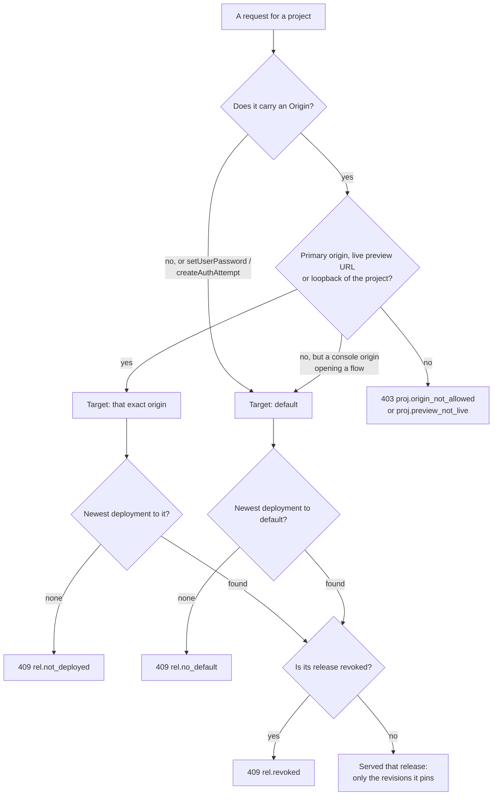

# ADR 083: Which Release Serves a Request

> **Status:** Accepted
> **Date:** 2026-10-29
> **Context:** How the server picks the release a request is served, and
> what it answers when there is none.
> **Builds on:** [ADR 035](035-configuration-environments.md) (releases and
> deployments), [ADR 036](036-api-credential-planes.md) (origins and the
> console's exemption), [ADR 066](066-operation-policies.md) (pinned
> policies) and [ADR 068](068-project-is-the-data-boundary.md) (a target
> serves its newest deployment).
> **Implemented by:** #2393 (default target), #2394 (pinned revisions only),
> #2465 (the CLI deploys the default target), #2469 (the platform project).

## Context

A release pins one revision of each piece of a project's configuration:
flows, user schemas, identity provider connections, policies and branding. A
deployment makes a release live on targets. Which release serves a request
is spread over four ADRs, and three paths fall back to the newest stored
revisions instead of a release: a request with no `Origin`, a release that
pins no flow, and an origin with nothing deployed to it. Those paths can mix
deployed and undeployed configuration in one sign-in.

## Decision

### Every request is served one release, or refused

A request that runs configuration (opening a flow, an auth attempt, a
password set) is resolved in four steps:

1. **Origin check** ([ADR 036](036-api-credential-planes.md)). The request's
   `Origin` must be a primary origin of the project, a preview URL with a
   live preview, or a loopback origin. A project with no origins admits only
   loopback origins. The console's origins (`server.public_base`'s and
   `server.console_origins`) may open any project's flow, so the console can
   preview its login, but no later step of it.
2. **Target.** A request with an `Origin` targets that exact origin. A
   request with no `Origin`, and a console origin the project does not list,
   target the project's `default` target.
3. **Deployment.** The target's newest deployment. With none, the request
   is refused with `409`: `rel.not_deployed` for an origin, `rel.no_default`
   for the default target.
4. **Release.** That deployment's release. A revoked release is refused
   with `409 rel.revoked`.

Calls that do not come from a browser page, `setUserPassword` and
`createAuthAttempt`, resolve the `default` target and ignore `Origin`.

The diagram is the opening of a flow and the calls above. A later step of a
flow skips it and is served the release the flow opened with.

### A flow keeps its release

The release a flow opens with is sealed into the flow. Every later step is
served that release, even after a newer deployment, and a step after the
release is revoked is refused with `409 rel.revoked`.

### The release is the only source

Everything a request reads is the revision its release pins. A kind the
release does not pin is absent: no flow to run, no policy to apply, the
built-in default branding. Nothing at runtime falls back to the newest
stored revision. Authoring keeps reading the newest revisions: creating a
flow definition and building a release are not requests a release serves.

### Every project has a release

Because nothing falls back, each path that signs someone in needs a deployed
release:

- `zitadel setup` deploys `.zitadel/` once it has scaffolded and committed
  the app, so the first sign-in it asks for is served a release.
- Every CLI deploy goes to the project's primary origins and its `default`
  target, so callers with no `Origin` run what the web origins run.
- The platform project, which the console signs operators in to, is served
  like any project. With platform bootstrap on, every start lists
  `server.public_base`'s origin as a primary origin of it if missing, and
  deploys a release of its newest revisions to its primary origins and the
  `default` target. A start that changes nothing deploys nothing.

## Consequences

- An edit to `.zitadel/` reaches sign-in only through a deploy, locally as
  in production.
- One app reached at two origins, such as `localhost` and `127.0.0.1`, is
  two targets; each needs its own deployment.
- The console's login preview of a project it does not list shows the
  project's `default` deployment, not undeployed drafts.
- Signing in to the console from a hosted deployment's own URL, beside its
  stable URL, is not covered: it would need a preview pattern and a preview
  deploy at each start.

## Rejected alternatives

- **Serve the newest revisions while nothing is deployed.** It keeps
  development working without a deploy, but it is the mixing this ADR
  removes; setup deploys instead.
- **A special rule that admits the console's origins for the platform
  project.** It needs no stored origin, but it makes the platform project
  the one project that is not served through its own origins and
  deployments.
- **Replace the platform project's origins at each start.** It would remove
  origins added on purpose; bootstrap only adds what is missing.
