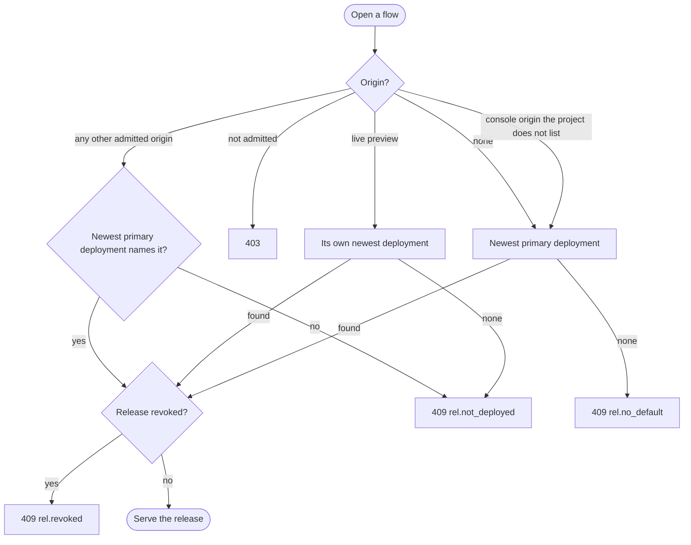

# ADR 085: Which Release Serves a Request

> **Status:** Accepted
> **Date:** 2026-10-29
> **Builds on:** [ADR 035](035-configuration-environments.md) (releases and
> deployments), [ADR 036](036-api-credential-planes.md) (origins),
> [ADR 066](066-operation-policies.md) (policies) and
> [ADR 068](068-project-is-the-data-boundary.md) (a request resolves its release
> from its `Origin`).
> **Implemented by:** #2469, #2552, #2553, #2554, #2555, #2556.

## Context

A release pins one revision of each piece of a project's configuration, and a
deployment makes it live on targets. A request with no `Origin`, a release that
pinned no flow and an origin with nothing deployed all fell back to the newest
stored revisions, so one sign-in could mix deployed and undeployed
configuration.

## Decision

### Every request is served one release, or refused

Opening a flow takes four steps:

1. Check the origin ([ADR 036](036-api-credential-planes.md)). The `Origin` must
   be a primary origin of the project, a live preview URL or a loopback origin.
   Anything else answers `403` with `proj.origin_not_allowed` or
   `proj.preview_not_live`. The console's origins (`server.public_base`'s and
   `server.console_origins`) can open any project's flow, but cannot take a
   later step. An unlisted loopback origin passes, but no deployment names it,
   so it answers `409 rel.not_deployed` rather than `403`.
2. Find the deployment. A live preview URL uses its own newest deployment. Any
   other origin uses the project's newest primary deployment, if that deployment
   names the origin. A request with no `Origin`, and a console origin the project
   does not list, a loopback one included, use the newest primary deployment.
3. With no deployment, the request answers `409`: `rel.not_deployed` for an
   origin, `rel.no_default` for a request with no origin of its own.
4. Serve that deployment's release. If it was revoked, the request answers `409`
   with `rel.revoked`.

`setUserPassword` and `createAuthAttempt` do not come from a browser page, so
they follow the newest primary deployment and ignore `Origin`.

### A primary deployment covers every caller

Primary origins deploy as a whole, so one deployment already describes what the
project serves. It also serves callers with no `Origin`, and there is no other
target to deploy to or keep in step. The newest primary deployment is therefore
always live, whatever the project lists, and its release cannot be revoked.
`targets` on `POST /deployments` is `"primary"` or a list of preview URLs.

### A deployment freezes its origins

A deployment to `primary` records the project's primary origins, and a rollback
restores the ones it recorded. A primary origin is served only while the newest
primary deployment names it and the project lists it. So an origin new to the
project serves nothing until the next deploy. Removing an origin takes effect at
once, because the origin check still reads the project's list, and adding it back
before the next deploy restores it. Primary deploys to one project are serialized,
so two that name different origins cannot both replace the same deployment.

### Example

A project lists three primary origins and a preview pattern, trimmed here to the
columns that decide. `new.acme.com` was added after `dep_2`.

`project_origins`:

| pattern | kind |
| --- | --- |
| `https://app.acme.com` | `primary` |
| `https://www.acme.com` | `primary` |
| `https://new.acme.com` | `primary` |
| `https://*-acme.vercel.app` | `preview` |

`deployments`, newest last:

| id | release_id | origin_kind |
| --- | --- | --- |
| `dep_1` | `rel_1` | `primary` |
| `dep_2` | `rel_2` | `primary` |
| `dep_3` | `rel_3` | `preview` |

`deployment_origins`:

| deployment_id | origin | seq |
| --- | --- | --- |
| `dep_1` | `https://app.acme.com` | 1 |
| `dep_1` | `https://www.acme.com` | 1 |
| `dep_2` | `https://app.acme.com` | 2 |
| `dep_2` | `https://www.acme.com` | 2 |
| `dep_3` | `https://pr-7-acme.vercel.app` | 1 |

`previews` holds `https://pr-7-acme.vercel.app` with an `expires_at` in the
future. Requests then resolve like this:

| `Origin` | Deployment | Answer |
| --- | --- | --- |
| `https://app.acme.com` | `dep_2` | serves `rel_2` |
| none | `dep_2` | serves `rel_2` |
| a console origin the project does not list | `dep_2` | serves `rel_2` |
| `https://pr-7-acme.vercel.app` | `dep_3` | serves `rel_3` |
| `https://new.acme.com` | none: `dep_2` does not name it | `409 rel.not_deployed` |
| `https://other.acme.com` | none | `403 proj.origin_not_allowed` |

### A flow keeps its release

A flow stays on the release it opened with, even after a newer deployment. If
that release is revoked, a later step or the session exchange answers `409` with
`rel.revoked`.

### The release is the only source

A request reads only the revisions its release pins. When the release pins no
flow or policy, there is none to run or apply, and when it pins no branding the
login uses the built-in one. Creating a flow definition and building a release
still read the newest revisions, because no release serves them.

### Every project has a release

- `zitadel setup` deploys `.zitadel/` once the app is scaffolded and committed.
- `zitadel deploy` and the console deploy to `primary`.
- With platform bootstrap on, every start makes `server.public_base`'s origin
  the platform project's one primary origin and deploys the configuration the
  server ships to it. A start that changes nothing deploys nothing, and a server
  older than the live release's leaves it alone.

## Consequences

- An edit to `.zitadel/` reaches sign-in only through a deploy.
- One app reached at two origins, such as `localhost` and `127.0.0.1`, needs both
  listed and deployed.
- A project with no primary origin cannot deploy, so a project with no web app
  lists one anyway.
- Callers with no `Origin` cannot stay on an older release than the web origins.
- A rollback drops every listed origin the restored deployment does not name, and
  those refuse until the next deploy. `zitadel deployment rollback` names them
  before it asks.
- A dev server on a loopback origin the project does not list, such as `:5173`
  with `:3000` listed, answers `409 rel.not_deployed`.
- The console's login preview of a project it does not list shows the newest
  primary deployment, so undeployed drafts stay out of it.
- Signing in to the console from a hosted deployment's own URL is not covered:
  it would need a preview pattern and a preview deploy at each start.

## Rejected alternatives

- Serving the newest revisions while nothing is deployed brings back the mixing
  described above.
- A separate `default` target would let callers with no `Origin` move on their
  own, but every client deployed to both anyway. It added a second history to
  roll back and a target that is not an origin.
- A special rule admitting the console's origins for the platform project would
  make it the one project not served through its own origins and deployments.
- Deploying the platform project once, at deploy time, would leave a local
  `zitadel start` or a self-hosted server with nothing deployed.
