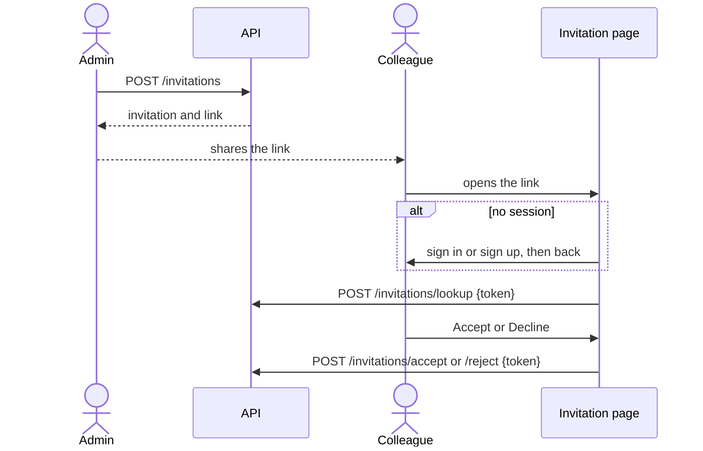
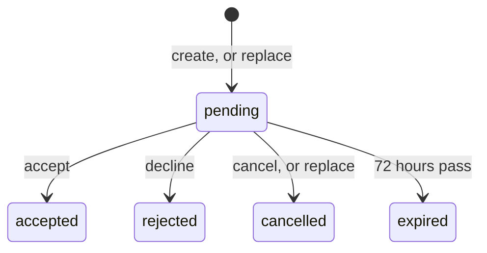

# ADR 086: Invitations

> **Status:** Proposed
> **Date:** 2026-11-04
> **Builds on:** [ADR 029](029-cryptography-secrets-and-key-lifecycle.md)
> (secret hashing), [ADR 046](046-claim-lifecycle-v2.md) (claim link),
> [ADR 047](047-dialect-id-generation.md) (ids),
> [ADR 048](048-wide-events-internal-audit-primitive.md) (events) and
> [ADR 054](054-customer-collaboration-grants.md) (project roles).
> **Amends:**
> [ADR 054 §1](054-customer-collaboration-grants.md#1-membership-and-authorization-are-separate-facts)
> (invitation state) and
> [ADR 054 §6](054-customer-collaboration-grants.md#6-grant-mutations-are-protected-project-operations)
> (invitations as a later surface).

## Context


Today a project administrator can **Add admin** by email: `POST /grants` looks
the address up among the platform project's users by `x-identifier` and grants
`admin` to the match. The colleague must have signed up first, through a link
shared outside Zitadel. The API answers `202` either way, so nobody can tell
whether it worked. The API also supports `viewer` and `editor`, which the
console doesn't offer, and a `viewer` or `editor` has no way to leave.

This ADR adds invitations with a lifecycle
([#2458](https://github.com/zitadel/nextgen/issues/2458)), designed so that
team-membership invitations
([#2436](https://github.com/zitadel/nextgen/issues/2436)) reuse it.

**In scope:** project invitations for `viewer`, `editor` or `admin`, delivered
as a shared link valid for 72 hours; accept, decline, cancel, replace; events;
a list of a project's invitations; one list of members and invitations;
leaving a project; API, console and CLI;
binding an invitation to an existing account for later use.

**Not in scope:** sending email or SMS; verifying addresses; showing users
their own invitations; schemas whose `x-identifier` isn't an email;
prefilling the address at sign-up; changing personal team creation;
configurable expiry, reminders, bulk or reusable links; team invitations and
leaving a team (shape reserved here); an `invitation.expired` event.

## Decision

### 1. The invitation resource

```json
{
  "id": "inv_01JD3B7K2M9P4R6T8V0X2Z4C6E",
  "project_id": "proj_01JD2Q6V3R8M5K7N9P1T4W6Y8A",
  "type": "project_member",
  "relation": "admin",
  "recipient": { "email": "ada@example.com" },
  "status": "pending",
  "created_by": { "user_id": "user_01JC9X3N5Q7S9U1W3Y5A7C9E1G" },
  "created_at": "2026-11-04T10:00:00Z",
  "expires_at": "2026-11-07T10:00:00Z",
  "journey_id": "q7Z0bX2rT1aM4cV8nL5wYg",
  "journey_started_at": "2026-11-04T10:00:00Z",
  "replaces_invitation_id": null,
  "accepted": null
}
```

- **`type`** is the discriminator and **`data`** carries what the type needs.
  `project_member` needs nothing, so `data` is absent. `team_member` (later)
  carries `{ "team_id": "team_…" }`. The API declares each type as a `oneOf`
  variant, so a new type is a new variant, not a new endpoint.
- **`relation`** is validated per type: `viewer`, `editor` or `admin` for
  `project_member`; `member` for `team_member`.
- **`journey_id`** is a random value shared by a chain of replacements, and
  **`journey_started_at`** is when the chain began. Neither is a resource id.
- **`accepted`** is `{ user_id, at, grant_id }` once accepted (§4):

  ```json
  {
    "id": "inv_01JD3B7K2M9P4R6T8V0X2Z4C6E",
    "status": "accepted",
    "accepted": {
      "user_id": "user_01JD4F2H6K8M0P2R4T6V8X0Z2B",
      "at": "2026-11-05T08:12:44Z",
      "grant_id": "asgn_01JD4F2J1N3Q5S7U9W1Y3A5C7E"
    }
  }
  ```

  The other fields are unchanged and left out here.
- **Storage** adds columns the API never returns: `token_hash`,
  `recipient_user_id` (§2) and `target_id`, the project's or team's id, which
  indexes use instead of JSON in `data`.
- **The address is PII and is stored encrypted** with the project's key
  (ADR 029). A keyed hash of it serves the duplicate check.

Invitations are their own table. A pending invitation may name someone without
an account, so it can't be a membership or a grant.

### 2. The link authorizes; the address binds an existing account

Whoever holds the link and is signed in can accept. They don't have to match
the recipient, so a forwarded link works.

On create, the server looks the address up the way **Add admin** does. If
exactly one active platform user matches, it stores their id as
`recipient_user_id`. Nothing uses it yet; it lets a later slice list a user's
own invitations without a model change. The administrator can't tell whether
it bound: no response, list, event or CLI output shows it. Accounts created
after the invitation are never bound, because registration doesn't verify the
address.

The address is otherwise only shown to the administrator and used for the
duplicate check. It's decrypted only to answer an administrator's read, and
never logged or put in an event. This iteration assumes the platform schema's `x-identifier`
is an email; otherwise nothing binds and only the link works.

### 3. The link opens a signed-in page

The token is 16 random bytes, stored only as its hash. The link carries it in
the fragment, `{console}/invitations/accept#token=…`, so it never reaches a
server log.

The invitation page is for signed-in users only. It moves the token to
`sessionStorage` and drops the fragment, then redirects a signed-out visitor
to sign-in with `next=/invitations/accept`. Sign-up happens inside that flow.
Back on the page, it shows the project, role, inviter and expiry with
**Accept** and **Decline**. The page checks the session itself, outside the
console's guarded routes, because the guard would put the token into a query
string. Reopening the link resumes an interrupted acceptance.



### 4. Lifecycle and acceptance



- All states but `pending` are final. Revoking the resulting grant doesn't
  change the invitation, and its link can't restore access.
- `expired` is derived on read from `expires_at`; no sweeper runs.
- **Replace** creates a new invitation in the same journey. A pending original
  becomes `cancelled`; an expired or rejected one keeps its status.
- **Duplicates:** at most one live invitation per project, type, `target_id`
  and `recipient_hash`, enforced by a nullable `pending_key` with a unique
  index.
- **Accept** runs in one transaction: find by token hash, check it is pending
  and unexpired, run the type's effect, mark it accepted if still pending (the
  loser of a race gets a 404), emit events. The inviter can't accept their own
  invitation.
- **Effect per type:** `project_member` creates the user's grant, or reuses
  an identical one, since grants are unique per user and relation and roles
  are additive. `team_member` (later) creates an active membership.
- **Grant link:** the invitation stores `accepted.grant_id`. The grant row
  doesn't point back: ADR 054 §6 keeps provenance in events, and
  `invitation.accepted` and `authz.granted` share a `request_id`.

### 5. Events

| `event_type` | Emitted on | Payload |
|---|---|---|
| `invitation.created` | create, and the new row of a replace | `type`, `data`, `relation`, `recipient_kind`, `journey_id`, `replaces_invitation_id`, `expires_at` |
| `invitation.accepted` | accept, with `authz.granted` | `type`, `data`, `relation`, `journey_id`, `user_id`, `grant_id` |
| `invitation.rejected` | decline | `journey_id`, `user_id` |
| `invitation.cancelled` | cancel, and the old row of a replace | `journey_id`, `reason` (`cancelled` or `replaced`), `replaced_by_invitation_id` |

Payloads never carry the address or the token. `invitation.expired` waits for
a sweeper.

### 6. Listing invitations, and members with invitations

`GET /invitations?project_id=` lists every invitation of a project, newest
first, in any status, paginated with `limit` and `page_token`. Optional
filters: `status` and `type`. It's the management view: the CLI lists from it,
and it shows history (accepted, rejected, cancelled) that the members list
leaves out.

The console's Admins tab needs members and open invitations in one table, so
it uses a second list:

`GET /projects/{project_id}/members` replaces `GET /projects/{project_id}/admins`.
It lists open invitations (pending, expired, rejected), then everyone with a
role on the project, with each person's strongest `relation` and its
`sources`. Optional filters: `kind` (`invitation` or `member`) and `relation`
(at least that role). A single table makes one call; split tables make one
call per `kind`.

It pages with `limit` and `page_token` and needs no SQL `UNION`. The service
runs the invitation query first and, if the page isn't full, the members query
from the start; the cursor records which section it's in. Members keep today's
admins query, widened to all relations. They're ordered by `user_id`, since
names aren't stored on users; sorting by name needs a stored name column
first.

### 7. API

| Operation | Credential |
|---|---|
| `POST /invitations?project_id=`: create, or replace with `replaces_invitation_id`; returns the invitation and `link` | project `admin` |
| `GET /invitations?project_id=[&status=][&type=]`: list | project `admin` |
| `GET /invitations/{id}?project_id=` | project `admin` |
| `DELETE /invitations/{id}?project_id=`: cancel | project `admin` |
| `POST /invitations/lookup`, `/accept`, `/reject` with `{token}` | platform-project session; CSRF on writes |
| `GET /projects/{project_id}/members` | project read |
| `DELETE /projects/{project_id}/members/me`: leave | own session |

Standard methods first: cancel is `DELETE`, which keeps the row as
`cancelled`; replace is a create, like signing-key rotation. `lookup`, `accept`
and `reject` are verbs because their caller holds a token, not an id. Unknown
tokens all get one 404, and these calls are rate-limited.

**Leaving** revokes every direct grant the caller holds on the project and
answers `204`. Access through a team stays, and the console warns about it
first. Owning-team admins hold their role through the team, so leaving never
leaves a project without an admin.

### 8. CLI

| Command | Does |
|---|---|
| `zitadel invitation create [email] [--relation …] [--replaces <id>]` | Asks for anything missing, confirms, prints the link and "It expires in 72 hours." |
| `zitadel invitation list [--status …] [--type …]` | The project's invitations, with status and expiry |
| `zitadel invitation get <id>` | Shows one invitation |
| `zitadel invitation cancel [id]` | Asks to confirm; offers pending invitations when no id is given |

The commands sit in a new "Project administration" help group. Replace is a
flag because it's the same operation as create. The members list and leaving
have no command, and neither do `lookup`, `accept` and `reject`: the CLI's
coverage test exempts them. Existing members stay reachable through
`zitadel grant list`. The link
appears in `--json` output only, never in telemetry.

### 9. Product analytics

> **Open:** waiting on the choice between Vercel Web Analytics and Mixpanel.

#2458 asks for colleagues invited, the share accepting within 72 hours and
time to acceptance. `journey_id` and `journey_started_at` (§1) carry what
that needs.

## Consequences

- A colleague can be invited before they have an account, and the
  administrator sees them as pending, then as a member.
- Team invitations add a type, its `data` and its effect; everything else is
  reused.
- A forwarded or leaked link lets its holder accept or decline. The expiry,
  cancel and the visible accepter limit this.
- The members query is a harder query than the admins one it replaces.

## Rejected alternatives

- **Invitation state on `team_memberships`:** can't express a project role,
  and needs a user before one exists.
- **Require the accepter to match the address:** without verification it
  compares two unverified values and blocks legitimate colleagues.
- **Bind accounts at sign-up:** whoever registers the address first would get
  the invitation.
- **`invitation_id` on the grant:** puts provenance on the assignment row.
- **Token in the query string:** reaches server and proxy logs.
- **An SQL `UNION` or a name-sorted merge:** has to fold every member before
  `LIMIT`.

## Documentation impact

- ADR 047's prefix registry: `inv_`.
- [`events-catalog.md`](../design/api/events-catalog.md): the four new types.
- [`system-permission-catalog.md`](../design/api/system-permission-catalog.md)
  and [`resource-map.md`](../design/api/resource-map.md): team invitations
  become `/invitations` with `type: team_member`.
- The CLI's `SKILL.md` and command reference.
- Self-hosted docs: no configuration needed; the link is the only delivery.
- v4 migration docs: v4 project members map to grants; v4 invite codes don't
  carry over.
