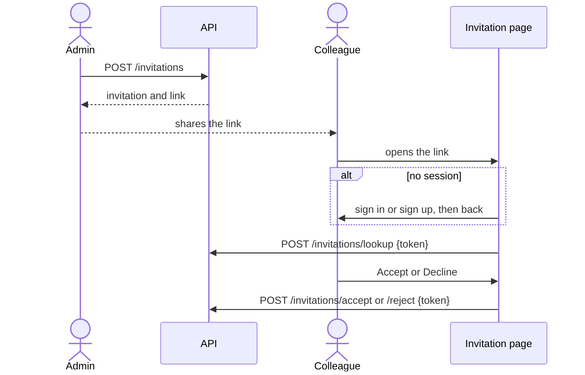
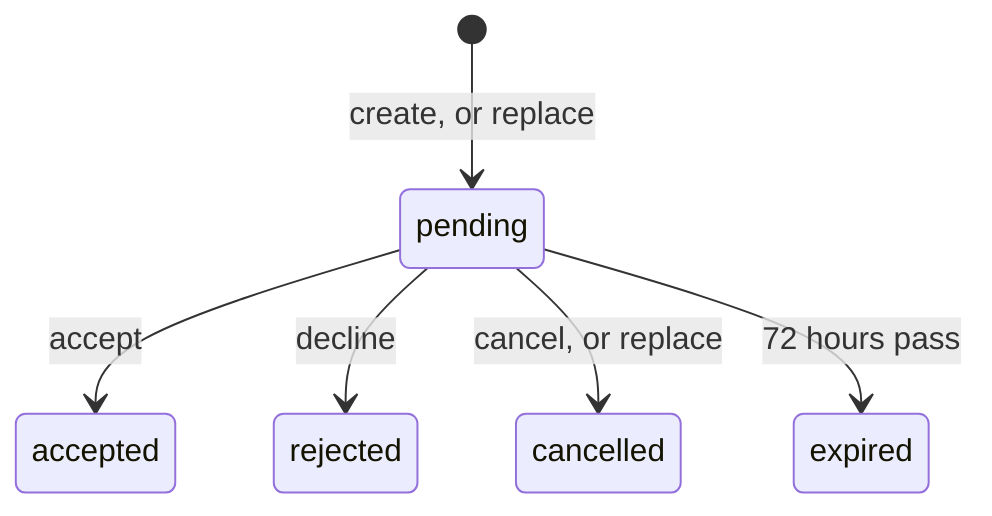

# ADR 086: Invitations

> **Status:** Proposed
> **Date:** 2026-11-04
> **Builds on:** [ADR 029](029-cryptography-secrets-and-key-lifecycle.md)
> (secret hashing), [ADR 046](046-claim-lifecycle-v2.md) (claim link),
> [ADR 047](047-dialect-id-generation.md) (ids),
> [ADR 048](048-wide-events-internal-audit-primitive.md) (events) and
> [ADR 054](054-customer-collaboration-grants.md) (project roles).
> **Amends:**
> [ADR 054 §1](054-customer-collaboration-grants.md#1-membership-and-authorization-are-separate-facts)
> (invitation state) and
> [ADR 054 §6](054-customer-collaboration-grants.md#6-grant-mutations-are-protected-project-operations)
> (invitations as a later surface).

## Context


Today a project administrator can **Add admin** by email: `POST /grants` looks
the address up among the platform project's users by `x-identifier` and grants
`admin` to the match. The colleague must have signed up first, through a link
shared outside Zitadel. The API answers `202` either way, so nobody can tell
whether it worked. The API also supports `viewer` and `editor`, which the
console doesn't offer.

This ADR adds invitations with a lifecycle
([#2458](https://github.com/zitadel/nextgen/issues/2458)), designed so that
team-membership invitations
([#2436](https://github.com/zitadel/nextgen/issues/2436)) reuse it.

**In scope:** project invitations for `viewer`, `editor` or `admin`, as a
link valid for 72 hours that grants the role to whoever redeems it; metadata
entered at creation so administrators know who a link is for; accept,
decline, cancel, replace; events; a list of a project's invitations and a
separate list of its members; API, console and CLI.

**Not in scope:** addressing an invitation to an email or an account;
sending email or SMS; letting users find invitations meant for them; changing
personal team creation; configurable expiry, reminders, bulk or reusable
links; leaving a project or a team (its own issue); team invitations (shape
reserved here); an
`invitation.expired` event.

## Decision

### 1. The invitation resource

```jsonc
{
  "id": "inv_01JD3B7K2M9P4R6T8V0X2Z4C6E",
  "project_id": "proj_01JD2Q6V3R8M5K7N9P1T4W6Y8A",
  "type": "project_member",
  "project_member": { "relation": "admin" },
  // team_member: "team_member": { "team_id": "team_01JD6N8Q0S2U4W6Y8A0C2E4G6J", "role": "member" }
  "metadata": { "name": "John Doe" },
  "status": "pending",
  "created_by": "user_01JC9X3N5Q7S9U1W3Y5A7C9E1G",
  "created_by_type": "human",
  "created_at": "2026-11-04T10:00:00Z",
  "expires_at": "2026-11-07T10:00:00Z",
  "journey_id": "q7Z0bX2rT1aM4cV8nL5wYg",
  "accepted_by": null,
  "accepted_at": null,
  // Stored, never exposed by the API:
  "token_hash": "3f9a…"  // hash of the link's token (§3)
}
```

- **`type`** is the discriminator, and the object named after it holds
  everything specific to that type. All other fields are common.
  - `project_member` takes `relation`: `viewer`, `editor` or `admin`, named
    as in `POST /grants`.
  - `team_member` takes `team_id` and its own fields; `role` in the example
    is only illustrative. It's declared in the API now, so the contract
    doesn't change when it ships, and creating one answers `501` until then.
    Its slice adds a `team_id` column to index on.

  Each type is a `oneOf` variant in the API with its own schema, not a new
  endpoint. A type can grow fields without touching the others.
- **`metadata`** is what the administrator entered at creation, so other
  administrators know who the link is for: `{ "name": "John Doe" }` for
  `project_member`. It's only displayed, never matched. It's PII, so it's
  stored encrypted with the project's key (ADR 029) and erased later (§4).
- **`created_by`** and **`created_by_type`** follow releases and deployments.
  The console creates as the signed-in user (`"user_…"`, `human`). The CLI
  creates with the project secret, which names no user: `created_by` is
  `null` and `created_by_type` is `service`.
- **`journey_id`** ties a link to its replacements: a replacement keeps the
  original's `journey_id`. It's a random correlation id, not a resource id.
- **`accepted_by`** and **`accepted_at`** say who redeemed the link and when,
  like `created_by` and `created_at`. They replace `metadata` as the record
  of who it was for:

  ```json
  {
    "id": "inv_01JD3B7K2M9P4R6T8V0X2Z4C6E",
    "status": "accepted",
    "metadata": null,
    "accepted_by": "user_01JD4F2H6K8M0P2R4T6V8X0Z2B",
    "accepted_at": "2026-11-05T08:12:44Z"
  }
  ```

  The other fields are unchanged and left out here. The invitation doesn't
  store what acceptance produced; the events link it (§4).

Invitations are their own table. A pending invitation names no account, so
it can't be a membership or a grant.

### 2. The link carries the grant

The invitation isn't addressed to anyone. Whoever holds the link and is
signed in can redeem it, and gets the role. The administrator chooses who to
share it with; the metadata only reminds administrators who that was.

A later iteration may bind an invitation to a user, for example so they can
find it in the console. That is out of scope here.

### 3. The link opens a signed-in page

The link is `{console}/invitations/accept#token=…`. The invitation page is for
signed-in users only. It moves the token to
`sessionStorage` and drops the fragment, then redirects a signed-out visitor
to sign-in with `next=/invitations/accept`. Sign-up happens inside that flow.
Back on the page, it shows the project, role, inviter and expiry with
**Accept** and **Decline**. The page checks the session itself, outside the
console's guarded routes, because the guard would put the token into a query
string. Reopening the link resumes an interrupted acceptance.



### 4. Lifecycle and acceptance



- All states but `pending` are final. Revoking the resulting grant doesn't
  change the invitation, and its link can't restore access.
- `expired` is derived on read from `expires_at`; no sweeper runs.
- **Replace** is a create with `replaces_invitation_id`, a request parameter
  that isn't stored. The new invitation keeps the original's `journey_id`. A
  pending original becomes `cancelled` in the same transaction; an expired or
  rejected one keeps its status.
- **Erasure:** accepting, declining and cancelling null `metadata` in the same
  transaction; replacing moves it to the new invitation. An expired
  invitation that is never replaced keeps it until a cleanup job removes it
  (follow-up).
- **Accept** runs in one transaction: find by token hash, check it is pending
  and unexpired, hand off to the type's adapter, mark it accepted, emit
  events. The inviter can't accept their own invitation.
- **One adapter per type.** The invitation service knows nothing about grants
  or memberships. Each type has an adapter that calls the service owning the
  target, inside the same transaction: the grant service for
  `project_member`, the membership service later for `team_member`. The
  adapter knows that service's errors and decides which of them mean
  "already done". Its outcome is success, which lets acceptance continue, or
  a failure, which aborts it.
- **The `project_member` adapter** calls the grant service with the accepting
  user and the relation. Grants are unique per user and relation, and roles
  are additive, so:
  - no grant for that relation yet: the grant service creates one;
  - a different relation already held: a second grant is created, and the
    strongest wins;
  - an identical active grant: the grant service refuses a duplicate, and the
    adapter treats that as success;
  - an identical expired grant still holds the binding: the adapter revokes
    it and creates a new one.

  These rules follow the grant service as it is. If it starts accepting
  duplicates, the adapter gets simpler; the invitation doesn't change.
- **Provenance:** the grant row doesn't point back to the invitation (ADR 054
  §6 keeps provenance in events). The grant service emits `authz.granted`,
  and `authz.revoked` for a replaced expired grant. They share
  `invitation.accepted`'s `request_id`.

### 5. Events

| `event_type` | Emitted on | Payload |
|---|---|---|
| `invitation.created` | create, and the new row of a replace | `type` and its object, `journey_id`, `replaces_invitation_id`, `expires_at` |
| `invitation.accepted` | accept; with the grant service's events when it writes | `type` and its object, `journey_id`, `user_id` |
| `invitation.rejected` | decline | `journey_id`, `user_id` |
| `invitation.cancelled` | cancel, and the old row of a replace | `journey_id`, `reason` (`cancelled` or `replaced`), `replaced_by_invitation_id` |

Payloads never carry the metadata or the token. `invitation.expired` waits for
a sweeper.

### 6. Listing invitations and members

Invitations and members are listed separately, and the console shows them in
separate tables.

`GET /invitations?project_id=` lists every invitation of a project, newest
first, in any status, paginated with `limit` and `page_token`. Optional
filters: `status` and `type`.

`GET /projects/{project_id}/members` replaces `GET /projects/{project_id}/admins`
and lists members only: everyone with a role on the project, with each
person's strongest `relation` and its `sources`. It's today's admins query
widened from `admin` to every relation, paginated by `user_id`. An optional
`relation` filter means at least that role, so `relation=admin` gives the
admins view. Widening the query doesn't widen the credential: like the admins
list, it needs `project.write` or a session, never `project.read`, which the
browser-plane preview secret carries.

### 7. API

| Operation | Credential |
|---|---|
| `POST /invitations?project_id=`: create, or replace with `replaces_invitation_id`; returns the invitation and `link` | project `admin` |
| `GET /invitations?project_id=[&status=][&type=]`: list | project `admin` |
| `GET /invitations/{id}?project_id=` | project `admin` |
| `DELETE /invitations/{id}?project_id=`: cancel | project `admin` |
| `POST /invitations/lookup`, `/accept`, `/reject` with `{token}` | platform-project session; CSRF on writes |
| `GET /projects/{project_id}/members` | `project.write`, or a session that can read the project |

Cancel is `DELETE`, which keeps the row as `cancelled`; replace is a create,
like signing-key rotation. `lookup`, `accept` and `reject` are verbs because
their caller holds a token, not an id.

### 8. CLI

| Command | Does |
|---|---|
| `zitadel invitation create [--name …] [--relation …] [--replaces <invitation_id>]` | Asks who it's for and which role, confirms, prints the link and "Whoever opens it gets this role. It expires in 72 hours." |
| `zitadel invitation list [--status …] [--type …]` | The project's invitations, with status and expiry |
| `zitadel invitation get <invitation_id>` | Shows one invitation |
| `zitadel invitation cancel [invitation_id]` | Asks to confirm; offers pending invitations when no id is given |

The commands sit in a new "Project administration" help group. Replace is a
flag because it's the same operation as create. The members list has no
command, and neither do `lookup`, `accept` and `reject`: the CLI's
coverage test exempts them. Existing members stay reachable through
`zitadel grant list`. The link appears in `--json` output, never in
telemetry.

### 9. Product analytics

The console and the CLI send product events to Mixpanel, following
[product analytics](../product-analytics.md). They go into
[the catalog](../product-analytics-events.yaml) as `planned` in the same
change. #2458 specifies the events; this ADR adjusts them slightly.

| Event | Sent by | When |
|---|---|---|
| `invitation_created` | the console's invite dialog; `zitadel invitation create`, including `--replaces` | after the API confirms the create |
| `invitation_accepted` | the console's invitation page | after the API confirms the accept |
| `invitation_rejected` | the console's invitation page | after the API confirms the decline |

| Property | Events | Value |
|---|---|---|
| `role` | all | the type and its role combined: `project_viewer`, `project_editor`, `project_admin`; later `team_member` |
| `invitation_journey_id` | all | the invitation's `journey_id` |

- **Changes from #2458:**
  - `invitation_rejected` is added, so declines are counted rather than
    looking like invitations nobody opened.
  - `delivery_method` is dropped while the shared link is the only method.
  - `duration_ms` is dropped. The events' timestamps give the same answer
    (see below).
- **`surface`** comes from the standard header (`console` or `cli`), so there
  is no interface property.
- **Counting:** colleagues invited is the number of distinct journeys. The
  72-hour acceptance rate counts only journeys older than 72 hours.
- **Time to acceptance** comes from the events' own timestamps, joined on
  `invitation_journey_id`: from the journey's first `invitation_created` to
  its `invitation_accepted`. Creating and accepting are done by different
  users, so a per-user funnel can't link them. The journey id has to be the
  key, either as a Mixpanel group or in an export query.
- **No identifiers or PII:** no token, link, metadata or invitation id goes
  into an event. `journey_id` is random, so the CLI keeps its promise of
  sending no resource ids.
- **Work this needs:**
  - The console sends only to Vercel today, through the cloud add-on, so it
    needs a Mixpanel sink.
  - Mixpanel is paused for every client until its project region is fixed.
  - A self-hosted console has no add-on, so it sends nothing.

### 10. Security

**The token**
- Minted and hashed like a handoff token: 16 bytes from `crypto/rand`, stored
  as their SHA-256
  ([`handoff_token.go`](../../apps/api/internal/domain/handoff_token.go)).
  Looked up by that hash like a claim challenge
  ([`000014_claim_challenges.sql`](../../apps/api/internal/storage/dialect/postgres/migration/sql/000014_claim_challenges.sql),
  ADR 046 §3). The plaintext appears once, in the create or replace response.
- The invitation id is partly predictable (ADR 047), but only the admin
  endpoints take it. Only the token redeems.
- It travels in the link's fragment and in POST bodies, never in a URL query.
  The invitation page removes it from the URL before any third-party script
  loads, and the page is excluded from analytics and error-report URL
  capture.
- `sessionStorage` holds it only while the page needs it. It's cleared on
  accept, decline, an unknown token, and sign-out.

**Authority**
- Creating, listing, reading and cancelling run the same project `admin` check
  as `POST /grants`.
- The creator's authority is checked again at accept. The invitation is
  refused if `created_by` no longer holds `admin` on the project, or if the
  project is no longer active. When `created_by` is `null` (the CLI), only
  the project check applies. Rotating the secret doesn't cancel them; an administrator does.
- Pending invitations are cancelled when their project is deleted or changes
  owner.
- The platform project can be invited into, so its administrators can add
  colleagues until team membership exists (#2436). It's always claimed, as
  for grants to its own principals.
- Invitations need a platform project. Accepting needs a platform-project
  session, and without a platform project there's none to sign into, so
  such a server refuses to create invitations.
- An unclaimed project can neither create nor accept invitations, because
  the grant they lead to needs a claimed project
  ([ADR 054 §4 amendment](054-customer-collaboration-grants.md#amendment-2026-11-03-sharing-needs-a-claimed-project)).
- A project has a cap on pending invitations.
- `lookup`, `accept` and `reject` need a platform-project user session, with
  CSRF on the writes. Every unknown token gets the same 404, and the calls
  are rate-limited.

**State changes**
- Accept, decline, cancel and the cancel inside a replace change an
  invitation's status only while it's `pending`, each in one transaction.
  When two race, one wins and the other gets the same answer as for a
  finished invitation. Two replacements of an expired or rejected invitation
  can both succeed, like any two invitations for the same person.

**Logs**
- Request logs and wide events redact `token`, `link` and `metadata`, and
  event payloads never carry them.

**Accepted risks**
- A leaked link grants its role to whoever redeems it first within 72 hours.
  The expiry, cancel and the visible accepter limit the damage.
- Expired invitations keep their metadata until the cleanup job exists.
- An `admin` link to the platform project is the most powerful link there is.
  The same rules apply to it as to any other project's links.

## Consequences

- A colleague can be invited before they have an account, and the
  administrator sees them as pending, then as a member.
- No address, no matching, no binding: team invitations add only a type, its
  object and its adapter.
- An existing user can't find invitations meant for them; only the link leads
  to one. That would need addressed invitations, which this ADR doesn't model.
- Nothing prevents two pending invitations for the same person.
- A leaked link grants its role to whoever redeems it first (§10).

## Rejected alternatives

- **Invitation state on `team_memberships`:** can't express a project role,
  and needs a user before one exists.
- **Address invitations to an email and bind existing accounts:** lets users
  find their invitations, but needs matching rules, verification and a
  duplicate check, and keeps an address around. The link alone is simpler and
  serves every invitation type.
- **`invitation_id` on the grant:** puts provenance on the assignment row.
- **Token in the query string:** reaches server and proxy logs.
- **Members and invitations in one list:** needs a shared order and a cursor
  that spans two tables. The console always shows them separately.

## Documentation impact

- ADR 047's prefix registry: `inv_`.
- [`events-catalog.md`](../design/api/events-catalog.md): the four new types.
- [`system-permission-catalog.md`](../design/api/system-permission-catalog.md)
  and [`resource-map.md`](../design/api/resource-map.md): team invitations
  become `/invitations` with `type: team_member`.
- The CLI's `SKILL.md` and command reference.
- [`product-analytics-events.yaml`](../product-analytics-events.yaml) and the
  CLI's telemetry page: the events and properties in §9.
- Self-hosted docs: invitations need a platform project
  (`platform.bootstrap_project`); the link is the only delivery.
- v4 migration docs: v4 project members map to grants; v4 invite codes don't
  carry over.
