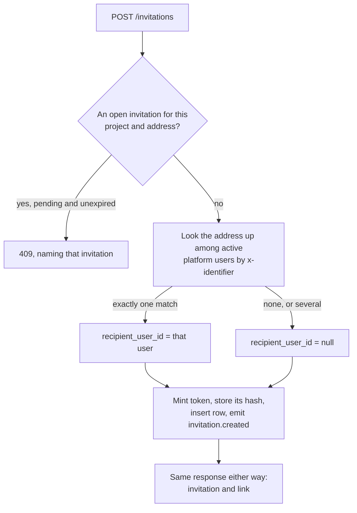
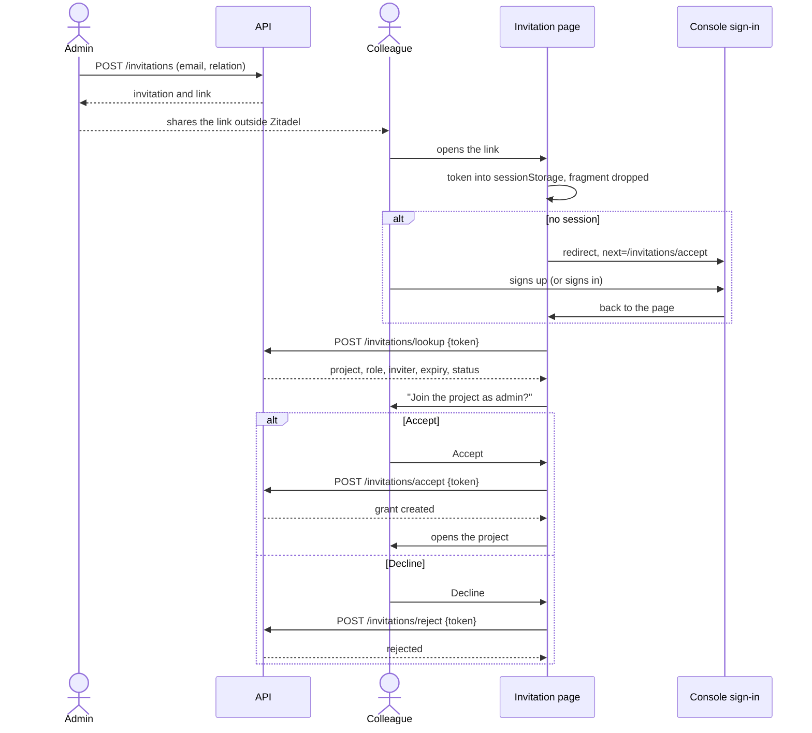
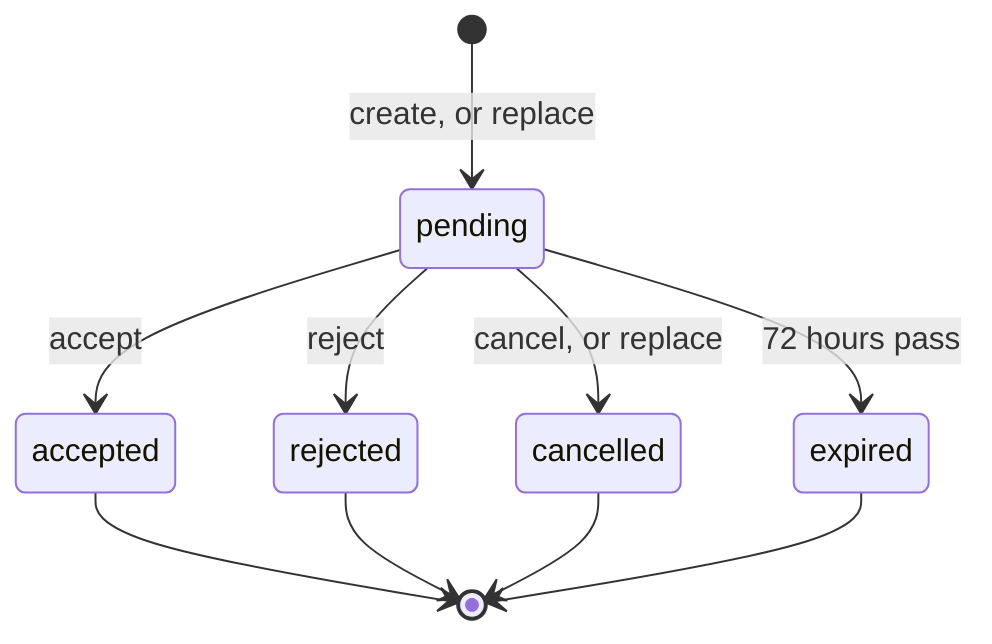
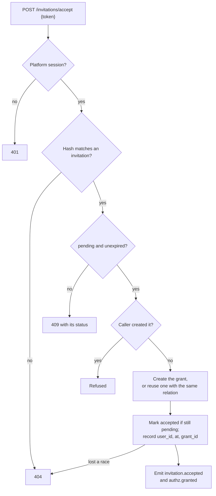
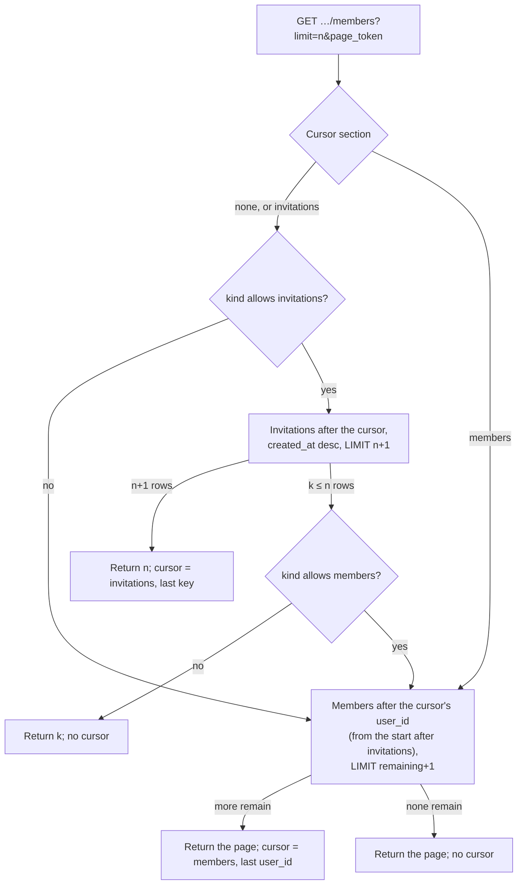

# ADR 086: Invitations

> **Status:** Proposed
> **Date:** 2026-11-04
> **Builds on:** [ADR 029](029-cryptography-secrets-and-key-lifecycle.md)
> (secret hashing), [ADR 033](033-internal-permission-management.md)
> (membership dual-write), [ADR 046](046-claim-lifecycle-v2.md) (claim link),
> [ADR 047](047-dialect-id-generation.md) (ids),
> [ADR 048](048-wide-events-internal-audit-primitive.md) (events),
> [ADR 053](053-cross-project-principals.md) (principal homes) and
> [ADR 054](054-customer-collaboration-grants.md) (project roles).
> **Amends:**
> [ADR 054 §1](054-customer-collaboration-grants.md#1-membership-and-authorization-are-separate-facts)
> (invitation state) and
> [ADR 054 §6](054-customer-collaboration-grants.md#6-grant-mutations-are-protected-project-operations)
> (invitations as a later surface).

## Context

The console lets a project administrator add another admin to a project, but
only someone who has already signed up, and only as `admin`. The API supports
more than the console uses: `viewer` and `editor` grants, grants to teams, and
expiry.

This ADR introduces proper invitations
([#2458](https://github.com/zitadel/nextgen/issues/2458)). An invitation has a
lifecycle, it can reach a colleague who has no account yet, and it carries the
role chosen up front. The design is meant to be reused for team-membership
invitations later ([#2436](https://github.com/zitadel/nextgen/issues/2436)).

### How it works today


The project's **Admins** tab lists who administers it and how. **Add admin**
takes an email address and calls `POST /grants`. The server looks the address
up among the platform project's active users, matching it against the value of
each user schema's `x-identifier`, and grants `admin` to the one user it finds.
The colleague must have signed up first, through a link the administrator
shares outside Zitadel. The API answers `202` whether or not anyone matched, so
the console can't confirm that the address named anyone.

### Limitations

- **No pending state.** The administrator can't see who is expected, or tell a
  colleague who hasn't signed up yet from a typo. The neutral `202` hides both,
  on purpose: it stops the endpoint from revealing which addresses have
  accounts.
- **The colleague lands without the project.** Registration knows nothing
  about the project, so the colleague's console lists no projects until the
  administrator adds them.
- **Admin only in the console.** The API accepts `viewer` and `editor`, but the
  dialog grants only `admin`.
- **No way out for most people.** Revoking a grant (`DELETE /grants/{id}`)
  needs `admin` on the project. An admin can remove their own direct grant
  that way, but a `viewer` or `editor` can't give up theirs. No operation adds
  or removes a team membership, so nobody can leave a team.
- **Nothing in the CLI** beyond the generic `grant create` and `grant delete`.
  `GET /projects/{project_id}/admins` has no command.

### What the backend already has

| Capability | Where | Reused for |
|---|---|---|
| Project roles `viewer` ⊂ `editor` ⊂ `admin`, additive, strongest wins | Seeded catalog, ADR 054 §5 | The role an invitation offers |
| Direct user and team grants, created by user id or by identifier, revoked by id, with optional expiry; each write emits `authz.granted` or `authz.revoked` | `POST /grants`, `DELETE /grants/{id}`, `GrantService` | The effect of accepting a project invitation |
| One unique grant per principal and relation | `authz_assignments` | Accepting reuses an identical grant |
| Admins with their sources, keyset-paged by `user_id`, hiding people reached only through teams the caller isn't in | `GET /projects/{project_id}/admins` | The members half of §8 |
| User refs (identifier, display) resolved per page | ADR 058 resolver | Names in the members list |
| A secret link that survives sign-up: random token, only its hash stored, spent once in a transaction | Project claim, ADR 046 | The invitation secret and the invitation page |
| `next` deep links kept through sign-in and the in-flow sign-up step | Console `/login`, `<zitadel-login>` | Returning to the invitation page after sign-in or sign-up |
| Personal team created on session exchange for platform users with no membership | `EnsurePersonalTeam` | Unchanged |
| Team roster with a `pending` membership status, which nothing produces | `team_memberships`, ADR 024 | Replaced by invitations (§1) |

### In scope

- Invitations to a project, offering `viewer`, `editor` or `admin`, delivered
  as a link the administrator shares. An invitation is valid for 72 hours.
- The lifecycle (accept, reject, cancel, replace, expiry) and its events.
- Accepting through the console's existing sign-in and registration.
- One list of a project's members and open invitations.
- Binding an invitation to the existing account its address names, so a
  later view of a user's own invitations needs no model change (§3).
- Leaving a project.
- The API, console and CLI for all of the above.
- A model that team-membership invitations can reuse.

### Not in scope

- Sending invitations by email or SMS, and verifying the recipient's address.
- Showing users the invitations bound to them (a console view,
  `GET /users/me/invitations`), and answering one without the link.
- Binding an invitation to an account created after it.
- User schemas whose `x-identifier` is not an email address (§3).
- Prefilling the invited address into the sign-up form (§3).
- Changes to personal team creation. A colleague who registers through an
  invitation gets a personal team, like any other platform user.
- Configurable expiry, reminders, bulk invitations, reusable join links.
- Invitations into a team (#2436), and leaving a team. This ADR only reserves
  their shape.
- An `invitation.expired` event and an expiry sweeper.
- Listing, on a grant, the invitation that produced it.

## Decision

### 1. An invitation has a type, and the type says what it grants

An invitation is its own resource, `inv_…` (ADR 047). It offers one relation
to one recipient, on what its `type` names. Whoever presents its secret while it is
pending can accept it once.

| Field | Meaning |
|---|---|
| `project_id` | The project the invitation belongs to and is deleted with. For a team invitation, the team's project. |
| `type` | The discriminator: what acceptance grants. `project_member` now, `team_member` later. |
| `data` | What the type needs beyond the project, or absent when it needs nothing. `project_member` has none; `team_member` carries `{ "team_id": "team_…" }`. |
| `relation` | The role it grants. `project_member` takes `viewer`, `editor` or `admin`; `team_member` will take `member`. |
| `recipient` | Who the administrator means: `{email}` now. |
| `recipient_user_id` | The existing account the address named when the invitation was created, if any (§3). Never returned to the administrator. |
| `status` | `pending`, `accepted`, `rejected`, `expired` or `cancelled`. |
| `expires_at` | 72 hours after creation. |
| `journey_id`, `journey_started_at` | A random opaque value minted with the first invitation of a replace chain, and that invitation's creation time. Replacements copy both. Not a resource id, and not the secret. |
| `replaces_invitation_id` | The invitation this one replaced, if any. |
| `accepted` | Who accepted, when, and what acceptance produced (§6). |

The domain validates `data` against the type and the relation against the
type. Nothing else in the row depends on the type, and the API declares the
variants as a `oneOf` with `type` as its discriminator, so a new type is a new
variant and not a new endpoint.

Storage keeps `type` and `data` as they are on the wire, `data` as JSON, plus
an internal `target_id` derived from them: the project's id for
`project_member`, the team's id for `team_member`. Indexes and the duplicate
guard (§5) use `target_id`, because indexing inside JSON differs across the
three dialects. `target_id` never appears on the wire.

An invitation as the administrator reads it. `recipient_user_id` is stored but
never returned (§3):

```json
{
  "id": "inv_01JD3B7K2M9P4R6T8V0X2Z4C6E",
  "project_id": "proj_01JD2Q6V3R8M5K7N9P1T4W6Y8A",
  "type": "project_member",
  "relation": "admin",
  "recipient": { "email": "ada@example.com" },
  "status": "pending",
  "created_at": "2026-11-04T10:00:00Z",
  "created_by": { "user_id": "user_01JC9X3N5Q7S9U1W3Y5A7C9E1G", "identifier": "grace@example.com" },
  "expires_at": "2026-11-07T10:00:00Z",
  "journey_id": "q7Z0bX2rT1aM4cV8nL5wYg",
  "journey_started_at": "2026-11-04T10:00:00Z",
  "replaces_invitation_id": null,
  "accepted": null
}
```

Once accepted, `status` is `accepted` and `accepted` names the result:

```json
"accepted": {
  "user_id": "user_01JD4F2H6K8M0P2R4T6V8X0Z2B",
  "at": "2026-11-05T08:12:44Z",
  "grant_id": "asgn_01JD4F2J1N3Q5S7U9W1Y3A5C7E"
}
```

A team invitation later differs only in `type`, `data` and `relation`:

```json
{
  "type": "team_member",
  "data": { "team_id": "team_01JD6N8Q0S2U4W6Y8A0C2E4G6J" },
  "relation": "member"
}
```

The invitations table is separate from `team_memberships` and
`authz_assignments`. A pending invitation names a recipient who may not have an
account, so it can't be a membership row or an assignment row without a
principal.

### 2. Acceptance effect depends on the type

Acceptance runs one effect per type, in the same transaction that marks the
invitation accepted:

- **`project_member`:** create a user grant on the project with the invited relation,
  the same write `POST /grants` makes. The accepting session must belong to a
  platform-project user, the home of every console principal (ADR 053).
- **`team_member` (later):** create an active membership in `data.team_id` through the dual-write
  helpers (ADR 033). The accepting session belongs to a user of the team's
  project. For a customer team that is an end user signing in through the
  embedded component.

The team slice adds a type, its `data` and its effect. It adds no new table and no
new lifecycle.

### 3. The link is the authority; the address binds an existing account

Holding the link authorizes acceptance, and is the only way in for this
slice. The accepting user does not have to match `recipient`, so a forwarded
link works for whoever it was forwarded to. The administrator sees who
accepted (§6, §8) and can revoke the resulting grant.

**Binding to an existing account.** On create, the server looks the address up
the way **Add admin** does: among the platform project's active users, against
each user schema's `x-identifier`. If exactly one user matches, the invitation
stores that user's id as `recipient_user_id`. A replacement looks the address
up again. The binding is fixed once stored: a later change to the user's
address doesn't move it.



This slice stores the binding and doesn't use it yet. It is what a later
slice needs to show a user their own pending invitations
(`GET /users/me/invitations`) and let them answer without the link. An index
on `recipient_user_id` and status serves that query.

**No leak to the administrator.** Whether the address matched anyone is never
visible to the administrator. The create response, the members list (§8),
`GET /invitations/{invitation_id}`, the events (§7) and the CLI look the same
either way. `recipient_user_id` appears in none of them. Like `POST /grants` by
identifier today, creating an invitation tells the administrator nothing about
which addresses have accounts.

**No binding later.** Someone who signs up after the invitation was created
isn't bound to it. Registration doesn't verify the address, so binding at
sign-up would hand the invitation to whoever registered that address first.
Binding at create trusts the address exactly as far as **Add admin** already
does.

**What else the address is for:** the administrator sees who an invitation is
for, and the duplicate guard compares it (§5). It is not prefilled into
registration: `<zitadel-login>` takes no identifier hint today. Prefilling
needs a new input on the widget, and is a follow-up.

**The identifier assumption.** This iteration assumes the platform project's
user schema designates an email address as its `x-identifier`. Then the
address the administrator types is the one the colleague signs in with, and
the lookup can match it. Where the identifier is a username or a phone number,
nothing binds. The link still works. Supporting other identifiers is out of
scope.

`recipient` is a one-of so that later slices can add a phone number, or an
email that is not the login identifier, as a new variant, each with its own
rule for binding.

### 4. The secret is random, hashed, and kept out of request lines

The server mints the token like a claim challenge: 16 bytes from
`crypto/rand`, base64url, with a prefix distinct from the `inv_` id. It stores
only the ADR 029 hash. The plaintext appears once, in the response that created
the invitation, inside `link`.

The server builds `link` from the console base URL, as claim does, and carries
the token in the fragment: `{console}/invitations/accept#token=…`. A fragment
never reaches a server or proxy log. The console moves it into
`sessionStorage`, removes it from the address bar, and sends it only in POST
bodies. The claim link puts its secret in the query; invitations
don't follow that, because the secret is a longer-lived grant of access.

#### The invitation page is for signed-in users only

The link opens the invitation page, where the colleague accepts or declines.
Only a signed-in user can see it:

1. The page reads the token from the fragment, keeps it in `sessionStorage`
   and drops the fragment from the address bar.
2. Without a session, the page sends the colleague to the console's sign-in
   with `next=/invitations/accept`. They sign in, or switch to sign-up inside
   the same flow, and the console returns them to the page. The token
   survives in `sessionStorage`, also across an identity-provider round trip.
3. With a session, the page calls `lookup` and shows the project, the role,
   who sent it and the expiry, with **Accept** and **Decline**. An invitation
   that isn't pending says so, and points to the administrator for a new one.
4. **Accept** grants the role and opens the project. **Decline** rejects it.

The token must leave the URL before the redirect. The console's signed-in
guard puts the whole current URL into `next`, which travels as a query
parameter and so reaches server logs. So the page does its own session check,
outside the guarded routes, as the claim page does: it stores the token, drops
the fragment, then redirects.

Reopening the link while the invitation is pending opens the same page, so an
interrupted acceptance can be finished later, after any number of sign-ins.

The whole journey, for a colleague who has no account yet:



### 5. Lifecycle

| Action | Change | Result |
|---|---|---|
| Create | → `pending` | Valid for 72 hours. |
| Accept | `pending` → `accepted` | The type's effect (§2) runs in the same transaction. |
| Reject | `pending` → `rejected` | The recipient declined. Acceptance refused. |
| Expiry reached | `pending` → `expired` | Acceptance refused. |
| Cancel | `pending` → `cancelled` | Acceptance refused immediately. |
| Replace a pending invitation (`POST /invitations` with `replaces_invitation_id`) | old → `cancelled`; new → `pending` | The old link stops working. |
| Replace an expired or rejected invitation | old keeps its status; new → `pending` | |



`accepted`, `rejected`, `expired` and `cancelled` are final. Revoking the grant an
invitation produced does not change the invitation, and its link can't
restore the grant.

Storage keeps `pending`, `accepted`, `rejected` and `cancelled`. `expired` is derived on
read: a pending row whose `expires_at` has passed. No sweeper runs. Acceptance
compares `expires_at` to the dialect clock inside the transaction, so a row
can't be accepted after it expires.

A replacement inherits `journey_id` and `journey_started_at`, and gets a fresh secret and a fresh 72
hours. Cancelling stores `cancel_reason`, `cancelled` or `replaced`.

Rejecting happens on the invitation page, so it needs a signed-in user, like
accepting. The invitation records who rejected it and when. Anyone who can
accept can also reject, and §3 already accepts that risk for acceptance.

At most one invitation per project, type, `target_id` and recipient may be
live (pending and unexpired). Spanner has no partial unique index, so the guard is a nullable
`pending_key` column with a unique index that ignores nulls. The column is set
while the row is live and cleared when the row is accepted, rejected or
cancelled. A
create that finds an expired row holding the key clears it in the same
transaction. A create that finds a live row fails with a conflict that names
the existing invitation.

### 6. Acceptance links the invitation to what it produced

One transaction:

1. Find the invitation by secret hash. Every miss is the same not-found.
2. Refuse it if it is not pending or has expired.
3. Run the type's effect (§2).
4. Mark it accepted, conditional on it still being pending. When two accepts
   race, the loser updates no row and gets the not-found too.
5. Emit the events (§7).



Roles are additive (ADR 054 §5). A user who already holds a higher role still
gets the invited lower one, and the strongest role wins at check time. If the
user already holds a grant with exactly the invited relation, the unique
assignment index refuses a second one, and acceptance links that grant
instead of failing.

The invitation records the result: `accepted.user_id`, `accepted.at`, and for
a `project_member` invitation `accepted.grant_id`, the grant created or
reused. The link
runs from the invitation to the grant and never the other way. ADR 054 §6
keeps provenance off the assignment row: the row says who holds which role,
and events say who changed it. `invitation.accepted` and `authz.granted` share
the transaction's `request_id`, so the event stream holds the same link.

`grant_id` is a plain column without a foreign key. A revoked grant keeps its
row, and the invitation's history must outlive it either way. A `team_member`
invitation needs no result column: a membership is keyed by team and user, both already on
the invitation.

The administrator who created an invitation can't accept it. Acceptance doesn't
touch the personal team: the session exchange that precedes it has already run
`EnsurePersonalTeam`, unchanged.

### 7. Events

| `event_type` | Emitted by | Payload |
|---|---|---|
| `invitation.created` | create; the new row of a replace | `type`, `data`, `relation`, `recipient_kind`, `journey_id`, `replaces_invitation_id`, `expires_at` |
| `invitation.accepted` | accept | `type`, `data`, `relation`, `journey_id`, `user_id`, `grant_id` |
| `invitation.rejected` | reject | `journey_id`, `user_id` |
| `invitation.cancelled` | cancel; the old pending row of a replace | `journey_id`, `reason` (`cancelled` or `replaced`), `replaced_by_invitation_id` |

The `invitation.created` payload; the envelope carries the invitation id, the
project and the actor:

```json
{
  "type": "project_member",
  "relation": "admin",
  "recipient_kind": "email",
  "journey_id": "q7Z0bX2rT1aM4cV8nL5wYg",
  "replaces_invitation_id": null,
  "expires_at": "2026-11-07T10:00:00Z"
}
```

The envelope carries the invitation id and the actor, so payloads don't repeat
them. Payloads leave out the recipient's address and the secret (events catalog,
PII deny-by-default). Accepting also emits `authz.granted` for the grant, and
emits nothing more when an existing grant is reused.

Replacing is a cancel and a create in one transaction. It gets no event type of
its own, so each type stays one state transition. Replacing an expired
invitation emits only `invitation.created`.

`invitation.expired` is deferred until a sweeper exists, like
`session.expired` and `preview.expired`. Product analytics (§12) are separate
from these events.

### 8. One list holds members and invitations

A console table that mixes invitations and members can't be paginated across
two endpoints: there would be two cursors and no shared order. The table also
can't be admins-only once an invitation can carry `viewer` or `editor`, because
an accepted viewer would disappear from it.

`GET /projects/{project_id}/members` replaces
`GET /projects/{project_id}/admins` (`listProjectAdmins`), which is removed. It
returns everyone with a role on the project and every open invitation into it,
in one list paginated with `limit` and `page_token`:

- Each row has a `kind`: `member`, with `user_id`, the strongest `relation`
  and the `sources` admins have today; or `invitation`, with the invitation.
- Two optional query parameters filter it: `kind` (`member` or `invitation`)
  and `relation`. `relation` means "at least": `editor` lists editors and
  admins, matching the role closure. Leaving out a parameter means no filter
  on it.
- Invitations are listed while an administrator can act on them: pending,
  expired and rejected. An accepted invitee appears as a member. Cancelled
  invitations are not listed.
- The order is fixed. Invitations come first, newest first by `created_at`
  then `id`. Members follow, by `user_id`. The cursor carries the section and
  the key, so a page may span both sections.

A page of `GET /projects/{project_id}/members`, with an invitation, an
owner and an editor. A member's `sources` now carry their `relation`, since the
list is no longer admins only. Owning-team access is always `admin`:

```json
{
  "members": [
    {
      "kind": "invitation",
      "invitation": {
        "id": "inv_01JD3B7K2M9P4R6T8V0X2Z4C6E",
        "relation": "admin",
        "recipient": { "email": "ada@example.com" },
        "status": "pending",
        "expires_at": "2026-11-07T10:00:00Z"
      }
    },
    {
      "kind": "member",
      "user": { "user_id": "user_01JC9X3N5Q7S9U1W3Y5A7C9E1G", "identifier": "grace@example.com", "display": "Grace Hopper" },
      "relation": "admin",
      "sources": [
        { "type": "owning_team", "relation": "admin", "team": { "team_id": "team_01JC9X3P0R2T4V6X8Z0B2D4F6H", "name": "Hopper" } }
      ]
    },
    {
      "kind": "member",
      "user": { "user_id": "user_01JD5K7M9P1R3T5V7X9Z1B3D5F", "identifier": "alan@example.com" },
      "relation": "editor",
      "sources": [
        { "type": "grant", "relation": "editor", "grant_id": "asgn_01JD5K8A2C4E6G8J0L2N4Q6S8U" }
      ]
    }
  ],
  "next_page_token": "eyJzIjoibWVtYmVyIiwiayI6InVzZXJfMDFKRDVLN00ifQ"
}
```

The invitation row is the invitation as §1 shows it; trimmed here.

#### How it pages

The two sections are not one SQL `UNION`. A member is a person folded from
several source rows (owning team, team grants, direct grants), and the admins
query picks a page of people before it reads their sources. A union would have
to fold every candidate before it could apply `LIMIT`. Because the sections
follow one another and never interleave, the service concatenates two keyset
queries instead:

1. **Invitations**: one table, `WHERE project_id = ? AND type =
   'project_member' AND status IN ('pending', 'rejected')`, after the cursor in
   `(created_at, id)` descending order, `LIMIT n + 1`. An index on
   `(project_id, type, created_at, id)` serves it in every dialect.
2. **Members**: the admins query with `relation = 'admin'` widened to the
   relations the `relation` parameter admits. It keeps the people-first
   `LIMIT`, after the cursor's `user_id`. Go keeps folding sources per person
   and also records the strongest relation.

A page runs the invitation query first. If it returns `n + 1` rows, the page is
full and the cursor points into the invitations. If it returns `k ≤ n` rows,
the same request runs the member query from its start with `LIMIT n - k + 1`
and fills the page. A cursor already in the members section skips the
invitation query. A `kind` filter skips one of the two. Each page costs one
query or two, and each is an index range scan on its own key.



The page token is opaque. It carries the section and that section's key, and is
checked like the admins cursor: a token from another order or section is
refused. Like any keyset, the list doesn't freeze: an invitation accepted
while someone is paging moves from the first section to the second, and may
show up twice or not at all on later pages. The next fresh read is correct.

The list has a fixed order and two simple filters, so it is a plain `GET`
(ADR 031's amendment allows simple filters on a `GET`). It has no
`/members/query`: nothing needs a filter or sorting body.

A merged table makes one call. Split tables make two, `kind=invitation` and
`kind=member`, each with its own cursor. The admins view is `relation=admin`.
People the caller reaches only through teams the caller isn't in are left out,
as they are from the admins list.

There is no separate invitation list endpoint. The CLI lists invitations
through this one too. The team slice adds `GET /teams/{team_id}/members` with
the same row shape.

### 9. API and permissions

| Operation | Credential |
|---|---|
| `POST /invitations?project_id=`: create, or replace with `replaces_invitation_id`; returns the invitation and `link` | project `admin` |
| `GET /invitations/{invitation_id}?project_id=` | project `admin` |
| `DELETE /invitations/{invitation_id}?project_id=`: cancel | project `admin`; destructive |
| `POST /invitations/lookup`: `{token}` returns the project's name, the relation, the inviter, the status and the expiry, and spends nothing | a platform-project session |
| `POST /invitations/accept`: `{token}` | a platform-project session, with CSRF |
| `POST /invitations/reject`: `{token}` | a platform-project session, with CSRF |
| `DELETE /projects/{project_id}/members/me` (§10) | a user session with any role on the project, with CSRF; destructive |

The paths are top level, like `/grants`, so a team invitation is a new `type`
and not a new path tree. Managing `project_member` invitations takes the same
`admin` relation as managing grants. For `team_member` it maps to
`team_membership.create`
([system-permission-catalog](../design/api/system-permission-catalog.md#team-invitations-mvp-folded)).
`lookup`, `accept` and `reject` each need a session and the token. They return
one 404 for every unknown token and are rate-limited per session, like
`getClaimWindow`.

Standard methods come first, and an action verb is added only where none fits
([`resource-map.md`](../design/api/resource-map.md),
[`system-permission-catalog.md`](../design/api/system-permission-catalog.md#standard-verbs)):

- **Cancel is `DELETE`.** `DELETE` on a managed resource runs its lifecycle,
  as `DELETE /sessions/{id}` revokes a session and `DELETE /teams/{id}`
  deactivates a team. A cancelled invitation stays readable. The CLI names the
  command after what it does: `invitations cancel` (ADR 064 §3).
- **Replace is a create.** It brings a new invitation into existence with its
  own id and secret, like the catalog's signing-key rotation, which is
  create-a-successor and not a `rotate` verb. The body names only
  `replaces_invitation_id`. The type, data, relation and recipient are copied, and
  changing any of them means a new invitation. `replaces_invitation_id`
  must name a pending, expired or rejected invitation.
- **Leaving is `DELETE` on the caller's member entry**, the `me` alias of the
  §8 collection, like `/users/me` and `/sessions/me`.
- **`lookup`, `accept` and `reject` stay verbs**, in the slash form
  (url-architecture.md). A link holder has a secret, not an id it can
  address, so there is no resource path to put a standard method on. The
  secret travels in the body, as it does for
  `/projects/{project_id}/claim/complete`, `/sessions/exchange` and
  `/policies/evaluate`. A later answer by the bound user can take
  `invitation_id` in the same body instead of the token, keeping one
  operation per answer.

#### Examples

Create:

```http
POST /invitations?project_id=proj_01JD2Q6V3R8M5K7N9P1T4W6Y8A
{ "type": "project_member", "relation": "admin", "recipient": { "email": "ada@example.com" } }
```

```http
201 Created
{
  "invitation": { "id": "inv_01JD3B7K2M9P4R6T8V0X2Z4C6E", "status": "pending", "expires_at": "2026-11-07T10:00:00Z" },
  "link": "https://console.example.com/invitations/accept#token=ivt_bXlfc2VjcmV0X3Rva2Vu"
}
```

Replace; the response has the same shape, with a new id and link:

```http
POST /invitations?project_id=proj_01JD2Q6V3R8M5K7N9P1T4W6Y8A
{ "replaces_invitation_id": "inv_01JD3B7K2M9P4R6T8V0X2Z4C6E" }
```

Lookup and accept, from the invitation page with the colleague's session:

```http
POST /invitations/lookup
{ "token": "ivt_bXlfc2VjcmV0X3Rva2Vu" }

200 OK
{
  "project": { "project_id": "proj_01JD2Q6V3R8M5K7N9P1T4W6Y8A", "name": "Acme storefront" },
  "relation": "admin",
  "invited_by": { "user_id": "user_01JC9X3N5Q7S9U1W3Y5A7C9E1G", "display": "Grace Hopper" },
  "status": "pending",
  "expires_at": "2026-11-07T10:00:00Z"
}
```

```http
POST /invitations/accept
{ "token": "ivt_bXlfc2VjcmV0X3Rva2Vu" }

200 OK
{ "project_id": "proj_01JD2Q6V3R8M5K7N9P1T4W6Y8A", "relation": "admin", "grant_id": "asgn_01JD4F2J1N3Q5S7U9W1Y3A5C7E", "accepted_at": "2026-11-05T08:12:44Z" }
```

The invitation in the create response is trimmed; it is the §1 resource. The
`ivt_` token prefix is illustrative; the spec PR fixes it.

### 10. A user can leave a project

`DELETE /projects/{project_id}/members/me` revokes every direct user grant the caller
holds on the project, in one transaction, and emits `authz.revoked` for each,
with the caller as actor. It works for any direct grant, whether an
invitation or `POST /grants` created it. It needs only the access being given
up, not `admin`.

Leaving doesn't touch access that comes through a team. The owning team and
granted teams are left by leaving the team. It answers `204`. Before it asks
for confirmation, the console reads the caller's own row in §8's list. If that
row shows team sources, the console says "you still have access through team
X" instead of claiming the project will be gone. A caller with no direct grant
gets a conflict that names the sources they still hold.

Leaving can't strand a project. The owning team's administrators hold their
role through the team, not through grants (ADR 054 §2, §3), so revoking
direct grants never removes them.

The invitation the grant came from stays `accepted` (§5). Coming back takes a
new invitation or a new grant.

Leaving a team comes with the team slice: `DELETE /teams/{team_id}/members/me` sets
the caller's membership to `removed` through the dual-write helpers. It refuses
to remove a team's last active owner (ADR 054 §1).

### 11. CLI

The commands follow the CLI grammar
([glossary §11](../design/glossary.md#11-cli-grammar), amending ADR 064 §2):
a singular noun, then a verb. They are hand-written project commands like
`origin add`, on `EnvironmentCommand`. That class shows the deployment and
project in effect and asks for the project when none is selected: "Which
project do you want to invite a colleague to?". Every command takes `--json`
and `--non-interactive`. An explicit argument or flag skips the question it
answers.

| Command | Operation | Interaction |
|---|---|---|
| `zitadel invitation create [email] [--relation viewer\|editor\|admin]` | `POST /invitations` | Asks "What is your colleague's email address?" and which role, then shows email, project, role, expiry and "shared link" and asks "Invite [email] to the [project] project as [role]?". Prints the link and "Share this link with your colleague. It expires in 72 hours." Next: `member list`. |
| `zitadel invitation create --replaces <invitation_id>` | `POST /invitations` with `replaces_invitation_id` | Without an id, offers the pending, expired and rejected invitations to pick from. Says the previous link stops working and asks "Create a replacement invitation for [email]?". Prints the new link and expiry. |
| `zitadel invitation get <invitation_id>` | `GET /invitations/{invitation_id}` | Status, role, recipient, expiry, and who accepted it with which grant. |
| `zitadel invitation cancel [invitation_id]` | `DELETE /invitations/{invitation_id}` | Destructive. Without an id, offers the pending invitations. Asks "Cancel the invitation for [email] to the [project] project?" and confirms afterwards. |
| `zitadel member list [--kind member\|invitation] [--relation …]` | `GET /projects/{project_id}/members` | Members and invitations in one table (§8): name, role, status, expiry for invitations, and how each member holds access. |
| `zitadel member leave` | `DELETE /projects/{project_id}/members/me` | Destructive. Warns first when the caller keeps access through a team (§10). |

- **`invitation` and `member` form a new root-help group, "Project
  administration"** (`CommandGroups`), so `zitadel --help` lists them
  together.
- **Replace is a flag, not a verb.** The API makes replacing a create (§9), and
  the CLI's coverage rule maps each operation to one command. `member list`
  suggests `invitation create --replaces <id>` as the next step for expired and
  rejected rows, and `invitation cancel` for pending ones.
- **`cancel` and `leave` are state verbs.** Glossary §11 uses one "where
  `delete` would lie": the invitation stays readable as `cancelled`, and
  leaving revokes grants without deleting anything.
- **The invitee's operations have no command.** `lookup`, `accept` and
  `reject` belong to the console page the link opens. They are recorded as
  exemptions in the CLI's `api-coverage` test, like `createSession`.
- **Adding someone who already has an account** stays `grant create`. Removing
  another person's direct grant stays `grant delete`. `member list` shows each
  grant id for that.
- **`--json` output:** `invitation create` puts the invitation and `link` in
  the envelope's `data`. The link is the secret, so it never goes into
  telemetry, the `next` hints or logs. Telemetry records only `relation` and
  whether the invitation replaced another.
- The commands and their questions go into
  [SKILL.md](../../apps/cli/skills/zitadel-cli/SKILL.md) in the same change.

### 12. Product analytics

> **Open:** waiting on the choice between Vercel Web Analytics and Mixpanel.

#2458 asks to measure colleagues invited, the share accepting within 72 hours,
and time to acceptance, with `invitation_created` and `invitation_accepted`.
The invitation already carries what that needs: `journey_id`, shared across
replacements, and `journey_started_at`, the first invitation's creation time
(§1).

## Consequences

### Positive

- An administrator can bring in a colleague without either of them waiting for
  the other's account to exist. The administrator sees the colleague as
  pending and then as a member.
- Team invitations reuse the table, lifecycle, events, secret handling and
  members list. They add only a type, its `data` and its acceptance effect.
- A single table and split tables page the same way, from one endpoint.
- Every grant an invitation produced can be traced back to it: on the
  invitation itself and through the shared `request_id`.
- A colleague answers an invitation in one place, the invitation page, and can
  later give up any role they hold directly on a project, whatever the role.

### Negative / Risks

- A forwarded or leaked link lets its holder accept or reject. The 72-hour expiry,
  cancel, and the visible accepter bound this but don't prevent it.
- The members list is harder to write than the admins list it replaces: a
  union of computed member rows and stored invitation rows, with a two-part
  keyset, in three dialects.
- `expired` rows stay `pending` in storage. Every reader has to derive the
  status through the same predicate.
- Replacing `listProjectAdmins` breaks its clients. That is acceptable before
  the first release, and the console is its only consumer.

## Rejected alternatives

### Bind at sign-up or sign-in by matching the address

The server could bind an invitation to anyone whose identifier matches the
recipient when they register or sign in, not only to accounts that existed at
create. Registration doesn't verify the address, so whoever registers it first
would see and could accept the invitation without the link. The ticket rules
out an attribute match as enough on its own. Binding at create adds nothing
**Add admin** doesn't already trust.

### Invitation state on `team_memberships`

ADR 054 §1 planned this, and `pending` exists as a membership status. It can't
express a project-role invitation, and it needs a user id before the user
exists. The membership status `pending` loses its only planned producer and is
removed in the team slice.

### Require the accepting user to match the recipient

This stops a forwarded link from working. Without email verification, the
match only compares one unverified attribute to another. It would also block a
colleague who signs in with a different address. The ticket says an attribute
match alone must never grant access, so the check would cost usability and add
no security. A later slice that verifies the recipient can add it.

### Link the grant to the invitation

Adding an `invitation_id` column to `authz_assignments` puts provenance on the
assignment, which ADR 054 §6 keeps in events. It would also need a team
counterpart on memberships.

### An `invitation.replaced` event

It would describe two state changes in one event. Cancel plus create keeps
each event one transition, and the shared `request_id` and
`replaced_by_invitation_id` tie them together.

### A separate invitations list beside the admins list

Two cursors can't page a merged table.

### One SQL `UNION` with a merged sort key

Interleaving members and invitations, for example by name, would need one
sort key across both. Then every candidate member has to be folded before the
limit, and names come from the identifier designation (ADR 058) per user.
Section order avoids both.

### The secret in the link's query

This is the claim link's pattern. The query reaches server and proxy logs on
every load of the console page.

## Documentation impact

- [`system-permission-catalog.md`](../design/api/system-permission-catalog.md)
  §Team invitations and [`resource-map.md`](../design/api/resource-map.md):
  replace the planned `/teams/{id}/invitations` with `/invitations` and
  `type: team_member`.
- [`events-catalog.md`](../design/api/events-catalog.md): the four new types,
  and `invitation.expired` under Deferred.
- ADR 047's prefix registry: `inv_`.
- The CLI's `SKILL.md` and command reference (§11).
- [`concepts/project-team-user.mdx`](../../apps/docs/content/docs/concepts/project-team-user.mdx):
  how to invite a colleague and what the link grants.
- Self-hosted: invitations need no operator configuration, because nothing is
  sent. Document the limits: the administrator delivers the link, holding it
  is enough to accept, and invitees can't find invitations without it.
- Migration from v4: how v4 project members map to grants, and that v4's
  pending user invitations (invite codes) don't carry over and must be sent
  again as invitations.
- Product analytics: the catalog and telemetry pages, once §12 is settled.
