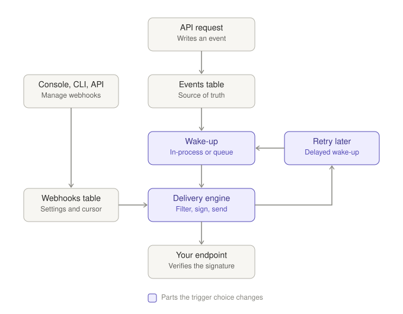

# ADR 090: Project Webhooks

> **Status:** Proposed
> **Date:** 2026-11-11
> **Builds on:** [ADR 029](029-cryptography-secrets-and-key-lifecycle.md)
> (secret encryption), [ADR 047](047-dialect-id-generation.md) (ids),
> [ADR 048](048-wide-events-internal-audit-primitive.md) (events),
> [ADR 049](049-events-api-retention-export.md) (sinks, cursors, the shipper),
> [ADR 061](061-egress-policy-user-injectable-urls.md) (egress) and
> [ADR 064](064-cli-resource-commands.md) (CLI resources).
> **Amends if accepted:**
> [ADR 049 §3](049-events-api-retention-export.md#3-external-export-per-sink-delivery)
> (a project's webhooks are a resource of their own, not project-scoped sinks)
> and [ADR 047 §2](047-dialect-id-generation.md) (registers the `hook`
> prefix).
> **Related:** ADR 091, proposed apart from this one (versions of event
> payloads).

## Context

A project's events reach the outside in two ways today: `GET /events`, and the
shipper, which POSTs every event to the sinks named in the server's
configuration ([ADR 049](049-events-api-retention-export.md)). Those sinks are
the operator's. A customer cannot point their own endpoint at their project's
events, choose which events it gets, or check that a request came from Zitadel.

Much of what that needs exists:

- the shipper delivers events in order from a cursor, at least once, and
  lists only settled events;
- the spec documents one webhook per event type, whose body is the event as
  `GET /events` returns it;
- `webhook.read`, `webhook.write` and `webhook.delete` are reserved scopes,
  and the resource map sketches the resource.

**In scope:** a webhook resource a project's administrators manage; a filter
by event type; a signature on every delivery and the secret behind it;
delivery to customer-chosen URLs; a version pin; API, console and CLI.

**Not in scope:** a log of every delivery attempt; retrying each event on its
own schedule; filters other than the event type; team-scoped webhooks;
sending a test event;
versions of the payload (§6).

## Decision

### 1. The webhook resource

A webhook is a row of its own table, `webhooks`, owned by one project. Its
delivery cursor is two columns on that row. It is a runtime resource: no
release pins it, so a deploy or a rollback never changes where events go.

The operator's sinks stay as ADR 049 has them, in `event_sinks` with their
cursors per project. ADR 049 sketched a project's webhook as one more row
there. A webhook belongs to one project, so it needs no cursor table, and
`event_sinks` identifies a sink by its URL, which two webhooks may share.

```jsonc
{
  "id": "hook_01KWH3B7K2M9P4R6T8V0X2Z4C6",
  "project_id": "proj_01JD2Q6V3R8M5K7N9P1T4W6Y8A",
  "url": "https://api.acme.com/hooks/zitadel",
  "description": "User sync",
  "event_types": ["user.created", "user.updated", "user.deleted"],
  "enabled": true,
  "last_delivered_at": "2026-11-11T10:00:12Z",
  "last_error_at": null,
  "last_error_status": null,             // the HTTP status; null with no response
  "last_error_reason": null,             // why there was no response (§10)
  "previous_secret_expires_at": null,
  "created_at": "2026-11-11T10:00:00Z",
  // Only in the responses to create and rotate_secret:
  "secret": "whsec_…"
}
```

- **`id`** carries the `hook` prefix, minted when the row is inserted
  ([ADR 047](047-dialect-id-generation.md)). The operator's sinks keep `sink`:
  they are named in the server's configuration and are not an API resource.
  No `sink_` id is in the spec yet, so nothing public changes. Error codes are
  `webhook.*`, as an application's are `application.*` beside its `app`
  prefix.
- **`url`** is `https`, at most 2048 characters, with no userinfo. A
  self-hosted server's operator may also allow `http` (§10).
- **`event_types`** holds event types as `GET /events` names them, each
  once, or the single entry `*`. It is never empty.
  - `*` is every type the server writes, those added later included, except
    `request.api`. That type is every API call, and a receiver that calls the
    API for each event it gets would feed itself. It is delivered only when
    named.
  - The list is checked against the types the server writes, on write only.
    A stored type the
    running server does not know matches nothing and is not an error, so a
    retired type and a rolled-back server both keep the webhook working.
- There is no `status` field. A webhook is failing when `last_error_at` is
  later than `last_delivered_at`, and a reader works that out: a field that
  only restates two others is one more thing to keep true.
- A project holds at most 10 webhooks. Two projects, or two webhooks of one
  project, may name the same URL.
- Deleting a project deletes its webhooks.

### 2. What an endpoint receives

```http
POST /hooks/zitadel
Content-Type: application/json
webhook-id: evt_01HZY…
webhook-timestamp: 1794391200
webhook-signature: v1,K5oZfzN95Z9UVu1EsfQmfVNQhnkZ2pj9o9NDN/H/pI4=

{
  "id": "evt_01HZY…",
  "type": "user.created",
  "created_at": "2026-11-11T10:00:00Z",
  "project_id": "proj_abc",
  "actor":  { "type": "human", "id": "user_xyz" },
  "entity": { "type": "user",  "id": "user_123" },
  "data": { "schema_id": "sch_…", "attribute_keys": ["email", "name"] }
}
```

- The body is one envelope for every event type, every field always
  present: the event's `id`, its `type`, `created_at` and `project_id`, who
  caused it (`actor`) and what it is about (`entity`), each `null` when the
  event has none, and `data`. An event that names only a type or only an id
  keeps the object, with the other half `null`.
- `data` is the event's payload as stored, already redacted
  ([ADR 048](048-wide-events-internal-audit-primitive.md)), `{}` when empty.
  It is not the resource. A receiver that needs more reads the resource by
  `entity.id`, or the whole event with `GET /events/{id}`.
- The spec describes the envelope once and types `data` per event type from
  the payload schemas `GET /events` uses.
- The operator's sinks are not this: they keep receiving the event as
  `GET /events` returns it, unsigned (ADR 049).
- The headers and the signature follow
  [Standard Webhooks](https://www.standardwebhooks.com/): HMAC-SHA256 over
  `{webhook-id}.{webhook-timestamp}.{body}`, base64, with the bytes sent as
  the body.
- `webhook-id` is the event's id. It is the same on every retry, so a
  receiver drops duplicates by it.
- `webhook-timestamp` is the time of the attempt, not of the event, so a
  retry hours later still passes a receiver's five-minute tolerance.
- Any `2xx` acknowledges. The response body is ignored.

### 3. The secret

- The server generates it: 32 random bytes, shown as `whsec_` and their
  base64. A caller cannot choose it.
- It is returned once, in the response to create and to `rotate_secret`. No
  other response, event or log carries it.
- A repeated create makes a second webhook and a repeated rotation rotates
  again; neither takes an `Idempotency-Key`, because the server keeps no
  record of one for any operation (see Open questions).
- It is stored encrypted with the project's secret encryption key
  ([ADR 029](029-cryptography-secrets-and-key-lifecycle.md)), through the
  `KeyService` the variable service encrypts a secret variable with. It is not a variable: a variable is frozen per deployment and
  split by target kind ([ADR 069](069-variables-per-kind-frozen-per-deployment.md)),
  and one name holds one value.
- `rotate_secret` issues a new secret and keeps the previous one valid for 24
  hours. During that time every delivery carries two signatures, one per
  secret. A second rotation inside the window drops the older of the two.
- A webhook whose secret cannot be decrypted fails its deliveries. Nothing is
  ever sent unsigned.

### 4. Delivery



The shipper delivers, with the cursor and the settled-events bound of
ADR 049. The events table and each webhook's cursor decide what is sent. A
wake-up only says that a project has something new:

- A server that runs until it is stopped wakes its own shipper when a
  request has written an event, and checks on a timer besides.
- A server that runs only while it serves a request, as the hosted cloud's
  does, calls a wake hook the operator configures. On the hosted cloud that
  hook is a function beside the server
  ([ADR 084](084-hosted-cloud-business-systems.md)): it publishes a message
  to a queue, whose consumer calls the server's delivery path for the
  project. A retry is a delayed message. The server itself knows no queue.
- A lost wake-up loses no event: the next one in the project delivers
  everything after the cursor. The hosted cloud also has a scheduler call
  the delivery path once an hour, so a quiet project does not wait for its
  next event.

What changes for a project's webhook:

- **Start.** The cursor is set when the webhook is created, so a new webhook
  gets no history. Changing `url` keeps the cursor.
- **Filter.** An event whose type the webhook does not list is skipped, and
  the cursor moves past it.
- **Order.** Events arrive in `(created_at, id)` order. A failed delivery
  holds back the events after it, for that webhook only.
- **Retry.** After a failure the next attempt waits, from 5 seconds doubling
  to at most 1 hour. A success resets it.
- **Giving up.** A webhook that has failed for 3 days without a success, or
  that answers `410`, is disabled and a `webhook.disabled` event is written.
- **Enabling** a disabled webhook sets its cursor to now: what happened while
  it was disabled is not sent. A failing webhook keeps its backlog for as
  long as retention holds the events.
- **Before the claim** a project's webhook delivers nothing (ADR 049 §4).
- **Egress.** The URL is the customer's, so every request goes through the
  hardened client of [ADR 061](061-egress-policy-user-injectable-urls.md). A
  redirect is a failure, not followed. Each request has a 10 second deadline.
  §10 has what an operator may open beside it.
- **One sender.** A server takes a time-limited lease on a webhook before it
  ships it, so replicas do not each deliver every event.
- **Isolation.** Webhooks ship concurrently, each within its own time budget,
  so a slow endpoint delays only itself.

### 5. Events

`webhook.created`, `webhook.updated`, `webhook.deleted`,
`webhook.secret_rotated` and `webhook.disabled` join the
[catalog](../design/api/events-catalog.md), and a webhook can subscribe to
them. Their payloads hold `url` without its query, `description`,
`event_types` and `enabled`, and never the secret.

### 6. Versions

A webhook carries no version. Versions of event payloads are proposed apart
from this ADR, as ADR 091. If they are accepted, a webhook gains a pinned
version then, and every webhook that exists takes the first one: with one
shape in existence there is nothing to guess.

Until then the rule for a payload is the catalog's: fields and event types
may be added, and a receiver ignores what it does not know.

### 7. API

| Operation | Request | Permission |
|---|---|---|
| List | `GET /webhooks` | `webhook.read` |
| Get | `GET /webhooks/{id}` | `webhook.read` |
| Create | `POST /webhooks` | `webhook.write` |
| Update | `PATCH /webhooks/{id}` | `webhook.write` |
| Delete | `DELETE /webhooks/{id}` | `webhook.delete` |
| Rotate the secret | `POST /webhooks/{id}/rotate_secret` | `webhook.write` |

- The paths are flat and name the project as `/invitations`, `/idps`,
  `/policies` and `/variables` do. `/projects/{project_id}/…` holds only a
  project's own properties.
- Every operation takes an API credential with the scope, or the console's
  session cookie.
- Create takes `url`, `event_types` and optionally `description`. `PATCH`
  takes those and `enabled`, and at least one of them.
- Delete removes the row. There is no deleted state.
- The three permissions are the reserved scopes, added to the system catalog.
  A team-scoped credential holds none of them.

### 8. Console

A project gets a Webhooks page: the list with each webhook's status and last
delivery, a form to add one, and a page per webhook to edit it, enable or
disable it and rotate its secret.

- The form chooses event types from the list Logs filters by, grouped the
  same way, or "All events".
- The secret is shown once, in a dialog after create and after rotate.

### 9. CLI

`zitadel webhook list`, `get`, `create`, `update`, `delete` and
`rotate-secret`, by the grammar of [ADR 064](064-cli-resource-commands.md).
`create` and `rotate-secret` print the secret once; with `--json` it is
`data.secret`. No flag takes a secret.

### 10. A self-hosted server

Delivery needs nothing but the server and its database: no queue, no
function and no scheduler (§4). What a self-hosted server changes is which
endpoints a webhook may name. The defaults are the hosted cloud's, `https`
and public addresses only, and an in-cluster receiver or a developer's
machine is neither.

- **Two settings, both off.** They are the operator's and apply to webhooks
  only:
  - `events.webhooks.allow_list` re-allows addresses and host names the deny
    list of ADR 061 blocks, in the form `httpclient.allow_list` takes.
    Deliveries are allowed what either list allows.
  - `events.webhooks.allow_http` lets a webhook's `url` be `http`. The
    contract's pattern takes both schemes, and a server without the setting
    refuses `http` with `webhook.invalid`.
- **The local runtime** (`zitadel start`) sets both for loopback, so
  `http://localhost:3000/hooks` works with no tunnel.
- **Refused when written.** Create and update answer `webhook.invalid` for a
  `url` whose host is an address or a name the server would not deliver to.
  A name that only resolves to such an address is found at delivery.
- **Why a delivery got no response.** `last_error_reason` is set with
  `last_error_at` when `last_error_status` is null, and null otherwise:
  `blocked_address`, `dns`, `connect`, `tls`, `timeout` or `redirect`. It is
  a closed list, never the client's error text, which holds the URL.
- **Delivery switched off.** With `events.webhooks.enabled: false` create,
  update and `rotate_secret` answer `webhook.delivery_disabled`. Reads and
  delete keep working, and the console says that the server sends nothing.
- **No proxy.** The egress client connects directly (ADR 061 decision 4), so
  a server that reaches the internet only through a proxy delivers to no
  webhook outside its network.
- **Certificates** are checked against the operating system's trust store.
  An operator adds a private authority there; the server has no setting.
- **Limits are constants.** Ten webhooks per project, the 10 second
  deadline and the 3 days before a webhook is disabled are the same on every
  server.

## Open questions

- **The hosted cloud's queue.** Vercel Queues is in beta, nothing has run
  against it yet, and
  [ADR 084](084-hosted-cloud-business-systems.md) decided against a queue of
  our own for usage. Here it is one message per project with something new,
  not one per event.
- **A lost rotate response.** Rotating again drops the secret the endpoint
  still uses, so its deliveries fail until it has the newest one. An
  `Idempotency-Key` would let the caller repeat the request and get the same
  secret, and needs an idempotency store the server does not have.
- **`http` to a public address.** `allow_http` permits `http` to every
  address the server may reach, the public ones included, where the event is
  readable on the way. Limiting `http` to what `events.webhooks.allow_list`
  names would close that and make one setting depend on the other.

## Consequences

- A broken endpoint loses the events that age out of retention while it
  fails. `events_purged_undelivered` counts them, per ADR 049.
- One event an endpoint always refuses holds back the events after it until
  the webhook is disabled. Per-event retries would remove that and need the
  jobs table of [ADR 065](065-background-jobs.md).
- A webhook's page shows the last result, not a history of attempts.
- One new table on all three dialects. `event_sinks`, its cursors and the
  operator's export are untouched.
- The shipper reads two sources: the operator's sinks with their cursor
  table, and webhooks with the cursor on the row.

## Rejected alternatives

- **A secret the caller chooses, or a `${{ NAME }}` variable.** A chosen
  secret can be weak and would pass through a command line or a file. A
  variable changes only with the next deploy, comes back with a rollback, and
  cannot hold the two secrets a rotation needs.
- **Stripe's `t=…,v1=…` header.** It carries the same HMAC. Standard Webhooks
  has verification libraries in most languages, so the SDKs need not ship one
  each.
- **Paths under `/projects/{project_id}/webhooks`**, as the resource map
  sketched. Every project-scoped resource added since is flat.
- **A `status` field, a failure counter and a nested `last_error`.** Each
  restates what `enabled` and two timestamps already say.
- **Webhooks as project-scoped rows of `event_sinks`**, with `sink_` ids, as
  ADR 049 sketched. It needs the unique key on a sink's URL taken apart, a
  second way to delete cursors and, on SQLite, both tables rebuilt, to save
  one table.
- **The event as `GET /events` returns it, as the body.** Its optional
  columns come and go, so no two types have the same keys, and a receiver
  written for one cannot rely on the next. It also sends every correlation
  column to an endpoint that mostly wants to know what happened to what.
- **The whole resource in `data`**, as Stripe's `data.object` is. It would
  send what the audit rules keep out of events, and cost a read per
  delivery.
- **`httpclient.allow_list` for a self-hosted server's private endpoints.**
  It also opens schema and identity-provider fetches to the same addresses,
  for every project on the server, and it does nothing about `http`.
- **A proxy for deliveries.** The dial-time address check would see the
  proxy, not the endpoint the proxy reaches (ADR 061 decision 4).
- **The client's error text as the reason.** It holds the URL, whose path or
  query may be a token.
- **Webhooks as release configuration.** The URL differs per environment, and
  a rollback would redirect events.

## Documentation impact

- [ADR 049](049-events-api-retention-export.md) gets an amendment note for §3,
  and [ADR 047](047-dialect-id-generation.md)'s registry the `hook` row.
- [`resource-map.md`](../design/api/resource-map.md),
  [`system-permission-catalog.md`](../design/api/system-permission-catalog.md)
  and [`events-catalog.md`](../design/api/events-catalog.md).
- On implementation: the spec, the CLI's
  [`SKILL.md`](../../apps/cli/skills/zitadel-cli/SKILL.md), and a docs page on
  verifying a signature.
- [`configuration.md`](../quick-start/configuration.md) for §10's two
  settings and the missing proxy, and the signature guide, which should say
  "`https` and public addresses" of the hosted cloud only.
