# ADR 090: Release Pinning

> **Status:** Proposed
> **Date:** 2026-11-25
> **Context:** [#1635](https://github.com/zitadel/nextgen/issues/1635)
> **Related:** [ADR 035](035-configuration-environments.md),
> [ADR 081](081-customer-hosted-login-and-oidc-provider.md)

## Context

An app's code and its sign-in configuration are deployed separately. Zitadel
serves each sign-in the newest release deployed to the app's origin. So the
two can fall out of step, a problem known as version skew: when the app is
rolled back on its host, or when a browser tab still runs an older build of
the app. For example, a new release adds a required field to the sign-up step,
and an older build of the app does not know how to show it.

Hosts solve the same problem for the app's own backend. Vercel's
[skew protection](https://vercel.com/docs/skew-protection) keeps an older
client talking to the deployment it was built with, by sending that
deployment's ID with each request. Release pinning does the same for the
sign-in configuration, which the host does not deploy.

A rollback, for example:

```mermaid
sequenceDiagram
    participant Host as App host
    participant Browser
    participant Zitadel
    Note over Host,Zitadel: App v1 is built against release R1. Both are deployed.
    Host->>Host: Deploy app v2, built against R2
    Zitadel->>Zitadel: Deploy R2 to the app's origin
    Host->>Host: Roll back to app v1
    Browser->>Zitadel: Start a sign-in from app v1
    Note over Zitadel: Without a pin: serves R2, which app v1 was not built for
    Note over Zitadel: With a pin to R1: serves R1, so app and configuration match
```



## Decision

A build of the app can pin the release it was built against.

- The build sends the release ID in the `X-Zitadel-Release` header when it
  starts a sign-in.
- The server first finds the target from the request's `Origin`, as it does
  today. It then serves the pinned release, if that release was deployed to
  this origin.
- A release that was never deployed to the origin, or that was revoked, is
  refused with an error the app can show.
- A pinned request without an `Origin` is refused too. Without a pin, such a
  request gets the project's newest deployment; with one, that would silently
  serve a different release than the one asked for.
- The rest of the sign-in stays on the same release, as it does today.

A pinned sign-in start:

```http
POST /flows HTTP/1.1
Origin: https://app.example.com
X-Zitadel-Release: rel_01KB3F7Y4Q2M8XVN

{ "project_id": "proj_01K9AA9M3K7E2QX8VB4T", "purpose": "login" }
```

`rel_01KB3F7Y4Q2M8XVN` was deployed to `https://app.example.com` earlier, so
the sign-in runs on it even though a newer release is live there. A release
that was never deployed to the origin is refused:

```http
HTTP/1.1 409 Conflict

{
  "code": "rel.not_deployed",
  "details": { "origin": "https://app.example.com", "release": "rel_01KA9D2C6T1R5HJM" }
}
```
- Pinning is optional. Without the header, nothing changes.

## Security concerns

The header is not a secret. Anyone can send it with any release ID.

- It can only select a release that was deployed to the same origin. It
  cannot reach other origins, other projects, or revoked releases.
- But every release ever deployed to the origin stays selectable until it is
  revoked. That includes older releases with weaker settings, such as a
  shorter password, no second factor, or an identity provider that was
  removed.
- So after a deploy that tightens security, the older releases must be
  revoked. Revoking works one release at a time, and a revoked release can no
  longer be deployed or rolled back to.
- Hosts face the same risk: Vercel keeps an older deployment reachable only
  for a maximum age, 12 hours by default, and a deployment with a bug stays
  reachable until it is deleted. Release pinning has no such limit yet.

## Future possibilities

- **A/B testing.** Today a release must go live on the origin before it can be
  pinned there, so a variant cannot be tested without first serving it to
  everyone. A staged deployment, which makes a release available on an origin
  without serving it, would allow two releases side by side, with the app
  choosing one per visitor.
- **A pinnable flag.** Only releases marked as pinnable could be pinned. This
  limits what a forged header can reach, and can be undone, unlike revoking.
- **A limit on how far back a pin reaches**, such as a maximum age as Vercel
  has, or the last few deployments to the origin. Past its limit Vercel serves
  the newest deployment; whether a pin past the limit gets the newest release
  or an error is open.
- **Pinning by content.** A digest of the release's content, instead of its
  ID, would let the same build work across projects.
