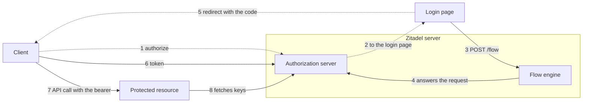

# OAuth Server: One Server for Customers' Applications and Zitadel's Own Clients

> **Status:** Draft for discussion. An investigation, not a decision: it
> proposes an order of work and names what blocks it.
>
> **Date:** 2026-11-05, revised 2026-11-06 to follow #1425's first scope
>
> **Builds on:** [ADR 081](../../adrs/081-customer-hosted-login-and-oidc-provider.md),
> [ADR 082](../../adrs/082-oauth-and-oidc-server.md), the
> [identity model](identity-model.md),
> [#1283](https://github.com/zitadel/nextgen/issues/1283) (applications: the
> resource and access model),
> [#1425](https://github.com/zitadel/nextgen/issues/1425) (connect an
> application with OIDC, the epic), and two open prototypes:
> [#2452](https://github.com/zitadel/nextgen/pull/2452) (applications,
> clients and APIs) and
> [#2451](https://github.com/zitadel/nextgen/pull/2451) (the platform
> project's authorization server, the CLI and MCP clients)
>
> **Related:** [#375](https://github.com/zitadel/nextgen/issues/375) (MCP
> authorization), [#560](https://github.com/zitadel/nextgen/issues/560) (the
> project secret out of the browser path)
>
> **Sources:** `main`, the two PR branches and the issues as read on the
> dates above. Nothing here was run. What #2451 is said to do beyond its
> `apps/api/internal/oauth` package comes from its description and its
> [findings](https://github.com/zitadel/nextgen/blob/claude/poc-platform-oauth-415a8f/docs/design/api/platform-oauth-poc-findings.md).

## Goal

Zitadel needs an authorization server twice:

- **For customers:** a customer's applications, third parties and MCP
  clients sign users in to the customer's project, with the customer's login
  app as the issuer (ADR 081, ADR 082). #1425 builds this first, for a web
  application.
- **For itself:** the `zitadel` CLI and MCP clients sign a developer in to
  the platform project and call Zitadel's API as that person. #2451
  prototypes this.

This note says how both become one server on the structure the repository
has, where the epic and the prototypes differ, and which packages carry the
result to customers.

Names follow #1283: an **application** is the product, a **client** its
technical integration, an **API** what it serves. ADR 082, the identity model
and both PRs say *app* for the first. Here an *app* is only a customer's
running software, as in *login app*.

## One server, two issuers

Build one authorization server in `apps/api`, switched on per project. The
epic starts with a customer's project
([#2793](https://github.com/zitadel/nextgen/issues/2793)). The platform
project then turns the same server on, and differs in three places, which
#2451's findings name.

| | Customer project | Platform project |
| --- | --- | --- |
| Issuer | The login app's origin, from a primary pattern (ADR 081 §5) | `server.public_base`'s origin, which the console shares |
| Login app | The login in the customer's app | The console's `/login` |
| Applications | Declared in the release or registered through the API | One built-in application in the binary |
| Browser endpoints | Under the app's `/__nextgen/oauth/{project_id}/` | On the server |
| Switch | `.zitadel/oauth.json` in the release | `platform.oauth.enabled` in the server's config, in #2451 |

The server is part of the Zitadel binary, and should stay there: it needs the
project's keys, the flow engine, sessions and the token records in one
transaction. What must not be fixed is the project it serves.

Customers get no protocol code. They get the server, and package releases
that make the login app they already have the front door (ADR 081 §13).

## How the parts talk

The same eight calls serve both issuers. A dotted line runs through the
user's browser; a solid one is a direct call.



| Part | A customer's project | Zitadel's own |
| --- | --- | --- |
| Client | The customer's web applications, third parties, MCP clients | The `zitadel` CLI, MCP clients |
| Login page | The app's login page: `<zitadel-login>` behind the SDK proxy | The console's `/login`, with `<zitadel-login>` |
| Flow engine | The server | The same server |
| Authorization server | The server; the issuer is the app's origin | The same server; the issuer is its own origin |
| Protected resource | The customer's API or MCP server, which the SDK protects | Zitadel's API and `/mcp`, in the server |

What differs in a customer's project:

- Calls 1 to 3 reach the server through the app's SDK proxy, under
  `/__nextgen`, since they need the issuer's cookies (ADR 081 §6).
- Calls 6 and 8 go straight to the server's public origin, so a refresh
  never depends on the login app.
- Call 8 is a real fetch of the JWKS. Zitadel's own API verifies with the
  keys the server already holds.

The epic's first scope stops at call 6: a web application signs a user in
and has no protected API yet.

## Wiring the platform project

Three things are easy to mix, and each has its own home:

| Thing | Belongs to | Configured in |
| --- | --- | --- |
| The authorization server: issuer, keys, endpoints | The project, which has one issuer | The project's OAuth settings, `.zitadel/oauth.json`, a singleton like branding |
| Applications: clients, and the APIs they may get tokens for | The project, one document each | A file per application, or `POST /applications` |
| Resource servers: what accepts a token | The software that hosts the API | Code: the API's own check of the token's audience |

So the server is never part of an application, and an application never
configures the server. An application is registration data: who may ask
for tokens, and for which API.

The hook for the platform project exists on `main`. On every start,
[`deploy.go`](../../../apps/api/internal/bootstrap/platform/deploy.go) builds
the configuration the server ships into a release and deploys it to the
console's origin, which it makes the project's one primary origin. With
that:

1. **The switch.** The built-in bundle carries the OAuth settings when the
   operator sets `platform.oauth.enabled`. The server then asks one question
   of every project: does its deployed release turn the issuer on?
2. **The issuer.** An issuer must be a primary origin of its project
   (ADR 081 §5), and the console's origin already is the platform project's.
   The carve-out left in §5 is only that this origin is also the server's.
3. **The application.** The `zitadel` application ships in the same bundle
   as a document, in place of #2451's `PlatformApp()` in Go, and is then
   stored and found like any declared application. #2452's `builtin` source
   goes away.
4. **The login page.** In a customer's project the SDK proxy names it on
   every request it forwards (`X-Zitadel-Login-Path`, `/login` by default,
   ADR 081 §7). The platform project has no proxy, so the server takes the
   path from the project's link target (ADR 081 §4) and not from a
   hard-coded console path: the console sits at `/ui/console/` on a
   self-hosted server and at `/console/` on the cloud.
5. **The resource servers.** The management API's security handler and
   `/mcp` each accept a token whose audience is their own identifier. `/mcp`
   leaves the `oauth` package.

The document, with the fields of #2452's application schema and the values
of `PlatformApp()`. The bundle is rendered with the public base at start, as
it is today for the schema and the flows:

```json
{
  "slug": "zitadel",
  "name": "Zitadel",
  "clients": [
    {
      "slug": "cli",
      "name": "Zitadel CLI",
      "client_id": "cli",
      "type": "public",
      "grant_types": ["authorization_code", "refresh_token"],
      "redirect_uris": [
        "http://127.0.0.1/callback",
        "http://[::1]/callback",
        "http://localhost/callback"
      ],
      "apis": [{ "api": "platform" }, { "api": "mcp" }]
    }
  ],
  "apis": [
    { "slug": "platform", "name": "Zitadel API", "identifier": "<base>/api/v1" },
    { "slug": "mcp", "name": "Zitadel MCP server", "identifier": "<base>/mcp", "third_party": true }
  ],
  "registration": { "client_id_metadata_documents": true }
}
```

What it says, and what it leaves out:

- `cli` is the one client Zitadel declares. The CLI compiles in only that
  client id and finds everything else through the metadata.
- `platform` and `mcp` are APIs, the audiences of tokens. They are not
  clients, and the entry does not configure the MCP server.
- MCP clients such as Claude Code are not listed. They register themselves
  and join the application through `registration`, as third parties, and
  only for an API marked `third_party`.
- The console is not listed. It shares the server's origin and keeps its
  session cookie.

What stays special to the platform project:

- Its browser endpoints sit on the server, since the console shares the
  origin and no SDK proxy stands in front.
- The server answers the root `/.well-known/` document for the project that
  owns that origin as primary, which is the platform project.

## What `main` has to build on

| Piece | Where | What it gives |
| --- | --- | --- |
| Flow engine | [`flow.go`](../../../apps/api/internal/api/flow.go) | `POST /flow` already takes `auth_request_id`, and keeps its state in a sealed cookie |
| Widget | [`zitadel-login.ts`](../../../packages/components/src/orchestrator/zitadel-login.ts) | Already navigates to a `redirect_uri` the server computes |
| Tokens | [`token_type.go`](../../../apps/api/internal/domain/token_type.go) | The `tokens` table reserves `oidc_access_token` and `oidc_session_id` |
| Keys | [`keys.go`](../../../apps/api/internal/service/keys.go) | A signing key and a crypter per project; `zitadel/oidc` is a dependency |
| Authorization | [`security.go`](../../../apps/api/internal/api/security.go) | `ScopeContext`, and ADR 053's resolver for a platform user's projects |
| Sessions | `POST /sessions/exchange` | The handoff that lands a session on the app's origin (ADR 073) |
| Upstream sign-in | [`internal/idp`](../../../apps/api/internal/idp) | Redirect validation and a cookie that binds a callback to a browser |
| Releases | `.zitadel/` and `POST /releases/build` | The vehicle for declared applications, APIs and OAuth settings |
| SDK proxy | [`middleware.ts`](../../../packages/sdk-core/src/middleware.ts) | `/__nextgen`, with cookie renaming and redirect filtering |
| CLI | `setup`, `doctor --fix` | The way generated files reach apps that already exist |

Missing on `main`:

- any authorization server (`apps/api/internal/oauth` is #2451's);
- the application resource
  ([#2788](https://github.com/zitadel/nextgen/issues/2788), which #2452
  prototypes);
- a `/mcp` endpoint on the server;
- ADR 081's reservation release: the SDKs forward neither
  `/.well-known/` path and send no `X-Zitadel-Login-Path`.

## The epic and the two prototypes

#1425 scopes the customer's side as issues. #2452 and #2451 covered much of
the same ground earlier, for the platform project and for public clients.

| Epic issue | Asks for | Prototype has | Differs in |
| --- | --- | --- | --- |
| [#2788](https://github.com/zitadel/nextgen/issues/2788), [#2790](https://github.com/zitadel/nextgen/issues/2790) applications | `POST /applications`, `.zitadel/applications/<slug>.json`, `zitadel application create` | #2452: `POST /apps`, `.zitadel/apps/<slug>.json`, `zitadel apps create`, revisions, `AppDirectory` | Names. #2452 also stores clients that register themselves, and serves built-in applications |
| [#2791](https://github.com/zitadel/nextgen/issues/2791) client credentials | A first secret at create, or `${{ NAME }}` in the file; no credentials resource yet | #2452: named secrets and keys as a resource of their own | #2452 is wider |
| [#2792](https://github.com/zitadel/nextgen/issues/2792) web preset | One preset | #2452: eight presets | #2452 is wider |
| [#2793](https://github.com/zitadel/nextgen/issues/2793) switch and metadata | `.zitadel/oauth.json` per project; the issuer from the forwarded headers | #2451: a server config flag, one project, the issuer from `server.public_base` | Per project against one project |
| [#2794](https://github.com/zitadel/nextgen/issues/2794) authorization endpoint | PKCE, `iss`, exact redirect URIs, the deployment sealed in the flow | #2451: all of it but the deployment, and it requires `resource` | The deployment, and `resource` |
| [#2795](https://github.com/zitadel/nextgen/issues/2795) customer-hosted login | The SDK's reservation release; the widget's handle; the application on every response | #2451: the widget's handle and the consent step, in the console | No SDK part |
| [#2796](https://github.com/zitadel/nextgen/issues/2796) token endpoint | Client secrets, basic and post; no refresh tokens yet | #2451: public clients only; rotating refresh tokens and revocation | Opposite halves |
| [#2797](https://github.com/zitadel/nextgen/issues/2797) keys and JWKS | RS256, ES256 where chosen, JWKS per project, `at+jwt` | #2451: the same | Nothing found |
| [#2800](https://github.com/zitadel/nextgen/issues/2800) cloud routing | Rules for the server's new paths | Neither | Not built |
| [#2801](https://github.com/zitadel/nextgen/issues/2801) ID token and discovery | Phase 2, on top of the OAuth server | Neither | Not built |

The two meet at the foundation: applications, authorize, keys and the
widget's handle. Past that they deliver different things first. The epic's
first scope is a confidential web application that gets an ID token. #2451
has public clients, consent, registration, refresh tokens and a protected
API, which the epic set aside on 2026-11-05
([#2798](https://github.com/zitadel/nextgen/issues/2798),
[#2799](https://github.com/zitadel/nextgen/issues/2799) and others, closed as
not planned for now).

### Where the prototypes leave #1283's model open

| #1283 or #1425 says | The prototypes | Kind |
| --- | --- | --- |
| Every client belongs to one application | A client that registers itself sits at the project until its first request names an API; a client ID metadata document has no record | A gap in #1283, which the identity model fills and MCP relies on |
| Users and teams get access to the application | Authorize checks the client, the redirect URI, the grant type and the scopes, never the user's access to the application | Missing. Adding it later refuses users who could sign in before |
| The client is the principal when acting as itself | A token's `sub` is always a user; `main` has no `client` principal type | Not built |
| Applications can be owned by teams; each customer authorizes a shared partner on its own (scenarios 2, 3) | No owner on the document; a consent is per user, client and API | Missing. A customer's authorization is a grant, not a consent |
| A user-authorized request is limited by what the integration was granted (scenario 4) | A token carries every grant of the user | Missing: the scope ceiling |
| Applications and clients are deactivated, machines suspended (scenario 5) | The document has no status | Missing |
| No Zitadel-hosted login | The console answers the platform project's requests | Holds for customer projects; ADR 081 §5 needs its carve-out |
| The glossary: `app` is one client, `app_group` is locked | The new names throughout | Stale; its update is set aside ([#2812](https://github.com/zitadel/nextgen/issues/2812)) |

The hierarchy, several clients per application, presets instead of
application types, credentials per client and one audience per token all
match.

## What #2451 settles

Worth keeping, whichever code carries it:

- **The split of work.** The package owns authorize and registration;
  `zitadel/oidc`'s `op.Server` answers token, revoke and JWKS. The library's
  authorize has no `resource`, no `iss` on errors, and renders errors it
  should redirect. #2794 and #2796 say the same.
- **No `auth_requests` table.** Authorize seals the request into a handle, a
  cookie per request binds it to the browser, and the flow carries it in its
  own cookie.
- **Consent is a step the engine inserts,** under a reserved name a flow
  definition cannot use.
- **One audience per access token** (RFC 8707). It kept a third-party MCP
  client out of the management API with no scope vocabulary.
- **Two security schemes on one header:** `pat` for a secret, `oauth2` for a
  person's token, with the app plane left to the secret.
- **The redirect matcher:** one decode, one parse, and the browser is sent to
  the URL that was checked.
- **Signing keys per algorithm,** minted when first needed, RS256 unless an
  API chooses ES256.
- **Clients through #2452's `AppDirectory`,** so a built-in application, a
  declared one and a registered one are found the same way.

## The three kinds of client

| Client | Shape | State |
| --- | --- | --- |
| Web application | Confidential, with a backend that holds a client secret | The epic's first scope. Not in #2451 |
| CLI | Public, first party, loopback redirect on any port, PKCE | Prototyped in #2451: `login`, `whoami`, `logout`, and project commands as the developer |
| MCP client | Public, third party, registers by client ID metadata document or RFC 7591, always sends `resource` | Prototyped in #2451 against a stub `/mcp` with one tool; Claude Code connected in the proof of concept |

What the epic's web application needs that #2451 lacks:

- the issuer and the project from the request (#2793);
- client authentication at the token endpoint by secret (#2796); #2452's
  `AppDirectory` already offers the check;
- an ID token and `openid-configuration` (#2801);
- an authorization request without `resource`, which #2451 refuses: the
  first scope has no protected API to name.

Set aside by the epic for now: `private_key_jwt`, refresh tokens and
revocation, userinfo, RP-initiated logout, and browser-only and native
clients. Relying-party mode, with the handoff beside the tokens so a
first-party application keeps a Zitadel session (ADR 081 §12), comes after
those, and SPAs wait for #560 (ADR 081's question 7).

The console is no OAuth client while it shares the server's origin: it keeps
its session cookie.

## Scope: which apps become the issuer

One rule decides it: an app can be the issuer when it has a server runtime
for the SDK's proxy to run in. So for now, apps on a server framework can
become OAuth logins, and SPAs stay embedded logins.

| App | First scope | Later |
| --- | --- | --- |
| On a server framework: Next.js, Nuxt, SvelteKit, SolidStart, TanStack Start, Qwik Router | Keeps its embedded login and can become the issuer, with no change to its pages | Relying-party mode; protecting its own API |
| An SPA: React, Vue, Svelte, Solid, Angular or Qwik without a server | Stays an embedded login. Never the issuer | The issuer once #560 takes the project secret out of the browser path; a public client once those are back in scope (#2799) |
| The generated login app | The issuer for a customer with no app on a server framework (#2784) | Login-only, for open registration (ADR 082 §9) |
| An existing OIDC app with a backend, on any stack | A confidential client of the issuer, through the OIDC library it already uses | Refresh tokens, sign-out |

What "stays an embedded login" means for an SPA:

- Nothing changes: `<zitadel-login>` in its page, and the session cookie as
  today.
- It takes no part in a sign-in across several apps, unless a backend of its
  own is the client. A customer with an SPA and a second app puts the login
  in the generated login app and makes that the issuer.
- It is no issuer in development either. A loopback issuer that cannot go to
  production would only mislead.

### What the SDK does for an issuer

The whole job is forwarding. It holds no protocol logic (ADR 081 §13):

1. Forward the two root paths, `/.well-known/openid-configuration` and
   `/.well-known/oauth-authorization-server`, to the project's documents.
2. Forward the browser endpoints under `/__nextgen/oauth/{project_id}/`,
   beside what the proxy forwards today.
3. Name the login path on every forwarded request (`X-Zitadel-Login-Path`),
   replacing any value the browser sent.
4. Pass the request's host on, so the server derives the issuer and checks
   it against the project's primary origins.
5. Keep passing no redirect that leaves the app, as today. The widget makes
   the last redirect to the client.

Next.js reads its path list at build time, so its app also needs the
generated `matcher` entries, which `doctor --fix` writes. The other server
frameworks need the version bump alone.

The app that becomes the issuer gets no client id and no secret, and names
no issuer: the server takes it from the request. Only the app that signs in
with it is configured, with the issuer, its client id, its secret and its
redirect URI.

### What the CLI guards

`zitadel oauth enable`, and `zitadel application create` when it turns the
issuer on, refuse with the reason and the way out when:

- the app is an SPA, or sits under a base path, since the metadata has to be
  at the host's root: the answer names the generated login app;
- the SDK is older than the reservation release, or a Next.js app lacks the
  generated entries: the answer names `doctor --fix`;
- the project has no primary origin, or several: the developer picks one,
  and is told the issuer is permanent.

## OAuth 2.1 at the core, OpenID Connect as a layer

The server does not have to be an OpenID Connect provider to serve callers of
an API, such as the CLI and MCP clients. The line runs between calling an API
and telling another app who signed in. Only the second is OpenID Connect's
job.

| Client | Needs OpenID Connect | Why |
| --- | --- | --- |
| CLI | No | It wants an access token for the API, and reads the user from `GET /users/me` |
| MCP client | No | MCP asks for OAuth 2.1, resource indicators, and RFC 8414 and RFC 9728 metadata |
| First-party web application | Barely | Its session comes from the handoff (ADR 081 §12); the ID token is a check on the way |
| Third-party or off-the-shelf web application | Yes | It expects `openid-configuration`, an ID token and usually userinfo |

#2451 is an OAuth server as built: RFC 8414 metadata, no ID token, no
userinfo and no `openid-configuration`. It lists `openid` in
`scopes_supported` all the same.

The layer is additive:

- an ID token at the token endpoint, with `nonce`, `auth_time` and `sid`;
- `openid-configuration` beside the RFC 8414 document;
- RS256, which the access tokens already use for this reason (ADR 082 §7);
- later, a userinfo endpoint and the conformance suite as an end-to-end
  lane, both set aside for now
  ([#2802](https://github.com/zitadel/nextgen/issues/2802),
  [#2809](https://github.com/zitadel/nextgen/issues/2809)).

So:

- **OAuth 2.1 is phase 1 and OpenID Connect phase 2,** as the epic has it
  (#2793 to #2797, then #2801). Its first client is a web application, so
  phase 2 follows at once; the CLI and MCP clients never wait for it.
- **`openid` stays out of the metadata until #2801.**
- **The access token path never depends on the layer.** An API or an MCP
  server verifies a JWT in RFC 9068's profile and needs neither an ID token
  nor userinfo. One audience per token, scopes per API, client ID metadata
  documents and token exchange later all stay as they are.
- **No protocol of our own for identity.** A third-party web application
  learns who signed in through OpenID Connect or not at all; anything else
  costs customers their integrations.

The library is a separate matter. #2451 uses `zitadel/oidc` lightly:
`op.Server` routes token, revoke and JWKS, parses their forms and encodes
their errors. Authorize, registration, tokens, consent and storage are the
package's own, so the library's model binds nothing, and replacing those
three handlers later is a small job.

For [#2785](https://github.com/zitadel/nextgen/issues/2785) to record in the
ADRs:

- ADR 082's first release serves MCP clients, with userinfo and discovery
  (its step 2). The epic's first scope is a web application, with discovery
  in phase 2 and userinfo set aside.
- ADR 081 §7 reserves `/.well-known/openid-configuration`. It stays
  reserved, and answers `404` until #2801, while
  `/.well-known/oauth-authorization-server` answers from phase 1.

## Challenges

1. **The prototype serves one project.** #2451's `oauth.Server` holds one
   project id, one issuer and the console's path, its routes name the
   platform application's two APIs, and its `/mcp` handler sits in the same
   package. #2793 asks for the issuer and the project from the request: the
   path on the back channel, the forwarded host on the front channel. That
   rework decides whether the package becomes the epic's server.
2. **Two tracks over the same ground.** #2451 is about 40,000 added lines in
   344 files, some 14,000 of them hand-written, stacked on #2452. The epic's
   issues describe the same endpoints under other names. Both PRs are behind
   `main` and conflict with it, and their migrations are numbered against
   each other.
3. **Requests without `resource`.** #2451 refuses them, since it serves no
   userinfo. The epic's web application asks for an ID token and names no
   API.
4. **Scopes on Zitadel's own API.** A consented client acts with every grant
   of the developer. The proof of concept keeps third parties off the
   management API because nothing narrower exists, and Claude Code asked for
   every scope the metadata lists. `/mcp` cannot get real tools before checks
   intersect a principal's roles with the token's scopes
   ([identity model](identity-model.md#principals)).
5. **The front channel runs through the app.** The sealed request takes
   3.3 KB of the flow cookie's 4 KiB. Two requests in one browser still share
   `_zflow`. The SDK proxy passes no redirect that leaves the app, so every
   answer goes through the widget, across every SDK and the generated files
   that apps keep for months.
6. **Scripts on the issuer's origin.** Each acts with the user's session and
   can drive a request to the end. Open registration therefore needs a
   login-only issuer with a strict content security policy (ADR 082 §9). The
   platform project's issuer is the console's origin, which serves the whole
   console, and #2451's `oauth` package has no login-only handling.
7. **The first-party skip.** The CLI gets no consent step and returns to a
   loopback port, so any page can navigate a signed-in browser into issuing a
   code to a local port. PKCE protects the code from the page, not from a
   process listening there.
8. **Which release serves a request.** Authorize has no `Origin`, the code
   must carry its deployment to the token endpoint, and a refresh must
   resolve the newest one (ADR 081 §10). #2451 reads applications at their
   newest revision, with no deployment; #2794 seals one in the flow.
9. **Revocation.** Without introspection an access token outlives a revoked
   consent by up to five minutes. Whether signing out of the console ends
   the CLI's sign-in is undecided. Revoking a consent scans a project's
   tokens until an index exists.
10. **Deployment shape.** A `public_base` with a path is refused, since the
    metadata sits at the host's root. The cloud routes only the server's own
    paths to it, so the well-known paths, `/oauth/` and `/mcp` need rules
    (#2800). Client ID metadata documents need egress to hosts that clients
    choose, and their cache is per replica. Relying parties must reach a
    self-hosted server's back channel.
11. **The issuer is permanent.** Tokens and passkeys bind to it. Moving a
    login app to another domain breaks both.
12. **Contracts that change.** The CLI's fallback from a secret to a sign-in
    goes against the rule in
    [`credentials.ts`](../../../apps/cli/src/lib/oclif/credentials.ts), the
    `--json` envelope gains a field, the generated Go client's
    `SecuritySource` gains `Pat`, which breaks its implementers, and a flow
    definition can no longer name a step `consent` or `account_choice`.
13. **Not yet proven.** The Spanner lane and Claude Code against the current
    branch were not run, three of #2451's checks fail, and no end-to-end lane
    signs the CLI in through the console.

## What customers get

Each part ships in a package the customer already installs, so a fix is a
version bump and never a re-scaffold.

| Package | License | Carries |
| --- | --- | --- |
| `@zitadel/server` | AGPL | The protocol under `/oauth/{project_id}/`: authorize, token, JWKS, and later revocation, registration and consents |
| `@zitadel/sdk-*` | MIT | The reserved paths and the browser endpoints under `/__nextgen`; later, bearer verification with RFC 9728 metadata and `WWW-Authenticate`, the claims hook and relying-party mode |
| `@zitadel/components` | MIT | The authorization request's handle in `<zitadel-login>`; later, consent, account choice and a connected-apps element |
| `@zitadel/config` | MIT | Schemas and presets for applications, APIs and the OAuth settings |
| `@zitadel/cli` | MIT | The commands that write those files, `doctor` checks, and the skill an agent reads |
| `@zitadel/testing`, the API mock | MIT | An authorization server to test against without a running Zitadel |

The names below are the epic's where it has one, and ADR 082 §12's working
names otherwise.

**A customer's existing web application** connects as any OpenID Connect
client. This is the epic's first scope:

1. `zitadel application create` writes the application and its client from
   the web preset.
2. `zitadel oauth enable` turns the project's issuer on.
3. The login app answers the request. Which login ships first is open
   ([#2784](https://github.com/zitadel/nextgen/issues/2784)).
4. The backend takes the issuer, the client id and the secret into the OIDC
   library it already uses.

**A customer's MCP server** is a protected API its app hosts, once protected
APIs and registration are back in scope:

1. The application declares the API, open to third parties, and the issuer
   is declared login-only.
2. `protectResource({ api })` in the app verifies bearers and serves the
   API's metadata.

**A customer's second web application** signs in with the first:
`zitadel setup --sign-in-with <issuer>` declares it as a first-party client
and configures its proxy; `auth()` and the session elements are unchanged.

**A backend in another language** needs no SDK: access tokens are JWTs in
RFC 9068's profile, verified against the issuer's JWKS.

What blocks the later paths today:

- The SDK's verifier accepts only `iss` equal to `ZITADEL_URL` and fetches
  keys from `{ZITADEL_URL}/auth/keys`
  ([`jwt.ts`](../../../packages/sdk-core/src/jwt.ts)). It has to take an
  issuer, read `jwks_uri` from its metadata and require an audience.
- Apps pin packages for months, so the SDK's forwarding must be in their
  hands before a project can turn its issuer on.

## Proposed sequence

Steps 1 to 4 are the epic's first scope, in its order. Steps 5 to 7 are this
note's proposal for what follows.

1. **Decisions:** the login approach (#2784), and ADR 082 in line with the
   identity model and accepted (#2785). Whether #2452 and #2451 become the
   implementation of the issues below belongs here too (open question 1).
2. **Applications:** registered and declared, client secrets and the web
   preset (#2788, #2790, #2791, #2792).
3. **The OAuth 2.1 server, per project:** the switch and metadata, authorize,
   the token endpoint with client authentication, keys and JWKS, and cloud
   routing (#2793, #2794, #2796, #2797, #2800), with the customer-hosted
   login (#2795). The SDK's reservation release inside #2795 depends on
   nothing else and has the longest lead time, so it can ship ahead. It
   covers the server frameworks; SPAs stay embedded logins
   ([Scope](#scope-which-apps-become-the-issuer)).
4. **The OpenID Connect layer:** the ID token and discovery (#2801), then
   the end-to-end lane, the CLI journey and the docs
   ([#2806](https://github.com/zitadel/nextgen/issues/2806),
   [#2655](https://github.com/zitadel/nextgen/issues/2655)).
5. **What the epic set aside:** public clients, refresh tokens and
   revocation, a protected API as the audience, userinfo and the standard
   scopes, RP-initiated logout and the conformance lane. #2451 holds working
   versions of the first three.
6. **Zitadel's own clients:** the platform project turns the same server on
   ([Wiring the platform project](#wiring-the-platform-project)), under
   ADR 081 §5's carve-out for its issuer. Then `zitadel login`, consent
   and its me endpoints, registration for MCP clients, `/mcp`, and the scope
   ceiling on Zitadel's API, from #2451.
7. **Customers' APIs and MCP servers:** the SDK's bearer verification and
   metadata, the claims hook, and a demo app with a protected MCP server as
   the reference and its end-to-end lane.

## Open questions

1. Do #2452 and #2451 become the implementation of the epic's issues, renamed
   and reshaped per project, or stay prototypes to take from?
2. Application or app, in paths, files and commands? The epic says
   application; ADR 082, the identity model and both PRs say app.
3. What does an authorization request without `resource` get, while no
   userinfo is served: an ID token alone?
4. #2795 lists the Vite and Angular dev proxy entries. If no SPA is an issuer
   for now, do they still ship as a reservation, or wait for #560?
5. Does the CLI get a consent once per device, as `gh` asks once, to close
   the first-party skip?
6. What is the scope vocabulary of Zitadel's own API, and does the MCP server
   expose every operation or a chosen set?
7. Does signing out of the console end the sign-ins of the CLI and of
   connected agents?
8. How does the console's origin meet ADR 082 §9's login-only rule before
   the platform project opens registration?
9. Does the SDK verify tokens for backends in Go as well, through the
   generated client's module, or is a documented JWKS check enough?
10. Which demo app hosts the reference MCP server?
