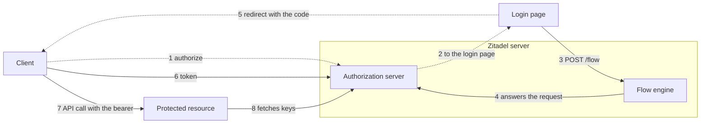

# OAuth Server: One Server for Customers' Applications and Zitadel's Own Clients

> **Status:** Draft for discussion. An investigation, not a decision: it
> proposes an order of work and names what blocks it.
>
> **Date:** 2026-11-05, revised 2026-11-06 to follow #1425's first scope
> (OAuth only, no OpenID Connect) and a review against the issues, the ADRs
> and the code
>
> **Builds on:** [ADR 081](../../adrs/081-customer-hosted-login-and-oidc-provider.md),
> [ADR 082](../../adrs/082-oauth-and-oidc-server.md), the
> [identity model](identity-model.md),
> [#1283](https://github.com/zitadel/nextgen/issues/1283) (applications: the
> resource and access model),
> [#1425](https://github.com/zitadel/nextgen/issues/1425) (connect an
> application with OIDC, the epic), and two open prototypes:
> [#2452](https://github.com/zitadel/nextgen/pull/2452) (applications,
> clients and APIs) and
> [#2451](https://github.com/zitadel/nextgen/pull/2451) (the platform
> project's authorization server, the CLI and MCP clients)
>
> **Related:** [#375](https://github.com/zitadel/nextgen/issues/375) (MCP
> authorization), [#560](https://github.com/zitadel/nextgen/issues/560) (the
> project secret out of the browser path)
>
> **Sources:** `main`, the two PR branches and the issues as read on the
> dates above. Nothing here was run. What #2451 is said to do beyond its
> `apps/api/internal/oauth` package comes from its description and its
> [findings](https://github.com/zitadel/nextgen/blob/claude/poc-platform-oauth-415a8f/docs/design/api/platform-oauth-poc-findings.md).

## Goal

Zitadel needs an authorization server twice:

- **For customers:** a customer's applications, third parties and MCP
  clients sign users in to the customer's project, with the customer's login
  app as the issuer (ADR 081, ADR 082). #1425 builds this first, for a web
  application.
- **For itself:** the `zitadel` CLI and MCP clients sign a developer in to
  the platform project and call Zitadel's API as that person. #2451
  prototypes this.

This note says how both become one server on the structure the repository
has, where the epic and the prototypes differ, and which packages carry the
result to customers.

Names follow #1283: an **application** is the product, a **client** its
technical integration, an **API** what it serves.
[#2785](https://github.com/zitadel/nextgen/issues/2785) settles Application
as the name in the API path, the CLI command, the release directory, the
console and the docs, and
[#2864](https://github.com/zitadel/nextgen/pull/2864) rewrites ADR 082 and
the identity model to that name and sets ADR 082 to Accepted. Where this
note cites ADR 082, it means that text; its section numbers did not move.
Both PRs still say *app*. Here an *app* is only a customer's running
software, as in *login app*.

## One server, two issuers

Build one authorization server in `apps/api`, switched on per project. The
epic starts with a customer's project
([#2793](https://github.com/zitadel/nextgen/issues/2793)). The platform
project then turns the same server on, and differs in three places, which
#2451's findings name.

| | Customer project | Platform project |
| --- | --- | --- |
| Issuer | The primary origin a request arrives on; a project may have several ([D1](#decisions-to-take-first)) | `server.public_base`'s origin, which the console shares, once pinned ([D6](#decisions-to-take-first)) |
| Login app | The login in the customer's app | The console's `/login` |
| Applications | Declared in the release or registered through the API | One built-in application in the binary |
| Browser endpoints | Under the app's `/__nextgen/oauth/{project_id}/` | On the server |
| Switch | `.zitadel/oauth.json` in the release | `platform.oauth.enabled` in the server's config, in #2451 |

The server is part of the Zitadel binary, and should stay there: it needs the
project's keys, the flow engine, sessions and the token records in one
transaction. What must not be fixed is the project it serves.

Customers get no protocol code. They get the server, and package releases
that make the login app they already have the front door (ADR 081 §13).

## How the parts talk

The same eight calls serve both issuers. A dotted line runs through the
user's browser; a solid one is a direct call.



| Part | A customer's project | Zitadel's own |
| --- | --- | --- |
| Client | The customer's web applications, third parties, MCP clients | The `zitadel` CLI, MCP clients |
| Login page | The app's login page: `<zitadel-login>` behind the SDK proxy | The console's `/login`, with `<zitadel-login>` |
| Flow engine | The server | The same server |
| Authorization server | The server; the issuer is the app's origin | The same server; the issuer is its own origin |
| Protected resource | The customer's API or MCP server, which the SDK protects | Zitadel's API and `/mcp`, in the server |

What differs in a customer's project:

- Calls 1 to 3 reach the server through the app's SDK proxy, under
  `/__nextgen`, since they need the issuer's cookies (ADR 081 §6).
- Calls 6 and 8 go straight to the server's public origin, so a refresh
  never depends on the login app.
- Call 8 is a real fetch of the JWKS. Zitadel's own API verifies with the
  keys the server already holds.

The epic's first scope stops at call 6, with call 8 made by the web
application's own backend: it gets an access token whose audience is the
client, verifies it against the JWKS, and has no protected API yet (#2796).

## Wiring the platform project

Three things are easy to mix, and each has its own home:

| Thing | Belongs to | Configured in |
| --- | --- | --- |
| The authorization server: issuers, keys, endpoints, registration | The project; each of its primary origins is an issuer (D1) | The project's OAuth settings, `.zitadel/oauth.json`, a singleton like branding |
| Applications: clients, and the APIs they may get tokens for | The project, one document each | A file per application, or `POST /applications` |
| Resource servers: what accepts a token | The software that hosts the API | Code: the API's own check of the token's audience |

So the server is never part of an application, and an application never
configures the server. An application is registration data: who may ask
for tokens, and for which API.

The hook for the platform project exists on `main`. On every start,
[`deploy.go`](../../../apps/api/internal/bootstrap/platform/deploy.go) builds
the configuration the server ships into a release and deploys it to the
console's origin, which it makes the project's one primary origin. With
that:

1. **The switch.** The built-in bundle carries the OAuth settings when the
   operator sets `platform.oauth.enabled`. The server then asks one question
   of every project: does its deployed release turn the issuer on?
2. **The issuer.** An issuer must be a primary origin of its project
   (ADR 081 §5), and the console's origin already is the platform project's.
   But ADR 081 §5 on `main` says the server's own origin is never an issuer;
   the carve-out exists only on #2451's branch. And the origin is not stable:
   `ownPrimaryOrigin` in `deploy.go` replaces it whenever `public_base`
   changes, and on the cloud a shorter Vercel domain changes `public_base`
   ([cloud runbook](../../runbooks/cloud.md)). Both are preconditions of
   turning the platform's issuer on (D6).
3. **The application.** The `zitadel` application ships in the same bundle
   as a document, in place of #2451's `PlatformApp()` in Go, and is then
   stored and found like any declared application. #2452's `builtin` source
   goes away.
4. **The login page.** In a customer's project the SDK proxy names it on
   every request it forwards (`X-Zitadel-Login-Path`, `/login` by default,
   ADR 081 §7). The platform project has no proxy, so the server takes the
   path from the project's link target (ADR 081 §4) and not from a
   hard-coded console path: the console sits at `/ui/console/` on a
   self-hosted server and at `/console/` on the cloud.
5. **The resource servers.** The management API's security handler and
   `/mcp` each accept a token whose audience is their own identifier. `/mcp`
   leaves the `oauth` package.

The document, with the fields of #2452's application schema and the values
of `PlatformApp()`. The bundle is rendered with the public base at start, as
it is today for the schema and the flows:

```json
{
  "slug": "zitadel",
  "name": "Zitadel",
  "clients": [
    {
      "slug": "cli",
      "name": "Zitadel CLI",
      "client_id": "cli",
      "type": "public",
      "grant_types": ["authorization_code", "refresh_token"],
      "redirect_uris": [
        "http://127.0.0.1/callback",
        "http://[::1]/callback",
        "http://localhost/callback"
      ],
      "apis": [{ "api": "platform" }, { "api": "mcp" }]
    }
  ],
  "apis": [
    { "slug": "platform", "name": "Zitadel API", "identifier": "<base>/api/v1" },
    { "slug": "mcp", "name": "Zitadel MCP server", "identifier": "<base>/mcp", "third_party": true }
  ]
}
```

Registration is not in the document. It opens an endpoint for the whole
project, so it is a switch of the project's OAuth settings (ADR 082 §9,
§12), not of one application, and it needs a login-only issuer, which the
console's origin is not (D3, D6). #2452 has it on the application, where any
one application opens it for all.

What it says, and what it leaves out:

- `cli` is the one client Zitadel declares. The CLI compiles in only that
  client id and finds everything else through the metadata.
- `platform` and `mcp` are APIs, the audiences of tokens. They are not
  clients, and the entry does not configure the MCP server.
- MCP clients such as Claude Code are not listed. Once the project opens
  registration, they register themselves and join the application whose
  API they first ask for, as third parties, and only for an API marked
  `third_party`.
- The console is not listed. It shares the server's origin and keeps its
  session cookie.

What stays special to the platform project:

- Its browser endpoints sit on the server, since the console shares the
  origin and no SDK proxy stands in front.
- The server answers the root `/.well-known/` document for the project that
  owns that origin as primary, which is the platform project.

## What `main` has to build on

| Piece | Where | What it gives |
| --- | --- | --- |
| Flow engine | [`flow.go`](../../../apps/api/internal/api/flow.go) | `POST /flow` already takes `auth_request_id`, and keeps its state in a sealed cookie |
| Widget | [`zitadel-login.ts`](../../../packages/components/src/orchestrator/zitadel-login.ts) | Already navigates to a `redirect_uri` the server computes |
| Tokens | [`token_type.go`](../../../apps/api/internal/domain/token_type.go) | The `tokens` table reserves `oidc_access_token` and `oidc_session_id` |
| Keys | [`keys.go`](../../../apps/api/internal/service/keys.go) | A signing key and a crypter per project; `zitadel/oidc` is a dependency |
| Authorization | [`security.go`](../../../apps/api/internal/api/security.go) | `ScopeContext`, and ADR 053's resolver for a platform user's projects |
| Sessions | `POST /sessions/exchange` | The handoff that lands a session on the app's origin (ADR 073) |
| Upstream sign-in | [`internal/idp`](../../../apps/api/internal/idp) | Redirect validation and a cookie that binds a callback to a browser |
| Releases | `.zitadel/` and `POST /releases/build` | The vehicle for declared applications, APIs and OAuth settings |
| SDK proxy | [`middleware.ts`](../../../packages/sdk-core/src/middleware.ts) | `/__nextgen`, with cookie renaming and redirect filtering |
| CLI | `setup`, `doctor --fix` | The way generated files reach apps that already exist |

Missing on `main`:

- any authorization server (`apps/api/internal/oauth` is #2451's);
- the application resource
  ([#2788](https://github.com/zitadel/nextgen/issues/2788), which #2452
  prototypes);
- a `/mcp` endpoint on the server;
- ADR 081's reservation release: the SDKs forward neither
  `/.well-known/` path and send no `X-Zitadel-Login-Path`.

## The epic and the two prototypes

#1425 scopes the customer's side as issues. #2452 and #2451 covered much of
the same ground earlier, for the platform project and for public clients.
#2785 takes #2452 as a reference only, so the issues are built anew and the
prototypes are read for what they found.

| Epic issue | Asks for | Prototype has | Differs in |
| --- | --- | --- | --- |
| [#2788](https://github.com/zitadel/nextgen/issues/2788), [#2790](https://github.com/zitadel/nextgen/issues/2790) applications | `POST /applications`, `.zitadel/applications/<slug>.json`, `zitadel application create` | #2452: `POST /apps`, `.zitadel/apps/<slug>.json`, `zitadel apps create`, revisions, `AppDirectory` | Names. #2452 also stores clients that register themselves, and serves built-in applications |
| [#2791](https://github.com/zitadel/nextgen/issues/2791) client credentials, folded into #2788 and #2790 | A registered application's first secret at create, or `${{ NAME }}` in a declared one's file; no credentials resource yet | #2452: named secrets and keys as a resource of their own | #2452 is wider |
| [#2792](https://github.com/zitadel/nextgen/issues/2792) web preset | One preset | #2452: eight presets | #2452 is wider |
| [#2793](https://github.com/zitadel/nextgen/issues/2793) switch and metadata | `.zitadel/oauth.json` per project; the issuer from the forwarded headers | #2451: a server config flag, one project, the issuer from `server.public_base` | Per project against one project |
| [#2794](https://github.com/zitadel/nextgen/issues/2794) authorization endpoint | PKCE optional (`S256` only when sent), exact redirect URIs, the deployment sealed in the flow; `iss` later | #2451: PKCE required, `iss`, exact redirect URIs; no deployment, and it requires `resource` | PKCE and `iss` stricter in #2451; the deployment, and `resource` |
| [#2795](https://github.com/zitadel/nextgen/issues/2795) customer-hosted login | The SDK's reservation release; the widget's handle; the application on every response | #2451: the widget's handle and the consent step, in the console | No SDK part |
| [#2796](https://github.com/zitadel/nextgen/issues/2796) token endpoint | Client secrets, basic and post; an access token with the user as `sub` and the client as `aud`; no refresh tokens yet | #2451: public clients only; one API as `aud`; rotating refresh tokens and revocation | Opposite halves, and the audience |
| [#2797](https://github.com/zitadel/nextgen/issues/2797) JWKS | A JWKS per project for the EdDSA key every project already has; RS256 and ES256 come with OpenID Connect | #2451: RS256, ES256 where chosen, minted when first needed, `at+jwt` | The algorithm |
| [#2800](https://github.com/zitadel/nextgen/issues/2800) cloud routing, closed as a duplicate | Rules for the server's new paths | Neither | Not built |
| [#2801](https://github.com/zitadel/nextgen/issues/2801) ID token and discovery | Dropped from the first scope on 2026-11-06: OAuth only for now | Neither | Not built |

The two meet at the foundation: applications, authorize, keys and the
widget's handle. Past that they deliver different things first. The epic's
first scope is a confidential web application that gets an access token
and no ID token. #2451
has public clients, consent, registration, refresh tokens and a protected
API, which the epic set aside on 2026-11-05
([#2798](https://github.com/zitadel/nextgen/issues/2798),
[#2799](https://github.com/zitadel/nextgen/issues/2799) and others, closed as
not planned for now).

On PKCE and `iss`, ADR 082 §2 decides (#2864): PKCE is required for public
clients, recommended for confidential ones and supported for every client,
so an existing confidential client on the OAuth 2.0 code flow connects
unchanged; `S256` only, and a `code_verifier` is refused when the request
carried no challenge. `iss` on the authorization response stays required
and may ship after the first step, since adding it breaks no client: the
metadata advertises it only once it is there. So #2794 keeps `iss` out of
its first scope, and #2795's acceptance criterion, which returns `iss`,
should move with it. #2451 has both working (open question 2, answered).

### Where the prototypes leave #1283's model open

| #1283 or #1425 says | The prototypes | Kind |
| --- | --- | --- |
| Every client belongs to one application | A client that registers itself sits at the project until its first request names an API; a client ID metadata document has no record | Filled by ADR 082 §9 (#2864): a self-registering client joins the application of its first `resource`, and its party is its own, never the application's |
| Users and teams get access to the application | Authorize checks the client, the redirect URI, the grant type and the scopes, never the user's access to the application | Missing. Adding it later refuses users who could sign in before |
| The client is the principal when acting as itself | A token's `sub` is always a user; `main` has no `client` principal type | Not built |
| Applications can be owned by teams; each customer authorizes a shared partner on its own (scenarios 2, 3) | No owner on the document; a consent is per user, client and API | Missing. A customer's authorization is a grant, not a consent |
| A user-authorized request is limited by what the integration was granted (scenario 4) | A token carries every grant of the user | Missing: the scope ceiling |
| Applications and clients are deactivated, machines suspended (scenario 5) | The document has no status | Missing |
| No Zitadel-hosted login | The console answers the platform project's requests | Holds for customer projects; ADR 081 §5 needs its carve-out |
| The glossary: `app` is one client, `app_group` is locked | The new names throughout | Stale; its update is set aside ([#2812](https://github.com/zitadel/nextgen/issues/2812)) |

The hierarchy, several clients per application, presets instead of
application types, credentials per client and one audience per token all
match.

## What #2451 settles

Worth keeping, whichever code carries it:

- **The split of work, now open again.** #2451's package does authorize and
  registration itself; `zitadel/oidc`'s `op.Server` answers token, revoke and
  JWKS. #2794 uses `op.Server.VerifyAuthRequest` and `Authorize` instead,
  whose errors do reach the client's `redirect_uri` once it is validated, as
  the issue's thread established. What the library still lacks is
  `resource` and `iss`, neither in the first scope.
- **No `auth_requests` table.** Authorize seals the request into a handle, a
  cookie per request binds it to the browser, and the flow carries it in its
  own cookie. ADR 081 §8.2 stores the request in `auth_requests`, so keeping
  this is an amendment (D4).
- **Consent is a step the engine inserts,** under a reserved name a flow
  definition cannot use.
- **One audience per access token** (RFC 8707). It kept a third-party MCP
  client out of the management API with no scope vocabulary.
- **Two security schemes on one header:** `pat` for a secret, `oauth2` for a
  person's token, with the app plane left to the secret.
- **The redirect matcher:** one decode, one parse, and the browser is sent to
  the URL that was checked.
- **Signing keys per algorithm,** minted when first needed, RS256 unless an
  API chooses ES256. The first scope signs with the EdDSA key every project
  has (#2797, D9), so this waits for OpenID Connect.
- **Clients through #2452's `AppDirectory`,** so a built-in application, a
  declared one and a registered one are found the same way.

## The three kinds of client

| Client | Shape | State |
| --- | --- | --- |
| Web application | Confidential, with a backend that holds a client secret | The epic's first scope. Not in #2451 |
| CLI | Public, first party, loopback redirect on any port, PKCE | Prototyped in #2451: `login`, `whoami`, `logout`, and project commands as the developer |
| MCP client | Public, third party, registers by client ID metadata document or RFC 7591, always sends `resource` | Prototyped in #2451 against a stub `/mcp` with one tool; Claude Code connected in the proof of concept |

What the epic's web application needs that #2451 lacks:

- the issuer and the project from the request (#2793);
- client authentication at the token endpoint by secret (#2796); #2452's
  `AppDirectory` already offers the check;
- an authorization request without `resource`, which #2451 refuses: the
  first scope has no protected API to name;
- an access token whose audience is the client, signed with the project's
  EdDSA key (#2796, #2797).

Set aside by the epic for now: OpenID Connect (the ID token,
`openid-configuration` and userinfo, #2801 and #2802), `private_key_jwt`,
refresh tokens and revocation, RP-initiated logout, and browser-only and
native clients. Relying-party mode, with the handoff beside the tokens so a
first-party application keeps a Zitadel session (ADR 081 §12), comes after
those, and SPAs wait for #560 (ADR 081's question 7).

The console is no OAuth client while it shares the server's origin: it keeps
its session cookie.

### How an MCP client's consent runs

Consent is not a round trip of its own. It is a step inside the one flow
that answers the one authorization request (ADR 081 §11, ADR 082 §8):

1. The MCP client sends one authorization request: its client id,
   `resource`, the scopes, PKCE and a redirect URI. The server checks it,
   seals it into a handle and sends the browser to the login page with
   `?auth_request=<handle>` and a binding cookie.
2. The widget starts the login flow with that handle, and the user signs in
   as on any other day.
3. The engine inserts the `consent` step after sign-in when the client is
   third party and the user has not consented to those scopes for that API,
   when the request says `prompt=consent`, or when the application's
   document asks for it on every request. A first-party client gets no step
   unless the request asks.
4. The step shows the client's name beside the redirect host the server
   checked, the API, and one line per scope from the API's text keys. Allow
   records a consent per user, client, API and scopes; Deny records nothing.
5. The flow ends in the one redirect to the client: with a code after Allow,
   with `error=access_denied` after Deny. `prompt=none` without a stored
   consent answers `consent_required` and shows nothing.

A later request for the same scopes skips the step while the consent lives;
one for more scopes gets a step for the difference, and the consent becomes
the union. The user revokes a consent through the me endpoints and the
connected-apps element, which ends the client's refresh tokens; the access
token runs out on its own, since there is no introspection (challenge 9).

**Consent is all or nothing so far.** #2451's step has Allow and Deny and no
fields, so a user takes every requested scope or none. Stripe's MCP server
shows the other design: its consent page is a permission builder where the
user picks read, write or none per resource, and the token carries the
selection, not the request. OAuth allows that, since a server may grant
fewer scopes than asked and returns the granted `scope`. For Zitadel it
would take scopes with structure in the API's entry (which resource, which
level, and an order so that write implies read), a consent step with fields
whose Allow submits the selection, a consent stored for the chosen subset,
and a template block that renders the matrix. It changes nothing about
tokens. Whether a user may choose a subset is open question 12.

## Scope: which apps become the issuer

One rule decides it: an app can be the issuer when it has a server runtime
for the SDK's proxy to run in. So for now, apps on a server framework can
become OAuth logins, and SPAs stay embedded logins.

| App | First scope | Later |
| --- | --- | --- |
| On a server framework: Next.js, Nuxt, SvelteKit, SolidStart, TanStack Start, Qwik Router | Keeps its embedded login and can become the issuer, with no change to its pages | Relying-party mode; protecting its own API |
| An SPA: React, Vue, Svelte, Solid, Angular or Qwik without a server | Stays an embedded login. Never the issuer | The issuer once #560 takes the project secret out of the browser path; a public client once those are back in scope (#2799) |
| The generated login app | The issuer for a customer with no app on a server framework (#2784) | Login-only, for open registration (ADR 082 §9) |
| An existing app with a backend, on any stack | A confidential client of the issuer, through an OAuth library. An OIDC library cannot connect yet: there is no ID token and no `openid-configuration` | OpenID Connect, refresh tokens, sign-out |

What "stays an embedded login" means for an SPA:

- Nothing changes: `<zitadel-login>` in its page, and the session cookie as
  today.
- It takes no part in a sign-in across several apps, unless a backend of its
  own is the client. A customer with an SPA and a second app puts the login
  in the generated login app and makes that the issuer.
- It is no issuer in development either. A loopback issuer that cannot go to
  production would only mislead.
- An SPA that already signs in with OIDC, as a public client with PKCE, has
  no path in the first scope: it cannot be the issuer, and public clients
  are set aside (#2799). Many v4 customers run such an app, so this is a
  product decision for #1425 (open question 10), and until it is taken
  `application create` refuses a browser-only or native client with that
  reason.

### What the SDK does for an issuer

The whole job is forwarding. It holds no protocol logic (ADR 081 §13):

1. Forward the two root paths, `/.well-known/openid-configuration` and
   `/.well-known/oauth-authorization-server`, to the project's documents.
   The first answers `404` until OpenID Connect ships.
2. Forward the browser endpoints under `/__nextgen/oauth/{project_id}/`,
   beside what the proxy forwards today.
3. Name the login path on every forwarded request (`X-Zitadel-Login-Path`),
   replacing any value the browser sent.
4. Pass the request's host on. The server accepts it as the issuer only
   when it is one of the project's primary origins, or loopback while
   developing (#2793, D1). The SDK has no reliable source for its own
   public origin: `X-Forwarded-Host` can be set by anyone on a direct
   request (the Next.js and Nuxt proxies keep an incoming one), and the
   host is wrong behind a proxy that rewrites it
   ([`middleware.ts`](../../../packages/sdk-core/src/middleware.ts)). So
   the server's check against the origin list is the one that counts: a
   forged host that is no primary origin gets no issuer, and one that is
   only picks among the project's own issuers.
5. Keep passing no redirect that leaves the app, as today. The widget makes
   the last redirect to the client.

Next.js reads its path list at build time, so its app also needs the
generated `matcher` entries, which `doctor --fix` writes. The other server
frameworks need the version bump alone.

The app that becomes the issuer gets no client id and no secret, and names
no issuer: its origin is one because it is a primary origin of the project.
Only the app that signs in with it is configured, with the issuer, its
client id, its secret and its redirect URI.

### What the CLI guards

`zitadel oauth enable`, and `zitadel application create`, which turns the
issuer on when it is off (ADR 082 §12, open question 3), refuse with the
reason and the way out when:

- the app is an SPA, or sits under a base path, since the metadata has to be
  at the host's root: the answer names the generated login app;
- the SDK is older than the reservation release, or a Next.js app lacks the
  generated entries: the answer names `doctor --fix`;
- the project has no primary origin: the answer names
  `zitadel origin add`.

With the server on, the customer sees what its origins now mean (D1):

- `oauth enable` and `origin list` say which origins are issuers, and that
  an issuer is permanent for the clients that pin it;
- `origin add` says the new primary origin becomes an issuer;
- `origin rm` warns before it removes one, since its clients stop working
  and its tokens end;
- the console's origin list marks them the same way, once it has one.

## OAuth 2.1 at the core, OpenID Connect as a layer

The server does not have to be an OpenID Connect provider to serve callers of
an API, such as the CLI and MCP clients. The line runs between calling an API
and telling another app who signed in. Only the second is OpenID Connect's
job.

| Client | Needs OpenID Connect | Why |
| --- | --- | --- |
| CLI | No | It wants an access token for the API, and reads the user from `GET /users/me` |
| MCP client | No | MCP asks for OAuth 2.1, resource indicators, and RFC 8414 and RFC 9728 metadata |
| First-party web application | Barely | Its session comes from the handoff (ADR 081 §12); the ID token is a check on the way |
| Third-party or off-the-shelf web application | Yes | It expects `openid-configuration`, an ID token and usually userinfo |

#2451 is an OAuth server as built: RFC 8414 metadata, no ID token, no
userinfo and no `openid-configuration`, and `openid` out of
`scopes_supported` until it issues an ID token.

The layer is additive:

- an ID token at the token endpoint, with `nonce`, `auth_time` and `sid`;
- `openid-configuration` beside the RFC 8414 document;
- RS256 beside the EdDSA key, which RFC 9068 requires among the supported
  algorithms (ADR 082 §2, #2797);
- later, a userinfo endpoint and the conformance suite as an end-to-end
  lane, both set aside for now
  ([#2802](https://github.com/zitadel/nextgen/issues/2802),
  [#2809](https://github.com/zitadel/nextgen/issues/2809)).

So:

- **The first iteration is OAuth only,** as the epic has it since
  2026-11-06 (#2801): no ID token, no `openid-configuration` and no
  userinfo. The web application's backend uses an OAuth library, finds the
  server through the RFC 8414 document, and verifies its access token
  against the JWKS (#2806). The CLI and MCP clients never needed the layer.
- **What that costs.** An off-the-shelf application, and any OIDC library,
  cannot connect in this iteration: both expect `openid-configuration` and
  an ID token. The docs say so (#2810), and OpenID Connect is the first
  thing to return (step 5).
- **A request without `resource` gets an access token with the user as
  `sub` and the client as `aud`** (#2796, D2). The backend must check
  `aud` against its own client id: a verifier that sets no audience, as the
  SDK's does not by default, accepts another client's token.
- **Reading `sub` from that token is a stopgap, not a contract.** It is how
  the application learns who signed in until the ID token exists, and the
  ID token replaces it.
- **Unknown standard scopes are ignored, not refused.** Libraries send
  `openid profile email` by default; the server grants none of them, issues
  no ID token for `openid`, and returns the granted `scope` (RFC 6749
  §3.3). `invalid_scope` stays for an API's own scopes (D2).
- **`openid` stays out of the metadata until OpenID Connect returns.**
- **The access token path never depends on the layer.** An API or an MCP
  server verifies a JWT in RFC 9068's profile and needs neither an ID token
  nor userinfo. One audience per token, scopes per API, client ID metadata
  documents and token exchange later all stay as they are.
- **No protocol of our own for identity.** A third-party web application
  learns who signed in through OpenID Connect or not at all; anything else
  costs customers their integrations. The stopgap above is for the
  customer's own backend only.

The library is a separate matter. #2451 uses `zitadel/oidc` lightly:
`op.Server` routes token, revoke and JWKS, parses their forms and encodes
their errors. Authorize, registration, tokens, consent and storage are the
package's own, so the library's model binds nothing, and replacing those
three handlers later is a small job.

ADR 082's sequence now reads this way (#2864): a confidential web
application through an OAuth server first, then OpenID Connect, public
clients, protected APIs and MCP, and services. Its §2 records what holds
until OpenID Connect ships: no ID token and no userinfo (#2801, #2802),
`openid` not in `scopes_supported`, EdDSA only, and
`/.well-known/openid-configuration` reserved (ADR 081 §7) and answering
`404`, while `/.well-known/oauth-authorization-server` answers from the
first iteration. Schema claims wait as well (#2803).

## Challenges

1. **The prototype serves one project.** #2451's `oauth.Server` holds one
   project id, one issuer and the console's path, its routes name the
   platform application's two APIs, and its `/mcp` handler sits in the same
   package. #2793 asks for the issuer and the project from the request: the
   path on the back channel, the forwarded host on the front channel. That
   rework decides whether the package becomes the epic's server.
2. **Two tracks over the same ground.** #2451 is about 40,000 added lines in
   344 files, some 14,000 of them hand-written, stacked on #2452. The epic's
   issues describe the same endpoints under other names, and #2785 takes
   #2452 as a reference only. Both PRs are behind
   `main` and conflict with it, and their migrations are numbered against
   each other.
3. **Requests without `resource`.** #2451 refuses them, since it serves no
   userinfo. The epic's web application names no API and gets an access
   token whose audience is the client (#2796, D2).
4. **Scopes on Zitadel's own API.** A consented client acts with every grant
   of the developer. The proof of concept keeps third parties off the
   management API because nothing narrower exists, and Claude Code asked for
   every scope the metadata lists. `/mcp` cannot get real tools before checks
   intersect a principal's roles with the token's scopes
   ([identity model](identity-model.md#principals)).
5. **The front channel runs through the app.** The sealed request takes
   3.3 KB of the flow cookie's 4 KiB, before the sealed deployment and,
   later, OpenID Connect's parameters. Two requests in one browser still
   share `_zflow` (D7), and one cookie per flow puts several such cookies
   on one host. The
   binding cookie stays in the browser that started the request, so a
   magic link or email code opened on another device cannot finish it
   (ADR 081 §4). The SDK proxy passes no redirect that leaves the app, so
   every answer goes through the widget, across every SDK and the generated
   files that apps keep for months (D4).
6. **Scripts on the issuer's origin.** Each acts with the user's session and
   can drive a request to the end, with its own PKCE verifier, and redeem
   the code for any public client (ADR 081's risks). Open registration
   therefore needs a login-only issuer with a strict content security
   policy (ADR 082 §9). The platform project's issuer is the console's
   origin, which serves the whole console, and on the cloud also the
   website and the docs: `vercel.json` sends every path it does not route
   elsewhere to the website. #2451's `oauth` package has no login-only
   handling (D6).
7. **The first-party skip.** The CLI gets no consent step and returns to a
   loopback port, so any page can navigate a signed-in browser into issuing a
   code to a local port. PKCE protects the code from the page, not from a
   process listening there. With challenge 6, a script on the platform's
   origin can complete the CLI's flow itself and keep a refresh token that
   carries every grant of the developer.
8. **Which release serves a request.** Authorize has no `Origin`, the code
   must carry its deployment to the token endpoint, and a refresh must
   resolve the newest one (ADR 081 §10). #2451 reads applications at their
   newest revision, with no deployment; #2794 seals one in the flow.
9. **Revocation.** Without introspection an access token outlives a revoked
   consent by up to five minutes. The identity model lets an API name the
   clients that may introspect its tokens (RFC 7662), which closes that gap
   for the APIs that ask; ADR 082 §2 still has no introspection endpoint.
   Whether signing out of the console ends the CLI's sign-in is undecided.
   Revoking a consent scans a project's tokens until an index exists.
10. **Deployment shape.** A `public_base` with a path is refused, since the
    metadata sits at the host's root. The cloud routes only the server's own
    paths to it, so the well-known paths, `/oauth/` and `/mcp` need rules.
    #2800 asked for them and closed as a duplicate, so they need a home
    (D8).
    Client ID metadata documents need egress to hosts that clients choose,
    and their cache is per replica. Relying parties must reach a
    self-hosted server's back channel.
11. **The issuer is permanent.** Tokens and passkeys bind to it. Moving a
    login app to another domain breaks both, unless the old origin stays a
    primary origin while clients move. A customer's issuers are its primary
    origins, which it adds and removes itself without a deploy, so the CLI
    and the console have to say what an origin means before one goes (D1).
    The platform's issuer follows `public_base` (D6).
12. **Contracts that change.** The CLI's fallback from a secret to a sign-in
    goes against the rule in
    [`credentials.ts`](../../../apps/cli/src/lib/oclif/credentials.ts), the
    `--json` envelope gains a field, the generated Go client's
    `SecuritySource` gains `Pat`, which breaks its implementers, and a flow
    definition can no longer name a step `consent` or `account_choice`.
13. **Not yet proven.** The Spanner lane and Claude Code against the current
    branch were not run, two of #2451's checks fail (CodeQL and Vercel),
    and no end-to-end lane signs the CLI in through the console.
14. **No sign-out, and a session that stays.** The handoff leaves a session
    on the issuer's origin (ADR 081 §9), and a flow with a live session
    answers at once (§8). With RP-initiated logout set aside (#2804), a user
    who signs out of the web application and signs in again gets the same
    account without a prompt, on a shared device too, unless the client can
    ask for `prompt=login` (D5). #1425 still asks for sign-out.
15. **Audit, limits and keys.** #1283 asks for attributable token-issuance
    and authorization events; #2451 reuses `auth.token.issued` and
    `auth.token.revoked`, and consent, denial and replay have no event of
    their own. Nothing limits guessing a client secret at the token endpoint
    or flooding authorize (ADR 078). Signing keys are minted when first
    needed, with no rotation that publishes the next key before it signs
    (ADR 039), while both the server and the SDK cache a JWKS for five
    minutes. A declared client's secret is the variable its deployment
    froze, so rotating it has no overlap.

## What customers get

Each part ships in a package the customer already installs, so a fix is a
version bump and never a re-scaffold.

| Package | License | Carries |
| --- | --- | --- |
| `@zitadel/server` | AGPL | The protocol under `/oauth/{project_id}/`: authorize, token, JWKS, and later revocation, registration and consents |
| `@zitadel/sdk-*` | MIT | The reserved paths and the browser endpoints under `/__nextgen`; later, bearer verification with RFC 9728 metadata and `WWW-Authenticate`, the claims hook and relying-party mode |
| `@zitadel/components` | MIT | The authorization request's handle in `<zitadel-login>`; later, consent (with fields if open question 12 says so), account choice and a connected-apps element |
| `@zitadel/config` | MIT | Schemas and presets for applications, with their `apis` entries (ADR 082 §5: no files or commands of their own), and the OAuth settings |
| `@zitadel/cli` | MIT | The commands that write those files, `doctor` checks, and the skill an agent reads |
| `@zitadel/testing`, the API mock | MIT | An authorization server to test against without a running Zitadel |

The names below are the epic's where it has one, and ADR 082 §12's working
names otherwise.

**A customer's existing web application** connects as an OAuth client;
OpenID Connect comes later. This is the epic's first scope:

1. `zitadel application create` writes the application's file with its
   client from the web preset, and generates the client id. When the
   project's authorization server is off, it writes `oauth.json` to turn it
   on and says so (ADR 082 §12, #2864). It deploys nothing.
2. `zitadel oauth enable` does that alone, for a project that already has
   its applications. Either way the CLI prints the origins that are now
   issuers (D1).
3. The developer sets the client's secret with
   `zitadel variable set <NAME> --secret`, puts the same value in the
   backend, and runs `zitadel deploy`. The CLI neither generates nor prints
   a secret for a declared application.
4. The login app answers the request. Which login ships first is open
   ([#2784](https://github.com/zitadel/nextgen/issues/2784)).
5. The backend takes the issuer, the client id and the secret into an
   OAuth library, verifies the access token against the JWKS, checks `aud`
   against its own client id, and reads the user from `sub`. Its sign-out
   ends only its own session until
   RP-initiated logout returns; the docs say so, and how to ask for
   `prompt=login` (challenge 14).

**A customer's MCP server** is a protected API its app hosts, once protected
APIs and registration are back in scope:

1. The application declares the API, open to third parties, and the issuer
   is declared login-only.
2. `protectResource({ api })` in the app verifies bearers and serves the
   API's metadata.

**A customer's second web application** signs in with the first:
`zitadel setup --sign-in-with <issuer>` declares it as a first-party client
and configures its proxy; `auth()` and the session elements are unchanged.

**A backend in another language** needs no SDK: access tokens are JWTs in
RFC 9068's profile, verified against the issuer's JWKS.

What blocks the later paths today:

- The SDK's verifier accepts only `iss` equal to `ZITADEL_URL` and fetches
  keys from `{ZITADEL_URL}/auth/keys`
  ([`jwt.ts`](../../../packages/sdk-core/src/jwt.ts)). It has to take an
  issuer, read `jwks_uri` from its metadata and require an audience.
- Apps pin packages for months, so the SDK's forwarding must be in their
  hands before a project can turn its issuer on.

## Decisions to take first

Each of these is owned by an ADR or an issue, not by this note; the note
proposes an answer and names where it belongs. The last column is the state
on 2026-11-09.

| | Decision | Belongs in | Proposal | State |
| --- | --- | --- | --- | --- |
| D1 | Is the issuer stored or derived per request? | ADR 081 §5 and §6, #2793; the console's origin list later | Derived, as #2793 has it: the origin the request arrived on, accepted when it is a primary origin or loopback. Origins are project data a customer adds and removes without a deploy, a staging origin is meant to be an issuer (ADR 081 §10), and a domain move needs the old and the new issuer side by side, so a stored field would dangle or force a hard cut. A primary origin is an exact URL, never a wildcard, and a forged host can only name one of them. Three guards for #2793 and its neighbours: **(1)** the code records its issuer and the token endpoint issues for that one alone, so removing an origin ends its tokens at their next exchange; **(2)** an answer that depends on the origin, the metadata first, is never stored by a shared cache, and a test holds that; **(3)** the customer sees which origins are issuers and is warned before removing one, in the CLI now and in the console later | Raised on #2793; no answer yet |
| D2 | What does a request without `resource` get? | Settled by #2796; ADR 082 §5 in #2864 | An access token with the user as `sub` and the client as `aud`, and no ID token. The backend checks `aud`. Unknown standard scopes, `openid` among them, are ignored and the granted `scope` returned; an API's unknown scope stays `invalid_scope` | Settled by #2796 and ADR 082 §5 (#2864), which rejects `aud` = issuer: every client's backend would accept every other client's token |
| D3 | Where does registration switch on? | ADR 082 §9 and §12 | In `oauth.json`, for the project, and only on a login-only issuer, as ADR 082 has it. An application only marks which of its APIs are `third_party` | As ADR 082 §12 keeps it in #2864. Not in the first iteration |
| D4 | Does the authorization request live in a cookie? | ADR 081 §8.2, as an amendment | Yes, sealed, as #2451 does, with a test that holds it under a size budget, a short lifetime, and a documented restart when the binding cookie is missing, as on another device | Not raised. Not on the list of ADR 081 amendments in #2864, where it belongs |
| D5 | How does a user sign in again as someone else? | #2794 | `prompt=login` in the first scope, since the issuer keeps a session and sign-out is set aside; `max_age` comes with OpenID Connect. #1425's sign-out criterion waits for #2804 or changes | Not raised |
| D6 | What must hold before the platform project turns its issuer on? | Step 6; ADR 081 §5 | A pinned issuer that the server refuses to start without when `platform.oauth.enabled` is set, and refuses to change; a login-only host of its own on the cloud, not the origin of the website, the docs and the console; the §5 carve-out merged from #2451; registration as D3 has it | Not raised. Blocks only step 6 |
| D7 | Does each flow get its own cookie in the first scope? | ADR 081 §8.3, #2795 | Yes, one cookie per flow before the server ships, as §8.3 asks. Two sign-ins in one browser overwrite each other today, and renaming the cookie later breaks the proxies that pass it | Raised on #2795; no answer yet. Not on the list of ADR 081 amendments in #2864 |
| D8 | Where do the cloud's routing rules live? | #2793, or an issue of its own, since #2800 closed as a duplicate | With #2793: one rule that sends `/oauth/*` to the server, which both the SDK proxy and the back channel call. The root well-known paths and `/mcp` wait for step 6 | Not raised |
| D9 | Is EdDSA alone enough for the first iteration? | ADR 082 §2, #2797 | Yes, if the docs name libraries that verify it and the end-to-end lane uses one, since the customer's backend verifies the access token itself. RS256 returns with OpenID Connect, or sooner for the first customer whose library cannot verify EdDSA | Settled by ADR 082 §2 (#2864), as proposed |

D2 and D9 are settled, and D1 follows #2793 with three guards to add. D4,
D5, D7 and D8 shape the first scope; D4 and D7 belong in the ADR 081
follow-up that #2864 lists, before it is written. D3 waits for
registration, and D6 blocks only step 6.

## Proposed sequence

Steps 1 to 4 are the epic's first scope, in its order: OAuth only. Steps 5
to 7 are this note's proposal for what follows.

1. **Decisions:** the login approach (#2784, agreed: the generated login
   app, with the starter app first), D1's guards, D4, D5, D7 and D8. ADR
   082 is in line with the identity model and accepted in #2864 (#2785),
   which settles D9 and open questions 2 and 3. #2785 takes #2452 as a
   reference only; which pieces of #2451 carry over belongs here too (open
   question 1).
2. **Applications:** registered and declared, with their client secrets,
   and the web preset (#2788, #2790, #2792).
3. **The OAuth server, per project:** the switch and metadata, with the
   issuer derived under D1's guards, authorize with `prompt=login`, the
   token endpoint with client authentication, and the JWKS (#2793, #2794,
   #2796, #2797), with the customer-hosted login (#2795) and the cloud's
   routing rules. Each issue's acceptance criteria name its audit event and
   its limits. The SDK's reservation release inside #2795 depends on
   nothing else and has the longest lead time, so it can ship ahead. It
   covers the server frameworks; SPAs stay embedded logins
   ([Scope](#scope-which-apps-become-the-issuer)).
4. **Proof and docs:** the end-to-end lane with an OAuth library, with and
   without PKCE, the CLI journey and the docs
   ([#2806](https://github.com/zitadel/nextgen/issues/2806),
   [#2655](https://github.com/zitadel/nextgen/issues/2655)).
5. **What the epic set aside,** OpenID Connect first, since off-the-shelf
   applications and OIDC libraries wait for it: the ID token,
   `openid-configuration`, RS256, userinfo and the standard scopes (#2801,
   #2802). Then public clients, refresh tokens and revocation, a protected
   API as the audience, RP-initiated logout, key rotation and the
   conformance lane. #2451 holds working versions of public clients,
   refresh tokens and a protected API.
6. **Zitadel's own clients,** once D6 holds: the platform project turns the
   same server on
   ([Wiring the platform project](#wiring-the-platform-project)). Then
   `zitadel login`, consent and its me endpoints, registration for MCP
   clients, `/mcp`, and the scope ceiling on Zitadel's API, from #2451.
7. **Customers' APIs and MCP servers:** the SDK's bearer verification and
   metadata, the claims hook, and a demo app with a protected MCP server as
   the reference and its end-to-end lane.

## Open questions

Each names where it was raised, as of 2026-11-09. Questions 2 and 3 are
answered; the rest have no answer yet.

1. #2785 takes #2452 as a reference only. Is #2451 one too, and which of its
   pieces carry over: the redirect matcher, the sealed request, the consent
   step, the signing keys? *Asked on #2451 and #2785. On #2785 this is left
   to the epic's owner; the ADR cites neither prototype.*
2. PKCE and `iss` on the authorization response: optional and later, or
   required from the start? *Raised on #2785. Answered in #2864: PKCE is
   required for public clients and recommended for confidential ones;
   `iss` stays required and may ship after the first step.*
3. Does `application create` turn the project's issuer on when it is off, or
   does only `zitadel oauth enable` (#2793)? *Raised on #2785. Answered in
   #2864: it does, writing `oauth.json` and saying so; `oauth enable` stays
   for doing that alone.*
4. #2795 lists the Vite and Angular dev proxy entries. If no SPA is an issuer
   for now, do they still ship as a reservation, or wait for #560?
   *Raised on #2795.*
5. Does the CLI get a consent once per device, as `gh` asks once, to close
   the first-party skip? *Raised in the review of #2451.*
6. What is the scope vocabulary of Zitadel's own API, and does the MCP server
   expose every operation or a chosen set? *The missing scope check is in
   the review of #2451; the vocabulary is not raised.*
7. Does signing out of the console end the sign-ins of the CLI and of
   connected agents? *Not raised.*
8. Does the SDK verify tokens for backends in Go as well, through the
   generated client's module, or is a documented JWKS check enough?
   *Not raised.*
9. Which demo app hosts the reference MCP server? *Not raised.*
10. Does an SPA that already signs in with OIDC have a supported path when
    #1425 ships, or do public clients (#2799) come back first? *Not raised;
    belongs on #1425.*
11. When does OpenID Connect return (#2801)? Until it does, an off-the-shelf
    application or an OIDC library cannot connect, and the application
    reads the user from its access token. *Not raised; belongs on #1425.*
12. Can a user allow part of a request, per scope or per resource and level
    as Stripe's MCP consent does, or is consent all or nothing as #2451 has
    it? *Not raised; belongs in ADR 082 §8.*
