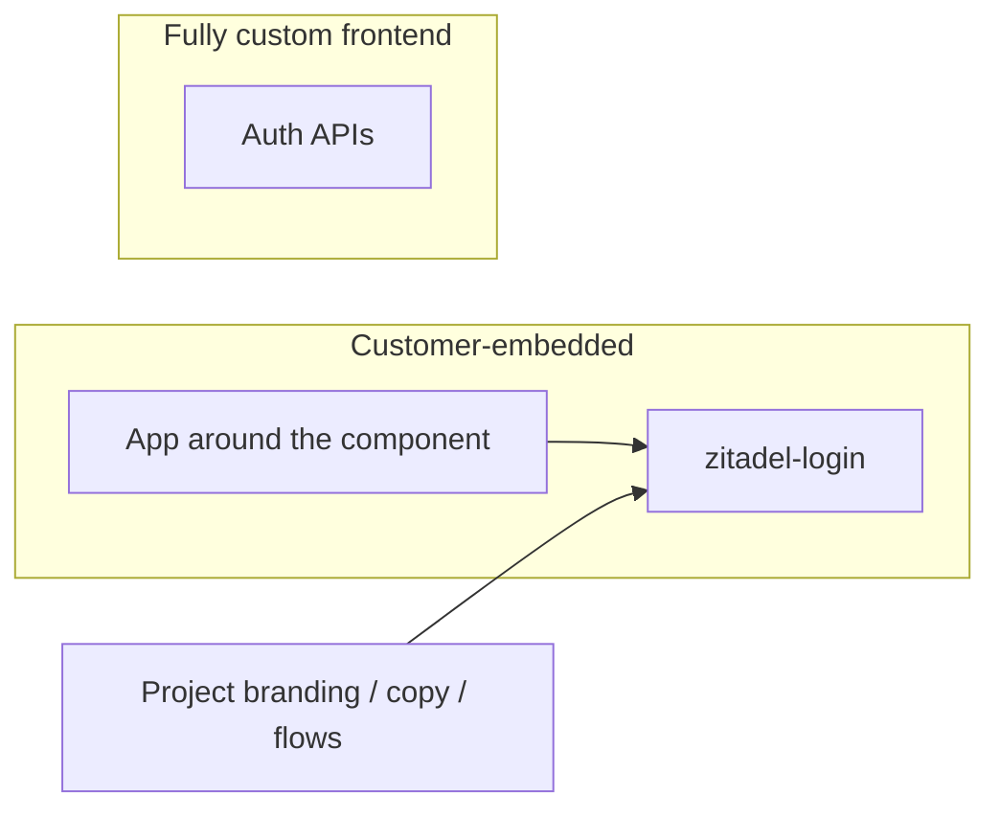
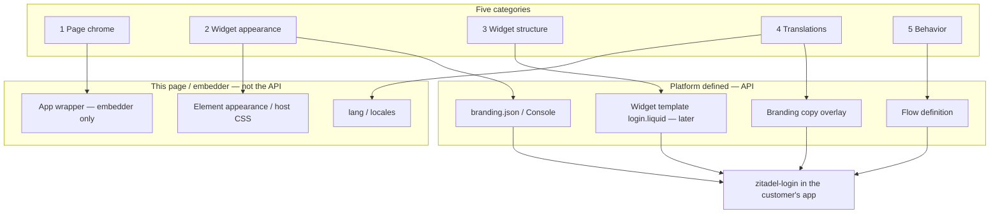
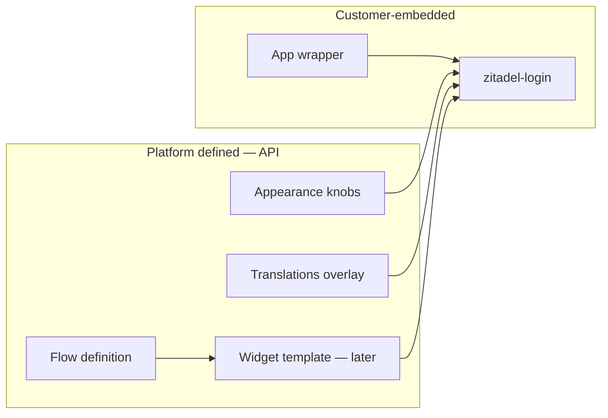
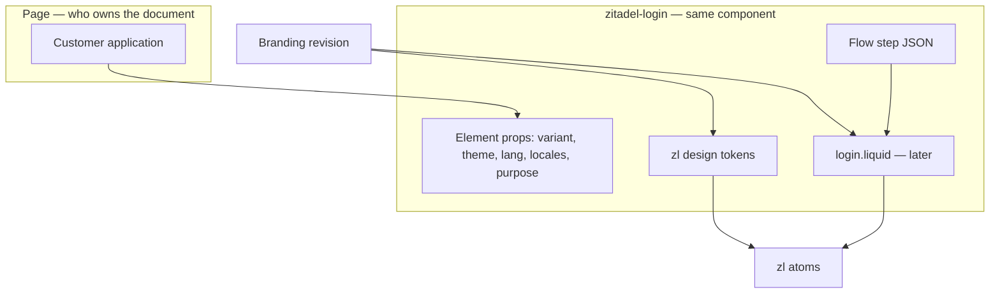

# Login Customization Strategy

> **Status:** Proposed
> **Date:** 2026-08-28
> **Audience:** Product, design, and engineering deciding *where* a login
> customization lives — not the token catalogue or Liquid grammar.
> **Product context:** [#678](https://github.com/zitadel/nextgen/issues/678)
> (vision), [#936](https://github.com/zitadel/nextgen/issues/936) (first
> iteration — branding), [#1038](https://github.com/zitadel/nextgen/issues/1038)
> (translations), [#1039](https://github.com/zitadel/nextgen/issues/1039)
> (setup template), vision doc landing in
> [#1034](https://github.com/zitadel/nextgen/pull/1034)
> **Decisions:** [ADR 057](../../adrs/057-login-customization-categories.md)
> **Amended:** 2026-10-24 — Zitadel-served login is dropped: Zitadel serves
> no login page, and the customer's application presents every login. Two
> presentation models remain.
> **Implements:** [`templates.md`](templates.md), [`schema.md`](schema.md),
> [`tokens.md`](tokens.md), [`override-ladder.md`](override-ladder.md),
> [ADR 040](../../adrs/040-tenant-login-templates-editable-config.md),
> [ADR 044](../../adrs/044-scaffold-embedding-posture-defaults.md),
> [ADR 045](../../adrs/045-copy-overlays-as-branding-revisions.md)

This is the engineering **placement map** under the product vision in #678.
Customers pick a presentation model; they can change it later; they do not
have to.

Nextgen ships one login component — `<zitadel-login>` plus the `<zl-*>`
atoms — and two ways to put authentication in front of a user: embed the
component, or build a fully custom frontend on the APIs. The
product goal is **total customizability** without dumping every kind of
change into one editor, one JSON blob, or one Liquid file. This document
names the customization categories, the surface each one is authored on,
what the first iteration ships, and what stays later or unset.

## Thesis

Customizability is a placement problem, not a missing-knob problem.

A customer who wants a 1:1 split page with marketing copy on the left is
editing **their application**. A customer who wants rounder buttons is
turning a **convenience knob** on the widget. A customer who wants a legal
disclaimer between the password field and the submit button is editing the
**widget template**. Those three changes look similar in a screenshot and
are different products: different authors, different publish paths, different
failure modes.

The strategy is: **give every change exactly one home.** Where a look must
travel with the project — to every app that embeds the login — it lives on
the project-scoped resource (branding, copy, flows, and later widget
structure).

## Two presentation models

From [#678](https://github.com/zitadel/nextgen/issues/678), less the
Zitadel-served login it also named: Zitadel serves no login page, so the
customer's application presents every login ([ADR 057](../../adrs/057-login-customization-categories.md)
amendment). These are **choices**, not stages.

| Model | Zitadel provides | Customer controls |
| --- | --- | --- |
| **Customer-embedded login** | `<zitadel-login>`, journeys, security controls | The application around the component, and supported component customisation |
| **Fully custom frontend** | Authentication APIs, policies, backend enforcement | The complete frontend |

"Self-hosted" is overloaded. Keep this axis separate from the models:

| Axis | Values | What it decides |
| --- | --- | --- |
| **Presentation model** | Embedded · Fully custom | Who presents the login UI |
| **Zitadel runtime** | Cloud · customer-operated server | Where the API runs |

Either runtime backs either model: a customer-operated server and a cloud
project both serve an embedded widget or a fully custom frontend. The
runtime axis does not move a knob from one category to another.



Fully custom does not render `<zitadel-login>`. Shared branding does not
apply there.

### First iteration vs later

[#936](https://github.com/zitadel/nextgen/issues/936) is the first
**branding** milestone: project appearance settings for working embedded
components. It is **not** this whole map, and it is **not** the
translations setting.

Translations is a different setting (locale × key copy overlays,
[ADR 045](../../adrs/045-copy-overlays-as-branding-revisions.md)).
It must not live in the appearance editor.
[#1038](https://github.com/zitadel/nextgen/issues/1038) owns that setting.

| Area | First iteration | Later / unset |
| --- | --- | --- |
| **Appearance (branding settings)** | Supported brand assets, colors, typography inside the embedded components. Console in #936 | More knobs; typed `appearance` sugar |
| **Translations** | Out of this iteration. Different setting ([#1038](https://github.com/zitadel/nextgen/issues/1038)) | Locale × key overlays for supported keys; then more locales |
| **Surrounding application** | Customer-owned. Not customized in #936 | CLI must stop applying a template at setup ([#1039](https://github.com/zitadel/nextgen/issues/1039)) |
| **Structure** (`login.liquid`) | Out of scope | Advanced, opt-in |
| **Behavior** | Login flows; not edited in branding settings | Unchanged ownership |
| **Fully custom frontend** | Not included | Supported APIs and responsibility split |
| **Branding door** | Console appearance settings (#936). Host CSS remains the page-local path | Code-based `branding.json` remains valid; CLI-to-Console handoff is out of #936 |

Do not lock branding to a CLI `setup → apply` path. Setup gets
authentication working. #936 is where a customer opens **branding
settings** for already working embedded components.

## Categories

Five categories. The first three are the ones a screenshot usually
conflates. Translations and behavior must stay out of the appearance
(branding) settings.

| # | Category | What the customer is changing | One-line home | Horizon |
| --- | --- | --- | --- | --- |
| 1 | **Page chrome** | How the login sits on the *page*: split, centered, left-pane content | The app wrapper around the component | Now (their app) |
| 2 | **Widget appearance** | Convenience look *inside* the widget: radii, colors, density, theme, logo | **Branding settings** — tokens / `branding.json` / element `appearance` | **First iteration (#936)** |
| 3 | **Widget structure** | What sits *between the atoms*: disclaimer, grouping | **Widget template** (`login.liquid`) | **Later** |
| 4 | **Translations** | Wording per locale and key | **Translations setting** — locale × key overlays; element `locales` / `lang` | **Separate setting** ([#1038](https://github.com/zitadel/nextgen/issues/1038)), not #936 |
| 5 | **Behavior** | Which steps, fields, factors exist | Flow definition — not an appearance surface | Already owned by flows |

**Why "widget template" at all.** The Liquid file inside the widget is
**advanced structure**: `<zl-*>` against the step payload, no page chrome.
It is not a setup default and not part of #936.

**There is no page template.** Page chrome is application code: with no
Zitadel-served page, nothing needs a Liquid document around the widget.

Page-local knobs (host CSS, `lang` / `locales`, the embedder wrapper) never
enter the API. Project appearance, translations, flows, and later widget structure
are **platform defined**: the same resources the Branding API and Flow API
expose, whether the customer authors them as `.zitadel/` files, Console
settings, or HTTP.





## What would change

Nothing in these tables is implemented by this PR. Follow-up issues will
own the CLI and structure work; #936 owns the first visual loop.

### First iteration — branding settings (#936)

| Surface | Today | First iteration |
| --- | --- | --- |
| Branding settings | Host CSS, and a branding revision published through the CLI or API. The Console shows the revision in use read-only, beside a live login preview and contrast warnings | Console: edit logo, colors, typography, theme on working embedded components. Preview, validate, publish, restore |
| Project look | Optional `branding.json` via CLI | Same branding resource. One appearance customization applies project-wide across the journeys #936 lists |
| Surrounding application | Customer-owned | Still customer-owned. Not edited here |
| Translations | Built-in dictionaries; optional element `locales` | **Different setting** ([#1038](https://github.com/zitadel/nextgen/issues/1038)). Not this iteration |

### Done — setup no longer applies a template

[#1039](https://github.com/zitadel/nextgen/issues/1039) under #678. Not part of #936 (onboarding is out of scope there).

| Surface | Before #1039 | Now |
| --- | --- | --- |
| `zitadel setup --design` / wizard | Wrote `.zitadel/branding/login.liquid` and published branding revision 1. Generated auth page was still a bare `<zitadel-login>` | Setup embeds the maintained component only. Writes **no** Liquid, publishes **no** branding revision. The wizard has no look question; `--design` fails with a hint pointing at app-side theming and `branding eject` |
| Embedder who wants a left pane | Ejected Liquid and edited marketing copy inside the sanitiser | Edits their application. `branding eject --design split\|split-right\|hero` is refused with the same pointer |

### Later — widget structure

| Surface | Today | Later |
| --- | --- | --- |
| `zitadel branding eject --design` | ~~Catalog of five Liquid files that mix page chrome with the form card~~ Done in #1039: `centered` (default card) + `minimal` | Ejects the **widget template** only. No split/hero in this catalog |
| Shared widget structure (disclaimer) | Same eject path, starting files are page layouts | Opt-in `login.liquid` from the default card |

### Legacy — ejected page layouts

| Surface | Today | Status |
| --- | --- | --- |
| Already-ejected split/hero revisions | Render today | Keep rendering. Legacy path |

### 1. Page chrome

Page chrome is everything **outside** `<zitadel-login>`.

The running example: a 1:1 split layout, login on the right, customer content
on the left (product screenshot, value prop, legal, a campaign). That left
pane is not a Zitadel atom and must not be authored as Liquid inside the
widget. It is a wrapping element the customer owns:

```tsx
<section className="grid min-h-svh grid-cols-2">
  <aside>{/* their content — copy, image, nav */}</aside>
  <zitadel-login variant="widget" purpose="login" />
</section>
```

`variant="widget"` is the contract that makes this honest: the widget is
content-sized and does not paint page chrome of its own
([ADR 044](../../adrs/044-scaffold-embedding-posture-defaults.md)).
`variant="page"` is the other posture — a dedicated login route that *is*
the page, used by fresh scaffolds.

**Embedded.** Authored in the customer's application. New-app setup may
leave a starting page the customer then edits; existing apps place the
component in their layout
([ADR 042](../../adrs/042-scaffolded-file-ownership-and-drift-detection.md)).
Those files are not Zitadel templates.

There is no Zitadel-served page whose chrome would need a template of its
own ([ADR 057](../../adrs/057-login-customization-categories.md)
amendment), so page chrome never becomes a Zitadel artifact. Do not grow
widget-internal splits as a stand-in.

### 2. Widget appearance

Convenience knobs that restyle the atoms without reordering them: button
and input radius, palette, density, light/dark, logo, typography scale.

These are `--zl-*` tokens plus a small structured branding shape
([`schema.md`](schema.md) `palette` / `shape` / `typography` / `theme`,
[`tokens.md`](tokens.md)). Customers should never have to write Liquid to
round a corner.

Two authoring surfaces, same tokens:

| Author | Surface | When to use it |
| --- | --- | --- |
| Embedder, this page only | JS/CSS on `<zitadel-login>` — `theme`, `variant`, host CSS `--zl-radius-md`, `::part()` | Match the host app *right now*, no publish |
| Project (every surface) | Branding revision — `.zitadel/branding/branding.json` via CLI, or Console settings | A second app, or a designer who should not touch the repo |

Host-page tokens beat server-side branding
([`override-ladder.md`](override-ladder.md)). That is intentional: an
embedded login should be able to inherit the app's design system without a
round-trip. Leave the host tokens unset and the project branding applies
unchanged.

The same object, three doors, all compiling to `--zl-*`. The second and third ship. The first, an `appearance` property on the element, is proposed and the element does not have it; its shape below is a sketch:

```html
<zitadel-login
  variant="widget"
  theme="light"
  appearance='{
    "logo_url": "https://cdn.acme.com/logo.svg",
    "palette": { "primary": "#4F46E5", "on_primary": "#FFFFFF" },
    "shape": { "radius": "lg", "density": "comfortable" },
    "typography": { "font_family": "Inter, ui-sans-serif, sans-serif" },
    "chrome": "card"
  }'
></zitadel-login>
```

```css
zitadel-login {
  --zl-radius-md: 0.75rem;
  --zl-radius-xl: 1.25rem;
  --zl-primary: #4F46E5;
  --zl-font-family-sans: Inter, ui-sans-serif, sans-serif;
}
```

```json
{
  "theme": {
    "mode": "dark",
    "dark": {
      "logo_url": "https://cdn.acme.com/logo.svg",
      "palette": { "primary": "#4F46E5", "on_primary": "#FFFFFF" }
    }
  },
  "shape": { "radius": "lg", "density": "regular" },
  "typography": { "font_family": "Inter, ui-sans-serif, sans-serif" }
}
```

| Knob | Values | Effect |
| --- | --- | --- |
| `theme.<side>.palette.primary` / `on_primary` | CSS color | CTA, focus ring |
| `theme.<side>.palette.background` / `surface` / `text` / `border` | CSS color | page vs card |
| `shape.radius` | `none` \| `sm` \| `md` \| `lg` \| `full`, or integer pixels | `--zl-radius-*` scale |
| `shape.density` | `compact` \| `regular` \| `comfortable` | spacing |
| `typography.font_family` | CSS stack | one face for body and headings |
| `theme.mode` | `light` \| `dark` \| `auto` | `data-theme` |
| `theme.<side>.logo_url` | HTTPS URL | mark in the widget header, per side |
| `chrome` (proposed, not in the contract) | `card` \| `plain` | card on/off (`minimal` without a template) |

`<side>` is `light` or `dark`. The contract is [`schema.md`](schema.md).

A typed `appearance` property on the element would be sugar over this shape,
not a third vocabulary. `theme`, `variant`, `lang`, `locales`, `purpose` stay
page-local element facts. Host CSS still beats the project object.

### 3. Widget structure

Everything that lives **between the atoms** and is still *inside* the
widget: field order and grouping, a disclaimer under the password field, a
"or continue with" divider, footer legal links, a compact header.

That is the **widget template** — `branding.liquid_template`, authored as
`.zitadel/branding/login.liquid`. Scope is **structure only**: compose
`<zl-*>` against the step payload; do not set colors; do not wrap the
page ([`templates.md`](templates.md)). It must stay strict: loosening it
for a left pane would loosen every embed.

A disclaimer belongs here because it is step-aware (show it on `password`,
not on `mfa_totp`), should travel with the project to every app, and is not
host-page content. A marketing essay on the left of a split does **not**.

**Later, not setup, not #936.** Opt-in when it ships. `zitadel branding
eject` copies the bundled default card into `login.liquid`; `plan` /
`apply` publishes a revision
([ADR 040](../../adrs/040-tenant-login-templates-editable-config.md)).
Setup must not write this file. Console may later grow a block editor
that emits the same validator. Split/hero must not re-enter this catalog.

### 4. Translations

User-facing strings, keyed by locale and message key. A **different
setting** from branding appearance — not fields on the #936 branding
screen, even if copy later travels on the same branding revision for
publish
([ADR 045](../../adrs/045-copy-overlays-as-branding-revisions.md)).
[#1038](https://github.com/zitadel/nextgen/issues/1038) owns this setting.

- **Project translations** — locale × key copy overlays. CLI and Console
  write this setting; the flow response delivers the effective overlay.
- **This page only** — `lang` and `locales` on `<zitadel-login>`
  ([ADR 018](../../adrs/018-widget-owned-locale-resolution.md)). Highest
  precedence; for embedders who need a one-off override.

Templates keep using `text_key` and `| t`. Hard-coded copy in Liquid is a
smell except for chrome the dictionary has no key for yet.

### 5. Behavior

Which identifier the user types, whether passkey is offered, what happens
after register — that is the **flow definition**
(`.zitadel/flows/`, Console flow editor). Appearance surfaces must not grow
"hide the SSO row" or "add a phone field" switches. Those are flow edits.
The template renders whatever the step payload contains; it does not decide
the payload.

## Where each category lives

One component, rendered by the customer's application. Fully custom does
not render it and is out of this table.

| Category | Customer-embedded | Shared source of truth |
| --- | --- | --- |
| **Page chrome** | App around the component. Not a Zitadel template. | *None shared.* The application owns it. |
| **Widget appearance** | Host CSS / `theme`, and later `appearance`. Optional `branding.json`. Console in #936. | Branding revision when the look must follow the project. |
| **Widget structure** | Later: opt-in **widget template** from the bundled default, or a later block editor. | `branding.liquid_template` — strict scope, **later**. |
| **Translations** | `lang` / `locales` on the element. Copy overlays later (ADR 045). | Locale × key overlay resource; element `locales` remains the embedder override. Not the branding-settings screen. |
| **Behavior** | `.zitadel/flows/*.json` via plan/apply, or the Console flow editor. | Flow definition (release-pinned per [ADR 035](../../adrs/035-configuration-environments.md)). |



### Self-hosters of the widget, in practice

"JS configuration of `zitadel-login`" means the **element API** plus the
host stylesheet, not a second configuration file format:

- **Properties / attributes** — `variant`, `theme`, `purpose`, `lang`,
  `locales`, `post-sign-in-url`, project handle. Page-local.
- **CSS custom properties** on `zitadel-login` — the appearance knobs for
  this page.
- **`::part()`** — surgical restyle of an atom interior
  ([`override-ladder.md`](override-ladder.md) tier 2).
- **Project branding** — the path every other app that embeds the login
  sees. Embedders who only set host CSS have customized *this page*; they
  have not customized the project.

## How customers customise (not a ladder)

Two doors. A customer picks one model and can change later. Neither path
is a prerequisite for the other.

### Customer-embedded

1. Get authentication working — new app starting page, or drop the
   component into an existing layout
   ([ADR 044](../../adrs/044-scaffold-embedding-posture-defaults.md)).
2. **First iteration (#936):** open **branding settings** for those
   working components. Appearance only — preview, publish, restore.
   Translations is a different setting
   ([#1038](https://github.com/zitadel/nextgen/issues/1038)).
3. Page chrome stays in the application. Host CSS / element props remain
   the no-publish path for "match this page."
4. **Later:** opt-in widget structure (`login.liquid`) if something must
   sit between atoms.
5. Behaviour stays on the flow definition.

Setup is only step 1. The former `setup --design`, which ejected Liquid
and published branding revision 1, was retired by
[#1039](https://github.com/zitadel/nextgen/issues/1039); see
[What the shipped designs really are](#what-the-shipped-designs-really-are).

### Fully custom frontend

APIs, policies, backend enforcement. The customer owns the UI. This is a
presentation model, not an eject footnote at the end of the embed path.

When knobs, parts, and (later) Liquid are not enough *inside* an embed,
customers can still compose `<zl-*>` by hand or eject an atom
([`override-ladder.md`](override-ladder.md) tier 4). That is embedded
escape, not the fully custom model.

Under [ADR 035](../../adrs/035-configuration-environments.md), branding and
flows become release-pinned. This strategy does not change that boundary.

## What the shipped designs really are

ADR 040 shipped five named Liquid files under
`packages/config/defaults/branding/*/login.liquid` (the audit below
predates #1039, which kept only `centered` and `minimal`). `setup --design`
copied one of them into `.zitadel/branding/` and published it as branding
revision 1; `branding eject --design` copies one locally for the next
`apply` to publish. The generated auth page is still just
`<zitadel-login>` — the "design" never becomes a wrapper. An audit of
those files:

| Design | What differs from the bundled `default.liquid` | Category it actually is |
| --- | --- | --- |
| `centered` | Nothing. Drift-tested copy of the bundled default. | The widget itself. Ejecting it only materializes a file the customer did not need yet. |
| `minimal` | Same field/action/passkey/gates loop; drops `<zl-card>` and the logo slot; wraps in `.zl-minimal`. | A thin widget-chrome variant (card off). Could be a host class or a future `chrome` knob; it is not a page layout. |
| `split` | Same card, wrapped in `.zl-split` with a brand `<aside>` (`logo_url` / `hero_url` / gradient placeholder), a compact mark for narrow containers, and an attribution anchor. | **Page chrome.** A 1:1 split whose left pane is an asset, not product UI. |
| `split-right` | `split` plus `zl-split--right`. | The same page chrome, mirrored. |
| `hero` | Same card, plus a landing-page left pane (nav, headline, bullets, footnote) whose own comment says "YOUR LANDING CONTENT — everything inside this aside is yours." | **Page chrome**, and the loudest proof: the template invites you to edit marketing copy inside a sandboxed Liquid string. |

The form wiring (~160 lines) is copy-pasted five times. The only real
payload of `split` / `split-right` / `hero` is a grid and a left pane.
The CSS that paints that grid (`layout-chrome.css`: `.zl-split*`,
`.zl-hero*`) lives in the orchestrator shadow root *because* the chrome
was stuffed into Liquid.

**They are not worth keeping as widget templates for embedders.** An
embedder who wants a split already has a better tool — their application.
Saving the split as `login.liquid` costs them a branding revision, a
sanitiser, a five-way template fork, and a left pane they cannot fill
with real React/Vue. Setup should leave the widget on the bundled default
and must not publish those files. A follow-up may still offer a look pick
that writes **application** files only.

`minimal` is the one catalog entry that is not page chrome. Keep the
idea (card-less widget) as a future appearance/chrome knob or as the
starting point of an opt-in eject. Do not keep it as a reason to ship
four page layouts as Liquid.

Already-ejected revisions keep rendering. This is direction, not a
runtime break.

### Vocabulary after this shift

| Term | Meaning |
| --- | --- |
| **Widget template** | Advanced widget structure (`login.liquid`). Strict scope: `<zl-*>` + step payload. **Later**, not setup, not #936. |
| **Wrapper** | Embedder application code around the widget. Not a Zitadel template. |
| **Design** | Retired as the setup noun. Historical Liquid starting points; no longer the path to a look. |
| **Layout** | Wire enum `centered \| split` on the branding object. The bundled template does not read it. Not how you get a split page. |
| **Branding** | Project resource for appearance, optional (later) widget template, assets, and copy. Not page chrome. |
| **Zitadel-served login** | Dropped: Zitadel presents no login page ([ADR 057](../../adrs/057-login-customization-categories.md) amendment). Alias: hosted login. |

## What we will not do

- **One mega-editor** that paints the page wrapper, the tokens, and the
  atom order as a single artifact. The publish paths and trust boundaries
  differ.
- **`advanced.custom_css` as the customization surface.** Rejected in
  [`schema.md`](schema.md); the override ladder covers CSS.
- **Treat the two models as a ladder.** Embedded and fully custom are
  choices; neither leads to the other.
- **Lock branding settings to a CLI-led journey.** #936 is Console
  appearance settings for working embedded components. Setup only gets
  login working.
- **Put translations in the branding-settings editor.** Copy is a
  different setting ([#1038](https://github.com/zitadel/nextgen/issues/1038)).
- **Page chrome inside the widget template.** That file must stay
  structure-only. Page chrome lives in the app.
- **Appearance switches that change the flow** ("add phone", "hide SSO").
  Those are flow-definition edits.
- **Serve a login page from Zitadel.** The customer's app presents every
  login; the server ships none ([ADR 057](../../adrs/057-login-customization-categories.md)
  amendment).
- **Requiring `apply` to restyle one embedded page.** Host CSS and element
  properties exist so embedders can match an app without a config release.
- **Keep shipping split/hero as Liquid so embedders can skip writing a
  wrapper.** Those files *are* wrappers, poorly placed.
- **A `page.liquid` page template.** With no Zitadel-served page there is
  no page to template.
- **Put structure or setup-template work in #936.** Onboarding and
  CLI-to-Console handoff are out of scope there.

## Rollout

Matches #678's delivery direction, with #936 as the first visual ticket.

| Stage | What customers can do | Ticket |
| --- | --- | --- |
| **Now (shipped)** | `branding eject` offers `centered` + `minimal` only | Setup no longer ejects Liquid; split/hero retired from the catalog ([#1039](https://github.com/zitadel/nextgen/issues/1039)) |
| **First iteration** | Console **branding settings** (appearance) on working embedded components; preview / publish / restore | [#936](https://github.com/zitadel/nextgen/issues/936) |
| **Translations setting** | Locale × key copy overlays. Different Console setting from branding | [#1038](https://github.com/zitadel/nextgen/issues/1038) |
| **Follow-up (done)** | Setup embeds the maintained component only. No Liquid, no branding revision 1. `branding eject` stays opt-in and offers widget structure only (`centered`, `minimal`) | [#1039](https://github.com/zitadel/nextgen/issues/1039) |
| **Later** | Widget structure (`login.liquid`) from the default card | New issue under #678 |

## Open questions

1. **`minimal` as a knob vs an eject starting point.** Card-less chrome is
   the one shipped design that is not a page layout. Appearance knob
   (`chrome: card \| plain`) is simpler for embedders; eject still covers
   anyone who wants to delete more than the card.
2. **Attribution / powered-by** — still open in [`README.md`](README.md).
   Treat it as widget chrome (category 3 or a policy flag), not page
   chrome.
3. **Migration of already-ejected split/hero revisions.** They keep
   working. Do we later offer a one-shot "move this left pane into your
   app wrapper" helper, or leave them as a supported legacy render path?

## See also

- [#678 Customise the authentication experience](https://github.com/zitadel/nextgen/issues/678) —
  product vision and presentation models
- [#936 Visually customize and preview the embedded login components](https://github.com/zitadel/nextgen/issues/936) —
  first iteration (branding)
- [#1038 Customize login translations](https://github.com/zitadel/nextgen/issues/1038) —
  locale × key overlays; different setting from branding
- [#1039 Stop zitadel setup from applying a login template](https://github.com/zitadel/nextgen/issues/1039) —
  setup embeds the maintained component only
- [#1034 vision doc](https://github.com/zitadel/nextgen/pull/1034) —
  landing `authentication-experience-vision.md`
- [ADR 057](../../adrs/057-login-customization-categories.md) — the
  decision record for these categories
- [`templates.md`](templates.md) — Liquid scope, shipped designs, eject
  workflow
- [`schema.md`](schema.md) / [`tokens.md`](tokens.md) — appearance knobs
- [`override-ladder.md`](override-ladder.md) — tokens → parts → slots →
  eject
- [ADR 040](../../adrs/040-tenant-login-templates-editable-config.md) —
  branding as editable config
- [ADR 044](../../adrs/044-scaffold-embedding-posture-defaults.md) —
  `page` vs `widget` posture
- [`../platform/README.md`](../platform/README.md) — integration levels
