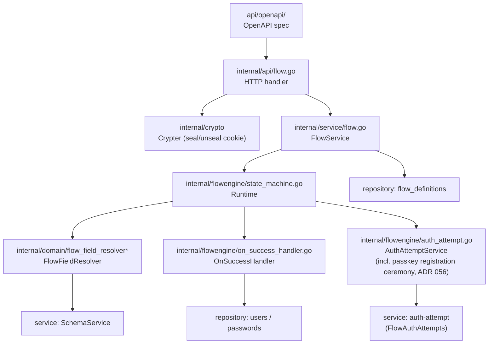
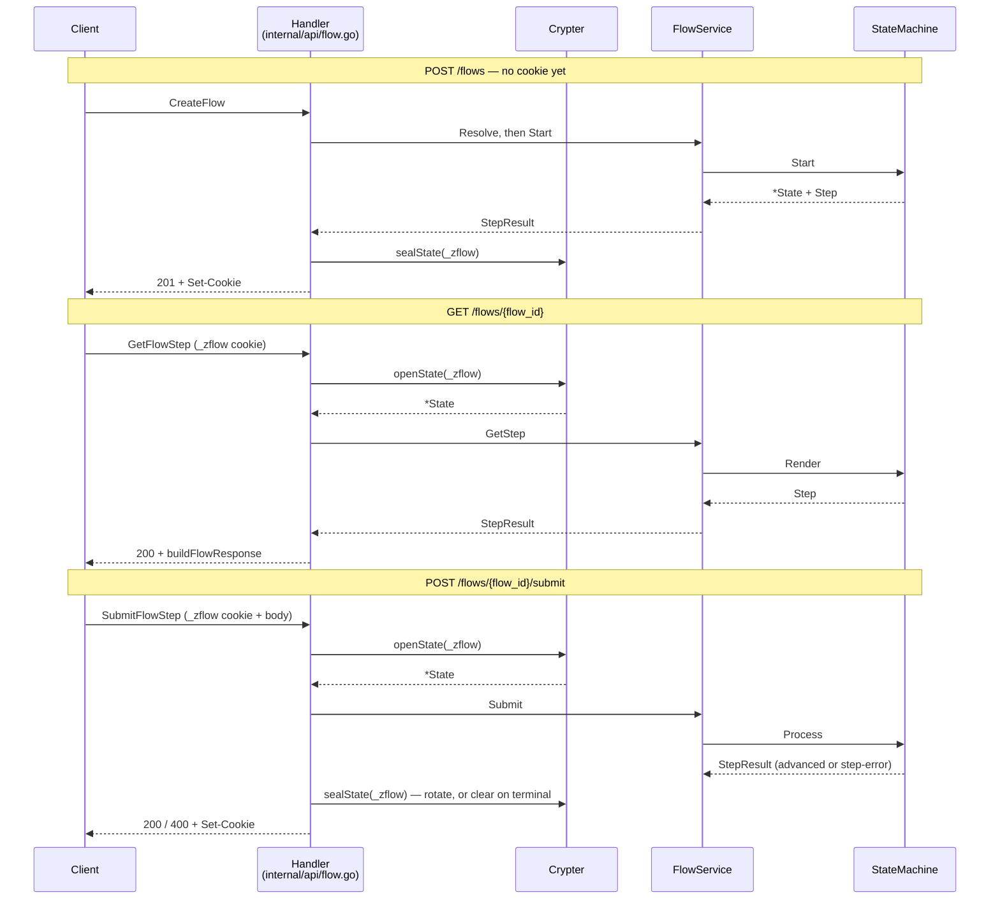

# Flow Engine — Architecture

> **Status:** Current
> **See also:** [Flow Engine](flow-engine.md) · [Definition Rules](flow-definition-rules.md) · [Capabilities](capabilities.md) · [Storage](flow-engine-storage.md)

This document maps the flow engine to the code that runs it: the components
that live inside the engine, the boundary code that drives it, and the
collaborators it calls into.

## Component map



## Request path



Cookie I/O is owned by the handler. The state machine never touches HTTP, cookies, or the encryption layer — it receives a `*flowengine.State` and returns one.

## Separation of concerns

A request passes three layers:

```
internal/api          opens the sealed _zflow cookie, maps HTTP to service calls, seals the returned state
   │
internal/service      I/O: database reads, release pins, sessions, ids, spans, metrics, audit
   │
internal/flowengine   decisions: which step, which outcome, which ceremony, when the flow completes
```

| Concern | `flowengine` | `service` |
| --- | --- | --- |
| Entry definition | chooses among candidates (`EntryByName`, `EntryByAudience`) | reads the release pins and loads the candidates (`FlowService.Resolve`) |
| Start | builds the first `State` and step | resolves the user schema and session, mints the flow id, binds audit |
| Definitions during a flow | reads the one the state names (`ActiveDefinition`) | provides the lookup by id (`Definitions`) |
| Submission | validates, routes, runs actions and ceremonies | passes the request through |
| Auth attempts, users, SSO, password policy | calls them through interfaces it declares | implements those interfaces |
| Sign-up gate | announces it on the step (`SignupRequired`) | issues the proof-of-work puzzle on render |
| Completion | decides the flow is done and requests the handoff | mints the handoff token behind `AuthAttemptService` |
| Flow state | declares `State`, takes and returns it | never stores it; the handler seals it into the cookie |
| Wiring | `New(Deps)` | `NewFlowEngine(FlowEngineDeps)` builds the engine and its collaborators |

Rules that keep the split:

- `flowengine` imports `domain`; `domain` never imports `flowengine`.
- Flow definitions and their validation belong to `domain`; the engine only reads them.
- A flow decision goes in `flowengine`, even when it needs data the service
  loads: the service loads it and passes it in.
- The engine never touches the database, the cookie or the HTTP request directly.

## Internal components

The components below all live under `internal/flowengine/`, `internal/domain/` and `internal/service/`.

### `FlowService` (`internal/service/flow.go`)

The use-case surface the HTTP handler depends on. Four methods:

| Method | Responsibility |
|---|---|
| `Resolve` | Read the revisions the release pins and let the engine pick the `FlowDefinition` to run: `Name` → the one pinned under it, checked by `flowengine.EntryByName`; otherwise all of them, ranked by `flowengine.EntryByAudience` (`entry_definition.go`). |
| `Start` | Mint the `flow_*` and `sess_*` ids and hand them, with the deployment and release the request resolved to, to `stateMachine.Start`, which builds the `flowengine.State`. |
| `Submit` | Hand the request's `flowengine.Definitions` to `stateMachine.Process`, which loads the definition the state names. |
| `GetStep` | Hand the request's `flowengine.Definitions` to `stateMachine.Render` (no advancement). |

The engine reads the running flow's definition through
`flowengine.ActiveDefinition`, once per request; the step it returns announces
the sign-up gate (`signup_gate.go`). The request's `flowengine.Definitions`
looks the revision up by the id the state names, within the flow's project.
`GetStep` issues the sign-up puzzle when the rendered step announces the gate.

Service holds `*service.DB` (v2 statements), the `flowengine.StateMachine`
interface and the sign-up protection. Flow definitions are loaded via
`ListFlowDefinitions` / `GetFlowDefinitionByID` on the statements.

### `flowengine.Runtime` (`internal/flowengine/state_machine.go`)

The state machine. Three entry points (`Start`, `Process`, `Render`) and one private pipeline:

```
Process(in):
  ├── restart the flow if its auth attempt expired or was handed off
  ├── find current step in definition
  ├── resolve fields via FlowFieldResolver
  ├── prefillFromCollected: hydrate resolved fields from state.CollectedData
  ├── validate submitted values
  │     └─ on error: return same step with Error set
  ├── merge fields into state.CollectedData
  ├── if action ∈ {passkey, passkey_register}:
  │     ├─ Phase 1 (no proof yet):
  │     │   ├─ login: run dispatchChallenges first so SubmitIdentifier
  │     │   │   resolves the user and PreparePasskeyChallenge can
  │     │   │   populate allowCredentials
  │     │   └─ register: the attempt service mints a provisional user
  │     │       handle (stored as _user_id; the persisted challenge is
  │     │       authoritative for provisional-or-not)
  │     └─ Phase 2 (challenge_response present):
  │         ├─ verify the assertion / attestation
  │         ├─ registration verify is atomic in the attempt service:
  │         │   create-user actions (provisional only), credential,
  │         │   user factor, and check success in one transaction;
  │         │   a lost uniqueness race routes user_already_exists after
  │         │   pinning the conflicting owner; a stale ceremony clears
  │         │   the pending challenge so a retry mints a fresh one
  │         └─ on success, fall through to terminal handoff
  ├── dispatchChallenges (identifier, then password) — skipped when the
  │     passkey ceremony handled the step
  │     ├─ verify-vs-skip keyed on state.CurrentPurpose + visited on_success
  │     ├─ on user_not_found / user_already_exists: route via outcome
  │     │   (and flip CurrentPurpose per the engine's flip rule)
  │     └─ on password reject: return same step with Error set
  ├── if step.OnSuccess set: run handler (create_user today)
  ├── look up routeOutcome in step.Transitions
  ├── advance state (push to history, set CurrentStep)
  └── if next step is terminal:
        ├── render terminal step
        └── if a user was resolved: authAttempts.Handoff → token + expiry
```

Inside `internal/flowengine`, by file:

| Component | Files | What it does |
| --- | --- | --- |
| Runtime | `state_machine.go` | `StateMachine` and its `Runtime`: `Start`, `Process`, `Render`, each returning a `StepResult` (the new `State` and the `Step` the client shows) |
| State | `state.go` | everything a running flow remembers between requests: definition and step, collected data, back stack, pending ceremony, auth attempt, release; sealed into the cookie, so the engine keeps nothing between requests |
| Definitions | `definition.go`, `entry_definition.go` | the entry definition a new flow starts on (by name or best audience match), and `ActiveDefinition`, the one way to read a running flow's definition |
| Actions | `action.go`, `action_<kind>.go` | a table of one handler per action kind (submit, back, navigate, passkey, passkey register), one file per kind |
| Fields | `fields.go` | resolves a step's fields against the user schema, prefills them, applies the password policy, validates and merges submitted values |
| Routing | `routing.go`, `back.go` | turns an outcome into the next step: transitions, purpose flips, identifier challenges, the back stack |
| Ceremonies | `challenge.go`, `passkey.go`, `sso.go` | two-phase proofs through a table of one declaration per method; passkey parameters; the external identity provider round trip |
| Outcomes | `on_success.go` | a table of one handler per `on_success` value, such as creating the user |
| Completion | `completion.go` | `completeFlow`, which every route onto a terminal step passes and the only caller of `Handoff`; an optional `CompletionPolicy` may refuse, and nothing wires one yet |
| Sign-up gate | `signup_gate.go` | marks a step `SignupRequired` when submitting it can create a user |
| Rendering | `render.go` | builds the client-facing `Step`: fields, actions, identifier, pending challenge, errors |

Each test file is named after the concern it covers; `*_internal_test.go`
files test unexported helpers, the rest drive `StateMachine` with mocks from
`flowengine/mock`.

Errors that surface from `Process`:

- `ErrInvalidAction` — submitted action not in the step's `Transitions`.
- `ErrIntegrity` — wiring contract violated (missing definition, missing step, missing dependency).
- `ErrUnsupported` — feature deferred (cross-flow transitions, gate proofs).
- `ErrSessionConflict` — reserved; not emitted today.

### `FlowFieldResolver` (`internal/domain/flow_field_resolver*.go`)

Interface (`Resolve` + `Validate`) plus a schema-backed implementation in `flow_field_resolver_schema.go`. Given a user schema URL and a list of property names, it returns:

- `FlowField` per property — UI input `Type`, `TextKey`, `Required`, optional `Validation`, the field's uniqueness scope, and the `FlowFieldChallenge` it maps to (derived from the property's `x-unique` annotation, or — for credential fields — the reserved `x-auth-methods#<method>` field name resolved against the schema root's `x-auth-methods`).
- `ImplicitOutcomes` per field — the engine-emitted routing outcomes the field contributes (today: `user_not_found` and `user_already_exists` from identifier-shaped fields).

`Validate` walks the resolved fields and returns `FlowFieldValidationErrors` on rule violations — the state machine surfaces those as step errors.

### `flowengine.OnSuccessHandler` (`internal/flowengine/on_success_handler.go`)

Interface every `on_success` mutation satisfies. One implementation today:

- `FlowCreateUserWithPasswordHandler` (`internal/service/flow_create_user_with_password_handler.go`) — reads the identifier and password fields from the collected data, hashes the password (argon2id), and applies user creation, password persistence, and the attempt's verified user + password factors (with their `auth.check.succeeded` events) in one transaction. A handler that returns a `UserID` must persist the user's factors itself; the state machine only records the id in flow state.

### `flowengine.AuthAttemptService` (`internal/flowengine/auth_attempt.go`)

A narrow interface over the auth-attempt service. The state machine sees
`Start`, `SubmitIdentifier`, `SubmitPassword`, the two legs of every
two-phase ceremony (`IssueChallenge`/`VerifyChallenge`), and `Handoff`.
Identifier no-match and password rejection both surface as
`ErrAuthAttemptProofRejected`, which the state machine routes
(`user_not_found`) or re-renders (step error) accordingly.

`IssueChallenge` takes a `flowengine.ChallengeParams` value, one type per check
(`flowengine.PasskeyChallengeParams`, `flowengine.PasskeyRegistrationChallengeParams`, ADR
056); `VerifyChallenge` takes the check type and the client's proof bytes. A
new ceremony adds a params type and an entry in the engine's
`challengeMethods` table (`flowengine/challenge.go`), which declares the
check, the step error of a rejected or stale proof, and whether the ceremony
binds its user at issue, may create it, or cannot be backed out of.

The registration verify leg is atomic in the attempt service: for a
provisional ceremony it applies the create-user actions (built by a factory
invoked with the challenge's authoritative user handle), persists the
credential, records the user factor, and marks the check succeeded in one
transaction. A lost uniqueness race surfaces as `ErrUserAlreadyExists`, which
the state machine routes like the identifier-dispatch conflict after pinning
the actually-conflicting owner via the collected identifier-class fields.

### Domain types worth knowing

- `FlowDefinition` / `FlowDefinitionStep` — the immutable graph (`flow_definition.go`). Steps don't have a `type`; behavior derives from `Fields`, `Actions`, `Gates`, `SSOProviders`, `OnSuccess`, `Complete`, and `Transitions`.
- `flowengine.State` / `flowengine.Progress` — the cookie payload (`flowengine/state.go`). `flowengine.State` wraps `flowengine.Progress` (current step, history, collected data, `Purpose`, and the dispatch-mode `CurrentPurpose`) and adds session/OIDC context plus a reserved `PivotStack`.
- `flowengine.Step` — the capability payload returned to the client (`flowengine/state_machine.go`). `Challenge` carries the issue-leg payload of a two-phase ceremony.
- `flowengine.StepChallenge` / `flowengine.ChallengeResponse` / `flowengine.PendingChallenge` — the two-phase ceremony contract: a pending challenge the client signs, and the proof it submits back.
- Reserved key `FlowCollectedUserIDKey` (`_user_id`) — set by the dispatch loop when the auth-attempt identifies the user; gates whether the terminal step mints a handoff. For a provisional passkey registration it carries the server-minted user handle between the issue and verify legs (the persisted challenge, not the cookie, is authoritative for provisional-or-not).

## Upstream dependencies (what calls into the engine)

### HTTP handler — `internal/api/flow.go`

Implements three ogen-generated method signatures: `CreateFlow`, `SubmitFlowStep`, `GetFlowStep`. The handler:

- Decodes ogen request types into `service.*Request` shapes.
- Calls `FlowService`.
- Seals the returned `*flowengine.State` into the `_zflow` cookie (`HttpOnly`, `Secure`, `SameSite=Strict`, `Max-Age=600`).
- Translates `flowengine.StepResult` into the OpenAPI `FlowResponse` (`toFlowStep`, `toFlowField`, `toFlowStepActions`).
- Maps domain errors to HTTP status codes (`mapFlowErrorStatus`, `mapFlowGetError`).
- Derives the WebAuthn RPID from the effective request host injected by `WithRequestHostMiddleware` (`internal/api/security.go`) — needed because same-origin browser fetches do not send an `Origin` header.

Cookie semantics:

| Sentinel | HTTP code | Cookie response |
|---|---|---|
| `errFlowCookieMissing` / `errFlowCookieInvalid` | 401 | none |
| `errFlowCookieExpired` | 401 | none |
| `errFlowIDMismatch` | 404 | none |
| `errFlowCompleted` (GET only) | 410 | none |
| Validation step error | 400 | rotated cookie |
| Terminal step | 200 | cleared cookie (`Max-Age=0`) |
| Advancing step | 200 | rotated cookie |

### Cookie sealer — `internal/crypto.Crypter`

Interface with `Encrypt(string) (string, error)` and `Decrypt(string) (string, error)`. Wired into `Handler.crypter` at construction. The handler's `sealState` / `openState` helpers wrap JSON encoding around it. Max-age expiration is enforced separately by comparing `state.IssuedAt` against `flowCookieMaxAgeSeconds`.

### OpenAPI spec — `api/openapi/`

Source of truth for the wire format. The ogen-generated types under `internal/api/generated/` are what the handler receives and returns. The relevant schemas live in `api/openapi/components/flows/`. Changing a request or response shape starts here.

## Downstream dependencies (what the engine calls)

The engine declares an interface for each collaborator; `service` implements
it, and `internal/flowengine/mock` holds the generated mocks.

| Interface (`internal/flowengine/`) | Implementation (`internal/service/`) | Purpose |
| --- | --- | --- |
| `AuthAttemptService` (`auth_attempt.go`) | `FlowAuthAttempts` | start an attempt, record identifier and password, issue and verify challenges, check liveness, hand off |
| `OnSuccessHandler` (`on_success_handler.go`) | `FlowCreateUserWithPasswordHandler` | run a step's outcome |
| `SSOProviderResolver` (`sso_services.go`) | `FlowSSOProviderResolver` | look up the step's providers |
| `SSORedirectIssuer` (`sso_services.go`) | `FlowSSORedirectIssuer` | issue the provider redirect |
| `SSOIdentityService` (`sso_services.go`) | `FlowSSOIdentityResolver` | load and bind external identities |
| `PasswordPolicy` (`password_policy.go`) | `PasswordPolicy` | the project's password length bounds |
| `CompletionPolicy` (`completion.go`) | none yet | may refuse to complete a flow |

### auth-attempt service

Wired in as `flowengine.AuthAttemptService` via `FlowAuthAttempts`
(`internal/service/flow_auth_attempt.go`). The state machine calls `Start` at
`FlowService.Start`, `SubmitIdentifier` and `SubmitPassword` from
`dispatchChallenges`, the passkey and passkey-registration issue/submit legs
from the two-phase ceremony handler, and `Handoff` at the terminal step when a
user has been resolved. The production implementation is the
`AuthAttemptService` in `internal/service/auth_attempt.go`; the registration
ceremony rides the same attempt + checks machinery (ADR 056).

### `FlowDefinitionStatements`

Postgres, Spanner, and SQLite implementations live under
`internal/storage/dialect/{postgres,spanner,sqlite}/flow_definition.go` and back
`FlowService.Resolve` (list pinned definitions) and `FlowService.Submit` /
`GetStep` (look up by id through `flowengine.Definitions`). Migrations ship
`flow_definitions` SQL per dialect.

### User writers

`FlowCreateUserWithPasswordHandler` composes `UserService.ApplyActions` with a
create-user action, a set-password action, and the attempt-factor recording
action, so all writes share one transaction. The handler itself stays
storage-agnostic.

### Password hasher

`FlowPasswordHasher` (`internal/domain/flow_on_success.go`). The runtime implementation lives in `internal/crypto/` and is injected at wiring time.

### Schema service

Backs the schema-driven `FlowFieldResolver` implementation. Reads the user schema referenced by `FlowDefinition.UserSchema` and translates JSON Schema + `x-*` annotations into `FlowField` and `ImplicitOutcomes`.

### ID generator

Dialect-owned `NewManagedID` on the storage pool (ADR 047). `FlowService`
mints `flow_*` / provisional `session_*` ids at `Start`; the attempt service
mints provisional `user_*` handles when a registration challenge is issued
without a pinned user; create inserts mint managed resource IDs in the
dialect. Auth attempts use DB IDENTITY (ephemeral IDs).

## Where to read next

- [`flow-engine.md`](flow-engine.md) — design-level overview of definitions, resolution, and capabilities.
- [`flow-definition-rules.md`](flow-definition-rules.md) — definition shape and validation rules.
- [`capabilities.md`](capabilities.md) — what works today, what's stubbed, what's missing.
- [`flow-engine-storage.md`](flow-engine-storage.md) — why the cookie, why the DB stays quiet between submits.
