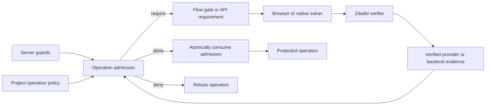

# Internal bot protection implementation plan

> **Status:** Desktop spike and protocol core complete; admission integration and production calibration pending
> **Date:** 2026-11-02
> **Execution:** [Ordered implementation PRs and Passwap assessment](bot-protection-implementation.md).
> **Scope:** Built-in proof of work, customer challenge providers, authenticated
> customer signals, and the hosted cloud's BotID integration.

Zitadel should own challenge issuance, verification, keys, expiry, replay
protection, and admission to the protected operation. The built-in option runs
inside the Go server and the login components. It requires no ALTCHA server,
Sentinel, external service, Redis, or customer provider account.

Stage 1 now includes a [matched comparison](pow-matched-benchmark-2026-11-02.md)
of ZITADEL-owned PBKDF2 and Argon2id against ALTCHA at four increasing levels.
Use our own precomputed PBKDF2 as the initial default, using Go's standard library
and browser WebCrypto. ALTCHA remains a benchmark/reference dependency;
Argon2id remains a candidate for a later supported algorithm family. The original
[SHA/library comparison](pow-benchmark-2026-11-02.md) is retained without changing
its measurements. [ADR 019](../../adrs/019-captcha-gate-and-bot-signals.md) owns
the finalized implementation contract. The pure Go protocol core and permanent
WebCrypto/Go vectors are now implemented; [implementation progress](bot-protection-implementation.md#implementation-progress)
distinguishes them from the pending product runtime, production calibration and
integrated admission testing.

## Product scenarios

| Scenario | Configuration | Execution |
|---|---|---|
| Zitadel Cloud signup | The platform project requires bot evidence and trusts its cloud backend; built-in PoW is available for a challenge. | Cloud functions check BotID and submit authenticated evidence. The Go server decides whether the operation may proceed. |
| Customer brings a challenge provider | A named connection contains public widget settings and a secret reference. | The browser obtains a token; Zitadel verifies it using the configured provider adapter. |
| Customer already has bot protection | The project registers its backend as a trusted signal source. | That backend verifies BotID, Cloudflare, or its own system and submits evidence through an authenticated app-plane operation. |
| Customer wants a turnkey solution | Built-in PoW is available without a provider connection. | Zitadel issues and verifies the challenge; the supplied login component solves it. |
| Customer builds a custom UI or native client | The same operation requirements and challenge protocol apply. | The client uses the flow contract or the app-plane auth-attempt contract; no widget is mandatory. |

The capability to issue built-in challenges exists without project configuration.
It does not mean every request is challenged. Baseline activation belongs to the
server guards of [ADR 078](../../adrs/078-abuse-prevention-in-layers.md); project
policies can add requirements. An omitted policy does not disable those guards.

## Research and protocol choice

| Option | What can be embedded | Fit for Zitadel |
|---|---|---|
| ALTCHA v1 library | Go challenge generation and verification, plus a compatible browser solver. | The bounded SHA puzzle resembles ADR 019, but it is now the library's legacy protocol. It would still need Zitadel-owned context binding and replay state. |
| ALTCHA v2 library | Local Go generation and verification with configurable KDFs; no remote verification is required. | Matched reference for both KDF families. Comparable solve time; its broader API is unnecessary for our fixed v1 protocol. No product runtime dependency selected. |
| Anubis | A Go application with SHA-256 work and browser workers. | Useful protocol and worker reference. Its proxy, clearance-cookie, and browser-routing model does not fit an operation inside an identity flow. |
| mCaptcha | A Rust SHA-256 library with browser WASM and JavaScript implementations. | Useful comparison, but adopting its Rust core adds a language/interop boundary to the Go server. |
| Own PBKDF2 / Argon2id | Standard Go KDFs, WebCrypto PBKDF2 and hash-wasm Argon2id, with owned framing and solver. | Matched at four levels. Select PBKDF2 for v1; Argon2id adds issuer memory/CPU and WASM requirements without measured GPU economics. |
| Own SHA-256 prototype | Go standard-library verifier and noble browser worker. | Measured, not selected: cheapest issuance but a 9–24× browser/native disparity on this host. Retain as comparison, not an automatic weaker fallback. |

ALTCHA's current [Go library documentation](https://github.com/altcha-org/altcha-lib-go/blob/main/README.md)
describes v2 KDF-based challenges and local verification. Its normal verification
path performs a KDF once; a signed-derived-key mode can avoid that verification
cost, but generating a challenge in that mode derives a key at issuance. This
tradeoff is visible in the [implementation](https://github.com/altcha-org/altcha-lib-go/blob/main/v2/altcha.go).
We should measure both issuance and verification under hostile traffic, not just
the browser's solve time.

Two findings must inform any ALTCHA evaluation. The older
[challenge-splicing advisory](https://github.com/altcha-org/altcha-lib/security/advisories/GHSA-6gvq-jcmp-8959)
describes ambiguous binding of expiry and nonce; Go versions before 1.0.0 were
affected. Separately, the current [v2 module file](https://github.com/altcha-org/altcha-lib-go/blob/main/v2/go.mod)
retracts v2.0.0 through v2.3.0 for accepting unverified solutions under missing
verifier configuration. These are reasons to evaluate a pinned, non-retracted
release with negative tests, not evidence that every current version is broken.
ALTCHA's own [integration guidance](https://altcha.org/docs/integration/security-recommendations/)
also leaves expiry, single-use enforcement, and rate limiting to a custom host.

Anubis documents a [leading-zero SHA-256 puzzle](https://github.com/TecharoHQ/anubis/blob/main/docs/docs/design/why-proof-of-work.mdx)
whose proof needs one hash to check. mCaptcha documents its
[Rust proof-of-work library](https://mcaptcha.org/docs/api/pow-sha256) and
[browser implementations](https://mcaptcha.org/docs/api/browser/). Their existence
supports comparing established constructions; their reported performance is not
a benchmark for Zitadel's clients.

### Selected construction and cost profiles

The selected `zitadel_pow_v1` protocol is defined in
[ADR 019](../../adrs/019-captcha-gate-and-bot-signals.md#built-in-profile-zitadel_pow_v1).
ZITADEL owns the small adapter and bounded solver; it uses standard PBKDF2-HMAC-
SHA-256, 5,000 iterations, a 32-byte derived key and a 16-byte public prefix.
The input is a raw 16-byte nonce followed by a big-endian uint32 counter, with
an independent 16-byte salt. The four immutable profile IDs select maximum trial
counts 512, 1,024, 2,048 and 4,096. Level zero issues no puzzle. Expected trials
are `(N+1)/2`; increasing N approximately doubles client work while issuance
remains one KDF evaluation and verification remains HMAC-only.

The challenge's authenticated context and persistent requirement bind project,
attempt, operation instance/target, generation, key versions and pinned policy/
configuration. The public wire fields are snake_case, with no ALTCHA blob.
The proof supplies only protocol, challenge ID and full derived key. Its counter
and reported solve time have no authority. Separate HMAC keys authenticate exact
stored context/parameter bytes and the full key. Keys live under dedicated bot
purposes; backend contexts/receipts use a separate encryption key. No custom
cryptographic primitive or resource-ID generator is needed.

The [matched report](pow-matched-benchmark-2026-11-02.md) records server, browser,
invalid-proof and memory measurements. Issuance must reserve bounded capacity
before KDF work, and re-rendering reuses the pending challenge. One active
generation per gate, at most four live gates per attempt, five-minute expiry,
one browser worker and a five-second foreground budget remain initial engineering
caps. The diagnostic benchmark allows 30 seconds to observe high levels; this
does not extend the product budget. These are not capacity or mobile results.

PBKDF2 has no WASM/CSP requirement and provides a larger search/issuance work
ratio in the tested profiles. Argon2id works in both languages but adds per-issuer
RAM/CPU and browser WASM allocation. It is not rejected as a primitive: advancing
it needs measured optimized attacker economics, real-device UX and bounded
issuance under load. Its experimental profiles are not initially accepted.
The implementation adds a profile registry and explicit algorithm selection now;
a later qualified family can share v1 framing without replacing admission.
Review our owned protocol and add permanent framing/binding vectors before
shipping; the research harness is not a production implementation.

PoW prices an operation, including an agent's operation; it does not prove
humanity. The observed browser/native ratio is implementation-specific. No GPU,
mobile energy or equal-security result is claimed. Rate budgets, hard guards,
send quotas and authenticated machine access remain necessary.

## Server architecture and lifecycle

The current [flow state machine](../../../internal/domain/flow_state_machine.go)
rejects non-empty gate proofs, and the [API projection](../../../internal/api/flow.go)
emits empty gates. The [policy catalog](../policies/catalog.md) implements password
setting only. The password verification path does not yet supply ADR 078's full
guard-count and admission mechanism. The plan must implement or explicitly depend
on that work; the existence of an ADR is not an available enforcement service.

The flow engine presents requirements. A shared bot-protection service owns their
evaluation and satisfaction, and the protected service operation owns admission.



### Persist requirements separately from authentication factors

Add a short-lived `bot_requirements` persistence model linked to an auth attempt,
with project ownership and cascade cleanup. It records the operation instance,
gate, current challenge generation, expiry, accepted evidence, and consumption
state. Use storage-owned identifiers and implement the same contract in
Postgres, Spanner, and SQLite.

The lifecycle is `pending -> satisfied -> consumed`, with expired and superseded
generations refused. A requirement can be satisfied by a built-in proof, a
verified provider token, or an authenticated backend receipt when the policy
allows that evidence type. Multiple required gates compose with AND; permitted
evidence types for one requirement compose with OR.

The existing auth-attempt verification path returns an `AuthFactor` and persists
it with `AuthAttemptChallengeSucceeded`. Reusing that path unchanged would turn
bot clearance into a reusable factor. Instead, add a separate bot result and
storage transition. The auth-attempt endpoints can delegate `captcha` ceremonies
to this service, but completion, handoff, session merging, and assurance never
treat bot evidence as a credential.

### Make consumption authoritative

1. After cheap request validation, evaluate the operation's guard and pinned
   policy using server-derived context. Do this before password hashing, user
   creation, or a protected send.
2. Ensure the current requirement. Repeated rendering returns the same unexpired
   challenge, rather than generating a new puzzle on every GET. Reissue advances
   the persisted generation and invalidates the old challenge.
3. Verify the bounded proof and its authenticated scope. A conditional storage
   transition accepts only the current, unexpired challenge. Expiry is checked
   again at the transition, so time spent waiting for a lock cannot extend it.
4. Before starting the protected operation, atomically consume all its required
   evidence. Concurrent submissions on different replicas must admit only one
   execution. No database transaction remains open during hashing or a provider
   network call.
5. A proof buys one attempt, not a successful result. A failed credential check
   spends it too. Transport/server failure after admission does not make the
   proof reusable; use an existing idempotent operation result where available,
   otherwise return a fresh requirement. Do not add a general idempotency system
   as part of this work.

The client-held flow cookie cannot be the replay ledger. Replaying an older
cookie must not restore a consumed requirement or superseded generation. Bind
requirements to a specific operation instance and re-evaluate after identifier,
purpose, action, or target changes. Never place a password, an OTP, or a public
hash of either in a challenge. A context that needs sensitive target binding uses
server-held state rather than public credential-derived claims.

The new rows are ceremony state, not per-request rate counters. Read-only
renders and repeated rejected proofs must not create unbounded rows or audit
events. Cap live requirements per attempt, clean up expired state using the
existing background-job mechanism, and retain consumed markers until their
tickets cannot be valid. Edge issuance limits and the guards' event-based limits
remain separate. Opening many attempts must not reset an account/project guard.

## Flow API and client changes

Keep `kind: captcha` as the gate category and use `provider: zitadel_pow` for the
built-in implementation. Keep the current name-keyed `gates` object and opaque
string values in `gate_proofs` for the initial implementation. Amend ADR 021's
gate-array statement to match this choice; changing collection shape is not
necessary to ship protection.

Illustrative runtime payload, with identifiers abbreviated:

```json
{
  "gates": {
    "bot_check": {
      "kind": "captcha",
      "provider": "zitadel_pow",
      "config": {
        "protocol": "zitadel_pow_v1",
        "challenge_id": "ch_example",
        "profile_id": "pbkdf2_sha256_5000_l1",
        "salt": "<32 lowercase hex characters>",
        "nonce": "<32 lowercase hex characters>",
        "key_prefix": "<32 lowercase hex characters>",
        "expires_at": "2026-11-02T20:05:00Z"
      }
    }
  }
}
```

The proof string is strict JSON containing `protocol`, `challenge_id`, and
`derived_key`; its exact limits and encoding are in ADR 019. The server loads the
stored challenge rather than accepting echoed parameters. Provider-token proofs
remain opaque to the orchestrator. Reject unknown versions, duplicate fields,
oversized payloads and malformed keys before expensive work.

Add `captcha` to the auth-attempt challenge method and its request/response
variants. Issuance selects a server-required gate; clients cannot choose an easier
provider or difficulty. Direct clients receive a typed challenge-required response
with a requirement identifier and an issuance path. Verification satisfies that
requirement; the subsequent operation consumes it. Expose bot requirements apart
from the attempt's authentication factors.

Surface real gates through `FlowStep`, rendering, and `toFlowStep`; remove the
unsupported-proof branch only when verification and admission are wired. Missing,
invalid, and expired proofs keep the user on the step with a usable challenge.
Unavailability remains a service error, not an authentication failure that clears
a session. Back/navigation need not solve a puzzle, but changing the protected
operation invalidates its old context. Cover passkey enrollment and SSO signup
paths as well as password submission.

Add `<zl-captcha>`, proof collection, sanitizer/manifest support, localization,
and mandatory-gate injection through the
[Storybook recipe](../../../apps/storybook/AGENTS.md). Run built-in work in a
cancelable worker with bounded concurrency; stop it on navigation, replacement,
or expiry. The component reports checking, retry, and unavailable states without
claiming to have identified a human. Solving a gate must not prematurely submit
an incomplete form or start a loop of automatic resubmissions.

Bundle the worker as a package asset compatible with customer asset bases and
CSP; do not assume a CDN or `blob:` permission. Test CSP-blocked workers and the
supported fallback. Custom clients get the same protocol documentation and test
vectors without importing the UI.

## Configuration and policy

Introduce one revisioned bot-protection configuration resource per project,
included in release build, validation, export, deployment, and CLI resource
metadata. A proposed file is `.zitadel/bot-protection.json`:

```json
{
  "default_challenge": "built_in",
  "fallback_challenge": "built_in",
  "providers": {
    "built_in": { "kind": "zitadel_pow", "algorithm": "pbkdf2_sha256" },
    "customer_turnstile": {
      "kind": "turnstile",
      "site_key": "${{ TURNSTILE_SITE_KEY }}",
      "secret_key": "${{ TURNSTILE_SECRET_KEY }}"
    }
  },
  "trusted_sources": {
    "application_backend": { "kind": "backend_attestation" }
  }
}
```

These names are proposed contract, not existing fields. `algorithm` defaults to
`pbkdf2_sha256` and is materialized in the pinned configuration revision. It
initially accepts only that value; additional algorithms require a released,
operator-enabled registry family and client support. Algorithm configuration is
separate from password hashing and CEL. [ADR 019](../../adrs/019-captcha-gate-and-bot-signals.md#algorithm-configuration-and-evolution)
owns selection, profile compatibility, retirement and rollback semantics.
Configuration describes
available capabilities and trust relationships. The operator bounds PoW cost,
expiry, concurrent work, and supported protocols; project policies cannot reduce
the guard's requirement. Resolve provider secrets through ADRs
[062](../../adrs/062-per-environment-variables-and-secrets.md) and
[069](../../adrs/069-variables-per-kind-frozen-per-deployment.md), keeping primary
and preview secrets separate. A flow reads the configuration and policy revisions
its release pins, and the variable set its deployment froze
([ADR 085](../../adrs/085-which-release-serves-a-request.md)).

Missing referenced providers, secrets, or unsupported fallback combinations fail
deployment validation. Public runtime config contains only the public projection.
An absent configuration resource supplies built-in PoW as a capability; it does
not manufacture a project policy. Secret/key revocation must override continued
use by an old deployment; ordinary rotation keeps old challenges and context tickets verifiable
only through their maximum TTL and clock-skew allowance.

### Start with the policy types the engine supports

The current engine supports integer and boolean settings, one setting per named
rule, and an allow/deny decision. Add the `require` outcome and undisclosed-rule
metadata described by ADRs 066 and 078, rather than putting strings, provider
objects, or custom expressions into today's policy schema.

An illustrative signup instance is:

```json
{
  "operation": "user.create",
  "config": {
    "require_bot_evidence": true
  }
}
```

The template applies this rule to self-service registration context derived by
the server. Operator-created users and imports have explicit authenticated
provisioning semantics; a browser-supplied `self_service: false` is never an
exemption. The shared user-create path must receive that trusted context from
every caller, including SSO and passkey registration.

`require_bot_evidence` accepts a current challenge or acceptable evidence from a
configured backend. A separate boolean `require_bot_challenge` demands an actual
challenge and cannot be waived by a clean backend signal. A later integer
`challenge_after_failures` belongs to `auth.check`, reads the guard's count, and
is bounded by the operator's baseline. Multiple active rules all apply; a denial
wins, and unmet requirements are combined without disclosing private thresholds.

Build normalized context in Go: evidence source/type, freshness, challenge
satisfaction, and verified-bot classification. CEL performs no I/O. Avoid a
universal numerical risk score in v1: provider scores have different meanings.
Unknown, unavailable, suspicious, and verified-bot signals do not become clean
evidence by absence of an error. The cloud initially requires a challenge for a
verified bot; explicitly authorizing automated clients is a separate policy case.

Implement audit mode before enabling adaptive thresholds: record the hypothetical
policy outcome while keeping domain guards enforced. Explicit static gates can
ship before adaptive policy; cloud signup requires the `user.create` rule before
its proxy check can be considered complete protection.

### Progressive work allocation through CEL

Support a PoW-free allowance followed by capped exponential **expected work**.
This is additional admission pricing, not permission to exceed a hard rate limit.
The policy chooses an integer work level; the server resolves it to a calibrated,
versioned work profile. Algorithm selection and provider connection settings stay
outside CEL. A level is neither a duration promise nor authentication assurance.

Illustrative password policy settings (proposed, not accepted by today's API):

```json
{
  "operation": "auth.check",
  "config": {
    "pow_free_attempts": 10,
    "pow_attempts_per_level": 5
  }
}
```

Assume one server-defined rolling window, for example 15 minutes, scoped by
project, normalized subject and factor. The example is a design choice, not a
recommended production threshold. `attempt.ordinal` is the prospective next
expensive check: prior failed checks in that scope/window since its latest
successful check, plus active execution reservations, plus one. A completed
failure and its reservation are never counted twice. The input comes from Go,
not the browser, a flow ID or a CEL-maintained counter.

The ZITADEL-owned CEL template computes a requested integer output `pow_level`:

```cel
attempt.ordinal <= config.pow_free_attempts
  ? 0
  : 1 + (attempt.ordinal - config.pow_free_attempts - 1)
        / config.pow_attempts_per_level
```

For this example the operator permits four levels, mapped to expected work
`base`, approximately `2 × base`, `4 × base`, `8 × base`. The selected v1
profiles use 512/1,024/2,048/4,096 trials, or expected 256.5/512.5/1,024.5/2,048.5
KDF evaluations; the additive half-trial explains why this is not exactly 2×. Go saturates a valid higher request
at level four, then combines it with all applicable guard/policy requirements
using the strongest required level. Independent hard denials always win. The
ceiling must accommodate the deployment's guard floor; reject inconsistent
configuration rather than weakening that floor.

| Prospective check ordinal | Requested level | Effective work in this example |
|---|---:|---|
| 1–10 | 0 | No PoW; still rate/concurrency limited and atomically admitted |
| 11–15 | 1 | Up to 512 trials; expected 256.5 |
| 16–20 | 2 | Up to 1,024 trials; expected 512.5 |
| 21–25 | 3 | Up to 2,048 trials; expected 1,024.5 |
| 26–30 | 4 | Up to 4,096 trials; expected 2,048.5 |
| 31 onward, below the hard limit | 5 onward | Level 4, capped |
| Hard limit reached | irrelevant | Refuse with retry guidance |

A stride of one requests doubling every check; five gives a less abrupt curve.
Both are bounded and calibrated before enablement. CEL needs no floating-point
exponent, `pow()` helper or mutable state: it selects a level, and the server
uses a finite profile table. Validate nonnegative free allowance, strictly
positive stride, complete activation settings, bounded context counts and
operator-compatible profiles. Missing one required setting is a configuration
error, not a hidden default or partial activation. Missing the entire output's
settings disables that project output, leaving baseline guards intact.

This requires a new typed-output section in the policy template and decision;
the current engine accepts only boolean rules, each reading exactly its one
setting. Outputs may declare multiple setting dependencies and an integer result
without changing existing boolean rules. Compile/type/cost-check outputs with the
same limits, and include them in compatibility validation. Keep count/curve
settings out of public constraints; a client necessarily sees its issued puzzle's
work parameters. Customers configure values in a shipped CEL template; arbitrary
customer-authored CEL is a separate policy-authoring capability.

### Accounting and enforcement for the curve

- For password checks, count actual failed checks and active admitted work, not
  HTTP requests, page renders, flow creation or failed PoW submissions. For
  signup/send operations, define their own principal/project/destination event
  budgets; do not reuse a password-failure counter or rely only on an IP address.
- Atomically reserve an execution slot before a PoW-free expensive check. With
  zero prior failures, 100 concurrent requests must not all observe a free first
  attempt: at most ten receive a PoW-free slot in this example. ADR 078's final
  recount alone cannot prevent the initial expensive work from being performed.
- Unsolved pending challenges do not occupy execution slots or increase the
  credential-failure count. Issuance/refresh is separately limited. On proof
  submission, atomically re-evaluate the current price/hard guards, consume the
  applicable one-use proof and reserve execution. A proof below the now-required
  level gets a new bounded requirement before any protected work; a sufficient
  unexpired proof is accepted even if counts have since decreased.
- Record a completed failure and retire its reservation in one transaction. Use
  bounded leases and fencing for crashed workers; an expired lease cannot let
  the old worker return a successful operation result. Recovery must not release
  capacity while stale work can keep using it without a bound. This is admission
  state for expensive operations, including PoW-free ones, not a durable write
  for every rejected HTTP request. Bound allocations before reserving them.
- New tabs, cookies, flows or attempts do not reset a subject/project budget.
  Use enumeration-safe accounting for nonexistent identifiers and bound that
  namespace. Success can clear the subject/factor failure streak; it must not
  clear broader principal/project abuse budgets. Counts age out of their window;
  expiry uses server time. Passkeys remain available when passwords are priced.
- Account-targeted pricing can burden a victim, and identity rotation can avoid
  an account-only curve. Keep separate principal/project budgets and hard limits;
  combine applicable requirements conservatively. Do not turn the example's
  ten free checks into ten free checks per new anonymous identity.
- Pin the policy revision, scope, operation, generation and issued profile on the
  requirement. Browser-submitted cost values cannot lower it. Price increases under the pinned policy or current guard
  may require fresh work at admission; solving a challenge never overrides a
  hard refusal. Provider tokens/backend receipts satisfy only the evidence
  alternatives explicitly allowed, not an assumed amount of computational work.

For a precomputed search puzzle, increasing a bounded hidden-counter range can
roughly double expected client work while issuance remains one evaluation of the
same KDF and verification remains a cheap authenticator. Keep per-trial KDF cost
and memory fixed within a profile family. Do not exponentially grow Argon2 RAM
or server KDF cost. Profiles still need measurements on mobile and native clients;
search luck means individual solve times do not double deterministically.

Acceptance includes the 10/11 and each band boundary, zero free allowance,
invalid/partial settings, hard caps, decay/success resets, concurrent free-slot
reservation, failure completion without double counting, crashes/lease fencing,
price changes while solving, direct API calls and cookie/identity rotation.
Audit the proposed output before enforcement. The matched measurements fix v1 profile meanings; production activation,
operator ceilings and the free allowance/stride still need device and admission
load calibration. No single solve time or issued counter proves a minimum
attacker cost; rate-limit challenge grinding and refresh separately.

## Customer evidence and cloud BotID

Use an explicit app-plane evidence exchange for v1. This keeps the current
project secret on a single authenticated operation, rather than attaching an
operator-capable credential to arbitrary public flow traffic
([ADR 036](../../adrs/036-api-credential-planes.md)).

1. A flow step exposes an opaque `bot_context` for its protected action. It binds
   the project, attempt, operation instance, gate requirements, and expiry. The
   orchestrator includes it on the submission; its public possession proves
   nothing by itself.
2. The customer backend evaluates its bot system for that incoming request.
   Through a server-only SDK helper it calls a proposed
   `POST /api/v1/bot_protection/evidence` with `bot_context`, the configured source
   identifier, and a normalized verdict. The project credential authenticates the
   backend; the server checks that it owns the context and trusts the source.
3. Zitadel returns a short-lived, opaque evidence receipt bound to those
   requirements. The gateway forwards it on the matching flow request through a
   reserved header, after deleting any incoming caller value. The public flow
   endpoint validates the receipt and consumes admission through the same state
   machine used for PoW.
4. A direct request without that receipt is still evaluated by the shared
   operation path. When evidence is required, the server supplies a challenge or
   refuses according to the configured requirement. Changing the proxy URL or
   presenting an allowed Origin cannot bypass protection.

An exchange retry uses the same context/verdict to return the same evidence
status, not a second admission. Receipts cannot move across projects, actions,
targets, or requirement generations. Missing context cannot mint general-purpose
clearance. Backend evidence is an assertion by a project-trusted party, not proof
that Zitadel independently ran BotID. It cannot override non-waivable guards.

The exchange costs one extra server round trip per protected submission. Measure
it on cloud previews. A directly signed, request-bound assertion can remove that
hop later, but would require issuer-key registration, revocation, signature
validation, and the same replay guarantees. Do not implement both channels in the
first release. Replace ADR 019's unsigned verdict dictionary plus broad proxy
secret injection with this explicit contract.

In the cloud, keep BotID in `apps/cloud-functions` and its client in
`apps/cloud-console`. The existing flow-create check may remain a preliminary
edge check, but it never grants clearance for a later signup. Flow creation stays
subject to edge/admission budgets; this work protects the first sensitive
operation after creation. Protection before allocating any flow/attempt state is
a separate pre-flow protocol, not something `gate_proofs` can provide.

For a policy accepting either backend evidence or a challenge, evaluate the
backend receipt on submit before materializing fallback PoW. This avoids making
every clean BotID visitor solve a puzzle first. A missing/unacceptable receipt
returns a challenge without performing the protected operation. A valid fallback
proof must survive the next proxy hop even if BotID again says suspicious: the
temporary proxy-side 403 must not make the server's fallback unreachable.

Check both `/api/v1/flow` paths and the transitional unprefixed paths consistently.
The current client protection list and forwarder path handling need an integration
test together. Enable production only after the preview proves BotID, context
exchange, direct-path enforcement, and fallback end to end. No Vercel import goes
into the Go server or general login component.

## Customer provider adapters and failure behavior

Implement Turnstile first as the reference adapter, then hCaptcha/reCAPTCHA as
separate additions. The connection selects verification settings; the client
cannot submit a verification URL or choose another provider. Validate token
success, expected hostname/action where supported, and expiry/single-use
semantics. Turnstile's [server verification contract](https://developers.cloudflare.com/turnstile/get-started/server-side-validation/)
requires server validation and allows a token only once. Any future custom
verification URL must use [ADR 061's egress path](../../adrs/061-egress-policy-user-injectable-urls.md).

| Condition | Behavior |
|---|---|
| Missing or unacceptable backend signal | Require a permitted challenge when the policy requires evidence. |
| Invalid, expired, or replayed proof | No protected operation; report a stable error and return/reissue the appropriate challenge. |
| External verifier unavailable | Use only an explicitly permitted fallback; otherwise a retryable service error. An outage does not mean solved. |
| Built-in key or replay store unavailable | Fail the protected operation with a service error. Never trust process-local replay state as a substitute. |
| Worker blocked or solve budget exhausted | Explain the retry/fallback path; never silently waive the requirement or repeatedly run background work. |
| Hard guard limit reached | Refuse even if the caller solved PoW or has a clean external verdict. |
| Ordinary authenticated machine operation | Apply its operation's guard/policy; do not infer exemption from User-Agent or force a browser-only challenge. |

An external verifier call stays outside retryable database transactions. Mark
successful evidence with a conditional update before acknowledging it. If a crash
occurs after a one-use vendor token was consumed remotely but before local
persistence, obtain a fresh token; do not reinterpret a vendor duplicate-token
error as success.

## Delivery sequence

The desktop measurement stage is complete. Follow the
[ordered implementation PRs](bot-protection-implementation.md#ordered-implementation-prs)
for the remaining work: protocol/profile core; keys and admission state;
revisioned configuration; shared service enforcement; API/flow projection;
worker/component; progressive CEL; customer backend/cloud integration; vendor
adapters; qualification and activation. Additional algorithms are a later release
using the registry boundary built in the first PR.

The first internal PBKDF2 path requires the core through component PRs. Cloud
activation also requires static operation-policy enforcement and the app-plane
receipt integration; changing UI routing alone is not an activation milestone.
A fixed evidence requirement can be exercised before progressive pricing.

Adaptive password protection depends on ADR 078's trusted event/window counts,
serialization, hard refusal and bounded concurrent hashing. Those are explicit
service/accounting deliverables, not assumed available because an ADR exists.
Do not advertise an exact free allowance until atomic reservations and the CEL
consumer pass their concurrency tests. Establish issuance limits before exposing
the new challenge/evidence operations publicly. The
[Passwap review](bot-protection-implementation.md#passwap-assessment) explains why
the existing password hasher remains separate from the raw-key PoW adapter.

### Main code surfaces

| Area | Starting points |
|---|---|
| Operation admission | `internal/service/auth_attempt.go`, `internal/service/user.go`, `internal/service/flow_auth_attempt.go`, new bot-protection service |
| Domain and flow | `internal/domain/auth_check.go`, `internal/domain/auth_attempt.go`, `internal/domain/flow_state_machine.go`, `internal/domain/flow_state.go`, new bot requirement types |
| Keys and storage | `internal/service/keys.go`, key-purpose models, all dialect migrations/statements, `internal/storage/stmttest` |
| API | `api/openapi/components/flows/`, auth-attempt endpoints, new configuration/evidence operations, `internal/api/flow.go` |
| Policy and release | `internal/policy/`, `internal/service/policy*.go`, release/deployment resolution, `packages/config`, CLI resource metadata and CLI skill |
| Browser and SDKs | `packages/components`, `packages/api-mock`, `apps/storybook`, server SDK entry points in `packages/sdk-*` |
| Cloud | `apps/cloud-functions/src/sign-in.ts`, its route handler, `apps/cloud-console/src/bot-check.ts` and add-on activation |

## Verification and rollout gates

Protocol tests cover exact bytes, counter limits, malformed/oversized proofs,
unknown versions/profiles, unsupported algorithms, duplicate fields, tampered
cost/expiry/context, wrong keys,
cross-project proofs, old generations, and clock boundaries. Fuzz the decoder and
verifier. Test keys rotating while challenges are pending and emergency
revocation of old tickets. Test algorithm changes while old challenges are live,
verify-only retirement, unknown clients, cross-family price rejection and binary
rollback/mixed-replica compatibility.

Portable statement tests prove atomic issue/reissue, verification, all-gate
consumption, expiry after waiting, and concurrent winners on every supported
dialect. Service tests prove admission happens before expensive work and is spent
on failed attempts. Include restarts and separate server processes; a single
process test cannot prove distributed replay protection.

API tests cover public flow and app-plane paths, direct calls bypassing the cloud
gateway, forged receipts, changed targets/purposes, registration via password,
passkey and SSO, and the fact that CAPTCHA alone cannot complete an attempt.
Ensure navigation is usable and a fallback PoW proof is accepted through a
suspicious BotID hop. Test legacy and prefixed routes together.

Browser tests cover worker cancellation, low-end device behavior, CSP, duplicate
submissions, incomplete forms, missing template consumers, and accessible status
announcements. Keep UI behavior tests in components and storage concurrency tests
in `stmttest`; do not duplicate the full matrix in end-to-end tests.

The [matched desktop spike](pow-matched-benchmark-2026-11-02.md) records exploratory
p50/p95/p99, increasing levels, Go issuance/verification and issuer memory.
Before production calibration, extend it to shipping desktop Chrome,
Firefox, Safari, Android, and iOS, including a slower device; server issuance and
verification CPU/allocations under invalid traffic; payload/worker sizes; database
writes per protected action; and the backend-exchange latency. Desktop CPU
throttling is useful during development but does not replace mobile measurements.
Compare a native solver's throughput with the browser worker, and exercise mass
challenge issuance, abandoned challenges, and repeated attempt creation. A good
browser time alone does not establish useful attacker cost or bounded server work.
Sweep the fixed profiles rather than interpreting a trial bound as a duration.
Provisional UX targets are p95 below one second on a typical device and below
three seconds on the chosen slow-device baseline for the normal cost band. They
are targets to validate, not measured results. Choose a bounded retry/timeout
experience and start with a proposed five-minute challenge TTL.

Metrics distinguish required, solved, expired, replayed, unavailable, denied, and
abandoned outcomes, with source/provider and operation labels of bounded
cardinality. Audit semantic state changes in their mutation transactions, per
the service rules; sample repeated refusals. Never log proof bodies, evidence
receipts, provider secrets, or credentials. Do not make browser fingerprints or
behavioral telemetry prerequisites for this release.

Implementation checks use Moon: `server:generate`, `server:openapi`,
`server:check-generate`, `server:check-generate-pruned`, the affected server tests,
`server:test-sqlite`, `server:test-postgres`, `server:test-spanner`,
`components:test`, and `storybook:test`, plus affected SDK/cloud tests. Run the
relevant journey lane once the full path is connected. Follow scoped AGENTS.md
instructions and add product Changesets in implementation PRs; this design-only
plan needs none.

## Remaining calibration and integration decisions

- Implement the selected own PBKDF2 framing with permanent vectors, protocol
  review, bounded issuance and immutable profile compatibility. The matched
  comparison closes the library/algorithm decision; it does not ship admission.
- Measure real Android/iOS, shipping Safari and Firefox, then fix production
  cost bands and device budgets. The desktop result does not establish these.
- Measure issuance saturation, duplicate/abandoned requirements and rate budgets
  with the real admission store; prove one winner across replicas and dialects.
- Measure the app-plane exchange on cloud preview. Keep it as the v1 trust
  channel unless latency justifies a separately reviewed signed-assertion design.
- Implement and test dedicated bot-key rotation/revocation, including pinned old
  releases. ADR 029 now records the chosen purpose separation.
- Signup and password checks are the first protected operations. OTP/recovery
  send protection must ship with those operations when they exist. Pre-flow
  allocation defense and custom remote verifier URLs remain separate work. The
  measured Argon2id candidates need GPU/optimized-native, mobile/CSP and issuance
  load evaluation before enabling a new immutable algorithm family. A new protocol
  version is needed only when its framing or proof semantics are incompatible.
