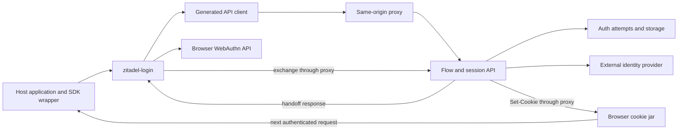

# Testing zitadel-login for release confidence

> **Status:** Concept with an implemented POC, revised 2026-10-30.
> Source baseline: `b43246de7`. The POC validation below is narrower than release verification.

Make security and UX checks part of an easy, fast component development loop.
A developer should be able to change `zitadel-login`, get focused feedback in
seconds, and open the failing scenario to see and interact with it. Start with
the existing component tests, API mock and Storybook workbench; extend the same
pattern to other critical components as they appear.

That loop needs three complementary proofs: the component correctly consumes
the Flow API, the server enforces authentication when the component is bypassed,
and each supported SDK establishes a usable session in a real application.
Keep server enforcement and package integration checks at their own layers,
with a short real-server check locally and the broader matrix in release CI.

## Implemented POC

Run the focused checks or keep them running while editing:

```sh
moon run components:check-login
moon run components:watch-login
# Open Chromium and limit the loop to one scenario:
moon run components:watch-login -- --browser.headless=false -t "wrong password"
```

These tasks prepare the existing API mock and Chromium. The focused selection
runs two browser scenarios and one jsdom scenario against component source;
it does not build a demo application. Watch mode retains Vitest and Chromium
and reruns on source changes.

| Scenario | What the POC actually checks |
| --- | --- |
| Wrong password, then keyboard retry | A server-shaped refusal leaves the password step usable, displays an alert, restores native input focus and permits correction with Enter. No flow completion or exchange occurs on refusal. Public widget input events include email but exclude password, and private atom events stay inside the widget. |
| Delayed submission | A controlled promise holds the response while the form is busy and the submit button is disabled. Repeated native submissions produce only one request; releasing the response advances the step and focuses its input. |
| Failed handoff exchange | A 503 is surfaced as an error, clears busy state and causes neither navigation nor a success screen. This case deliberately records the existing flow-complete event before exchange; consumers must not treat it as session establishment. |
| Real server and Next SDK | The existing real-login test first submits an incorrect password, checks that no app session cookie exists and that `/admin` redirects to `/login`, then retries successfully and verifies the authenticated identity and HttpOnly cookie. |

The first three cases live in
[the browser spec](../../../packages/components/src/orchestrator/zitadel-login-confidence.browser.spec.ts)
and [the jsdom spec](../../../packages/components/src/orchestrator/zitadel-login-confidence.spec.ts).
Fault controls live in the existing
[`@zitadel/api-mock` handlers](../../../packages/api-mock/src/handlers.ts):
one-shot submit refusal, a promise-controlled submit delay and one-shot exchange
failure. They reset between tests and reuse the shipped flow fixtures. The mock
does not validate passwords; the
[real-server test](../../../e2e/demo-next/src-real/real-auth.spec.ts) proves that
the backend refuses the credential and that the SDK remains unauthenticated.

### CI integration

No separate workflow or duplicate CI lane is required:

- `components:test` already discovers both new component spec files and emits
  the existing aggregate JUnit report. The local selector writes its own report
  to `packages/components/test-output/login/junit.xml`.
- `api-mock:test` covers the fault controls and their reset/retry behavior.
- `e2e:demo-next-real`, already part of `e2e:all`, runs the strengthened
  real-server test. Locally, select it with
  `moon run e2e:demo-next-real -- real-auth.spec.ts`.
- The Moon tasks have matching Turbo tasks. The focused local tasks are
  excluded from automatic CI selection because their tests already run in
  `components:test`.
- On a failed Moon graph, CI uploads the component and mock JUnit reports and
  component screenshots as `login-component-diagnostics`, retained for seven
  days. Existing e2e diagnostic uploads retain the real lane's report/traces.

Browser assertion failures retain Vitest's screenshot and identify the named
scenario. Reproduce interactively with the headed watch command above. This POC
does not yet add reusable Storybook scenario controls, screenshot baselines,
flow-level accessibility audits or the broader browser/SDK matrix. The failed
exchange case verifies safe error display; it does not add an in-place retry UI.

### Local validation of the POC

Measured on macOS arm64 with Node 24.22.0, Vitest 4.1.11 and dependencies/browser
already installed. These are individual local observations, not CI timings or
p95 measurements:

| Check | Observed result |
| --- | --- |
| `components:check-login` | 3 tests pass; 4.01 s in Vitest, 5.09 s for the complete warm Moon command. |
| Headed watch, one scenario | Source edit to updated report: 1.59 s with the password-event guard temporarily disabled; the test fails on the leaked password event. Restoring the original source gives a passing report in 1.49 s. |
| Existing `components:test` CI task | 1,065 tests, zero failures/errors; the new files appear in its aggregate JUnit report. |
| `api-mock:test` | 368 tests, zero failures/errors. |
| Existing `e2e:demo-next-real` lane | Passes against the server built from this checkout, including the rejected-password/session test. Lane task took 8.52 s, excluding dependency builds. |
| Static checks | Component, mock and e2e lint/type checks, plus `workspace:check-moon-graph`, pass. CI workflow YAML parses locally. |

The deliberate mutation was restored; no production component behavior changed.
The hosted GitHub Actions run and its artifact upload still need to execute on
the eventual PR. Cold-start and sustained CI/watch distributions remain to be
measured before adopting the proposed performance budgets below.

## The everyday developer workflow to expand next

Use `moon run storybook:dev` for interactive inspection. A failed scenario
should identify the assertion and provide the corresponding story/control URL,
with the same starting state, fault mode and synthetic seed. Security-sensitive
values stay out of that URL and its diagnostics.

### Small scenarios with observable outcomes

Keep a small named scenario catalogue using the existing `@zitadel/api-mock`
handlers and valid flow definitions. Reuse scenario setup between automated
component tests and Storybook controls. Assertions belong in the tests, with
expected behavior reviewed independently of the mock implementation. Use plain
typed builders and test helpers; introduce no new scenario language.

| Scenario | UX assertion | Security or correctness assertion |
| --- | --- | --- |
| Wrong password, then retry | Error is understandable, focus permits correction, retry works. | No completion or navigation on rejection; password values stay out of widget events and diagnostics. |
| Slow submit and repeated Enter | Busy state appears promptly; one action is submitted; focus and input remain usable. | A second click cannot create a second in-flight submit or duplicate exchange. |
| Expired flow | Explain what happened and offer a working restart. | Old credentials/proofs are not carried into the replacement flow. |
| Back or unmount while a response is delayed | The old response cannot replace the current screen. | The abandoned component cannot trigger completion or navigation. |
| Passkey cancelled or unavailable | Cancellation, retry and supported fallback are usable by keyboard. | No proof or successful authentication is fabricated. |
| Hostile branding, translation or error text | The form remains usable, with its required controls and accessible labels. | No script executes and no unexpected request is made. |
| Handoff exchange fails | Show a recoverable error; keep the user on a usable screen. | No successful navigation; a flow-complete event is not mistaken for an authenticated session. |

For each user-visible state, cover keyboard operation, focus, accessible
names/error association, loading and recovery. Add a few stable screenshot
baselines for clipping, hidden errors and layout changes across narrow/wide
containers. Review visual changes deliberately; do not accept new baselines
automatically. Keep detailed rendering checks at component level, and reuse
the existing atom tests rather than repeating them in every login scenario.

Storybook remains the manual workbench. Its
[orchestrator stories are tagged `no-test`](../../../apps/storybook/AGENTS.md),
so its existing accessibility gate does not establish login-flow accessibility.
Automate login interactions, accessibility and selected visual assertions in
the component browser project. Preview states are useful for inspection;
behavior tests must also drive actual interactions and API responses.

### Feedback speed is an acceptance criterion

These are proposed budgets to measure on a documented developer machine and
CI runner, not current performance claims:

| Loop | Target | Scope |
| --- | --- | --- |
| Edit and save | Within 5 seconds at p95 after warm-up | Affected unit tests or one focused browser scenario. |
| Check the component | Within 30 seconds warm | The small mandatory login security/UX suite in Chromium. |
| Check the real contract | Within 60 seconds with dependencies already built | Provision one ephemeral instance, run focused API conformance and enforcement cases, and tear down. |
| Release verification | Budget after measurement | SDK, browser, HTTPS and packaging matrix from the later sections. |

Report cold start separately, including dependency builds and browser startup.
The [current browser suite](../../../packages/components/AGENTS.md) documents
a 60–120 second or longer cold pre-bundle, so a persistent process matters.
Benchmark the initial slice before committing to these budgets. Reduce setup
cost and repeated work when a budget is missed; retain the required assertions.

Use controlled response delays and promises, explicit completion conditions,
isolated scenario state and clocks where supported. Avoid fixed sleeps and
external identity-provider availability in the fast loop. Run the same focused
tests headlessly in PR CI, so local success has a clear relationship to the gate.

### Keeping fast feedback trustworthy

Mock-backed browser tests prove what the component sends, renders and exposes.
They cannot prove that the real server refuses an invalid proof. Keep a compact
real-API check available through one companion Moon task, and require it in CI
when the Flow API, mock, credential handling or authentication behavior changes.
Use the existing Go enforcement tests and the TypeScript conformance cases
below; do not move every adversarial case into a browser journey.

Start with wrong-password/retry, delayed duplicate submit and failed exchange.
Prove watch speed, meaningful failures and visual reproduction with those three
before expanding the catalogue. Include one real-server login/exchange check
and rejection of an invalid proof in that first slice. For the next critical
component, add its scenarios and invariants using the same helpers; extract
shared infrastructure only when the second component demonstrates the need.

## Existing coverage and its limits

| Boundary | Existing evidence | What it establishes and where it stops |
| --- | --- | --- |
| Component and mock API | [Login specs](../../../packages/components/src/orchestrator/zitadel-login.spec.ts), [SSO specs](../../../packages/components/src/orchestrator/zitadel-login-sso.spec.ts) | Startup, submissions, validation, back navigation, passkey handling, completion, redirects, restart and secret-field event suppression. Most responses come from MSW, so this proves the consumer against the mock. |
| Native browser behavior | [Browser specs](../../../packages/components/src/orchestrator/zitadel-login.browser.spec.ts), [Vitest configuration](../../../packages/components/vitest.config.ts) | Real forms, native input values, Enter, focus, duplicate-submit suppression and late framework properties. The configured browser is Chromium. |
| Templates and accessibility | [Sanitiser specs](../../../packages/components/src/orchestrator/sanitiser.spec.ts), [mandatory gates](../../../packages/components/src/orchestrator/mandatory-gates.spec.ts), [Storybook rules](../../../apps/storybook/AGENTS.md) | Sanitisation, mandatory control preservation and an accessibility gate already exist. String-level sanitiser assertions do not prove that hostile content cannot execute in a browser. |
| Server enforcement | [Flow HTTP tests](../../../internal/api/flow_test.go), [state machine tests](../../../internal/domain/flow_state_machine_test.go), [real API integration tests](../../../internal/api/integration_test/) | Existing coverage includes invalid actions, tampered/stale flow cookies, flow ID mismatch, origin restrictions, password/passkey flows, attempt rotation, handoff replay, CSRF, session proof and SSO callback binding. These are foundations to extend, not new suites to duplicate. |
| SDK behavior | [Shared SDK contract](../../../packages/sdk-core/src/contract.spec.ts), [middleware tests](../../../packages/sdk-core/src/middleware.spec.ts), [framework tests](../../../packages/sdk-next/src/__tests__/) | Prop/event parity, SSR and edge entries, cookie mapping, proxy behavior and session validation have dedicated tests. A runtime import test or mocked middleware test does not prove deployment behavior. |
| Real application handover | [Next real lane](../../../e2e/demo-next/src-real/), [demo lane contract](../../../e2e/demo-next/AGENTS.md) | A real server, registration/password login, HttpOnly cookie and authenticated page. The dedicated Nuxt demo lane uses a mock; Nuxt also receives real-server coverage through the journey. |
| Published package integration | [User journey](../../../e2e/journey/src/user-journey.spec.ts), [schema/SSO journey](../../../e2e/journey/src/schema-revisions.spec.ts), [runner](../../../e2e/journey/scripts/run-local.mjs) | Installs candidate tarballs into fresh apps. Covers registration, logout/login, passkeys in a preset lane, pre-existing apps, test-kit consumption and a remote HTTPS variant. SSO/schema revision scenarios run in a representative Next lane. |

Four specific limitations should shape the work:

- The [CI framework list](../../../e2e/journey/scripts/frameworks.mjs) excludes
  SvelteKit, TanStack Start, SolidStart and Qwik Router because their scaffolders
  track upstream releases. A green journey matrix does not cover all SDKs.
- Both the component and [journey browser configuration](../../../e2e/journey/playwright.config.mts)
  select Chromium. Localhost coverage does not prove production cookie behavior.
- [Mock conformance](../../../packages/api-mock/src/fixtures/default-conformance.spec.ts)
  compares action names for default steps. It does not establish full parity
  for fields, validation responses, cookies, completion or error codes; the
  [mock rules](../../../packages/api-mock/AGENTS.md) also list intentional differences.
- The [API wrapper spec](../../../packages/components/src/orchestrator/api-client.spec.ts)
  checks exports only. Behavior is exercised indirectly elsewhere, but the
  wrapper's credentials and error-unwrapping contract deserves focused assertions.

## Scope and trust boundaries



The server owns identity, proof verification, tenant binding and whether an
attempt can complete. Hiding a button or requiring a field in the UI is never
evidence of server enforcement. The widget owns faithful rendering and
submission; the SDK owns framework integration, proxying and the application
session boundary.

Define success as **the intended user in the intended project can make an
authenticated request after navigation**. In the current
[completion implementation](../../../packages/components/src/orchestrator/zitadel-login.ts),
`zitadel-flow-complete` is emitted before automatic handoff exchange. That
event alone cannot prove a session exists. Preserve its documented semantics;
test exchange failure and authenticated application state separately.

Use implemented password, registration, passkey and upstream SSO paths for
the initial baseline. Recovery, OTP/TOTP, policy-driven MFA and the OIDC
provider work in [ADR 081](../../adrs/081-customer-hosted-login-and-oidc-provider.md)
need their own acceptance scenarios when implemented. Some Flow Engine design
pages lag the code, including statements about SSO and durable sessions;
feature claims must be checked against implementation and tests.

## Test architecture

Keep the [existing testing ladder](../../../packages/testing/AGENTS.md): each
property belongs at the lowest layer that proves it. Reuse fixtures and
drivers, but retain independent assertions at different boundaries.

| Layer | Primary responsibility | Proposed additions |
| --- | --- | --- |
| Go domain/service and HTTP integration | Authentication state and security enforcement | Complete the invariant inventory below; add sequence, concurrency and fuzz cases where missing. |
| TypeScript API conformance with a real server | Actual wire contract consumed by the generated client | Run a small HTTP-only scenario set against an ephemeral real server and the mock. Reuse real-instance provisioning without booting a framework. |
| Component Vitest unit | Renderer, orchestration and failure behavior | Focused API-wrapper tests; unknown/malformed response handling; delayed response and lifecycle cases. |
| Component Vitest browser | Native browser behavior and rendered content | WebKit/Firefox coverage for forms and focus; executable XSS probes; keyboard and accessibility regressions. |
| SDK unit and runtime contracts | Framework adapters and shared middleware | Extend the existing shared contract pattern for each supported entry and credential boundary. |
| Application integration and journeys | Cookie round trip, navigation, hydration, packaging and deployment | Stable production-build fixtures per SDK; focused HTTPS and project-isolation scenarios; retain fresh-app journeys. |

### Flow API conformance

Use the generated `@zitadel/api` client to drive create, get/resume, submit,
terminal response, exchange and session probe. Provision through
`@zitadel/testing`; use a cookie jar and an allowed app origin for HTTP tests.
Only a real browser lane can establish browser cookie acceptance.

Run the same semantic assertions against the real API and MSW where the mock
claims support. Validate real responses against the OpenAPI contract as well:
TypeScript types do not validate received JSON. Compare normalized behavior,
not snapshots of random IDs, signed cookies, timestamps or branding HTML.

Cover:

- Default login and registration, purpose navigation, server-injected back,
  custom declared fields and read-only values. Derive fixtures from
  [default-login.json](../../../packages/config/defaults/default-login.json)
  and actual supported definitions, including the schema-pointer password key.
- Field names/types/order, action kinds, required/optional values, absent versus
  empty fields, `false` checkboxes and server validation responses.
- A 400 carrying a valid step versus an error envelope; 401/403, expired/gone
  flows, `flow.restart_required`, server faults and invalid response shapes.
- Continuation after get/resume and submit, terminal cleanup, one-time handoff
  exchange and the resulting project-bound session.

Keep mock-only features in an explicit exception list. They must not count as
release coverage for a server feature. Never reproduce the Go flow engine in
the TypeScript oracle; assert public invariants and selected expected results.

At component level, pin `credentials: "include"` for all relevant wrappers
and their error classification. Test delayed submit followed by back,
unmount/remount or changed configuration; stale responses must not replace a
new flow or complete it twice. Test retry after lost responses without assuming
that a consumed handoff can be exchanged again. A rejected exchange must leave
a recoverable error and must not navigate as though sign-in succeeded.

### Security invariant inventory

Maintain one small inventory mapping an invariant to its owning test, required
lane and status: covered, partial, missing, or an explicit product limitation.
The following are the required categories; audit the existing tests before
adding cases. Map relevant items to [OWASP ASVS](https://asvs.owasp.org/)
authentication, session, frontend and API requirements. This is a review aid,
not a claim of ASVS compliance.

| Invariant | Required adversarial evidence | Primary owner |
| --- | --- | --- |
| A client cannot manufacture authentication | Submit an undeclared action, skip a required proof, alter fields/purpose, reuse an abandoned challenge or submit after terminal completion. No authenticated session or unauthorized account mutation results. | Go state machine and real API |
| Proofs stay bound to the correct context | Exchange flow IDs, cookies, challenges and handoffs across users, projects and origins. Reject tampering, expiry and disallowed reuse; race two exchanges and prove at most one succeeds. | Real API and storage transactions |
| Back and restart cannot mix identities | Authenticate partway as A, go back or switch purpose, continue as B; old proofs must not authenticate B. Exercise two tabs and overlapping flows; define unsupported concurrency as a safe restart, never an identity mix-up. | Go/API; browser only for tab/cookie effects |
| Browser writes respect origin and CSRF policy | Foreign and null origins, missing/mismatched tokens where required, cross-site logout, sibling subdomains and forged forwarding headers at the deployment trust boundary. Test each endpoint's actual policy. | API, SDK and HTTPS integration |
| Cookies cannot cross project or host boundaries | Two projects on one host, HTTPS upstream behind localhost development, HTTPS termination, old cookie names, attacker-planted Domain/Path cookies, logout and re-login. Assert attributes and browser acceptance, then the next authenticated request. | sdk-core plus browser integration |
| Credentials stay within their permitted surfaces | Search HTML, RSC/SSR payloads, events, URLs, storage, logs and captured traffic for sentinel secrets. Check both successful and failed sign-ins. | Component, SDK and integration |
| Untrusted rendering cannot execute code | Hostile template, translation, field value, error and branding content: script/event attributes, dangerous URL schemes, SVG and malformed markup. In a browser assert no execution or unexpected network request, not just string removal. | Sanitiser/render pipeline and browser |
| Redirect and SSO binding survive the whole path | Reuse the shared redirect corpus; test malicious `next` and return targets, provider cancellation, invalid/replayed state, missing binding cookie, wrong connection and issuer. Verify no credential leaks through redirects. | URL helpers, real API, representative SDK callback |
| Passkey proofs verify the right ceremony | Wrong challenge, origin, RP ID, user or ceremony; user-verification failure where required; expired/replayed proof. Separately test cancellation, timeout, missing API and retry UX. | Server verification; component/browser UX |
| Failures do not become authentication decisions | Timeouts, 5xx and database/key-store failures must neither authorize the request nor erase a valid session as if credentials had been rejected. Logout failure must not falsely claim revocation. | API and SDK session handling |

Apply precise exposure rules. Passwords and OTP values must not be broadcast
through widget events. Persistent authenticated session tokens and project
secrets must not appear in script-readable output. Publishable keys are public;
flow continuation data and the handoff intentionally consumed by the widget
have different contracts. In particular, the current completion event exposes
the handoff for host-managed completion. Shadow DOM cannot protect credentials
from malicious JavaScript already running on the host page.

Follow [ADR 083](../../adrs/083-session-cookie-host-prefix.md) for current cookie
names and transport rules. Its unprefixed `_zflow` limitation needs a separate
security disposition; a green session-cookie suite must not imply that the
flow cookie has the same host protection. Likewise, tests must expose any
missing redirect or abuse-control policy instead of declaring it covered by
UI checks. Review brute-force throttling and enumeration behavior against an
explicit product policy, especially where login deliberately offers signup.

Add property-based sequences and bounded fuzzing around action/state changes,
cookie decoding and redirect parsing. Trial targeted mutations—remove an
origin check, accept a reused handoff, expose a session token—and require the
corresponding tests to fail. Run these in isolated test builds; they validate
the strength of assertions rather than increasing line coverage.

### SDK and browser matrix

All framework wrappers use the same Lit component. Run the detailed flow and
rendering cases once at component/API level. Every SDK still needs a small
shared integration contract:

1. Import the built public entry, mount/hydrate, pass reactive properties and
   receive events once; unmount/remount must not duplicate registration or work.
2. Complete password login through the real API and proxy. Verify the expected
   user/project, cookie persistence through navigation/reload and authenticated
   application access. Server SDKs must also prove protected-route enforcement.
3. Sign out, then prove the old session can no longer access protected data;
   another project's session stays intact.
4. Reject credential leakage and distinguish unauthorized sessions from an
   unavailable backend. Run declared edge entries in their supported runtime.

Add pinned, minimal consumer fixtures for all supported SDKs, installed from
candidate tarballs and run with the framework's production build/start path.
This isolates release testing from `create-*@latest` failures. Keep fresh-app
scaffolder journeys as a separate onboarding signal, and restore the four
excluded framework release checks using the stable fixtures. For SPA SDKs,
exercise a documented production proxy; a Vite dev proxy cannot establish
production support. An undefined deployment recipe remains a support gap.

Use a focused matrix that covers each distinct integration boundary:

| Dimension | Required selection |
| --- | --- |
| SDK | Each supported SDK: production-build password/session/logout contract in Chromium. |
| Browser engine | Component forms/focus/rendering in Chromium, Firefox and WebKit; representative real-session round trip on each engine. |
| Authentication method | Full method semantics at API level; password, passkey and upstream SSO through representative real browser integrations. |
| Deployment | Loopback HTTP, real HTTPS to the application, TLS forwarded to the server, and two projects sharing a host. Reuse the existing HTTPS edge harness. |
| Runtime | Supported Node and edge entry contracts; production deployment smoke for each distinct supported hosting adapter. |
| Customization | Default and one ejected template, required controls, locale/error text, narrow layout and keyboard navigation; keep detailed visual work in component/Storybook tests. |

The [virtual passkey helper](../../../packages/testing/src/passkey.ts) uses CDP
and is Chromium-only. Keep that deterministic lane for each candidate. Add
real Safari/iOS, Android and a platform/security-key passkey smoke before GA
and after relevant WebAuthn/browser changes. Include real password-manager
autofill: synthetic input events cannot establish it. Playwright's WebKit is
a patched WebKit build, not branded Safari
([browser documentation](https://playwright.dev/docs/browsers#webkit)); virtual
authenticators simulate authenticator behavior
([WebAuthn automation](https://www.w3.org/TR/webauthn-3/#sctn-automation)).

For version compatibility, test candidate packages together first. Add older
client/new server and rollback combinations only within a declared support
window. ADR 083 explicitly excludes pre-rename server/client combinations;
an unconditional “N minus one must work” gate would contradict that contract.
Unknown additive fields should remain tolerable; unsupported capabilities must
fail clearly without manufacturing successful authentication.

## Release gates and diagnostics

Keep Moon as the task front door and extend existing lanes where they already
own the behavior. New matrix work must preserve the journey runner's isolated
ports and artifact handoff; do not pack while other lanes read `dist`.

| When | Gate |
| --- | --- |
| Pull request | Affected component/API/SDK tests, server integration and relevant browser/application cases. Auth, cookie, proxy or shared-client changes select all impacted boundary checks. |
| Scheduled full run | Full supported framework/browser matrix, fuzz budget, compatibility combinations, dependency/scaffolder canaries and representative deployment smoke. |
| Release candidate | No affected-only reduction: all mandatory invariants, supported SDK fixtures, representative HTTPS/browser flows and packed-package journeys against the exact candidate artifacts. |

A release report should record commit and tarball hashes, server and SDK
versions, framework/browser/runtime versions, required versus executed cases,
first-run failures, retries, skips and links to diagnostics. The current
[component task](../../../packages/components/moon.yml) permits retries; a
retried pass should remain visible. Security failures cannot be quarantined
into a green gate, and missing prerequisites must fail a required lane rather
than silently skipping it.

Publish only when every required scenario passed for the candidate artifacts,
there are no unreviewed security failures or missing supported combinations,
and any exclusion has an explicit support decision. Reuse evidence only when
artifact identity and relevant configuration are unchanged; rebuilding creates
a new candidate that needs verification.

Retain sanitized HTTP status/error/step traces, browser traces, framework/server
logs and the environment matrix. Use synthetic accounts and redact secrets,
cookie values, handoffs and submitted credentials before uploading diagnostics.
Measure time to diagnose failures and first-attempt pass rate. Global coverage
percentages do not establish these security or integration properties.

## Delivery sequence

| Priority | Work | Completion evidence |
| --- | --- | --- |
| P0 | Deliver the fast local loop with three initial scenarios, visual reproduction and one real-server check. | A developer can reproduce and fix a UX/security regression with one watch command; cold/warm timings and assertion failures are recorded. |
| P0 | Map existing tests to the security inventory and supported combinations; identify missing cases and unresolved product guarantees. | Each invariant has a concrete owning test or a named gap; each SDK/runtime has a declared release requirement. |
| P0 | Add the focused API-wrapper and real-server conformance cases; strengthen existing session integration assertions. | Real/mocked contract drift fails; exchange failure cannot pass as sign-in; authenticated user/project are verified after navigation. |
| P0 | Fill missing adversarial API cases and HTTPS/project-isolation browser cases. | Proof bypass, replay, cross-project confusion and cookie/credential regressions fail in their owning layers. |
| P1 | Introduce stable production fixtures for all SDKs and broaden browser coverage. | Every supported SDK runs in release CI, including the four excluded from fresh-app CI; WebKit/Firefox session checks run. |
| P1 | Produce an artifact-bound release report and enforce required-case execution. | A skipped required case, hidden retry failure or changed artifact cannot look like full release evidence. |
| P2 | Add sequence generation, targeted mutation checks, compatibility lanes and real-device qualification. | Deliberately broken security controls are detected, supported upgrades work, and device-dependent sign-in is exercised. |

Before the first broadly supported release, settle the supported SDK/browser/
hosting matrix, the client/server compatibility window, and the disposition of
known security limitations. These decisions determine which tests block release.
Before GA, supplement automation with an independent review of the flow,
session, template and proxy trust boundaries.
