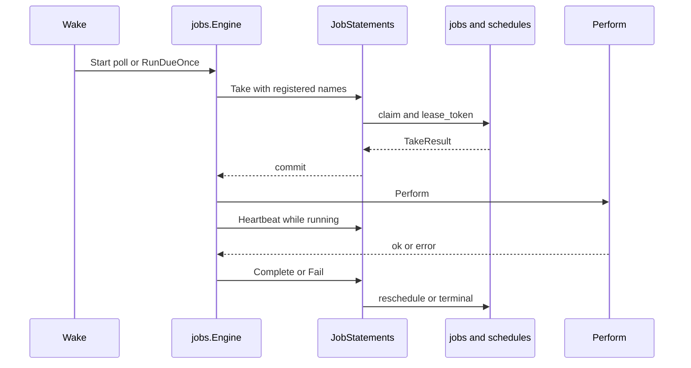

# Background jobs runtime

Companion to [ADR 065](../../adrs/065-background-jobs.md). ADR is the decision;
this note is the how-to for contributors and operators.

## Layers

```
jobs.Engine                    # RegisterWorker, Start/Close, RunDueOnce / drain
        │
service.JobStatements          # Enqueue / SetPeriodic / Take / Heartbeat / Complete / Fail / DeleteCompleted
        │
dialect/{postgres,spanner,sqlite}/  # migrations + claim SQL
```

- River is the **blueprint**, not a dependency.
- Statements are **tx-passive**: never `pool.Transaction`, never goroutines.
- Engine opens txs for Take / Heartbeat / Complete / Fail / DeleteCompleted.
- Callers open txs for Enqueue (product write) and SetPeriodic (boot / later ops).
- Dialects **do not** `RegisterWorker`.
- Mint IDs with `NewManagedID("job")` / `NewManagedID("sched")` inside dialect only.

## Schema

| Relation | Role |
|----------|------|
| `job_schedules` | Periodic definitions: `name`, `period`, next `run_at`, lease while in flight. PK `sched_…`. |
| `jobs` | Queued work + terminal queued rows. PK `job_…`. |

Periodic Complete/Fail only sets `run_at = now() + period` (skip missed beats).
No new row per period.

## One iteration



### Wake modes

| Mode | How work starts |
|------|-----------------|
| Self-hosted | `Engine.Start()` poll loop (`jobs.poll_interval`) |
| Serverless | Cron HTTP → `RunDueOnce` / drain until budget or shutdown. **That wake is the runner**, not a nudge-only signal. When `jobs.trigger_secret` is set, do not start the poll loop. |

Same `JobStatements` either way. Take always receives the registered-handler
**name allowlist** so old binaries do not lease work they cannot Perform.

## Ownership protocol

- Take writes `lease_until` + fencing `lease_token`.
- Heartbeat / Complete / Fail must send the token; mismatch is a no-op.
- Queued past `not_after`: mark `dead` without Perform.
- Default lease **30s**, heartbeat **10s** — long Performs extend via Heartbeat.
- Dialect claim SQL: Postgres `SKIP LOCKED`, Spanner jitter + lease tx, SQLite single-writer.

## Recipes

### Add a periodic sweep

1. Implement a handler `func(ctx, job) error` (idempotent; Path B uses system actor).
2. `RegisterWorker(…, "my.sweep", handler, opts)`.
3. At boot, if enabled: `SetPeriodic("my.sweep", period, opts)` from server config.
4. Do **not** write claim SQL in the handler.

### Enqueue deferred work with a product write

In the same product transaction that mutates the entity, call `Enqueue` with
optional `unique_key`, `not_after`, and `max_attempts`. If the tx rolls back,
the job is gone.

## Config (defaults)

| Knob | Default | Role |
|------|---------|------|
| `jobs.concurrency` | `1` | Parallel loops (SQLite max 1) |
| `jobs.poll_interval` | `1s` | `Start()` idle wait |
| `jobs.take_batch_size` | `1` | Rows per Take |
| `jobs.lease_duration` | `30s` | Initial lease |
| `jobs.heartbeat_interval` | `10s` | Heartbeat while Perform |
| `jobs.max_attempts` | `5` | Default queued Fail ceiling |
| `jobs.backoff_cap` | `1h` | Backoff cap |
| `jobs.retain` | `7d` | `DeleteCompleted` window |
| `jobs.trigger_secret` | unset | Set ⇒ Cron drain, no poll |
| `sessions.gc.enabled` | `true` when Engine on | Register + SetPeriodic |
| `sessions.gc.period` | `1m` | Sweeper cadence |

## First consumer: `sessions.gc`

Reap sessions with `expires_at` in the past; emit Path B `session.expired`
(system actor); hard-delete after emit (unless a later PR changes that).
Bounded batch per Perform. Read-time expiry stays.

**Local check:** short TTL exchange (or insert already-expired row) → wait →
`RunDueOnce` → session gone + event present.

## Coexistence with retention

Until the retention cutover PR: `RetentionJob` and `/cron/events-retention`
remain. Jobs Cron (e.g. `/cron/jobs`) is separate. Do not assume every sweep
is on the Engine yet.

## Non-goals (near term)

Spanner queues as SoT, version→job-kinds table, per-name fairness, OpenAPI jobs
resource, Path A durable outbox (can Enqueue later on this ledger).

## Related

- [ADR 028](../../adrs/028-storage-v2-statements-and-dialects.md), [041](../../adrs/041-storage-statement-contract-tests.md), [047](../../adrs/047-dialect-id-generation.md), [048](../../adrs/048-wide-events-internal-audit-primitive.md), [049](../../adrs/049-events-api-retention-export.md)
- Acceptance: [e2e/acceptance/background-jobs/](../../../e2e/acceptance/background-jobs/README.md)
