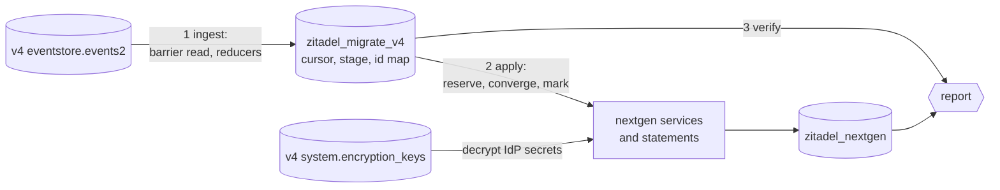

# Migrating Zitadel v4 to nextgen: the `migrate-v4` POC plan

> **Status:** Plan, and a working proof of concept in
> [`internal/migratev4`](../../../internal/migratev4) ([results](#proof-of-concept)), 2026-10-22
> **Scope:** organizations, human users with their password hashes, and
> generic OIDC IdPs with the users' links to them, from one v4 instance into
> one nextgen project
> **Checked against:** nextgen `8b99ba069`, Zitadel `v4.19.5`
> **References:** [Reading v4](v4-source.md) (tables, events, crypto) ·
> [Writing nextgen](nextgen-target.md) (write paths, gaps) ·
> [demo fixture](../../../internal/migratev4/demo/README.md)

## Goal

One command that, pointed at a running Zitadel v4:

1. reports what the v4 instance holds, what it can move and what it cannot
   (`assess`);
2. copies organizations, users and OIDC IdPs into nextgen, in the same
   PostgreSQL database, as often as needed while v4 keeps serving (`run`);
3. proves the copy so a cutover can follow (`verify`).

The POC is done when it shows, end to end against a real v4.19.5 database:

- a migrated user signs in to nextgen with their v4 password, without a reset;
- a migrated user signs in through a migrated OIDC IdP and lands on the same
  account, without relinking;
- a second `run` changes nothing, and a `run` after edits in v4 converges
  nextgen to them, including deactivations and removals;
- `assess` lists every v4 feature in use as migrated, partial or not migrated,
  with counts and the actions an operator has to take.

Not in the POC: apps, projects, roles and grants (nextgen has no OIDC
provider or `app_group` yet), machine users, MFA factors, policies, branding,
texts, actions, reverse sync, and Spanner or SQLite as the target.

## Proof of concept

`nextgen migrate-v4` implements milestones M0 to M4 below, with one exception:
`--identifier login_name` designates the identifier in the schema but does not
yet rename the login flow's identifier field, so only `email` works end to
end. It was run against a real Zitadel v4.19.5 database seeded through v4's
own APIs ([demo fixture](../../../internal/migratev4/demo/README.md)): 22
people in 5 orgs, every user state, 10 password-hash formats, 4 IdPs and 5
links.

| Criterion | Shown by |
|---|---|
| Sign-in with the v4 password | The demo check signs every seeded user in through nextgen's auth-attempt service: bcrypt (v4's own and `$2y$`), md5-crypt, sha512-crypt, phpass, md5salted and scrypt verify. The three hashes outside nextgen's default limits (argon2 at 4 MiB, pbkdf2 at 12 rounds, md5plain) are reported and refused, as `assess` said they would be |
| Sign-in through a migrated IdP | The integration test runs the SSO state round trip, callback result, identity resolution and bind the flow engine runs; the provider's subject lands on the migrated user. Only the OIDC exchange is simulated |
| Re-runs converge | A second run writes nothing. With v4 still serving, an email change, a deactivation and a new user made through v4's API converged after one `run`. A user edited in nextgen since the last run is reported as a conflict instead of being overwritten |
| `assess` | Prints migrates, partial, not migrated, conflicts and operator actions for the demo instance, setup defaults left out |

```sh
nextgen -c nextgen.yaml migrate-v4 assess --v4-masterkey-file v4.key
nextgen -c nextgen.yaml migrate-v4 run --v4-masterkey-file v4.key
nextgen -c nextgen.yaml migrate-v4 verify
```

Tests: unit tests for the reducers, the v4 decryption (with a vector from a
real v4.19.5 database), the planner and the login-flow rewrite (validated by
the server's own flow validator), and a Postgres integration test that
migrates, signs in with a password and through SSO, re-runs, and converges
edits (`go test -tags postgres_integration ./internal/migratev4/`).

It also confirmed [gap G1](nextgen-target.md#9-gaps) on real data: the four
users v4 holds inactive or locked are deactivated in nextgen, and still sign
in.

Where the POC departs from the design below:

- **Stage.** One JSON document per v4 aggregate in `zitadel_migrate_v4.aggregates`
  instead of a table per kind: IdPs live in their instance's or org's document,
  links in their user's.
- **Ingest.** It reads changed aggregates' events by sequence, not position
  (see [Pipeline](#pipeline)).
- **Reducer version.** The stage records the version of the reducers that
  folded it; a new version re-reads v4 from the start, keeping the id map.

## Concepts

The glossary's renames ([glossary §9](../glossary.md#9-renames-locked)) give
most of the mapping.

| v4 | nextgen | POC |
|---|---|---|
| Instance | Project | Yes, one instance into one project |
| Organization | Team | Yes |
| The instance's default organization | Self-owned users, no team | Yes ([D5](#open-decisions)) |
| Org domains, domain policy | Nothing; they only shape the login name | Derived |
| Human user | User: project-scoped, schema-validated attributes ([ADR 024](../../adrs/024-user-team-lifecycle-ownership.md), [ADR 052](../../adrs/052-user-envelope-and-attributes.md)) | Yes |
| Password hash | `user_passwords.encoded_hash`; both sides use passwap | Yes, byte for byte |
| Generic OIDC IdP, Google IdP | IdP connection, protocol `oidc` | Yes |
| IdP client secret | Secret variable referenced as `${{ NAME }}` ([ADR 062](../../adrs/062-per-environment-variables-and-secrets.md)) | Yes |
| IdP user link | Identity link | Yes |
| IdPs offered by the login policy | `sso_providers` on login flow steps | Instance level only |
| TOTP, passkeys, U2F, OTP SMS and email, recovery codes | Storage without a verifier, or blocked | No, reported |
| Machine users, keys, PATs | No equivalent; API access is `sk_proj` / `sk_team` | No, reported |
| Projects, apps, roles, grants, members | `app_group`, app, role, grant: not built | No, reported |
| Actions v1 and v2, SMTP, SMS, texts, branding, policies | Partly designed, not built | No, reported |
| Sessions, tokens, auth requests | None; users sign in again | Never |
| Event history | Stays in v4 | Never |

## Design summary

- **A server subcommand.** `nextgen migrate-v4` lives in the server binary
  (`cmd/server`, Cobra per [ADR 001](../../adrs/001-server-cli-cobra-viper.md)).
  It needs the v4 database and nextgen's internal services, which only code in
  this module can import. The TypeScript CLI talks HTTP and must run without
  Go or Docker; a `zitadel migrate v4` wrapper around the server binary can
  follow.
- **Events are the source.** The migrator reads `eventstore.events2`, not the
  projections:
  - password hashes, TOTP secrets and passkey keys exist only in events;
  - projection tables change name per v4 minor (`users14`, `orgs1`) and each
    advances on its own, so reading several gives a torn picture;
  - events give one gap-free, resumable cursor per instance, using v4's own
    guard ([Reading v4 §2](v4-source.md#2-reading-events-without-gaps)).

  Projections stay useful as an independent check in `verify`.
- **Ingest, stage, apply.** Events fold into stage tables that describe the
  v4 state (one row per org, user, IdP and link). Nextgen is then converged to
  that state. v4's quirks are handled in one place, and the first run creates
  only what is alive.
- **Idempotent by construction.** Every nextgen id is minted and recorded
  before it is written, and every write converges to a desired state. A run
  can stop anywhere and the next one finishes it; a run with nothing new
  writes nothing.
- **Same database, own schema.** Nextgen already keeps every table in
  `zitadel_nextgen`, which collides with none of v4's schemas. The migrator
  adds `zitadel_migrate_v4` for its own state and drops it after cutover.

## Command

```text
nextgen migrate-v4 assess     [--instance ID] [--json FILE] [--include-pii]
nextgen migrate-v4 run        [--instance ID] [--project ID] [--follow INTERVAL]
nextgen migrate-v4 status     [--instance ID]
nextgen migrate-v4 verify     [--instance ID]
nextgen migrate-v4 export-ids [--instance ID] [--format csv|json]
nextgen migrate-v4 cleanup    [--instance ID]
```

| Flag | Meaning |
|---|---|
| `-c, --config` | nextgen's own config: database and master keys, as the server reads it |
| `--source` | DSN of the v4 database, also `NEXTGEN_MIGRATE_V4_SOURCE`. Default: nextgen's own Postgres connection, i.e. the same database |
| `--v4-masterkey-file` | The 32-byte v4 master key, also read from `ZITADEL_MASTERKEY` as v4 reads it. Needed only for IdP secrets |
| `--instance` | The v4 instance. Needed only when the database holds more than one |
| `--project` | An existing nextgen project to fill. Default: create one |
| `--identifier` | `email` (default) or `login_name`: the property users sign in with ([D4](#open-decisions)) |
| `--default-org-users` | `self` (default) or `team` ([D5](#open-decisions)) |
| `--v4-stopped` | Confirms v4 is not running; required to read a v4 older than 4.18 |
| `--follow` | `run` keeps going, pausing this long between runs |
| `--json` | Also writes the report as JSON to a file, or only JSON with `-` |
| `--include-pii` | Lets issues name users and values |

Not built yet: `--dry-run` (plan without writing; `assess` covers most of it)
and `verify --deep` (compare against v4's projections).

- `assess` writes only to the stage. It never writes nextgen data.
- `status` prints the cursor, how far it lags v4, and counts per state.
- `export-ids` writes the v4-to-nextgen id map for teams whose data is keyed on
  the v4 `sub`.
- `cleanup` drops the stage, which holds password hashes.

## Architecture

### Topology and privileges

- **Same database.** This is the recommended setup for self-hosted
  installations. v4 owns `eventstore`, `projections`, `system`, `auth`,
  `adminapi`, `logstore`, `cache` and `queue`. Nextgen owns
  `zitadel_nextgen`, created by its goose migrations
  ([migrations.go](../../../internal/storage/dialect/postgres/migration/migrations.go)).
  The migrator owns `zitadel_migrate_v4`. Avoid a schema named `zitadel`: v5
  uses it, and `search_path` would put it first for a role named `zitadel`.
- **Roles.**
  - The v4 role is unchanged.
  - The nextgen role owns its two schemas. It gets `USAGE` on `eventstore` and
    `system`, and `SELECT` on `eventstore.events2` and `system.encryption_keys`.
  - Add `projections` for `verify --deep`.
  - Nothing else in v4 is readable, and nothing in v4 is writable.
- **Reads from the primary only**, in read-only transactions. v4's barrier
  is an advisory lock, and advisory locks are not replicated to standbys.
- **Separate databases also work.** `--source` points at v4 and the stage
  stays beside nextgen. The POC supports a Postgres target only.

### Pipeline



1. **Ingest.**
   - Asks v4 which aggregates have relevant events after the stored cursor, in
     v4's sort order and behind v4's barrier. Position only detects change.
   - Reads each changed aggregate's events after its staged `sequence`, in
     sequence order, on the events2 primary key. One aggregate's sequences
     become visible in order, so this folds correctly however v4 stamped
     positions, including old data with positions out of sequence order.
   - Folds them into the aggregate's document. Documents and cursor commit in
     one transaction.
2. **Apply.**
   - Derives the nextgen state the stage should produce and converges nextgen
     to it, in dependency order: project, user schema, teams, IdP secrets and
     connections, login flow, users, identity links, then deactivations and
     removals.
   - A source whose fingerprint and sequence match what was applied is skipped
     without touching nextgen.
3. **Verify.** Compares what the stage says should exist with what nextgen
   holds: counts, user attributes, passwords, connections and links.

The stage exists because several v4 facts only make sense folded together:

- login names depend on org domains and the domain policy;
- `org.removed` deletes its users without writing any user event;
- legacy IdP configs and IdP templates share one id space;
- a removed user's id can return in another org.

### Stage and ledger: `zitadel_migrate_v4`

| Table | Holds |
|---|---|
| `cursors` | Per instance: the last sort key read (position, `in_tx_order`, aggregate type, aggregate id, sequence) and the version of the reducers that folded the stage |
| `aggregates` | One JSON document per v4 aggregate with the sequence of the newest event folded into it ([model.go](../../../internal/migratev4/stage/model.go)): instance (name, default org, domain and login policy, the IdPs offered at sign-in, instance IdPs with their encrypted secrets as stored), org (name, state, domains, domain-policy override, org IdPs), user (org, state, username, profile, email and phone with verified flags, encoded password hash, factor and metadata counts, links), and the out-of-scope objects `assess` counts |
| `id_map` | v4 kind and id → nextgen id, `applied` or `reserved`, the v4 sequence applied, and a fingerprint of what was written |
| `runs` | Each command's report, conflicts and skips included. Values appear only with `--include-pii` |

The migrator creates these idempotently ([schema.sql](../../../internal/migratev4/stage/schema.sql)).
A dialect-portable version belongs to the work that makes nextgen Cloud a
target ([D8](#open-decisions)).

The reducers carry a version. When it changes, as when they learn an event
type they skipped before, ingest drops the stage and re-reads v4 from the
start. The id map stays, so apply converges without writing anything new.

### Converging nextgen: reserve, write, mark

Each stage row reaches nextgen in three steps:

1. **Reserve.** Mint the nextgen id with `Statements().NewManagedID(prefix)`
   and commit it to `id_map` before nextgen sees anything. Nextgen keeps a
   non-empty id it is given ([ADR 047](../../adrs/047-dialect-id-generation.md),
   [`idgen.Ensure`](../../../internal/storage/dialect/idgen/ensure.go)).
2. **Converge.** In one nextgen transaction, create the entity under the
   reserved id or update it to the desired state, and emit nextgen's events for
   it.
3. **Mark.** Record `applied_seq` and a fingerprint of what was written.

A crash leaves nothing the next run cannot finish:

- reserved but not written: create it with the reserved id;
- written but not marked: compare it with the desired state, then mark.

The ledger never has to join nextgen's transaction, so this does not depend
on nextgen's dialect or on where the ledger lives.

The fingerprint also catches an edit made in nextgen after the migrator wrote
the row. The next run reports a conflict instead of overwriting it: v4 stays
the only writer until cutover.

One migrator runs per instance. It holds
`pg_try_advisory_lock(hashtext('zitadel_migrate_v4'), hashtext(instance_id))`
for its whole run.

### Events

The migrator emits nextgen's normal events through `audit.Emit`, with actor
type `system` and actor id `migrate-v4`
([`audit.WithActorContext`](../../../internal/audit/context.go)). Event
consumers then see migrated users like any others. Statements emit nothing,
so every statement-level write in the migrator emits its event itself. Event
types nextgen has deferred (membership, `user.deactivated`) are not invented
here ([events catalog](../api/events-catalog.md)).

### Secrets

- **Decrypting on the v4 side.**
  - v4 encrypts IdP client secrets with `idpConfigKey`: AES-256-CFB with the IV
    prepended and no MAC. That key sits in `system.encryption_keys`, wrapped
    by the v4 master key.
  - The migrator decrypts only at apply time and keeps plaintext only in
    memory.
  - It checks each result (valid UTF-8, printable), because a wrong master key
    yields garbage rather than an error.
- **Storing on the nextgen side.**
  - The secret becomes a secret variable through `VariableService.SetVariables`:
    a JWE under the project's `secret` key, written to the `primary` kind.
  - The connection names it as `${{ NAME }}`.
  - Nextgen's master key comes from its normal config.
- Details: [Reading v4 §5](v4-source.md#5-encryption) and
  [Writing nextgen §5](nextgen-target.md#5-idp-connection-and-its-secret).

## Mapping

### Instance → project

- `--project` fills an existing project. Without it, the migrator calls
  `ProjectService.Create(name, origins: [], seedDefaults: true)`. That creates
  the project's keys, the default user schema and the default login flows
  ([project.go](../../../internal/service/project.go)).
- v4 instance domains and trusted domains are reported as origin candidates
  for `zitadel origin add`, not added. An origin is where an app runs, not
  where v4 served its login.
- Open for M2: how a migrator-created project gets its owning team, given the
  claim window ([ADR 046](../../adrs/046-claim-lifecycle-v2.md)).

### User schema

The default schema has a single property, `email`
([default-human-user.json](../../../packages/config/defaults/default-human-user.json)).
The migrator publishes a v4-shaped schema as a new revision of the same
`objectType`, `human-user`. Sign-in looks users up across every revision of
the flow's `objectType` ([ADR 058 §5](../../adrs/058-user-identity-designation-and-references.md)),
so the default login flow keeps working for migrated users and for new sign-ups.

| Property | From v4 | Notes |
|---|---|---|
| `email` | Email | `format: email`, `x-unique: project`. Identifier with `--identifier email` |
| `login_name` | Preferred login name | `x-unique: project`. Identifier with `--identifier login-name` |
| `username` | Username | Not unique: v4 scopes usernames per org when `userLoginMustBeDomain` is set |
| `given_name`, `family_name`, `nickname`, `display_name` | Profile | `x-display: ["display_name"]` |
| `preferred_language` | Profile | Dropped when `und` |
| `gender` | Profile | `female`, `male` or `diverse` |
| `phone` | Phone | E.164 |
| `email_verified`, `phone_verified` | Verified flags | Informational: nextgen has no verification state |
| `zitadel_v4_id` | User id | `x-unique: project`, so apps can look up a user by their v4 id |
| `x-auth-methods` | — | Password and passkey, as the default schema; `sso` with the migrated slugs |

- Only the identifier is required, because v4 data leaves the rest optional.
- `assess` validates every staged user against this schema before anything
  is written.
- `--identifier login-name` also needs the login flow's identifier field
  renamed. That lands in M4.

### Organization → team

- Active and inactive orgs become teams, keeping the v4 name trimmed to 200
  runes.
  - Nextgen team names are unique per project, case-insensitively
    (`uq_teams_project_name`).
  - A clash gets a deterministic suffix and an issue.
  - Teams are written with the `CreateTeam` statement under the reserved id,
    because `TeamService.Create` always mints its own. The migrator emits
    `team.created` itself.
- An inactive org's team is deactivated after its users exist. `DeactivateTeam`
  also deactivates the users the team owns. That matches v4, where users of an
  inactive org cannot sign in.
- The default org's users are self-owned and the default org gets no team
  ([D5](#open-decisions)).
- Org domains have no home in nextgen. They only shape login names.

### Human user → user

- **Skipped:**
  - removed users;
  - users of removed orgs (v4 writes no event for them, the stage cascades);
  - machine users, which are reported.
- **One transaction per user**, composed from `UserService` actions
  (`ApplyActions`, [user.go](../../../internal/service/user.go)):
  1. `CreateUserAction` with the reserved id. It validates against the schema
     and emits `user.created`.
  2. The org's team as `LifecycleOwnerTeamID` (set after `Prepare`; only the
     statement takes it today) and as `InitialMembershipTeamID`. The statement
     writes the membership and its authz edge
     ([dual write](../../../internal/storage/dialect/authz/dual_write.go)).
  3. `SetUserPassword{EncodedHash}` after `ValidateHash`, plus an
     `auth.factor.password.set` event.

  | v4 state | nextgen | Note |
  |---|---|---|
  | active | active | |
  | initial (no password yet) | active, no password | Issue: the user needs an IdP link or an admin-set password; nextgen has no email reset yet |
  | inactive | deactivated (`DeactivateUser`) | Memberships become `removed` |
  | locked | deactivated | Nextgen has no locked state ([D6](#open-decisions)) |
  | deleted | not created, or deactivated if created earlier | |

- **Password.**
  - The encoded hash moves byte for byte.
  - Nextgen's import bounds are narrower than v4's: pbkdf2 needs at least 100k
    rounds (v4 accepts 1k), sha2-crypt at least 5k (v4 accepts 1k), and plain
    MD5 needs the `md5plain` verifier.
  - A hash outside the bounds leaves the user without a password, with an
    issue. Operators can widen `password_hasher.limits` before running.
  - `changeRequired` has no equivalent and is counted.
- **Dropped and counted:** TOTP, passkeys, U2F, OTP SMS and email, recovery
  codes, metadata, avatar, address.
- **Forced MFA.** An instance with `forceMFA` would drop to password-only
  sign-in. `assess` flags it as a blocker for production.

### OIDC IdP → IdP connection

**In scope:**

- generic OIDC templates (`*.idp.oidc.*`);
- legacy OIDC configs (`*.idp.config.*` with `*.idp.oidc.config.*`);
- Google templates, which become `template: google`.

Both instance-owned and org-owned IdPs are included.

| Connection document | From v4 |
|---|---|
| `slug` | Derived from the name (`[a-z0-9_-]`, at most 64 characters), unique per project, stable across runs. It is fixed for life and part of the callback URL |
| `display_name` | Name |
| `oidc.issuer` | Issuer. Must be https, and nextgen never lets it change |
| `oidc.client_id` | Client id |
| `oidc.client_secret` | `${{ V4_IDP_<SLUG>_CLIENT_SECRET }}`, the decrypted secret as a secret variable |
| `oidc.scopes` | Scopes, plus `openid` if missing |
| `oidc.pkce_enabled` | `usePKCE`, always written: nextgen defaults to true, and legacy v4 configs never used PKCE |
| `oidc.id_token_mapping` | `idTokenMapping`. Legacy configs get `true`, as v4's projection treats them |
| `claim_mapping` | `email`, `given_name`, `family_name` and the rest, onto the schema above |
| `provisioning.creation` | `auto` when v4 allowed creation, otherwise `disabled` |
| — | `isLinkingAllowed`, `autoLinkingOption` and `isAutoUpdate` have no equivalent and are reported |

- **Written with** `IDPConnectionService.CreateOrRevise`, which validates and
  emits `idp.created` or `idp.updated`. Nothing is written when the newest
  revision already equals the desired document, so no empty revisions appear.
- **Offered at sign-in:**
  - Sign-in only offers slugs listed in a step's `sso_providers`.
  - The migrator publishes a new revision of the login flow that lists the
    instance-level IdPs v4's login policy offered, with the
    `sso_authenticated` and `user_already_exists` transitions from
    [the scaffold](../idp/schemas/default-login.scaffold.json).
  - Org-owned IdPs are created but not listed, because nextgen has no
    team-scoped login yet ([D9](#open-decisions)).
- **Only for a project that serves nothing through a deployment yet.** Only
  then does the runtime serve the newest revisions
  ([runtime.go](../../../internal/service/runtime.go)). Otherwise the change
  ships as a release and a deployment.
- **Operator actions, listed in the report:**
  - register `{origin}/__nextgen/idp/{slug}/callback` at each provider, plus
    `/idp/{slug}/callback` for SDK proxies;
  - allow private issuers in `httpclient.allow_list`.

### IdP link → identity link

- **What is written:** for every live v4 link whose user and IdP were
  migrated, the `CreateIDPIdentityLink` statement with
  `subject` = the v4 external user id, under a reserved `idplink_` id, plus an
  `idp.identity_link.created` event. No service creates links outside sign-in.
- **Why existing users keep working:** for OIDC, v4 stores the `sub` claim as
  the external id. That is also nextgen's default `subject_claim`, so the user
  signs in without relinking.
- **Not written:** links to an IdP that is out of scope are counted only.

### Later runs: changes and removals

| Change in v4 | Effect in nextgen |
|---|---|
| Profile, email or username | `PatchUser`, which checks `ExpectedUpdatedAt` |
| New password hash, including `user.human.password.hash.updated` | A new `SetUserPassword` row |
| Deactivate or lock | `DeactivateUser` |
| Reactivate or unlock | No statement yet ([gap](nextgen-target.md#9-gaps)) |
| User removed | User deactivated, as [ADR 024](../../adrs/024-user-team-lifecycle-ownership.md) tombstones first. `--propagate-deletes` hard-deletes through `UserService.DeleteUser` |
| Link removed | No delete statement yet (gap) |
| IdP removed | No connection delete API ([#1013](https://github.com/zitadel/nextgen/issues/1013)). The slug leaves the login flow and its secret variable is deleted |
| Org removed | Team deactivated, together with the users it owns |

## `assess`

The report has four parts:

1. **Source:** the database, the v4 capability detected from its setup steps,
   and the instances.
2. **Per instance, three lists with counts:**
   - migrates;
   - migrates partially, saying what is lost;
   - not migrated, saying why: not built, no equivalent, or runtime state.
3. **Conflicts** that block a clean run.
4. **Operator actions.**

The demo fixture's instance, after one live-sync run (real output, issues left out):

```text
instance 396264278547497158  "Acme Corp v4"  (continuous sync supported, last setup step 80_users14_instance_resource_owner_idx)

MIGRATES
  organizations -> teams                   3   1 inactive, deactivated
  default organization -> no team          1   its users are self-owned
  OIDC and Google IdPs -> IdP connections  3   corporate-sso, google, acme-okta
  human users -> users                     22  17 with a password
  IdP links -> identity links              4   

PARTIAL (migrated, something stays behind)
  org-owned IdPs                         1  created, not offered at sign-in: nextgen has no team-scoped login yet
  inactive or locked users               3  deactivated (nextgen has no locked state)
  users without a password or link       1  cannot sign in until an admin sets a password
  users with OTP email                   1  factor dropped
  users with metadata                    1  dropped
  users who must change their password   1  not enforced in nextgen
  IdP links to IdPs that do not migrate  1  dropped

NOT MIGRATED
  IdPs of type github               1  nextgen connections speak OIDC only
  machine users                     2  0 keys, 2 PATs; no equivalent
  users of removed organizations    1  removed in v4
  projects (without Zitadel's own)  1  1 app, 1 role, 0 project grants; no OIDC provider in nextgen yet
  user grants (authorizations)      1  not built in nextgen
  actions v2 targets                1  no equivalent
  changes to org login policies     6  no team-scoped login yet

CONFLICTS
  users whose email collides                             1  first created wins, the rest are skipped
  password hashes outside nextgen's verifiers or limits  3  migrated without a password

ACTIONS
  - register the redirect URI https://<app origin>/__nextgen/idp/corporate-sso/callback at "Corporate SSO" (v4 id 396264293663834310)
  - register the redirect URI https://<app origin>/__nextgen/idp/google/callback at "Google" (v4 id 396264293680611526)
  - register the redirect URI https://<app origin>/__nextgen/idp/acme-okta/callback at "Acme Okta" (v4 id 396264293680545990)
  - add the origins your apps run on (zitadel origin add); v4 served sign-in on acme-corp-v4-hwruzi.localhost, localhost
  - widen password_hasher.limits or add verifiers (md5plain) in nextgen's config, then run again, to keep the passwords of the users listed as password_hash_rejected
  - integrate the apps with nextgen: v4 OIDC clients do not carry over, and each user's id changes (export-ids)
```

`--json` writes the same content with stable keys and a `report_version`. It
has no names, emails or ids unless `--include-pii` is set.

## Cutover runbook

The POC rehearses this:

1. **Prepare v4.** Upgrade to the latest 4.x, at least 4.18, and back up the
   database.
2. **Deploy nextgen** against the same database: `nextgen migrate`, a
   production master key, `--disable-master-key-generation`. Then grant the
   read privileges above.
3. **`assess`.** Fix what it reports in v4, such as duplicate emails or http
   issuers, or pick options.
4. **First copy:** `run`, then `verify`.
5. **Prepare the apps.**
   - Integrate them with nextgen. v4 OIDC clients do not carry over.
   - Add origins and register the IdP callbacks.
   - Test with migrated accounts.
6. **Stay current** with `run --follow`.
7. **Cutover.**
   - Stop v4 by scaling it to zero.
   - Run the final `run`, then `verify`, then switch traffic.
   - Hand `export-ids` to the owners of data keyed on the v4 `sub`.
8. **Afterwards.** Keep v4's schemas read-only through the rollback window,
   then run `cleanup`.

Rolling back before step 7 costs nothing. After it, whatever was created in
nextgen is lost on rollback, because nothing syncs back to v4.

## Gaps in nextgen

These are the nextgen changes the migration needs. Each is detailed in
[Writing nextgen §9](nextgen-target.md#9-gaps).

| Gap | Effect | POC | Production |
|---|---|---|---|
| Sign-in does not check user status | Deactivated or locked v4 users could still sign in | Documented | Must fix (also a bug without migration) |
| Rehash on verify is not persisted (ADR 038 follow-up 1) | bcrypt users never move to argon2id, and every sign-in computes an argon2id hash and throws it away | Accept | Must fix |
| No email reset or recovery | Users without a usable hash cannot get in | Report them | Needed |
| Lifecycle owner, team id on create, membership, identity link: statement-only writers without events | The migrator writes and emits them itself | Workaround | Add import services |
| No user or team reactivation, no link delete | Later runs cannot replay these v4 changes | Report | Needed for `--follow` |
| Passkey user handle is fixed to the nextgen user id | v4 passkeys cannot verify | Out of scope | Legacy-handle column, and serving the v4 RP ID |
| TOTP and recovery codes have no verifier and no encryption | v4 secrets have nowhere usable to go | Out of scope | Needed for MFA parity |
| No verification state for email and phone | Verified flags become plain attributes | Accept | Decide |
| `created_at` cannot be set | Migrated users look new | Accept | Optional |

## Milestones

Each milestone ends with its exit test passing in CI against the
[fixtures](#testing).

| Milestone | Delivers | Exit criteria |
|---|---|---|
| **M0 Skeleton** | Command tree; nextgen config reuse; read-only source connection; capability detection from v4 setup steps; instance discovery; `assess` prints an event-type histogram | Runs against the v4.19.5 fixture and refuses a v4 older than 4.2 |
| **M1 Ingest and assess** | Ledger schema; barrier reader with the sort-key cursor; reducers for instance, org, user, IdP and link; inventory counters; the full `assess` report in text and JSON | Stage counts equal v4's own projections (`users14`, `orgs1`, `idp_templates6`, `idp_user_links3`); a second ingest changes nothing; killing ingest mid-batch and rerunning gives an identical stage |
| **M2 Orgs and users** | Project creation or reuse; schema revision; teams; users with attributes, owner, membership, state and password; `id_map` with reserve, write and mark; system-actor events; `verify` and `export-ids` | A migrated bcrypt user and a migrated argon2 user sign in with their v4 passwords through the auth-attempt API; reruns are no-ops; a deactivated v4 user is deactivated in nextgen |
| **M3 IdPs and links** | v4 master-key decryption; secret variables; connection documents; login-flow wiring; identity links | A migrated user with a v4 link signs in through a mock OIDC provider with the same `sub` and lands on their account, with no conflict step |
| **M4 Deltas and cutover** | `--follow`; changes and removals; conflict detection on foreign edits; `--identifier login-name`; final sync with v4 stopped | A scripted change set in v4 converges after one `run`; the [runbook](#cutover-runbook) passes with v4 stopped for the last step |

## Testing

[Testing layers](../../../packages/testing/AGENTS.md) apply: each property is
tested at the lowest layer that proves it.

- **Fixtures.**
  - Run a real `ghcr.io/zitadel/zitadel:v4.19.5` against Postgres and seed it
    through v4's APIs:
    - orgs, including inactive and removed ones;
    - users in every state;
    - passwords in each hash format, through import;
    - generic OIDC, legacy and Google IdPs, with links;
    - both domain-policy settings.
  - Dump `eventstore.events2` and `system.encryption_keys` into compressed
    testdata. The dump holds synthetic people only.
  - Repeat on an older 4.x when version drift becomes a question.
- **Unit tests:**
  - reducers, as table tests over event sequences: legacy v1 names, legacy
    IdP configs, id reuse, `org.removed`;
  - login-name and slug derivation;
  - decryption against vectors produced with v4's own code;
  - mapping of hash bounds to issues.
- **Postgres integration**, with `testcontainers` as in the
  [storage rules](../../../internal/storage/AGENTS.md):
  - the barrier reader racing concurrent pushers that take v4's shared lock;
  - idempotent ingest;
  - apply interrupted between reserve, write and mark.
- **End to end**, as Go integration tests in
  [`internal/api/integration_test`](../../../internal/api/integration_test):
  - password sign-in for a migrated user;
  - SSO sign-in through a mock OIDC provider.

## Risks

- **v4 version drift.** Event payloads and setup steps differ across 4.x.
  Detect capability rather than parse versions, and keep fixtures for the
  versions customers run.
- **Old data.** Look out for:
  - v1 event names, legacy IdP configs and events copied from the old
    `events` table;
  - unique constraints from before lowercasing, which can surface as clashes
    once names are case-folded.
- **Losing MFA.** TOTP and passkey users drop to password or IdP sign-in.
  That lowers assurance for instances that relied on them.
- **Apps must change.** Nextgen does not yet serve OIDC to apps, and the
  user's `sub` changes. Migrating users moves no app on its own.
- **Large instances.** Reading per event type on `es_projection` with batched
  applies should scale. Measure it on a large fixture in M1.
- **Secrets.**
  - The v4 master key passes through the migrator.
  - The stage holds password hashes, so it must be cleaned up after cutover.
  - The report holds no PII by default.

## Open decisions

| # | Decision | Recommendation | Alternative |
|---|---|---|---|
| D1 | Where the command lives | Server subcommand `nextgen migrate-v4` | A `zitadel` CLI command (needs HTTP import APIs first) |
| D2 | What to read | v4 events behind v4's barrier | Projections (no hashes, versioned names, torn reads) or the v4 API (no hashes, no secrets) |
| D3 | Nextgen user ids | Mint new `user_` ids, keep the v4 id as `zitadel_v4_id`, provide `export-ids` | Derive ids from v4 ids (`user_<v4 id>`). `sub` still changes, and the ids are sequential |
| D4 | What users sign in with | `email`, which works with the default login flow; duplicates reported | The v4 preferred login name, which needs a flow change. Nextgen has one identifier, so v4's "username or email" does not carry over |
| D5 | Users of the default org | Self-owned, no team | A team like any other org |
| D6 | Locked and inactive users | Deactivated, once sign-in checks status | Skip them until it does |
| D7 | Write path | Services where they exist, statements otherwise, events emitted by the migrator | Build import services in nextgen first |
| D8 | Where the ledger lives | Postgres `zitadel_migrate_v4` for the POC | Nextgen storage with dialect parity, needed to migrate into nextgen Cloud (Spanner) |
| D9 | Org-owned IdPs | Created, not offered at sign-in | Skipped |
| D10 | Configuration (schema, flow, connections) | The migrator writes it, and `--emit-config DIR` also writes it as `.zitadel/` files for the operator's repo | Files only, applied by `zitadel apply` and a deployment |

## After the POC

| v4 feature | What nextgen needs first |
|---|---|
| TOTP | A TOTP check in auth attempts, and encryption at rest |
| Passkeys and U2F | A legacy WebAuthn user handle per credential, the stored `backup_eligible` flag, and login served on the v4 RP ID (or related origins, [ADR 038](../../adrs/038-user-credential-migration-and-recovery.md)) |
| Machine users | Service accounts |
| Projects, apps, roles, grants | `app_group`, an OIDC provider, and keeping v4 client ids |
| Org login policies, org-owned IdPs | Team-scoped login flows (the flow audience) |
| Password, lockout and complexity policies | Operation policies ([ADR 066](../../adrs/066-operation-policies.md)) |
| Metadata, avatars | A home in the user envelope, and asset storage |
| SAML, LDAP, OAuth2 and JWT IdPs | Protocols beyond OIDC |
| nextgen Cloud as the target | The dialect-portable ledger (D8), and Spanner support in the import paths |
