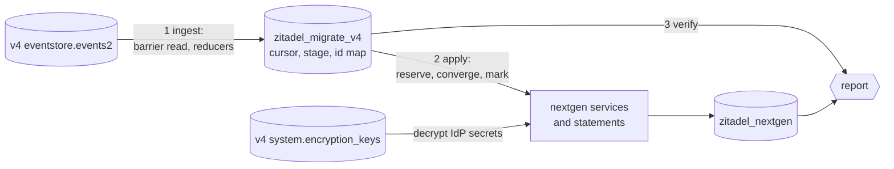

# Migrating Zitadel v4 to nextgen: the `migrate-v4` POC plan

> **Status:** Implementation plan for a proof of concept, revised 2026-11-03
> **Scope:** organizations, human users with their password hashes, and
> generic OIDC IdPs with the users' links to them, from one v4 instance into
> one nextgen project
> **Checked against:** nextgen `69df981d4`, Zitadel `v4.19.5`
> **References:** [Reading v4](v4-source.md) (tables, events, crypto) ·
> [Writing nextgen](nextgen-target.md) (write paths, gaps)

## Goal

One command that, pointed at a running Zitadel v4:

1. reports what the v4 instance holds, what it can move and what it cannot
   (`assess`);
2. copies organizations, users and OIDC IdPs into nextgen, in the same
   PostgreSQL database, as often as needed while v4 keeps serving (`run`);
3. proves the copy so a cutover can follow (`verify`).

The POC is done when it shows, end to end against a real v4.19.5 database:

- a migrated user signs in to nextgen with their v4 password, without a reset;
- a migrated user signs in through a migrated OIDC IdP and lands on the same
  account, without relinking;
- a second `run` changes nothing, and a `run` after edits in v4 converges
  nextgen to them, including inherited changes, deactivation, reactivation
  and unlinking; interrupted applies resume even if v4 has advanced;
- inactive and locked users, including users of inactive organizations,
  cannot authenticate by password or SSO;
- `assess` lists every v4 feature in use as migrated, partial or not migrated,
  with counts and the actions an operator has to take.

Not in the POC: apps, projects, roles and grants (nextgen has no OIDC
provider or `app_group` yet), machine users, MFA factors, policies, branding,
texts, actions, reverse sync, and Spanner or SQLite as the target.

Build and prove the stopped-source importer first (M0–M3). Enable live
`--follow` only after M4's lifecycle and recovery tests pass. Out-of-scope
authentication controls can block a migration: reporting a loss is not
permission to weaken sign-in. The [safety gates](#safety-gates) apply to the
POC's fixtures as well as to real instances.

## Concepts

The glossary's renames ([glossary §9](../glossary.md#9-renames-locked)) give
most of the mapping.

| v4 | nextgen | POC |
|---|---|---|
| Instance | Project | Yes, one instance into one project |
| Organization | Team | Yes |
| The instance's default organization | Team, with team-owned users | Yes, like every other org ([D5](#decisions)) |
| Org domains, domain policy | Nothing; they only shape the login name | Derived |
| Human user | User: project-scoped, schema-validated attributes ([ADR 024](../../adrs/024-user-team-lifecycle-ownership.md), [ADR 052](../../adrs/052-user-envelope-and-attributes.md)) | Yes |
| Password hash | `user_passwords.encoded_hash`; both sides use passwap | Yes, byte for byte |
| Generic OIDC IdP, Google IdP | IdP connection, protocol `oidc` | Yes |
| IdP client secret | Secret variable referenced as `${{ NAME }}` ([ADR 062](../../adrs/062-per-environment-variables-and-secrets.md)) | Yes |
| IdP user link | Identity link | Yes |
| IdPs offered by the login policy | `sso_providers` on login flow steps | Instance level only |
| TOTP, passkeys, U2F, OTP SMS and email, recovery codes | Storage without a verifier, or blocked | No, reported |
| Machine users, keys, PATs | No equivalent; API access is `sk_proj` / `sk_team` | No, reported |
| Projects, apps, roles, grants, members | `app_group`, app, role, grant: not built | No, reported |
| Actions v1 and v2, SMTP, SMS, texts, branding, policies | Partly designed, not built | No, reported |
| Sessions, tokens, auth requests | None; users sign in again | Never |
| Event history | Stays in v4 | Never |

## Design summary

- **A server subcommand.** `nextgen migrate-v4` lives in the server binary
  (`apps/api/cmd/server`, Cobra per [ADR 001](../../adrs/001-server-cli-cobra-viper.md)).
  It needs the v4 database and nextgen's internal services, which only code in
  this module can import. The TypeScript CLI talks HTTP and must run without
  Go or Docker; a `zitadel migrate v4` wrapper around the server binary can
  follow.
- **Events are the source.** The migrator reads `eventstore.events2`, not the
  projections:
  - password hashes, TOTP secrets and passkey keys exist only in events;
  - projection tables change name per v4 minor (`users14`, `orgs1`) and each
    advances on its own, so reading several gives a torn picture;
  - events give one gap-free, resumable cursor per instance, using v4's own
    guard ([Reading v4 §2](v4-source.md#2-reading-events-without-gaps)).

  Projections stay useful as an independent check in `verify`.
- **Ingest, stage, apply.** Events fold into stage tables that describe the
  v4 state (one row per org, user, IdP and link). Nextgen is then converged to
  that state. v4's quirks are handled in one place, and the first run creates
  only what is alive.
- **Idempotent by construction.** Every nextgen id is minted and recorded
  with a pending operation before it is written. Recovery finishes that
  operation's frozen desired state before applying newer source state. A run
  with nothing new makes no nextgen writes; stage/report bookkeeping may change.
- **Same database, own schema.** Nextgen already keeps every table in
  `zitadel_nextgen`, which collides with none of v4's schemas. The migrator
  adds `zitadel_migrate_v4` for its own state. Cleanup removes one migration's
  rows after the rollback window, preserving other migrations in that schema.

## Command

```text
nextgen migrate-v4 assess     [--instance ID]... [--json] [--include-pii]
nextgen migrate-v4 run        --instance ID [--project ID] [--dry-run]
nextgen migrate-v4 run        --migration ID [--follow[=INTERVAL]] [--dry-run]
nextgen migrate-v4 status     [--migration ID]
nextgen migrate-v4 verify     --migration ID [--deep] [--final]
nextgen migrate-v4 export-ids --migration ID [--format csv|json]
nextgen migrate-v4 cleanup    --migration ID
```

| Flag | Meaning |
|---|---|
| `-c, --config` | nextgen's own config: database and master keys, as `nextgen migrate` reads it |
| `--source` | DSN of the v4 database. Default: nextgen's own Postgres connection, i.e. the same database |
| `--v4-masterkey-file` | The 32-byte v4 master key, also read from `ZITADEL_MASTERKEY` as v4 reads it. Needed only for IdP secrets |
| `--instance` | The v4 instance. Required when the database holds more than one |
| `--project` | An existing dedicated nextgen project to fill. Default: reserve and create one once, then reuse the ledger binding |
| `--migration` | The ledger's handle for one source-instance/target-project binding; required for resume, verification, export and cleanup |
| `--identifier` | `email` (default) or `login-name`, chosen at first run and fixed thereafter; available in M2 ([D4](#decisions)) |
| `--only` | Restrict to `orgs,users,idps,links`; include dependencies and record the scope. A partial run cannot certify a full cutover |
| `--dry-run` | Ingest and plan, then print what `apply` would write |
| `--emit-config DIR` | Write schema, flow and connection documents for the operator's `.zitadel/` configuration; secret references only |
| `--final` | Require the stopped-writer watermark, independent source check and deployed-runtime checks described in [verification](#verification-contract) |

- `assess` writes only to the stage. It never writes nextgen data.
- `status` prints the cursor, how far it lags v4, pending operations, blockers
  and the last verification watermark. It does not claim readiness from lag alone.
- `export-ids` writes the v4-to-nextgen id map for teams whose data is keyed on
  the v4 `sub`.
- `--json` writes one versioned envelope on stdout; diagnostics go to stderr.
  Reports with blockers and inconclusive verification return nonzero exit codes.
- `cleanup` refuses an active migration or pending operation. After the operator
  retains the ID export and ends the rollback window, it removes only that
  migration's stage, ledger and reports, which hold password hashes and PII.
  It leaves nextgen and v4 data intact and never drops a shared schema.

## Architecture

### Topology and privileges

- **Same database.** This is the recommended setup for self-hosted
  installations. v4 owns `eventstore`, `projections`, `system`, `auth`,
  `adminapi`, `logstore`, `cache` and `queue`. Nextgen owns
  `zitadel_nextgen`, created by its goose migrations
  ([migrations.go](../../../apps/api/internal/storage/dialect/postgres/migration/migrations.go)).
  The migrator owns `zitadel_migrate_v4`. Avoid a schema named `zitadel`: v5
  uses it, and `search_path` would put it first for a role named `zitadel`.
- **Roles.**
  - The v4 role is unchanged.
  - The nextgen role owns its two schemas. It gets `USAGE` on `eventstore` and
    `system`, and `SELECT` on `eventstore.events2` and `system.encryption_keys`.
  - Add `projections` for `verify --deep`.
  - Nothing else in v4 is readable, and nothing in v4 is writable.
- **Reads from the primary only**, in read-only transactions. v4's barrier
  is an advisory lock, and advisory locks are not replicated to standbys.
- **Separate databases also work.** `--source` points at v4 and the stage
  stays beside nextgen. The POC supports a Postgres target only.

### Pipeline



1. **Ingest.**
   - Reads the instance's relevant events after the stored cursor, in v4's sort
     order and behind v4's barrier.
   - Folds events using a source checkpoint per aggregate. Source `sequence`
     is used only for replay deduplication, not for deciding which target rows
     need work. Apply all effects of an event before advancing its checkpoint.
   - Advance a separate monotonic `stage_revision` for every affected row,
     including dependents changed by an org or instance event. Cursor, source
     checkpoints, stage rows and dependency invalidations commit together.
2. **Apply.**
   - Recover pending operations first, then visit rows whose `stage_revision`
     is newer than `applied_revision` or whose mapping is not yet applied.
   - Derive the nextgen state the row should produce and converge nextgen to
     it, in dependency order: project, user schema, teams, IdP secrets and
     connections, login flow, users, identity links, then deactivations and
     removals.
3. **Verify.** Compare stage and nextgen at a recorded watermark, including
   fields, relationships and effective runtime configuration.
   `--deep` also checks independently derived v4 state; see the
   [verification contract](#verification-contract).

The stage exists because several v4 facts only make sense folded together:

- login names depend on org domains and the domain policy;
- `org.removed` deletes its users without writing any user event;
- legacy IdP configs and IdP templates share one id space;
- a removed user's id can return in another org.

Invalidate users on primary-domain, domain-policy and org-state changes;
invalidate links on user/IdP removal or subject changes; invalidate the flow
on effective provider-policy changes. Materialize these dependencies before
marking an ingest batch complete. Never compare sequences from different
aggregates. Re-created users must replace old owner, credential and link state
explicitly, even if removal and recreation occur in one ingest batch.

### Stage and ledger: `zitadel_migrate_v4`

| Table | Holds |
|---|---|
| `migration` | Ledger handle, source database identity and instance id, target database/project (unbound during initial assessment), mapping version, identifier mode and supported scope; no DSNs or master keys |
| `cursor` | Per instance: the last sort key read, i.e. position, `in_tx_order`, instance, aggregate type, aggregate id, sequence |
| `aggregate_checkpoint` | Last folded source sequence per instance, aggregate type and aggregate id |
| `src_instance` | Name, default org, domain policy, the login policy flags we read, the IdPs the login policy offers |
| `src_org` | Name, state, verified domains, primary domain, domain-policy and login-policy overrides, removed |
| `src_user` | Org, incarnation, kind, state, username, profile, email and phone with verified flags, encoded password hash and its source version, `changeRequired`, factor counts, effective authentication restrictions, metadata count, removed |
| `src_idp` | Owner (instance or org), type, name, OIDC settings, the encrypted secret exactly as stored, options, legacy flag, state, removed |
| `src_idp_link` | IdP id, external user id, user id, removed |
| `src_inventory` | Live counts of everything out of scope, for `assess` ([Reading v4 §6](v4-source.md#6-what-assess-counts-but-does-not-migrate)) |
| `id_map` | Source kind/id → stable target kind/id, source incarnation, `applied_revision`, last applied fingerprint, password-row lineage, status, reason |
| `operation` | Reserved ids, frozen desired state at a stage revision, expected target fingerprint, desired fingerprint, per-step progress, pending/completed/conflict status |
| `issue` | Conflicts and skips per run: code, severity, v4 id. Values only with `--include-pii` |
| `run` | Options, timings, counts, capability evidence, source watermark and verification result |

These are Postgres tables created by the migrator's own goose set. A
dialect-portable version belongs to the work that makes nextgen Cloud a
target ([D8](#decisions)). All tables are scoped by the migration handle;
stage rows also carry `stage_revision`. A source reconnect must match the
recorded database identity and instance, not just a DSN or instance name.
Use stable database identity evidence established in M0; restored or replaced
sources require explicit reassessment. The first run reserves the target once.
Resuming with another target, identifier mode or mapping version is an error;
changing these requires a new assessed migration, not reuse of its cursor.

### Converging nextgen: reserve, write, mark

Each stage row reaches nextgen through a durable operation:

1. **Reserve.** Freeze the desired state, `stage_revision`, mapping version,
   expected target fingerprint and desired fingerprint in `operation`. Mint
   missing target ids with `Statements().NewManagedID(prefix)` and commit the
   operation and `id_map` together before writing nextgen. Nextgen keeps a
   supplied id ([ADR 047](../../adrs/047-dialect-id-generation.md)). Reserve
   each new password row once per source password version, not per profile edit.
2. **Converge.** In one nextgen transaction, create the entity under the
   reserved id or update it to the desired state, and emit nextgen's events for
   it. Compare expected state inside that transaction, using row locks or
   optimistic version guards so a concurrent edit cannot slip between the
   comparison and the write.
3. **Mark.** Record that operation's `applied_revision` and fingerprint and
   complete it in one ledger transaction. Do not mark a newer staged revision
   applied. Project/config operations spanning service transactions record
   ordered substeps; each substep has the same expected/desired comparison.

A crash leaves nothing the next run cannot finish:

- target equals the recorded expected state: perform the pending write;
- target equals the pending desired state: mark it without repeating writes
  or audit events;
- target equals neither: record a conflict and stop that operation.

If A was changed to B before a crash and the source now wants C, recover the
frozen A → B operation first, then plan B → C. Ingestion may advance while
an operation is pending, but cannot replace its snapshot. Snapshots retain
source-encrypted IdP secrets, never plaintext. Canonical fingerprints omit
timestamps and randomized encryption bytes; secret comparisons use protected
keyed digests. Reports never expose credential fingerprints.

The ledger never has to join nextgen's transaction, so this does not depend
on nextgen's dialect or on where the ledger lives.

Before new applies and during verification, compare imported target state with
the ledger. Unexpected edits are conflicts, not permission to overwrite. v4
remains authoritative for profile, lifecycle and credential changes until
cutover. A rehearsal sign-in can rehash a password in place: record the imported
password-row id and source credential version, allow that supported rewrite,
and never reinstall an unchanged source hash. A new target password row is a
conflict. A genuine new source password version creates one new reserved row.
Check imported hash bytes before exposing the target to sign-in; afterwards
the password portion of the fingerprint uses source version and current row id
so a supported in-place upgrade does not fail the expected-state comparison.
Verify this distinction with actual password checks in fixtures; hash equality
alone cannot prove equivalent credentials after rehash.

One migrator runs per source instance and per target project. It holds
`pg_try_advisory_lock(hashtext('zitadel_migrate_v4'), hashtext(instance_id))`
in the source database and a target-project lock in the target database for
its whole run, using dedicated connections and a fixed acquisition order.
Losing a lock connection stops writes. Do not
allow two migrations to share a target project. Assessment, apply and cleanup
obey the same ledger lock so cleanup cannot race a writer.

### Events

The migrator emits nextgen's normal events through `audit.Emit`, with actor
type `system` and actor id `migrate-v4`
([`audit.WithActorContext`](../../../apps/api/internal/audit/context.go)). Event
consumers then see migrated users like any others. Statements emit nothing,
so the import service owns emits in the mutation's transaction. Add required
lifecycle event types, payloads and producers under the
[service rules](../../../apps/api/internal/service/AGENTS.md) before that
milestone can pass; a deferred catalog entry is not an exemption. Recovering
an already applied operation must emit nothing again.

### Secrets

- **Decrypting on the v4 side.**
  - v4 encrypts IdP client secrets with `idpConfigKey`: AES-256-CFB with the IV
    prepended and no MAC. That key sits in `system.encryption_keys`, wrapped
    by the v4 master key.
  - The migrator decrypts only at apply time and keeps plaintext only in
    memory.
  - It rejects malformed values and checks plausible plaintext, but these
    checks cannot authenticate AES-CFB ciphertext. M3 also requires a real
    provider exchange; plausible text alone does not prove a correct key.
- **Storing on the nextgen side.**
  - The secret becomes a secret variable through `VariableService.SetVariables`:
    a JWE under the project's `secret` key, written to the `primary` kind.
  - The connection names it as `${{ NAME }}`.
  - Nextgen's master key comes from its normal config.
- Details: [Reading v4 §5](v4-source.md#5-encryption) and
  [Writing nextgen §5](nextgen-target.md#5-idp-connection-and-its-secret).

## Mapping

### Instance → project

- `--project` fills a dedicated project after checking its schemas and data for
  collisions. Without it, the migrator reserves an id and calls
  the project's full creation service with no origins and `seedDefaults: true`.
  M2 must expose a reserved-id import path using the same transaction as
  `ProjectService.CreateWithID` (currently intended for platform bootstrap).
  That creates the project's keys, default user schema and default login flows
  ([project.go](../../../apps/api/internal/service/project.go)).
- v4 instance domains and trusted domains are reported as origin candidates
  for `zitadel origin add`, not added. An origin is where an app runs, not
  where v4 served its login.
- Before app testing, the operator claims the project through the normal flow
  within its claim window ([ADR 046](../../adrs/046-claim-lifecycle-v2.md)).
  Choose an owning team outside the migrated org lifecycle, because a team
  owning a project cannot be deactivated. `verify --final` checks ownership.

### User schema

The default schema has a single property, `email`
([default-human-user.json](../../../packages/config/defaults/default-human-user.json)).
The migrator publishes a v4-shaped schema as a new revision of the same
`objectType`, `human-user`. Sign-in looks users up across every revision of
the flow's `objectType` ([ADR 058 §5](../../adrs/058-user-identity-designation-and-references.md)),
so the flow can resolve migrated users across schema revisions. Its fields
must still match the selected identifier mode.

| Property | From v4 | Notes |
|---|---|---|
| `email` | Email | `format: email`; `x-unique: project` and identifier only in `--identifier email` mode |
| `login_name` | Preferred login name | `x-unique: project`; identifier in `--identifier login-name` mode |
| `username` | Username | Not unique: v4 scopes usernames per org when `userLoginMustBeDomain` is set |
| `given_name`, `family_name`, `nickname`, `display_name` | Profile | `x-display: ["display_name"]` |
| `preferred_language` | Profile | Dropped when `und` |
| `gender` | Profile | `female`, `male` or `diverse` |
| `phone` | Phone | E.164 |
| `email_verified`, `phone_verified` | Verified flags | Informational: nextgen has no verification state |
| `zitadel_v4_id` | User id | `x-unique: project`, so apps can look up a user by their v4 id |
| `x-auth-methods` | — | Password and passkey, as the default schema; `sso` with the migrated slugs |

- Only the identifier is required, because v4 data leaves the rest optional.
  In login-name mode, duplicate emails are preserved as non-unique attributes;
  neither lookup nor SSO linking may treat them as account identifiers.
- `assess` validates every staged user against this schema before anything
  is written, including collisions with existing target users across revisions.
  It uses nextgen's actual Unicode case folding, not a second implementation.
- Both identifier modes land in M2. Login-name mode changes the flow's field,
  validation and labels together; the default email field must not reject a
  non-email login name. A chosen mode cannot change during resume.

### Organization → team

- Active and inactive orgs become teams, keeping the v4 name trimmed to 200
  runes.
  - Nextgen team names are unique per project, case-insensitively
    (`uq_teams_project_name`).
  - A clash gets a deterministic suffix and an issue.
  - Teams are written with the `CreateTeam` statement under the reserved id,
    because `TeamService.Create` always mints its own. The import service
    validates the input and emits `team.created` in the same transaction.
- An inactive org's team is deactivated after its users exist. `DeactivateTeam`
  also deactivates the users the team owns. That matches v4, where users of an
  inactive org cannot sign in.
- The default org also gets a team and owns its users ([D5](#decisions)).
  Detaching those users to self-ownership is a later explicit ownership
  operation, not an import flag that discards their org's lifecycle.
- Calculate effective user eligibility from both org and user state. Creating
  users, credentials, links and final status must not expose an active window:
  keep the target inaccessible to sign-in until the offline import is complete,
  and use the gated import service for subsequent batches.
- Org domains have no home in nextgen. They only shape login names.

### Human user → user

- **Skipped:**
  - removed users;
  - users of removed orgs (v4 writes no event for them, the stage cascades);
  - machine users, which are reported.
- **One transaction per user**, owned by the import service and composed from
  `UserService` actions
  (`ApplyActions`, [user.go](../../../apps/api/internal/service/user.go)):
  1. `CreateUserAction` with the reserved id. It validates against the schema
     and emits `user.created`.
  2. The org's team as `LifecycleOwnerTeamID` (set after `Prepare`; only the
     statement takes it today) and as `InitialMembershipTeamID`. The statement
     writes the membership and its authz edge
     ([dual write](../../../apps/api/internal/storage/dialect/authz/dual_write.go)).
  3. `SetUserPassword{EncodedHash}` after `ValidateHash`, plus an
     `auth.factor.password.set` event.
  4. Apply effective denied status and its lifecycle effects before commit when
     the user or org is inactive. The service also owns membership/status emits.

  When a v4 user id is removed and recreated, retain its mapped target id but
  replace the incarnation explicitly. M4's import action must clear old links,
  credentials, memberships and sessions and replace owner/attributes atomically;
  old credentials must not authenticate the recreated account. Keep the previous
  incarnation in the ledger for audit, never as a second live uniqueness owner.

  | v4 state | nextgen | Note |
  |---|---|---|
  | active | active | |
  | initial | blocked pending remediation | Do not activate an account whose initialization requirements nextgen cannot enforce |
  | inactive | deactivated (`DeactivateUser`) | Memberships become `removed` |
  | locked | deactivated | Nextgen has no locked state; retain the source reason ([D6](#decisions)) |
  | deleted | not created, or deactivated if created earlier | |

- **Password.**
  - The encoded hash moves byte for byte.
  - Nextgen's import bounds are narrower than v4's: pbkdf2 needs at least 100k
    rounds (v4 accepts 1k), sha2-crypt at least 5k (v4 accepts 1k), and plain
    MD5 needs the `md5plain` verifier.
  - A hash outside the bounds is a blocker if it removes a required sign-in
    path. Operators must resolve it before apply, for example with an approved
    source password reset or deliberately configured import limits.
  - `changeRequired` has no equivalent and blocks importing that user as
    sign-in eligible until remediated; merely counting it is insufficient.
- **Dropped and counted:** TOTP, passkeys, U2F, OTP SMS and email, recovery
  codes, metadata, avatar, address.
- **Authentication policy.** Evaluate effective instance and org policies and
  enrolled factors under the [safety gates](#safety-gates). Never turn a user
  requiring MFA into an eligible password-only user.

### OIDC IdP → IdP connection

**In scope:**

- generic OIDC templates (`*.idp.oidc.*`);
- legacy OIDC configs (`*.idp.config.*` with `*.idp.oidc.config.*`);
- Google templates, which become `template: google`.

Both instance-owned and org-owned IdPs are included.

| Connection document | From v4 |
|---|---|
| `slug` | Derived from the name (`[a-z0-9_-]`, at most 64 characters), unique per project, stable across runs. It is fixed for life and part of the callback URL |
| `display_name` | Name |
| `oidc.issuer` | Issuer. Must be https, and nextgen never lets it change |
| `oidc.client_id` | Client id |
| `oidc.client_secret` | A stable `${{ NAME }}` reference allocated with the connection's id map; see naming below |
| `oidc.scopes` | Scopes, plus `openid` if missing |
| `oidc.pkce_enabled` | `usePKCE`, always written: nextgen defaults to true, and legacy v4 configs never used PKCE |
| `oidc.id_token_mapping` | `idTokenMapping`. Legacy configs get `true`, as v4's projection treats them |
| `claim_mapping` | `email`, `given_name`, `family_name` and the rest, onto the schema above |
| `provisioning.creation` | The two-flag mapping below; permission to create is not permission to auto-create |
| — | `isLinkingAllowed`, `autoLinkingOption` and `isAutoUpdate` have no equivalent and are reported |

| v4 `isCreationAllowed` | v4 `isAutoCreation` | nextgen / assessment |
|---|---|---|
| false | false | `disabled` |
| true | true | `auto`, only when the effective login policy permits registration |
| true | false | Manual creation has no equivalent; blocker, never silently map to `auto` |
| false | true | Inconsistent options; blocker requiring explicit source remediation |

Apply this after deriving legacy options (`autoRegister` supplies
`isAutoCreation`). Existing identity links do not require auto-provisioning.
Unsupported linking, auto-update or org-policy behavior that changes effective
access is a blocker, not just a count.

Allocate a variable name from the reserved connection id, for example
`V4_IDP_<opaque id suffix>_CLIENT_SECRET`, validate it against the variable
name contract and persist it before use. Detect existing-name collisions;
never overwrite an unrelated variable. Do not normalize slugs into names:
`acme-sso` and `acme_sso` must not share a secret. Preserve the allocation
across renames, reruns and secret rotations.

- **Written with** `IDPConnectionService.CreateOrRevise`, which validates and
  emits `idp.created` or `idp.updated`. Nothing is written when the newest
  revision already equals the desired document, so no empty revisions appear.
- **Offered at sign-in:**
  - Sign-in only offers slugs listed in a step's `sso_providers`.
  - The migrator publishes a new revision of the login flow listing only
    providers allowed by the supported effective policy, with the
    `sso_authenticated` and `user_already_exists` transitions. Derive step shape
    from [default-login.json](../../../packages/config/defaults/default-login.json)
    and validate against the flow schema; the old IdP scaffold is illustrative.
  - Org-owned IdPs are created but not listed, because nextgen has no
    team-scoped login yet ([D9](#decisions)). Users relying on those providers
    are reported as unavailable and block full cutover.
- **Deployment.** With no deployed flow, development sign-in can use newest
  revisions. A deployed flow uses its release's schema and IdP revisions and
  the deployment's frozen variables. Publish and deploy a complete release for
  app testing and again after configuration/secret deltas; updating a connection
  or live secret alone does not change the served configuration. Record the
  tested deployment id and verify it at each intended origin.
- **Operator actions, listed in the report:**
  - register `{origin}/__nextgen/idp/{slug}/callback` at each provider, plus
    `/idp/{slug}/callback` for SDK proxies;
  - allow private issuers in `httpclient.allow_list`.

### IdP link → identity link

- **What is written:** for every live v4 link whose user and IdP were
  migrated, the `CreateIDPIdentityLink` statement with
  `subject` = the v4 external user id, under a reserved `idplink_` id, plus an
  `idp.identity_link.created` event. The M3 import service supplies the missing
  non-sign-in writer and validates the user, connection and schema relation.
- **Why existing users keep working:** for OIDC, v4 stores the `sub` claim as
  the external id. That is also nextgen's default `subject_claim`, so the user
  signs in without relinking.
- **Not written:** links to an IdP that is out of scope are counted only.

### Later runs: changes and removals

| Change in v4 | Effect in nextgen |
|---|---|
| Profile, email or username | `PatchUser`, which checks `ExpectedUpdatedAt` |
| New password hash, including `user.human.password.hash.updated` | A new `SetUserPassword` row |
| Deactivate or lock | `DeactivateUser` |
| Reactivate or unlock | M4 must provide reactivation and restore source-derived membership only when both user and org permit it; individual locks/deactivations survive org reactivation |
| User removed | Deactivate and revoke access, as [ADR 024](../../adrs/024-user-team-lifecycle-ownership.md) tombstones first. Hard purge is outside this POC |
| Link removed or subject changed | M4 must delete the old link atomically with any replacement; verify the old subject cannot bind to the user |
| IdP removed | Remove the slug from a newly deployed flow and revoke affected runtime access before deleting its live secret. Old deployments freeze secrets, so deleting a variable alone does not disable them; no connection delete API yet ([#1013](https://github.com/zitadel/nextgen/issues/1013)) |
| Org removed | Team deactivated, together with the users it owns |
| Org domain, domain policy or login policy | Invalidate dependent users/flows and reassess effective eligibility, even without user events |
| Issuer or provider type changed | Block: these target connection fields are immutable; no automatic relinking to a new trust domain |

These are requirements for M4, not behavior already available in nextgen.
Without G5's writers and access-revocation tests, `--follow` is unavailable.
During follow, pause affected target sign-in when a delta introduces an
unsupported restriction, is stricter than a pending operation's desired state,
or when configuration has not been deployed yet. Do not leave the old, more
permissive login live while merely reporting a blocker.
M4 must provide and test an authentication maintenance fence, including session
use, before enabling follow; pause the whole target project if it cannot safely
isolate affected accounts. Closing that fence precedes refusing data/config
applies and recovering older pending operations.

## Safety gates

`assess` resolves inherited instance/org login policies and records one of
`ready`, `blocked` or `inconclusive`, with stable issue codes and remediation.
`run` reassesses at its watermark and refuses target writes while any blocker
for its scope remains. `verify --final` requires all in-scope accounts and
dependencies to be ready; `--only` cannot hide a missing login method or policy.

| Condition | Required outcome |
|---|---|
| G1 missing | M2 cannot pass or expose the imported project; prove password and SSO denial, including attempts in progress and existing sessions |
| Locked/inactive user, or inactive org | Import with effective access denied; verify behavior, not just the stored status |
| Initial user, required password change, or unusable required credential | Block eligibility until source remediation or an implemented equivalent recovery/initialization flow is verified |
| Required MFA or an enrolled factor that v4 requires at sign-in | Block while equivalent assurance is unavailable; inspect org overrides and user requirements, not only instance `forceMFA` |
| Password/registration/external IdP restrictions, required verification, linking or auto-update behavior the target cannot enforce | Block rather than enabling a more permissive default login flow |
| Only usable method is a dropped passkey/factor, unsupported IdP or unavailable org-owned IdP | Block full cutover; no eligible account may be left without a usable method |
| Source capability, encryption or projection state cannot be established | Inconclusive; never certify readiness |

Blocking authentication requirements are not waived by `--include-pii`,
`--dry-run` or a generic force flag. The synthetic fixtures include both ready
and intentionally blocked instances. Restrictions arriving during follow use
the fail-closed behavior above; proving that behavior is an M4 prerequisite.

## `assess`

The report has four parts:

1. **Source:** database identity, v4 capability evidence (setup steps and
   deployed writer versions), and the instances.
2. **Per instance, three lists with counts:**
   - migrates;
   - migrates partially, saying what is lost;
   - not migrated, saying why: not built, no equivalent, or runtime state.
3. **Blockers and inconclusive checks**, separate from informational losses,
   with effective-policy reasons and counts of affected accounts.
4. **Operator actions.**

```text
source: tested v4.19.5 capability (follow available after M4)
readiness: blocked

MIGRATES
  organizations -> teams             42   (1 inactive)
  human users -> users           18 210   (17 950 with a password)
  OIDC IdPs -> connections            3   (okta, entra, google)
  IdP links -> identity links     4 120
PARTIAL
  users with TOTP                 3 112   factor not imported; assess effective MFA
  users with passkeys                87   factor not imported; assess remaining methods
NOT MIGRATED
  machine users                      12   no equivalent
  projects / apps / user grants   5 / 9 / 31 004   not built in nextgen
  actions v1 / executions          4 / 2  no equivalent
BLOCKERS
  duplicate emails (case-folded)     14 groups, identifier would collide
  hashes outside nextgen bounds      10 (md5plain)
  users requiring MFA             3 112 no equivalent target enforcement
ACTIONS
  register https://<origin>/__nextgen/idp/okta/callback at the provider
```

`--json` writes the same content with stable snake_case keys, a
`report_version`, readiness, issue codes and the assessed watermark. Names,
emails and source resource ids require `--include-pii`; operational migration
and run handles remain available without it. Neither mode contains secrets,
hashes or credential fingerprints. The human report follows the same rule.

## Verification contract

Every result names its source watermark, mapping version, target project and
tested deployment. A watermark contains the barrier's cutoff time and the
six-column event cursor; keep decimal positions losslessly, never as floating
point. Finishing one batch is not reaching the watermark: all relevant scans
must be drained through its cutoff.

1. **Stage → target.** Freeze an apply generation at that watermark and recover
   every pending operation through it. Hold the ledger lock to pause staging
   and apply while comparing; do not compare live staging already beyond H
   with a target still at H. Compare canonical attributes, effective
   status, lifecycle owner, memberships, identifier uniqueness, provider
   configuration and exact identity-link subjects/users. Check credential-row
   lineage and unchanged source password versions as described in the apply
   protocol. Compare full entity sets, including missing and unexpected records,
   not counts alone. Explain every excluded object by a recorded rule.
2. **Source → stage (`--deep`).** Independently compare the fields and
   relationships exposed by v4 projections at the same logical cut. A single
   database snapshot does not make their individual projection cursors equal.
   Follow [Reading v4 §7](v4-source.md#7-projections-for-verify---deep): lag or
   advancement beyond the compared cut is `inconclusive`, not data corruption
   or success. Projections cannot validate hashes; use independently replayed
   credential state from the pinned v4 implementation and fixture sign-ins,
   never plaintext extraction or a second copy of the migrator's reducer.
3. **Served configuration.** At each intended app origin, verify the deployed
   flow, user schema, connection revisions and frozen variable set correspond
   to the migration's configuration generation. Check callback registration,
   allowed origins and project ownership. Use controlled migrated accounts to
   rehearse password and SSO sign-in and denial paths.

During follow, verification is advisory for its recorded watermark, not a
cutover certificate. `--final` requires all source writers stopped or fenced,
a final barrier watermark H, completed ingestion and apply through H, an
independent source comparison at H, zero pending/conflicted operations, zero
unresolved blockers, and the matching deployed configuration. Mark the
migration finalized so follow cannot restart implicitly. A later source write,
change to migration-owned target state or deployment change invalidates the
result and requires a new final run and verification. Report nonzero exit codes for both failure and
inconclusive checks; a count match alone never makes the result ready.

## Cutover runbook

The POC rehearses this:

1. **Prepare v4.** Use a source capability covered by the tested matrix; the
   first fixture is v4.19.5. Follow requires the 4.18+ barrier/position behavior
   on every writer, not merely a completed database setup step. Back up the
   database and rehearse restoring it.
2. **Deploy nextgen** against the same database: `nextgen migrate`, a
   production master key, `--disable-master-key-generation`. Then grant the
   read privileges above.
3. **`assess`.** Resolve blockers in v4 or implement equivalent target behavior.
   Choose the identifier and scope, then record the source/target binding.
   Informational losses do not waive authentication blockers.
4. **First copy:** with target sign-in inaccessible, `run`, then `verify --deep`.
   M0–M3 use a stopped source; only M4 permits live ingestion and follow.
   Complete project claim/ownership and export ids before app integration.
5. **Prepare the apps.**
   - Integrate them with nextgen. v4 OIDC clients do not carry over.
   - Give `export-ids` to application owners and rehearse their data remapping;
     validate referential integrity before any traffic switch.
   - Add origins, register callbacks, then publish and deploy the complete
     schema/flow/IdP configuration and its secret variables.
   - Test with migrated accounts, including accounts that must be denied.
6. **Stay current** with `run --migration ID --follow` after M4 passes.
   Keep user/admin writes on v4; target rehearsal sign-in may rehash in place.
   Resolve conflicts and deploy each configuration generation before verifying it.
7. **Cutover.**
   - Fence all v4 mutation paths, including background writers, and let
     projections drain to the final source cut before stopping their workers.
     Scaling all replicas to zero also stops projectors: if they lag, use the
     independent replay check on the stopped database described in §7 of
     [Reading v4](v4-source.md#7-projections-for-verify---deep), or remain blocked.
   - Capture H, complete the final `run`, deploy remaining configuration deltas,
     and run `verify --migration ID --deep --final` at the actual app origins.
   - Switch traffic only on a ready result. Keep target mutations paused until
     smoke checks complete; record the first accepted target mutation as the
     end of lossless rollback. Reconcile the final ID export with app data.
8. **Afterwards.** Keep v4's schemas read-only through the rollback window,
   retain exports and the final verification report securely, then run
   `cleanup --migration ID`. Treat backups containing stage data as sensitive
   and expire them under the same retention policy.

Before target mutations are accepted, traffic can return to the preserved v4
state. Afterwards, users, passwords and profile changes written only in nextgen
are absent from v4. Rollback then requires an explicit reconciliation decision;
this POC provides no reverse sync. Keep application-side ID remapping reversible
through the same boundary.

## Gaps in nextgen

These are the nextgen changes the migration needs. Each is detailed in
[Writing nextgen §9](nextgen-target.md#9-gaps).

| Gap | Effect | POC | Production |
|---|---|---|---|
| G1: sign-in does not check user status | Deactivated or locked v4 users could still sign in | Must fix before M2 passes | Required |
| G2 resolved: rehash is persisted | Rehearsal sign-in can change the target hash in place | Test lineage-aware resume and verify | Preserve upgrades |
| G3: no email reset or recovery | Users without a usable method cannot get in | Block affected eligibility until remediated | Recovery path needed |
| G4: lifecycle owner, reserved team id, membership and link lack complete service writers | Imports need validated writes and atomic events | Internal import service in M2/M3 | Same service contract |
| G5: no user/team reactivation or link delete | Later runs cannot replay these changes | Must fix before M4 and `--follow` | Required |
| Passkey user handle is fixed to the nextgen user id | v4 passkeys cannot verify | Out of scope | Legacy-handle column, and serving the v4 RP ID |
| TOTP and recovery codes have no verifier and no encryption | v4 secrets have nowhere usable to go | Out of scope | Needed for MFA parity |
| No verification state for email and phone | Verified flags become plain attributes | Block if effective source policy requires enforcement | Implement equivalent verification before admitting those accounts |
| `created_at` cannot be set | Migrated users look new | Accept | Optional |

## Milestones

Each milestone ends with its exit test passing in CI against the
[fixtures](#testing).

| Milestone | Delivers | Exit criteria |
|---|---|---|
| **M0 Contract and fixtures** | Command tree, read-only source connection, source identity/capability checks, pinned v4.19.5 fixtures, stable report/blocker definitions and binding options | Ready and rejected sources are distinguished; a setup marker alone cannot enable follow; CLI JSON is one envelope and unsupported capability fails closed |
| **M1 Ingest and assess** | Ledger, barrier cursor, source checkpoints, dependency invalidation, policy-aware reducers, inventory and independent source comparison | Interrupted ingestion resumes identically; primary-domain and org-state changes invalidate dependent rows without user events; equal-count field corruption is detected; projection lag is inconclusive |
| **M2 Offline users** | G1 and user/team import service prerequisites; project claim, both identifier modes, lifecycle/membership, hashes, durable operations, verify and ID export | Bcrypt/argon2 sign-in and rehash work; inactive/locked and inactive-org users are denied, including the default org; duplicate emails work in login-name mode; pending writes recover and reruns add no records/events |
| **M3 SSO** | Secret conversion/naming, two-flag provisioning mapping, links, complete deployed configuration and SSO enforcement | Linked subjects reach the same account; denied users remain denied through SSO; manual provisioning is not made automatic; frozen secrets/revisions are tested; colliding slug spellings get distinct variables |
| **M4 Continuous sync and cutover** | G5 lifecycle/unlink writers and events, fail-closed policy deltas, conflict detection, watermark verification and scoped cleanup | Source changes during crash recovery converge; reactivation preserves individual restrictions; old subjects cannot bind after unlink; in-place rehash is preserved; a full runbook rehearsal reaches zero pending work/blockers before switching traffic |

## Testing

[Testing layers](../../../packages/testing/AGENTS.md) apply: each property is
tested at the lowest layer that proves it.

- **Fixtures.**
  - Run a real `ghcr.io/zitadel/zitadel:v4.19.5` against Postgres and seed it
    through v4's APIs:
    - orgs, including inactive and removed ones and an inactive default org;
    - users in every state;
    - passwords in each hash format, through import;
    - generic OIDC, legacy and Google IdPs, with links;
    - both domain-policy settings.
  - Dump `eventstore.events2` and `system.encryption_keys` into compressed
    testdata. The dump holds synthetic people only.
  - Add supported source versions only with matching capability and payload
    fixtures. Include mixed-writer upgrades as rejected follow cases.
- **Unit tests:**
  - reducers, as table tests over event sequences: legacy v1 names, legacy
    IdP configs, id reuse, `org.removed`;
  - dependency invalidation, source incarnation changes, login-name derivation
    and distinct variable names for colliding slug spellings;
  - decryption against vectors produced with v4's own code, malformed values
    and wrong keys; provider exchange proves usability, not UTF-8 heuristics;
  - hash bounds, inherited policies and all provisioning-flag combinations
    mapped to ready/blocked/inconclusive outcomes;
  - canonical comparison: equal counts with wrong attributes, owners or links.
- **Postgres integration**, with `testcontainers` as in the
  [storage rules](../../../apps/api/internal/storage/AGENTS.md):
  - the barrier reader racing concurrent pushers that take v4's shared lock;
  - idempotent ingest and no nextgen records/events added by unchanged reruns;
  - kill after reserve, after target commit and before ledger mark; advance
    source B → C before restart and prove recovery finishes A → B → C;
  - competing target edits, wrong source/target bindings, lost lock connections
    and cleanup of one migration while another retains its ledger;
  - reactivation, unlinking and membership/authz-edge consistency in the
    portable statement suites; Postgres-only tests cover ledger/barrier details;
  - watermark boundaries, tied event positions and projection lag/ahead states.
- **End to end**, as Go integration tests in
  [`apps/api/internal/api/integration_test`](../../../apps/api/internal/api/integration_test):
  - password sign-in in both identifier modes, including duplicate emails;
  - rehash followed by resume, and a genuine later source password change;
  - denied password/SSO sign-in for inactive/locked and inactive-org users,
    including default-org users, attempts in progress and existing sessions;
  - SSO through a mock provider with existing links, creation disabled/manual
    cases, secret rotation and pinned deployment revisions;
  - non-NFC passwords as an explicit blocked/recovery case;
  - the cutover runbook, including project ownership, final ID-map application,
    a blocked safety-policy delta and the boundary after target writes begin.

## Risks

- **v4 version drift.** Event payloads and setup steps differ across 4.x.
  Detect capability rather than parse versions, and keep fixtures for the
  versions customers run.
- **Old data.** Look out for:
  - v1 event names, legacy IdP configs and events copied from the old
    `events` table;
  - unique constraints from before lowercasing, which can surface as clashes
    once names are case-folded.
- **Losing MFA.** Dropping a factor can lower assurance or remove the only
  usable method. The safety gates block those accounts until remediated.
- **Apps must change.** Nextgen does not yet serve OIDC to apps, and the
  user's `sub` changes. Migrating users moves no app on its own.
- **Large instances.** Reading per event type on `es_projection` with batched
  applies should scale. Measure it on a large fixture in M1.
- **Secrets.**
  - The v4 master key passes through the migrator.
  - The stage holds password hashes, so it must be cleaned up after cutover.
  - The report holds no PII by default.

## Decisions

These are the POC's implementation choices. A change to a persisted mapping
choice requires reassessment and a new migration binding.

| # | Decision | POC choice | Deferred alternative |
|---|---|---|---|
| D1 | Where the command lives | Server subcommand `nextgen migrate-v4` | A `zitadel` CLI command (needs HTTP import APIs first) |
| D2 | What to read | v4 events behind v4's barrier | Projections (no hashes, versioned names, torn reads) or the v4 API (no hashes, no secrets) |
| D3 | Nextgen user ids | Mint new `user_` ids, keep the v4 id as `zitadel_v4_id`, provide `export-ids` | Derive ids from v4 ids (`user_<v4 id>`). `sub` still changes, and the ids are sequential |
| D4 | What users sign in with | Both `email` and `login-name` in M2; default email only passes when unique. Login-name mode keeps email non-unique and changes the flow field/validation | Multiple login identifiers; changing mode during resume |
| D5 | Users of the default org | Team-owned, like every other org, preserving lifecycle propagation | Explicit post-migration transfer to self-ownership |
| D6 | Locked and inactive users | Deactivated with source reason retained; authentication denial and session invalidation are M2 prerequisites | A distinct target locked state |
| D7 | Write path | Existing services plus an internal import service for reserved ids, ownership, credentials and links, with atomic events | Public HTTP import APIs |
| D8 | Where the ledger lives | Postgres `zitadel_migrate_v4` for the POC | Nextgen storage with dialect parity, needed to migrate into nextgen Cloud (Spanner) |
| D9 | Org-owned IdPs | Created but unavailable at sign-in; affected accounts block full cutover | Team-scoped flow support |
| D10 | Configuration (schema, flow, connections) | Write draft revisions and emit config files with secret references; the operator publishes/deploys and verify checks the actual pins and frozen variables | Automated release/deployment creation |

## After the POC

| v4 feature | What nextgen needs first |
|---|---|
| TOTP | A TOTP check in auth attempts, and encryption at rest |
| Passkeys and U2F | A legacy WebAuthn user handle per credential, the stored `backup_eligible` flag, and login served on the v4 RP ID (or related origins, [ADR 038](../../adrs/038-user-credential-migration-and-recovery.md)) |
| Machine users | Service accounts |
| Projects, apps, roles, grants | `app_group`, an OIDC provider, and keeping v4 client ids |
| Org login policies, org-owned IdPs | Team-scoped login flows (the flow audience) |
| Password, lockout and complexity policies | Operation policies ([ADR 066](../../adrs/066-operation-policies.md)) |
| Metadata, avatars | A home in the user envelope, and asset storage |
| SAML, LDAP, OAuth2 and JWT IdPs | Protocols beyond OIDC |
| nextgen Cloud as the target | The dialect-portable ledger (D8), and Spanner support in the import paths |
