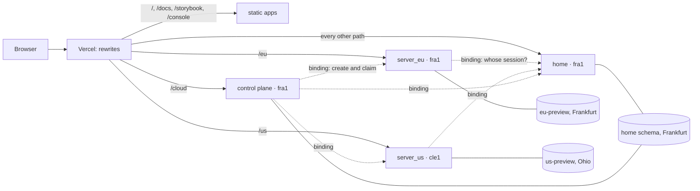

# The cloud

> **Status:** the record of a proof, 2026-10-07 to 11, written while it
> ran and kept in that tense. Its deployment was replaced on 2026-10-12 by
> [#1655](https://github.com/zitadel/nextgen/pull/1655), which deploys `main` to the Vercel project `cloud` on
> PlanetScale Postgres with a database per preview
> ([`apps/cloud/`](../../../../apps/cloud/), [runbook](../../../runbooks/cloud.md));
> the identity home, the regions and the control plane were not carried
> over. The proof's code and its runbook are on the branch
> [`claude/nextgen-deployment-research-3b5ebe-code`](https://github.com/zitadel/nextgen/tree/claude/nextgen-deployment-research-3b5ebe-code), unmerged.
>
> **Decided:** [decisions](decisions.md). **Tried:** [experiments](experiments.md).
> **Open:** [below](#open).

nextgen's backend, run the way Vercel runs applications: one Vercel project
whose deployments build every service from this repository. An **identity
home** in Frankfurt holds the cloud's accounts. A **region** per database
serves projects next to their data, Frankfurt and Ohio today. A **control
plane** next to the home knows which region a project lives in. One
**console** in platform mode signs in once and works across all of them.
A database of a customer's own (a **system**) is a concept for later: the MVP
proved it and it was taken out of the code until the product needs it
([systems.md](systems.md), [C43](decisions.md#c43)).

## The map

Every path is on one host. The services, their builds and their bindings are
in the [services table](https://github.com/zitadel/nextgen/blob/claude/nextgen-deployment-research-3b5ebe-code/apps/cloud/README.md#the-services).

## Routing

- **Regions are path prefixes** (`/eu`, `/us`) of the host the home owns
  ([C18](decisions.md#c18)): the home's cookie reaches them, no CORS, no DNS. A
  rewrite selects the service; the service's own route strips the prefix.
- **Each server function is pinned to its database's region** by `regions`
  in the Build Output its build writes ([C17](decisions.md#c17)). Vercel never
  moves a request to another region for us.
- **Later, systems** (removed, [C43](decisions.md#c43)): a project routing
  rule would send `/sys/<name>/…` to a region's server with the customer's
  database address attached, added by API without a deployment. Proven on
  2026-10-10 and taken out the same night ([systems.md](systems.md)). The
  code lives only in PR #1518's history: `git fetch origin pull/1518/head`,
  then `git show 602d0ae0` lists what left.

## Sessions

- **Sign-in is at the home.** The console signs in there. The home's session
  cookie is host-only, so the browser sends it to every path of the host.
- **A region asks the home whose cookie it is**, over a service binding,
  caches the answer for a minute and keeps a shadow of the person in its own
  platform project ([C19](decisions.md#c19), `internal/api/homesession.go`).
  It accepts only sessions of the home's platform project: a session of a
  project someone created at the home counts for nothing there.
- **Signing out at a region** (`DELETE /sessions/me`) signs out at the home:
  the region forwards it with the cookie and the CSRF header, and drops its
  cached answer. Signing out at the home reaches the other regions only
  through their caches, within a minute.
- **The control plane asks the home the same way**, accepts only the
  platform project's sessions too, caches an answer for at most a minute
  (never past the session's expiry) and keeps no shadow. It creates a
  project in a region with the region's own calls, the person's cookie
  forwarded.
- **All of this is interim.** The [auth plan](auth-plan.md) replaces the
  cookie across deployments with audience-bound tokens
  ([C24](decisions.md#c24)); the [security review](security.md) lists what
  the current shape exposes between the home and each region.

## Data and migrations

- **PlanetScale Postgres per region** (`eu-preview` in AWS `eu-central-1`,
  `us-preview` in `us-east-2`), served through PgBouncer with four
  connections per pool, migrated on the direct port ([C10](decisions.md#c10)).
  The home and the control plane have schemas of their own in the Frankfurt
  database. For now production runs on these databases too, until it gets
  its own ([C47](decisions.md#c47)).
- **Every deployment has schemas of its own** ([C46](decisions.md#c46)).
  Its schema base is `zitadel_nextgen` in production; a preview's is
  `CLOUD_SCHEMA` (a CLI upload), else `pr_<pull request id>`, else
  `br_<branch>` ([C8](decisions.md#c8)). Each role's schema derives from it:

  | Role | Schema | Database |
  |---|---|---|
  | a region | `<base>` | its region's |
  | the identity home | `<base>_home` | Frankfurt |
  | the control plane | `<base>_cloud` | Frankfurt |

  The launcher replaces any `schema=` a database URL names, so the URLs
  carry none: production and the previews share the database variables, not
  a schema. A local run uses its URLs as configured, and its control plane
  keeps `cloud`.
- **Previews start fresh.** A preview's home starts empty and imports the
  Preview target's admin document, so one known account signs in on every
  preview; a preview's migrations reach only its own schemas. Until
  2026-10-11 every preview shared the home and the control plane, accounts
  and migrations included ([C45](decisions.md#c45), superseded).
- **Only `schema=` names a schema** in a database URL. A `search_path` does
  not, and the server refuses `public` and Postgres's own system schemas.
- **Migrations are a release step** ([C9, C38](decisions.md#c9)): the `migrate`
  service's build migrates every regional database, the home and the
  control plane before the deployment goes live; a failure fails the
  deployment; a serving function refuses `--migrate`. Migrations are
  expand-and-contract, because a rollback promotes an older deployment over
  the newer schema.

## Runtime

- **Container image functions** ([C31, C32](decisions.md#c31)): the `image`
  service builds one image per deployment from the repo-root
  `Dockerfile.vercel`; the server services are Build Output functions that
  reference it with their role, region and prefix; the image's entrypoint
  starts the launcher, or the control plane for the role `cloud`.
- **Shutdown:** when Vercel scales an instance in (after 30 idle seconds on
  a preview, five minutes in production), it sends `SIGTERM` and waits 30
  seconds; the server flushes its audit buffer and its event shipper, then
  exits.
- **Numbers:** cold start 2.1 to 2.5 s in `fra1`, no failures at 200
  concurrent requests, warm p99 0.7 s; an image build of 74 to 90 s per
  deployment.
- **Internal calls** go over service bindings, not the public host
  ([C33](decisions.md#c33)).

## Observability

- **Logs:** Vercel shows what the servers print, for one day on Pro. For a
  container it cannot tie a line to its request, and it reads the level
  from the stream. So on Vercel the servers write JSON, errors on stderr and
  the rest on stdout.
- **Request ids:** a request's lines carry Vercel's request id
  (`x_vercel_id`) next to the server's own (`request_id`, also returned as
  `X-Request-Id`). The control plane logs the regions' request ids for each
  create.
- **Where a record comes from:** the launcher stamps region, deployment,
  environment and role on the server's OpenTelemetry resource.
- **Traces:** Vercel's trace view takes application spans from Node only,
  and the server creates no spans yet. Where traces go is still the team's
  choice ([observability.md](observability.md), [C44](decisions.md#c44),
  [C40](decisions.md#c40)).

## What the MVP proved

| Proof | Result |
|---|---|
| P1, a database per routed system | Proven, then taken out until the product needs it ([C43](decisions.md#c43)): `acme` as a service of its own, `beta` and `gamma` through routing rules added without a deployment, each project answering only where it was created |
| P2, observability | The ids and attributes above; the backend is open |
| P3, migrations end to end | The control plane in the build, a failing migration stopping a deployment, a rollback across a migration rehearsed |
| P4, project structure | One `vercel.json`, the services table, a script that deploys the working tree and moves a stable alias |
| P5, one console | Creates through the control plane only: the fallback to the region is gone, so a 404 from `/cloud` fails the create. The journeys do one signed-in create per region on every deployment since 2026-10-11 ([C50](decisions.md#c50)) |

Details and evidence: [MVP plan](history/2026-10-10-mvp-plan.md). Every
concept tried on the way, with its result: [experiments](experiments.md).
What the ids (C, S, P, D, T, R) stand for: [decisions](decisions.md#ids).

## Open

- Dropping a preview's schemas (`<base>`, `<base>_home`, `<base>_cloud`)
  when its pull request closes. Nothing drops them yet
  ([runbook](https://github.com/zitadel/nextgen/blob/claude/nextgen-deployment-research-3b5ebe-code/docs/runbooks/preview-cloud.md#operating)); needed once
  previews are on again.
- `launcher migrate` should fail a deployment that names no
  `CLOUD_DATABASE_URL_<KEY>`. Today it falls back to
  `NEXTGEN_DATABASE_POSTGRES`. That variable left both targets on
  2026-10-11, so such a deployment now fails in its build, but only because
  the variable is gone.
- The observability backend, then a Vercel drain to forward logs there, one
  dashboard and one alert.
- The [security review](security.md)'s fixes, in its order.
- Production of its own
  ([bring production up](https://github.com/zitadel/nextgen/blob/claude/nextgen-deployment-research-3b5ebe-code/docs/runbooks/preview-cloud.md#bring-production-up)):
  databases with backups and a rehearsed restore, and a master key and an
  admin for them; production from `main` after the merge; a custom domain,
  if wanted. Done: the leftover variables out, the production variables,
  schemas per deployment, Git connected.
- Undo the proof of concept's settings at the merge: production back on
  `main`, previews on
  ([undo at the merge](https://github.com/zitadel/nextgen/blob/claude/nextgen-deployment-research-3b5ebe-code/docs/runbooks/preview-cloud.md#undo-at-the-merge),
  [C47](decisions.md#c47)).
- The image from CI instead of Vercel's builder (containers plan, phase B).
- Background work on a tick, since instances scale in.
- Product work for the product team: teams across regions (auth plan),
  billing, onboarding.
- Cleanup of what the proofs left: the Vercel project `nextgen-routing-poc`
  and the throwaway schemas, now with the old shared home schema and
  `cloud`. It is the last step of the same
  [runbook section](https://github.com/zitadel/nextgen/blob/claude/nextgen-deployment-research-3b5ebe-code/docs/runbooks/preview-cloud.md#bring-production-up);
  the routing rules and the leftover variables are gone.

## Notes

| Note | What it is |
|---|---|
| [decisions.md](decisions.md) | Every decision with its reason and evidence, reversals included |
| [experiments.md](experiments.md) | Every concept tried or researched: its test, its result and where it stands, one row each |
| [security.md](security.md) | What crosses between the home and each region, and what to fix |
| [observability.md](observability.md) | What Vercel's logs, traces and drains do for our container, and what to change |
| [auth-plan.md](auth-plan.md) | Proposed: one session across deployments, authorization across regions |
| [auth-research.md](auth-research.md) | Research: how other products and the standards carry a sign-in and its teams to regional data; checks the auth plan |
| [systems.md](systems.md) | Concept for later: a customer's own database through routing rules, with the POC's results; proven and removed from the code |
| [provider-fit.md](provider-fit.md) | Research: Fly, Render, Railway and GCP against the systems model |
| [history/](history/) | The journal of 2026-10-07 to 10 and the plans as they were executed: the cloud plan, the containers plan, the MVP plan |
